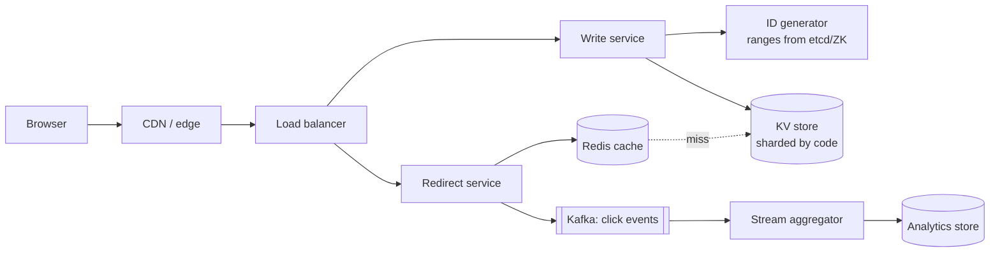

# 01 · URL Shortener (TinyURL / bit.ly)

> **Level:** Easy (warm-up for every loop) · **Time box:** 45 min · **Asked at:** almost everyone, often as the first HLD round
> **Concepts used:** [H02 estimation](../../1-basics/H02-back-of-envelope/README.md) · [H28 unique IDs](../../5-reliability/H28-unique-ids/README.md) · [H09 caching](../../2-scaling/H09-caching/README.md) · [H16 sharding](../../3-databases/H16-partitioning-sharding/README.md) · [H26 rate limiting](../../5-reliability/H26-rate-limiting/README.md)
> **Visuals:** [request lifecycle](../../1-basics/H03-networking-basics/visual.html) · [caching patterns](../../2-scaling/H09-caching/visual.html)
> **Code it:** [base62 + ID generator](../../5-reliability/H28-unique-ids/lab-base62/README.md)

## How to practise this

1. Set a 45-minute timer. Open [`my-design.md`](./my-design.md) and fill it in **without** looking below.
2. Then open each hint one at a time and compare. Write down what you missed in the Review section.
3. Do it again from memory on the repeat day in the plan. The second attempt is where it sticks.

## The prompt

"Design a service like bit.ly. Users submit a long URL and get a short one. Visiting the short URL redirects to the long one."

## Step 1: questions to ask

- Scale? How many new URLs per day, and what's the read:write ratio?
- Custom aliases? Expiry? Can users delete or edit links?
- Analytics (click counts, geo, referrer)? Real-time or daily?
- Should the same long URL return the same short code (dedupe)?
- How short is "short"? Is the code allowed to be guessable?

<details><summary>Assumed answers</summary>

- 100M new URLs/day, reads are **100:1**, so ~10B redirects/day
- Custom aliases: yes (optional). Default expiry 5 years, configurable
- Basic analytics: click count per link, can be eventually consistent
- Dedupe: not required (per-user dedupe is a nice-to-have)
- 7 characters, must not be sequential or guessable
</details>

## Step 2: estimates

<details><summary>Show the numbers</summary>

| | Calculation | Result |
|---|---|---|
| Write QPS | 100M / 86,400 | **~1.2k/s** avg, ~3k/s peak |
| Read QPS | ×100 | **~120k/s** avg, ~300k/s peak |
| Records in 5 yrs | 100M × 365 × 5 | **~180B** |
| Row size | short 7B + long ~200B + meta ~50B | ~300B |
| Storage | 180B × 300B | **~55 TB** (plus replicas) |
| Keyspace | 62^7 | **3.5 trillion**, ~20× the 180B we need |
| Cache | 20% of daily reads are hot: 10B × 0.2 × 300B | **~600 GB**, i.e. a small Redis cluster |

Takeaway to say out loud: "It's very read-heavy and the data is small. So the design is about **unique code generation** and **fast cached redirects**."
</details>

## Step 3: API

<details><summary>Show the API</summary>

```http
POST /v1/urls
Authorization: Bearer <token>
Idempotency-Key: <uuid>                 # so a retried create doesn't make two links
{ "longUrl": "https://…", "alias": "my-sale", "expiresAt": "2031-01-01" }
→ 201 { "shortUrl": "https://sho.rt/aZ3kP9q", "code": "aZ3kP9q" }

GET /{code}
→ 302 Location: https://…              # 302 (not 301) if you need click analytics
→ 404 / 410 Gone if expired

DELETE /v1/urls/{code}                  # owner only
GET /v1/urls/{code}/stats
```
**301 vs 302**: 301 is cached by browsers, which means less load but lost analytics. Most shorteners use 302 or 307.
</details>

## Step 4: data model

<details><summary>Show the data model</summary>

`urls`: `code (PK) | long_url | user_id | created_at | expires_at`
`users`: the usual. `clicks`: written to a stream, aggregated elsewhere.

**DB choice:** a key-value access pattern (lookup by code), 55 TB, and simple sharding by `code`. So DynamoDB or Cassandra fits. Postgres also works if you shard it, which is a fine answer if you can explain the sharding.
</details>

## Step 5: high-level design

<details><summary>Show the diagram</summary>


**Write:** validate the URL → get a unique ID → base62-encode it → store it (conditional put, so a duplicate fails) → return.
**Read:** CDN → Redis (hit ~95%) → on a miss, DB, then fill the cache → 302. Publish a click event asynchronously; never block the redirect on analytics.
</details>

## Step 6: deep dives (the part that gets scored)

<details><summary>Deep dive 1: generating unique short codes (the main question)</summary>

| Approach | How | Pros | Cons |
|---|---|---|---|
| Hash (MD5/SHA) of long URL, take 7 chars | `base62(md5(url))[0..7]` | Stateless; dedupe is free | Collisions → check and retry; same URL always gives the same code |
| Random 7 chars + check | random, then `PUT IF NOT EXISTS` | Simple, unguessable | Collision retries grow as the keyspace fills; one extra DB call per write |
| **Counter + base62** | global counter → base62 | No collisions, short codes | Sequential = guessable; the counter is a single point of failure |
| **Range allocation (recommended)** | Each write server leases a block of 1M IDs from etcd/ZK, then base62s them. Shuffle with a bijective scramble (e.g. a Feistel step) so codes aren't sequential | No coordination per request, no collisions, scales horizontally | Unused IDs are lost when a server dies (fine; 3.5T keyspace) |
| Snowflake-style | timestamp + machine + sequence | Decentralised | 64 bits → 11 base62 chars, too long |

Say: "I'll lease ID ranges from a coordinator and base62 them through a bijective shuffle. That gives zero collisions and no hot coordinator. Custom aliases go through the same table with a conditional insert."
</details>

<details><summary>Deep dive 2: making redirects fast at 300k QPS</summary>

- Cache-aside in Redis, with LRU eviction and the TTL set to the link's expiry. Hit ratio ~95%, since popular links follow a power law.
- Cache **negative results** (unknown codes) for a short time, so scanners hammering random codes don't hit the DB.
- Put the CDN/edge in front for viral links, with `Cache-Control` on the 302 response.
- Run redirect servers stateless and autoscaled, separate from the write path (read/write split).
- The DB has read replicas per shard; a replication-lag miss falls back to the primary.
</details>

<details><summary>Deep dive 3: analytics without slowing redirects</summary>

Fire a click event to Kafka asynchronously (code, ts, ip-hash, UA, referrer). A stream job (Flink, or Kafka Streams) aggregates per minute → an OLAP store (ClickHouse/Druid). Counts are eventually consistent, which is fine. Never `UPDATE clicks = clicks + 1` on the hot row: that creates write contention on popular links.
</details>

<details><summary>Deep dive 4: abuse, expiry and cleanup</summary>

- Rate limit creates per user/IP with a token bucket in Redis. Check new long URLs against a malware/phishing list (Safe Browsing).
- Expiry: check `expires_at` lazily on read (return 410), plus a nightly batch job (or a DB-native TTL in DynamoDB/Cassandra) to delete old rows.
- Should expired codes be reused? Usually no, because old links in the wild would point to new content.
</details>

## Follow-ups interviewers ask

1. Two users shorten the same URL. Same code or different codes? (Product choice: per-user dedupe using an index on `hash(longUrl)+user_id`.)
2. How do you make codes non-guessable but still collision-free? (Bijective shuffle, or encrypt the counter with a block cipher.)
3. Multi-region? (Region-prefixed ID ranges, so writes never collide. Replicate reads globally; only the create path needs to be local.)
4. The coordinator (etcd) is down. Can you still create links? (Yes, until the current range runs out. Lease big ranges.)

## Common mistakes

- Spending 15 minutes on the hash function and never reaching caching or analytics.
- A single global counter in MySQL with no answer for "what if it dies?".
- Using 301 and then promising click analytics.
- Forgetting that the read:write ratio is the whole point of the design.
