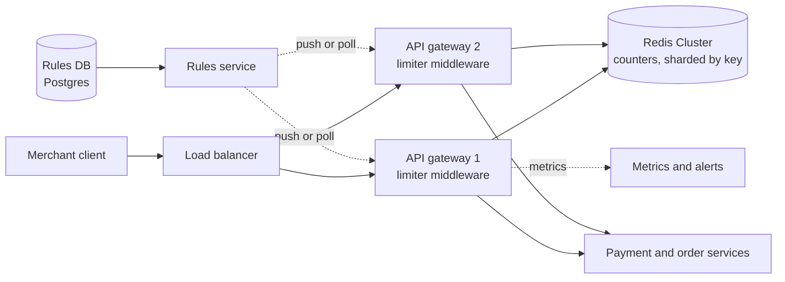

# 02 · Distributed Rate Limiter

> **Level:** Easy (but the deep dives go deep) · **Time box:** 45 min · **Asked at:** Razorpay, PhonePe, Juspay, Atlassian, Stripe-style API companies, often as a standalone round or inside an API gateway question
> **Concepts used:** [H26 rate limiting](../../5-reliability/H26-rate-limiting/README.md) · [H02 estimation](../../1-basics/H02-back-of-envelope/README.md) · [H09 caching](../../2-scaling/H09-caching/README.md) · [H17 consistent hashing](../../3-databases/H17-consistent-hashing/README.md) · [H25 API gateway](../../5-reliability/H25-microservices/README.md) · [H27 resilience](../../5-reliability/H27-resilience/README.md)
> **Visuals:** [rate limiting algorithms](../../5-reliability/H26-rate-limiting/visual.html) · [request lifecycle](../../1-basics/H03-networking-basics/visual.html)
> **Code it:** [token bucket, sliding window log, sliding window counter](../../5-reliability/H26-rate-limiting/lab-rate-limiters/README.md) · LLD version: [rate limiter](../../../lld/problems/04-rate-limiter/README.md)

## How to practise this

1. Set a 45-minute timer. Open [`my-design.md`](./my-design.md) and fill it in **without** looking below.
2. Then open each hint one at a time and compare. Write down what you missed in the Review section.
3. Do it again from memory on the repeat day in the plan. The second attempt is where it sticks.

## The prompt

"Design a rate limiter for our public API. Merchants call our APIs with an API key. Limit each key to N requests per window. It must work across many API servers."

## Step 1: questions to ask

- Where does it run? A library inside each service, a sidecar, or the API gateway?
- What is the key? API key, user ID, IP, or a combination (key + endpoint)?
- What are the rules? One limit per key, or different limits per plan and per endpoint?
- Hard limit or soft limit? Is a small overshoot (1–2%) acceptable?
- What happens when the limiter itself is down: allow traffic or block it?
- Scale: how many requests per second, how many distinct keys?
- Do clients need to know their remaining quota (headers)?

<details><summary>Assumed answers</summary>

- Runs in the **API gateway** layer (a middleware every request passes through). Services behind it stay simple.
- Key = `merchant_api_key + endpoint_group`. Example: 25 req/s on `/payments`, 100 req/s on `/orders` read.
- Rules differ by plan (free, growth, enterprise). Rules change without a deploy.
- Small overshoot is fine. Exactness is not worth extra latency.
- If the limiter's store is down: **fail open** for normal APIs, fail closed for sensitive ones (OTP, login).
- 500k req/s peak across all gateways, ~10M active keys.
- Return `429 Too Many Requests` with `Retry-After` and `X-RateLimit-*` headers.
</details>

## Step 2: estimates

<details><summary>Show the numbers</summary>

| | Calculation | Result |
|---|---|---|
| Peak traffic | given | **500k req/s** |
| Limiter checks | 1 check per request | **500k ops/s** on the counter store |
| Added latency budget | gateway p99 target 50 ms | limiter must add **< 2 ms** p99 |
| State per key (token bucket) | key ~50B + tokens 8B + last_refill 8B + overhead ~60B | ~130B |
| Total state | 10M keys × 130B | **~1.3 GB**, fits in Redis RAM easily |
| Redis capacity | one shard does ~100k simple Lua ops/s | **~6–10 shards** (with headroom) |
| Network | 500k × ~200B per call | ~100 MB/s to Redis |

Takeaway to say out loud: "State is tiny (about 1 GB). The hard part is **500k atomic checks per second with under 2 ms added latency**. So I need an in-memory store, atomic operations, and a clear failure policy."
</details>

## Step 3: API

<details><summary>Show the API</summary>

The limiter has two faces: the response contract that clients see, and an internal rules API.

```http
# Client-facing: what a throttled caller sees
HTTP/1.1 429 Too Many Requests
Retry-After: 2                          # seconds until a retry can succeed
X-RateLimit-Limit: 25
X-RateLimit-Remaining: 0
X-RateLimit-Reset: 1729250000           # epoch seconds when the window resets

# Every allowed response also carries X-RateLimit-Limit / Remaining

# Internal: rules management (ops or plan service)
PUT /v1/rate-rules/{ruleId}
{ "match": { "plan": "growth", "endpointGroup": "payments" },
  "algorithm": "token_bucket", "capacity": 50, "refillPerSec": 25,
  "onStoreFailure": "allow" }
```

Internal check (a function call inside the gateway, not HTTP): `allow(key, cost=1) → { allowed, remaining, retryAfterMs }`.
</details>

## Step 4: data model

<details><summary>Show the data model</summary>

**Rules** (small, rarely change): `rate_rules: rule_id | match (plan, endpoint_group) | algorithm | capacity | refill_rate | window | on_failure`. Store in Postgres or a config service. Gateways cache all rules in memory and refresh every 30 s or on a pub/sub push.

**Counters** (hot, short-lived): Redis.
- Token bucket: hash `rl:{apiKey}:{group}` → `{ tokens, ts }`, TTL = time to refill fully.
- Sliding window counter: two keys `rl:{apiKey}:{group}:{windowStart}` → count, TTL = 2 windows.

**DB choice:** counters need sub-millisecond atomic increments and auto-expiry. Redis (cluster mode, sharded by key) is the standard answer. A SQL DB cannot take 500k writes/s on hot rows. Counters can be lost on a crash; at worst a few keys get a fresh quota.
</details>

## Step 5: high-level design

<details><summary>Show the diagram</summary>


**Write (a request is counted):** request arrives → gateway authenticates the API key → looks up the rule from its in-memory rule cache → runs one Lua script on the Redis shard that owns the key (refill, check, decrement in one step) → allowed: forward to the service with `X-RateLimit-*` headers; denied: return 429 with `Retry-After`.
**Read (rules):** the rules service stores rules in Postgres. Gateways load all rules at start, then refresh on a pub/sub message or every 30 s. No DB call is on the request path.
</details>

## Step 6: deep dives (the part that gets scored)

<details><summary>Deep dive 1: which algorithm (the main question)</summary>

| Algorithm | How it works | Memory per key | Pros | Cons |
|---|---|---|---|---|
| Fixed window counter | `INCR rl:key:minute`, reject when > N | 1 counter | Simplest, cheapest | 2× burst at the window edge (N at 0:59, N at 1:00) |
| Sliding window log | sorted set of timestamps, drop old ones, count | N timestamps | Exact | Memory grows with the limit; costly at 10k/min limits |
| **Sliding window counter** | `prev_count × overlap% + curr_count` | 2 counters | Smooth, cheap, ~99% accurate (Cloudflare reported 0.003% wrong decisions) | An approximation; assumes even traffic in the previous window |
| **Token bucket** | bucket of `capacity` tokens, refill at `r`/s, each request takes 1 | 2 numbers | Allows controlled bursts; one rule gives both average and burst | Two parameters to tune |
| Leaky bucket | queue drained at a fixed rate | queue | Smooth output rate | Adds latency; old requests block new ones |

Say: "I'll use a **token bucket** per API key and endpoint group. It lets a merchant burst briefly (capacity 50) while keeping the average at 25/s. For per-minute quotas I'd use a sliding window counter. Both need only two numbers per key."
</details>

<details><summary>Deep dive 2: atomicity across many gateways</summary>

The race: two gateways read `tokens = 1` at the same time, both allow, and the key goes over the limit.

| Option | Correct? | Cost |
|---|---|---|
| GET then SET from the app | No: read-modify-write race | 2 round trips |
| `INCR` + `EXPIRE` (fixed window) | Yes for fixed window | 1–2 round trips; `INCR` is atomic |
| `WATCH`/`MULTI` transaction | Yes, but retries under contention | Bad for hot keys |
| **Lua script (`EVALSHA`)** | Yes: Redis runs a script without interleaving other commands | 1 round trip |
| Distributed lock per key | Yes | Far too slow; never do this |

The token bucket Lua script: read `tokens, ts` → add `(now - ts) × rate`, capped at capacity → if `tokens ≥ cost`, subtract and allow → write back with a TTL. Use the **Redis server time** (`TIME`) or pass the gateway time, but be consistent; mixed gateway clocks cause drift.

All keys used by one script must live on the same cluster slot. Use a hash tag: `rl:{merchant123}:payments`.

Say: "Each check is one Lua script call on the shard that owns the key. Redis runs scripts one at a time, so the check-and-decrement is atomic without locks."
</details>

<details><summary>Deep dive 3: when Redis is slow or down</summary>

| Policy | Behaviour | Use for |
|---|---|---|
| **Fail open** | Allow the request, log, alert | Normal business APIs. A limiter outage must not become an API outage |
| Fail closed | Reject with 429/503 | OTP send, login, password reset: abuse is worse than downtime |
| Local fallback | Each gateway enforces `limit / number_of_gateways` in memory | Best of both; approximate |

Other protections:
- A **tight timeout** on the Redis call (e.g. 5 ms). A slow limiter is worse than none.
- A **circuit breaker** around Redis. When it opens, switch to the local fallback.
- Redis replicas per shard with automatic failover. Some counts reset on failover; that is acceptable.

Say: "Default is fail open with a 5 ms timeout and a circuit breaker, falling back to a local in-memory limit. For OTP and login I fail closed, because there the limiter is a security control."
</details>

<details><summary>Deep dive 4: very high traffic, hot keys and multi-region</summary>

- **Hot key** (one big merchant at 20k req/s): all checks hit one Redis shard. Fixes: (a) a local token bucket per gateway that **leases** a batch of tokens (e.g. 100) from Redis and spends them locally; (b) split the key into K sub-keys, each with `limit / K`.
- **Batching / local counting:** gateways count locally and sync to Redis every 100 ms. Cuts Redis load 10–100× at the cost of a small overshoot.
- **Multi-region:**

| Option | Accuracy | Latency |
|---|---|---|
| One global Redis | Exact | Cross-region round trip on every request (bad) |
| **Per-region limit** (`global_limit × region_share`) | Approximate | Local |
| Per-region counters with async sync of totals | Close to exact | Local, more complex |

Say: "I keep limits per region and split the global quota by traffic share. Exact global limits are rarely worth a cross-region round trip on every call."
</details>

<details><summary>Deep dive 5: rules, tiers and the client contract</summary>

- Layer the limits: per IP at the edge/WAF (stop floods early), per API key at the gateway, per user or per resource inside services (e.g. 5 refunds per payment).
- Rules live in a DB, are cached in every gateway, and are versioned. A bad rule can block every merchant, so roll out rules gradually and support a "shadow mode" that logs denials without enforcing.
- Return `Retry-After` so good clients back off. Tell clients to use exponential backoff with jitter; otherwise all throttled clients retry at the same instant.
- Rate limiting (protect the system per client) is not the same as **load shedding** (protect the system as a whole when overloaded). Mention both.

Say: "Layer the limits: per IP at the edge, per API key at the gateway, per resource inside services. Rules are versioned and can run in shadow mode first. Every 429 carries Retry-After, so clients back off with jitter."
</details>

## Follow-ups interviewers ask

1. Why not keep counters in each gateway's memory only? (With 20 gateways behind a round-robin LB, each sees 1/20 of the traffic. A per-gateway limit of N allows 20N. Sticky routing by key helps but breaks on scaling and failover.)
2. How do you limit by cost instead of count, e.g. a bulk API that does 100 operations? (Pass `cost = 100` to the token bucket.)
3. How do you test the limiter? (Shadow mode in production, load tests with the real Redis topology, and alerts on 429 rate per merchant.)
4. A merchant says "you throttled me but I was under the limit". How do you debug? (Log decisions with key, rule version, remaining tokens; check clock drift and which region served them.)
5. How does it differ for a per-user limit on a consumer app with 100M users? (Same design, more keys: 100M × 130B ≈ 13 GB, still fine in a Redis cluster.)

## Common mistakes

- Picking an algorithm without saying why (burst handling, memory, accuracy).
- GET then SET in application code: a race that lets traffic through.
- Never deciding what happens when Redis is down.
- Putting a DB call or a cross-region call on the request path.
- Forgetting the 429 contract (`Retry-After`) and client backoff with jitter.
- Confusing rate limiting with load shedding or with circuit breaking.
