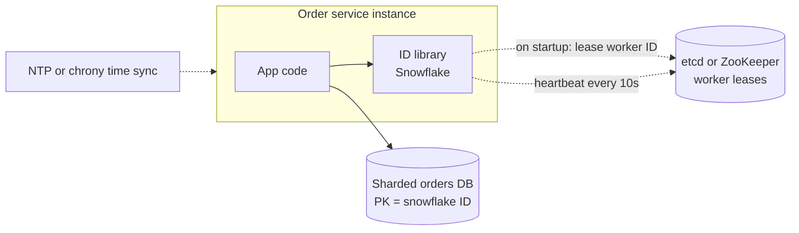

# 03 · Unique ID Generator

> **Level:** Easy · **Time box:** 45 min (often a 20-minute sub-question inside a bigger design) · **Asked at:** Flipkart, Swiggy, PhonePe, Razorpay, Uber; any company that shards its databases
> **Concepts used:** [H28 unique IDs](../../5-reliability/H28-unique-ids/README.md) · [H02 estimation](../../1-basics/H02-back-of-envelope/README.md) · [H29 coordination](../../5-reliability/H29-consensus-locks/README.md) · [H16 sharding](../../3-databases/H16-partitioning-sharding/README.md) · [H11 SQL indexes](../../3-databases/H11-indexing/README.md)
> **Visuals:** [sharding strategies](../../3-databases/H16-partitioning-sharding/visual.html) · [Raft leader election](../../5-reliability/H29-consensus-locks/visual.html)
> **Code it:** [Snowflake ID generator](../../5-reliability/H28-unique-ids/lab-snowflake/README.md) · see also [base62 + ID ranges](../../5-reliability/H28-unique-ids/lab-base62/README.md)

## How to practise this

1. Set a 45-minute timer. Open [`my-design.md`](./my-design.md) and fill it in **without** looking below.
2. Then open each hint one at a time and compare. Write down what you missed in the Review section.
3. Do it again from memory on the repeat day in the plan. The second attempt is where it sticks.

## The prompt

"Our system is sharded across many databases. Auto-increment IDs no longer work. Design a service that generates unique IDs for orders and payments at high scale."

## Step 1: questions to ask

- Must IDs be numeric? What size: 64-bit or 128-bit?
- Must they be sortable by time? Strictly increasing, or roughly increasing?
- How many IDs per second, at peak?
- Can IDs be exposed to users? Is it a problem if they reveal volume or are guessable?
- Is a gap in the sequence acceptable?
- Multi-region? Must IDs be unique across regions?
- Can the ID generator be a network hop, or must it be a library inside each service?

<details><summary>Assumed answers</summary>

- **64-bit integers** (fit in a `BIGINT` column and a JS `BigInt`; smaller indexes than 128-bit).
- **Roughly time-sorted** (k-sorted): IDs from later seconds are bigger. Strict global order is not needed.
- 100k IDs/s at peak across the company, up to 10k/s from one service instance.
- IDs are shown to users (order IDs). They should not reveal exact daily volume.
- Gaps are fine.
- Two regions, both generate IDs. Must never collide.
- Prefer no network hop on the hot path. Generation must not depend on a live coordinator.
</details>

## Step 2: estimates

<details><summary>Show the numbers</summary>

| | Calculation | Result |
|---|---|---|
| Peak rate | given | **100k IDs/s** company-wide |
| Lifetime needed | 100k/s × 86,400 × 365 × 50 yrs | ~1.6 × 10^14 IDs |
| 64-bit space | 2^63 (signed, keep positive) | ~9.2 × 10^18, so space is not the issue; layout is |
| Timestamp bits | 41 bits of milliseconds | 2^41 ms ≈ **69 years** from a custom epoch |
| Machine bits | 10 bits | **1,024** generators |
| Sequence bits | 12 bits | **4,096 IDs per ms per machine** = 4M/s per machine |
| Storage per ID | 8B (64-bit) vs 16B (UUID) | over 10B rows × 3 indexes: ~240 GB saved |

Takeaway to say out loud: "Space is not the problem; 64 bits is plenty. The design is about **no coordination per ID**, **rough time order** for index locality, and **surviving clock problems**."
</details>

## Step 3: API

<details><summary>Show the API</summary>

Preferred: a **library** inside each service (no network hop). If a central service is required:

```http
GET /v1/ids?count=100                    # batch, to cut round trips
→ 200 { "ids": ["7254012345678901248", ...] }   # strings: JSON numbers lose precision above 2^53

GET /v1/ids/{id}/decode                   # debugging aid
→ 200 { "timestampMs": 1729250000123, "datacenter": 1, "worker": 17, "sequence": 5 }
```
Return IDs as **strings** in JSON. JavaScript `Number` is only exact up to 2^53, so a 64-bit ID sent as a number gets corrupted in the browser and in Node unless you use `BigInt`.
</details>

## Step 4: data model

<details><summary>Show the data model</summary>

Snowflake layout (64 bits):

| Bits | Field | Notes |
|---|---|---|
| 1 | sign | always 0 |
| 41 | ms since custom epoch | e.g. epoch = 2024-01-01, lasts ~69 years |
| 5 | datacenter / region ID | 32 regions |
| 5 | worker ID | 32 workers per region |
| 12 | sequence | resets each ms |

The generator itself stores almost nothing. The only shared state is **worker ID assignment**: `workers: worker_id | host | lease_expires_at` in etcd/ZooKeeper (or a small DB table with leases).

**DB choice:** etcd or ZooKeeper for worker leases, because they give linearizable compare-and-set and leases that expire when a node dies. In Kubernetes, a StatefulSet ordinal (pod-0, pod-1) is a simple alternative.
</details>

## Step 5: high-level design

<details><summary>Show the diagram</summary>


**Write (startup):** the instance starts → leases a free worker ID from etcd (compare-and-set, with a TTL) → keeps the lease alive with heartbeats → if the lease is lost, it **stops generating IDs**.
**Read (generate an ID):** read the clock in ms → if same ms as the last ID, `sequence++` (if it overflows 4,095, wait for the next ms) → else reset sequence to 0 → compose `(ts << 22) | (dc << 17) | (worker << 12) | seq`. No network call. Takes well under a microsecond.
</details>

## Step 6: deep dives (the part that gets scored)

<details><summary>Deep dive 1: comparing the approaches (the main question)</summary>

| Approach | Size | Sorted by time? | Coordination | Pros | Cons |
|---|---|---|---|---|---|
| DB auto-increment, one DB | 64-bit | Yes, strictly | Every ID | Simple | Single point of failure; write bottleneck |
| Multi-master auto-increment (`step = k`, offset per DB) | 64-bit | Not across DBs | None | Simple | Hard to add a DB; IDs not time-ordered |
| **Ticket server** (Flickr) | 64-bit | Roughly | Per batch | Simple; batches make it fast | Ticket DB is a SPOF unless you run two (odd/even) |
| **Range lease** (each node takes a block of 10k IDs) | 64-bit | Roughly | Per block | Very fast; good for short codes | Lost blocks on restart; order only within a node |
| UUIDv4 | 128-bit | No | None | No coordination at all | Random inserts fragment B-tree indexes; 16 bytes |
| **UUIDv7 / ULID** | 128-bit | Yes (ms prefix) | None | No coordination; time-ordered; standard (RFC 9562) | 16 bytes; still larger than 64-bit |
| **Snowflake** | 64-bit | Roughly (k-sorted) | Only worker ID assignment | Fast, small, time-ordered | Depends on clocks; needs worker IDs |

Say: "I'd use Snowflake-style 64-bit IDs generated in-process, with worker IDs leased from etcd. If 128 bits is fine, UUIDv7 is simpler because it needs no worker IDs at all."
</details>

<details><summary>Deep dive 2: clock problems</summary>

Snowflake trusts the clock. Clocks go wrong in three ways:

| Problem | Risk | Fix |
|---|---|---|
| Clock moves **backwards** (NTP step, VM migration) | Same ts + same worker + same seq = **duplicate ID** | Remember `last_ts`. If `now < last_ts`: wait if the gap is small (< 10 ms); refuse and alert if large |
| Clock skew between machines | IDs from machine A look "older" than they are | Acceptable: we only promised rough order |
| Leap seconds | Small jumps | Use `chrony` with slewing (gradual), not stepping |

Also: persist `last_ts` periodically. On restart, refuse to generate until `now > saved_last_ts`. This protects against a restart combined with a backwards clock.

Say: "The generator never trusts a clock that went backwards. It waits a few ms or refuses, because a duplicate ID on a payment is far worse than a short pause."
</details>

<details><summary>Deep dive 3: assigning worker IDs safely</summary>

Two nodes with the same worker ID will produce duplicates. Options:

| Option | How | Risk |
|---|---|---|
| Static config | worker ID in env vars | Human error; breaks with autoscaling |
| K8s StatefulSet ordinal | pod-3 → worker 3 | Fine for fixed-size fleets |
| **etcd/ZK lease** | CAS on `/workers/17` with a TTL, heartbeat | Pause (GC, network) can expire the lease while the node still runs |
| DB table with lease | `UPDATE workers SET owner=? WHERE id=? AND lease_expires < now()` | Same as above; fine for small fleets |

Handle the "zombie" case: if heartbeats fail, the node must stop generating **before** the lease expires (e.g. stop at TTL/2). 10 bits give 1,024 IDs; reuse a worker ID only after its lease has expired plus a safety gap.

Say: "Each node leases its worker ID from etcd with a TTL and heartbeats. If heartbeats fail, it stops making IDs at half the TTL, so two live nodes never share an ID."
</details>

<details><summary>Deep dive 4: ID properties people forget</summary>

- **Index locality:** time-ordered IDs append at the right side of a B-tree. Random UUIDv4 inserts touch random pages, causing page splits and a cold buffer cache. This is a big reason to choose UUIDv7 or Snowflake for Postgres/MySQL primary keys.
- **Hot shard:** if you shard by **range** of a time-ordered ID, all new writes go to the last shard. Shard by **hash** of the ID instead.
- **Leaking business data:** sequential IDs let competitors count your orders. Snowflake hides this partly (sequence resets every ms). For public IDs, use a separate random public ID or encode it (e.g. `order_` + base62).
- **Sequence overflow:** 4,096 per ms per worker. Bursts above that wait for the next ms. If that is not enough, take bits from the worker field.
- **JavaScript:** send as strings; use `BigInt` in Node.

Say: "Time-ordered IDs keep B-tree inserts at the right edge, but I shard by hash of the ID, not by range, so the newest shard is not hot. Public IDs are separate, so we don't leak order volume."
</details>

## Follow-ups interviewers ask

1. How would you make IDs unique across two regions? (Region bits in the ID, or separate worker ranges per region. No cross-region call.)
2. What if you need strictly increasing IDs, not just roughly? (A single sequencer or a consensus log. It costs throughput and availability; ask why it's needed.)
3. Why not UUIDv4 everywhere? (128 bits, random index inserts, no time order. It is fine for low-volume tables.)
4. How does Instagram generate IDs? (Postgres per logical shard: 41 bits ms, 13 bits shard ID, 10 bits per-shard sequence, generated by a PL/pgSQL function. From the Instagram engineering blog.)
5. Can you get the creation time from the ID? (Yes, `id >> 22` + epoch. Useful for debugging and partition pruning.)

## Common mistakes

- Proposing one central auto-increment DB and not seeing it as a SPOF and a bottleneck.
- Using Snowflake but ignoring clocks that move backwards.
- No plan for how worker IDs are assigned and what happens on duplicates.
- Sending 64-bit IDs as JSON numbers to a JS client.
- Sharding by range on a time-ordered ID and creating a hot shard.
