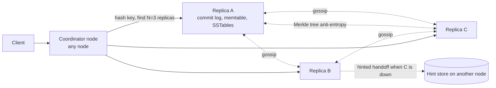

# 04 · Distributed Key-Value Store

> **Level:** Medium · **Time box:** 45–60 min · **Asked at:** Flipkart, Uber, Atlassian, Amazon, Google; infra-heavy teams at PhonePe and Juspay
> **Concepts used:** [H17 consistent hashing](../../3-databases/H17-consistent-hashing/README.md) · [H19 quorums](../../3-databases/H19-quorum-merkle/README.md) · [H15 replication](../../3-databases/H15-replication/README.md) · [H18 CAP and consistency](../../3-databases/H18-cap-pacelc-consistency/README.md) · [H16 sharding](../../3-databases/H16-partitioning-sharding/README.md) · [H35 Bloom filter](../../6-building-blocks/H35-probabilistic-ds/README.md) · [H14 NoSQL types](../../3-databases/H14-sql-vs-nosql/README.md)
> **Visuals:** [consistent hashing](../../3-databases/H17-consistent-hashing/visual.html) · [quorum reads and writes](../../3-databases/H19-quorum-merkle/visual.html) · [CAP under a partition](../../3-databases/H18-cap-pacelc-consistency/visual.html) · [Bloom filter](../../6-building-blocks/H35-probabilistic-ds/visual.html)
> **Code it:** [consistent hash ring](../../3-databases/H17-consistent-hashing/lab-hash-ring/README.md) · [quorum KV simulation](../../3-databases/H19-quorum-merkle/lab-quorum-kv/README.md) · [Bloom filter](../../6-building-blocks/H35-probabilistic-ds/lab-bloom-filter/README.md) · LLD version: [in-memory KV store](../../../lld/problems/14-kv-store/README.md)

## How to practise this

1. Set a 45-minute timer. Open [`my-design.md`](./my-design.md) and fill it in **without** looking below.
2. Then open each hint one at a time and compare. Write down what you missed in the Review section.
3. Do it again from memory on the repeat day in the plan. The second attempt is where it sticks.

## The prompt

"Design a distributed key-value store like DynamoDB or Cassandra. It supports `put(key, value)` and `get(key)`. It must scale to many terabytes and stay available when machines fail."

## Step 1: questions to ask

- Size of keys and values? Total data size?
- Read and write rates? Read-heavy or write-heavy?
- Consistency: is it OK to read a slightly old value? Or must reads always see the latest write?
- Availability target? Should writes succeed during a network partition?
- Single region or multi-region?
- Do we need range scans, secondary indexes or transactions? Or only point get/put?
- Durability: can we ever lose an acknowledged write?

<details><summary>Assumed answers</summary>

- Keys < 256B, values < 10 KB, average 1 KB. 10 billion keys.
- 100k writes/s and 300k reads/s at peak.
- **Tunable consistency.** Default: eventual (AP). Callers can ask for quorum reads/writes.
- 99.99% availability. **Writes must succeed during partitions** (shopping cart style, as in the Amazon Dynamo paper).
- One region, three availability zones. Multi-region is a follow-up.
- Only point get/put/delete. No range scans, no transactions.
- An acknowledged write must not be lost if one node dies.
</details>

## Step 2: estimates

<details><summary>Show the numbers</summary>

| | Calculation | Result |
|---|---|---|
| Raw data | 10B keys × ~1.2 KB (key + value + metadata) | **~12 TB** |
| With replication | × 3 (N = 3) | **~36 TB** |
| Nodes for storage | 36 TB / ~2 TB usable SSD per node (keep 50% free for compaction) | **~18–20 nodes** |
| Write load per node | 100k/s × 3 replicas / 20 nodes | ~15k writes/s per node; easy for an LSM tree |
| Read load per node | 300k/s × R=2 / 20 nodes | ~30k reads/s per node; needs page cache + Bloom filters |
| Write bandwidth | 100k × 1 KB × 3 | ~300 MB/s cluster-wide |
| Virtual nodes | 20 nodes × 256 vnodes | ~5k tokens on the ring; even spread |

Takeaway to say out loud: "12 TB needs ~20 machines with 3 replicas. So the design is about **partitioning** (consistent hashing), **replication with tunable quorums**, and **handling failures without downtime**."
</details>

## Step 3: API

<details><summary>Show the API</summary>

```http
PUT /v1/kv/{key}
X-Consistency: QUORUM                  # ONE | QUORUM | ALL
If-Match: <version>                     # optional: conditional write
<value bytes>
→ 200 { "version": "<vector clock or timestamp>" }

GET /v1/kv/{key}
X-Consistency: ONE
→ 200 <value>   ETag: <version>
→ 300 Multiple Choices + all sibling versions   # only if we keep conflicting versions

DELETE /v1/kv/{key}                     # writes a tombstone, not an immediate delete
```
Clients use a smart client library (knows the ring, sends straight to a replica) or any node acts as **coordinator** and forwards.
</details>

## Step 4: data model

<details><summary>Show the data model</summary>

On each node, per key: `key | value | version (timestamp or vector clock) | tombstone flag | TTL`.

Cluster metadata: the **ring** (node → token ranges) and node membership, spread by gossip.

**Storage engine choice: LSM tree** (as in Cassandra, RocksDB, LevelDB).
- Write path: append to the **commit log** (durability) → insert into the **memtable** (in-memory sorted map) → ack. When the memtable is full, flush it to an immutable sorted **SSTable** file.
- Read path: memtable → for each SSTable, check its **Bloom filter**, then its index → merge versions, newest wins.
- Background **compaction** merges SSTables, drops overwritten values and expired tombstones.

Why LSM and not B-tree: write-heavy load, sequential disk writes, and good compression. The cost is read amplification, which Bloom filters and caching reduce.
</details>

## Step 5: high-level design

<details><summary>Show the diagram</summary>


**Write:** client sends to a coordinator → it hashes the key and walks the ring clockwise to find N = 3 replicas in different AZs → sends the write to all 3 in parallel → each appends to its commit log and memtable → coordinator acks the client after **W** replies (W = 2) → late replicas catch up.
**Read:** coordinator sends to replicas (to R of them, or all and waits for R) → compares versions → returns the newest → if a replica was stale, fixes it in the background (**read repair**).
</details>

## Step 6: deep dives (the part that gets scored)

<details><summary>Deep dive 1: partitioning with consistent hashing</summary>

| Option | Adding a node moves | Hot spots | Notes |
|---|---|---|---|
| `hash(key) % N` | almost all keys | No | Unusable when N changes |
| Range partitioning | one range split | Yes, for sequential keys | Good for range scans (HBase, Bigtable) |
| Consistent hashing, 1 token per node | ~1/N of keys | Uneven ranges | Simple ring |
| **Consistent hashing + virtual nodes** | ~1/N, taken from many nodes | Even | Standard (Dynamo, Cassandra) |

Replicas: the next N **distinct physical** nodes clockwise, skipping vnodes on a node already chosen, and placed in different AZs (rack-aware placement).

Say: "I hash keys onto a ring with ~256 virtual nodes per machine. Adding a machine takes small slices from every node, so data moves evenly and no single node is overloaded during rebalance."
</details>

<details><summary>Deep dive 2: quorums and tunable consistency (the main question)</summary>

N = replicas, W = acks needed for a write, R = replies needed for a read. If **R + W > N**, the read set and write set overlap, so a read sees the latest acknowledged write (in the normal case).

| Setting (N=3) | Behaviour | Use for |
|---|---|---|
| W=1, R=1 | Fastest, eventual | Logs, metrics, caches |
| **W=2, R=2** | Read-your-writes, survives 1 node down | Default for most data |
| W=3, R=1 | Fast reads, writes fail if any node is down | Read-heavy, rarely written config |
| W=1, R=3 | Fast writes, slow reads | Rare |

Caveats to mention: sloppy quorums (writes go to non-home nodes during failures) break the overlap guarantee; concurrent writes still conflict; quorums are **not** linearizable without extra work. For true linearizability (e.g. compare-and-set), use consensus (Raft/Paxos) per partition, as in etcd or Spanner.

Say: "N=3, W=2, R=2 by default. Clients can choose ONE for speed. This is an AP system with tunable consistency, not a CP one."
</details>

<details><summary>Deep dive 3: conflicts: LWW vs vector clocks</summary>

| Option | How | Pros | Cons |
|---|---|---|---|
| **Last-write-wins (LWW)** | Each write has a timestamp; highest wins | Simple; one value per key | Silently loses concurrent writes; depends on clocks (Cassandra) |
| **Vector clocks** | Per key `{nodeA: 3, nodeB: 1}`; compare to detect "happened before" vs concurrent | Detects real conflicts | Client must merge siblings; clocks grow (prune old entries) |
| CRDTs | Data types that merge automatically (counters, sets) | No lost updates, no client merge | Only for specific data types (Riak) |

Example: two shoppers add items to the same cart on two partitioned nodes. LWW keeps one cart. Vector clocks return both versions; the app merges them (union of items). This is the Amazon Dynamo paper example.

Say: "For most data I use LWW with server timestamps, because it's simple. Where losing a concurrent write is unacceptable, I keep vector clocks and return siblings for the client to merge, or use a CRDT."
</details>

<details><summary>Deep dive 4: handling failures</summary>

| Failure | Mechanism | How it works |
|---|---|---|
| Detect a dead node | **Gossip** + phi-accrual failure detector | Each node pings a few random peers every second and shares heartbeat counters; no central master |
| Node down for minutes | **Hinted handoff** | Another node accepts the write with a "hint" for the owner and replays it when the owner returns |
| Replica missed writes | **Read repair** | On a read, stale replicas are updated |
| Long-term drift | **Anti-entropy with Merkle trees** | Replicas compare tree hashes per key range; only differing ranges are synced, so little data is transferred |
| Node gone forever | Remove from ring | Its ranges stream to new owners |
| Deletes resurrecting | **Tombstones** with a grace period (e.g. 10 days) | Tombstone must reach all replicas before compaction removes it |

Say: "Gossip finds failures, hinted handoff covers short outages, read repair fixes hot keys, and Merkle-tree anti-entropy fixes everything else in the background."
</details>

<details><summary>Deep dive 5: read and write performance on a node</summary>

- Writes: commit log fsync is the cost. Group commit (fsync every few ms for a batch) trades a few ms of risk for big throughput. With W=2 across AZs, losing one node's unsynced tail is safe.
- Reads: Bloom filter per SSTable (1% false positive at ~10 bits/key) avoids most disk reads for missing keys. A row cache for hot keys. Keep the SSTable index in memory.
- Compaction strategy: **size-tiered** (write-heavy, more space) vs **leveled** (read-heavy, less read amplification, more write amplification).
- Tail latency: send a read to an extra replica if the first is slow (speculative retry / hedged request).

Say: "On each node, the commit log with group commit makes writes cheap. Bloom filters and an in-memory SSTable index keep reads to about one disk seek. Hedged reads cut the tail latency."
</details>

## Follow-ups interviewers ask

1. What happens during a network partition between two AZs? (AP: both sides accept writes with sloppy quorum and hinted handoff; conflicts resolved later. CP choice: the minority side rejects writes.)
2. How do you add a node with no downtime? (It takes vnode tokens; existing owners stream those ranges; reads go to old owners until streaming completes.)
3. One key is extremely hot. What do you do? (Client-side cache, more replicas for that key, or split the key in the app: `key#1..key#k`.)
4. How would you support multi-region? (Replicate per region asynchronously; `LOCAL_QUORUM` for reads/writes; LWW or CRDTs across regions.)
5. Why is a delete harder than a put? (Without tombstones, a replica that missed the delete would "resurrect" the value during repair.)

## Common mistakes

- Saying "use consistent hashing" without virtual nodes or replica placement across AZs.
- Claiming R + W > N gives strong consistency in every case (sloppy quorums, concurrent writes).
- No conflict resolution story, or LWW without saying it loses writes.
- Forgetting tombstones, so deletes come back.
- Drawing a master node that decides everything; Dynamo-style stores are leaderless.
- Skipping the storage engine entirely: commit log, memtable, SSTables, compaction.
