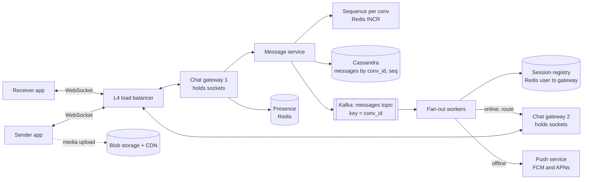

# 06 · Chat System (WhatsApp)

> **Level:** Medium · **Time box:** 45 min · **Asked at:** Flipkart, Swiggy, PhonePe, Atlassian, Uber, and most product companies with a support-chat or messaging feature
> **Concepts used:** [H05 real-time](../../1-basics/H05-realtime-communication/README.md) · [H20 message queues](../../4-async/H20-message-queues/README.md) · [H28 unique IDs](../../5-reliability/H28-unique-ids/README.md) · [H16 sharding](../../3-databases/H16-partitioning-sharding/README.md) · [H14 NoSQL types](../../3-databases/H14-sql-vs-nosql/README.md) · [H22 delivery semantics](../../4-async/H22-delivery-semantics/README.md)
> **Visuals:** [polling, SSE and WebSockets](../../1-basics/H05-realtime-communication/visual.html) · [delivery semantics](../../4-async/H22-delivery-semantics/visual.html) · [Kafka consumer groups](../../4-async/H21-kafka/visual.html)
> **Code it:** [Snowflake ID generator](../../5-reliability/H28-unique-ids/lab-snowflake/README.md) · LLD warm-up: [pub-sub queue](../../../lld/problems/15-pub-sub-queue/README.md)

## How to practise this

1. Set a 45-minute timer. Open [`my-design.md`](./my-design.md) and fill it in **without** looking below.
2. Then open each hint one at a time and compare. Write down what you missed in the Review section.
3. Do it again from memory on the repeat day in the plan. The second attempt is where it sticks.

## The prompt

"Design a chat app like WhatsApp. Users send one-to-one and group messages. Messages arrive in real time when the receiver is online, and later when they come back online."

## Step 1: questions to ask

- Scale? DAU, messages per user per day, peak concurrent connections?
- One-to-one only, or groups too? Max group size?
- Delivery receipts (sent, delivered, read)? Online/last-seen presence?
- Media (images, video, voice notes)? Or text only for now?
- Message history: stored on the server forever, or only until delivered (WhatsApp style)?
- Multi-device (phone + web at the same time)?
- End-to-end encryption in scope?

<details><summary>Assumed answers</summary>

- 100M DAU, ~40 messages per user per day, peak ~30M concurrent connections
- 1:1 and groups, max 500 members per group
- Receipts: sent (one tick), delivered (two ticks), read (blue ticks). Presence: online and last seen
- Media: yes, but uploaded to blob storage; the message carries only a link
- Server keeps history (so a new device can sync), retention 1 year for this design
- Multi-device: yes, up to 4 devices per user
- E2E encryption: mention it (Signal protocol); the server only sees ciphertext. Out of scope to design
</details>

## Step 2: estimates

<details><summary>Show the numbers</summary>

| | Calculation | Result |
|---|---|---|
| Messages/day | 100M × 40 | **4B/day** |
| Write QPS | 4B / 86,400 | **~46k/s** avg, ~150k/s peak (×3) |
| Delivery fan-out | groups make each send go to many devices; assume ×3 avg | **~140k deliveries/s** avg, ~450k/s peak |
| Message size | text ~100B + ids, ts, status ~100B | ~200B |
| Storage/day | 4B × 200B | **~800 GB/day** |
| Storage/year | 800 GB × 365 | **~290 TB** (×3 replicas ≈ 900 TB) |
| Concurrent sockets | peak | **~30M** |
| Gateway servers | 30M / ~100k sockets per box (tuned Node or Go) | **~300 boxes**, plus headroom |
| Media | out of the message path | blob storage + CDN |

Takeaway to say out loud: "It's write-heavy and latency-sensitive. The hard parts are **holding 30M long-lived connections**, **routing a message to the right gateway**, and **ordering plus not losing messages** when the receiver is offline."
</details>

## Step 3: API

<details><summary>Show the API</summary>

Real-time traffic goes over one WebSocket per device. REST is only for history, media and setup.

```http
# WebSocket frames (JSON or protobuf)
→ { "type": "send", "clientMsgId": "<uuid>", "convId": "c_42", "body": "<ciphertext>", "mediaUrl": null }
← { "type": "ack", "clientMsgId": "<uuid>", "msgId": "1720…", "seq": 1093 }       # one tick
← { "type": "message", "convId": "c_42", "msgId": "…", "seq": 1094, "from": "u_7", "body": "…" }
→ { "type": "delivered", "convId": "c_42", "upToSeq": 1094 }                       # two ticks
→ { "type": "read",      "convId": "c_42", "upToSeq": 1094 }                       # blue ticks
→ { "type": "sync", "cursors": { "c_42": 1080, "c_99": 55 } }                     # on reconnect

# REST
GET  /v1/conversations/{convId}/messages?beforeSeq=1080&limit=50
POST /v1/media            → { "uploadUrl": "<presigned S3 URL>", "mediaUrl": "…" }
POST /v1/groups           { "name": "…", "members": ["u_1", "u_2"] }
```
`clientMsgId` makes a resend idempotent: if the client retries after a dropped ack, the server finds the same id and returns the same `msgId` instead of storing a duplicate.
</details>

## Step 4: data model

<details><summary>Show the data model</summary>

`messages`: partition key `conv_id`, clustering key `seq` (descending) | `msg_id` | `sender_id` | `body` | `media_url` | `created_at`
`conversations`: `conv_id` | `type` (1:1 or group) | `members` | `last_seq`
`user_inbox`: partition key `user_id` | `conv_id` | `last_read_seq` | `last_delivered_seq` (drives unread counts and receipts)
`sessions` (Redis): `user_id → [{deviceId, gatewayId}]` with a TTL refreshed by heartbeats
`presence` (Redis): `user_id → {status, lastSeen}`

**DB choice:** Cassandra (or HBase, which Facebook Messenger used). The workload is very high write volume, append-only, and the main read is "last N messages of one conversation", which is exactly one partition read in clustering order. Cassandra gives linear write scaling and tunable consistency. Very large group conversations can make wide partitions, so bucket the partition key by time: `(conv_id, month)`. Postgres would struggle at 150k writes/s without heavy sharding, and its strengths (joins, transactions) are not needed here.
</details>

## Step 5: high-level design

<details><summary>Show the diagram</summary>


**Write:** the sender's gateway receives a `send` frame → message service dedupes on `clientMsgId` → gets the next `seq` for the conversation → writes to Cassandra → publishes to Kafka (keyed by `conv_id`, so order is kept per conversation) → acks the sender (one tick). The ack goes back only after the DB write, so an acked message is never lost.
**Read (delivery):** a fan-out worker reads Kafka → looks up each member's devices in the session registry → online devices: forwards to their gateway over an internal RPC, and the gateway pushes it down the socket → offline devices: sends a push notification. The receiver app acks with `delivered` up to a seq; the server updates `user_inbox` and sends a receipt back to the sender. On reconnect the app sends its last seq per conversation and pulls the gap from Cassandra.
</details>

## Step 6: deep dives (the part that gets scored)

<details><summary>Deep dive 1: holding connections and routing to the right gateway</summary>

| Transport | How | Pros | Cons |
|---|---|---|---|
| Short polling | client asks every N seconds | Simple | Wasteful, latency = N seconds |
| Long polling | request hangs until a message or timeout | Works through any proxy | One request per message, reconnect churn |
| SSE | server → client stream over HTTP | Simple, auto-reconnect | One direction; sends still need HTTP |
| **WebSocket (choice)** | one full-duplex TCP connection | Low latency both ways, small frames | Stateful servers; needs L4 LB and sticky routing |

- Gateways are stateful: they hold sockets and nothing else. All business logic sits in stateless services behind them.
- On connect, the gateway writes `user_id:device_id → gateway_id` to the session registry in Redis with a TTL of ~2 heartbeats. Heartbeats every 30s refresh it.
- To deliver, a worker looks up the gateway and calls it. Alternative: each gateway subscribes to a Redis Pub/Sub channel or Kafka partition for its own users. Lookup + direct RPC is simpler to reason about.
- Gateway dies: its sockets drop, clients reconnect (with jittered backoff, to avoid a thundering herd) to another gateway, and they sync the gap by seq. Nothing is lost because the DB is the source of truth.
- Deploys: drain a gateway slowly (close sockets in batches), never all at once.

Say: "Gateways only hold sockets. A Redis session registry maps user to gateway. Delivery is a lookup plus an RPC. If a gateway dies, clients reconnect and sync from their last seq, so the gateway holds no state we can't lose."
</details>

<details><summary>Deep dive 2: ordering, IDs and not losing messages</summary>

| Ordering option | How | Pros | Cons |
|---|---|---|---|
| Client timestamp | sort by device clock | No server work | Clocks are wrong; easy to fake |
| Server timestamp | sort by arrival time | Simple | Two servers' clocks differ; ties |
| Snowflake ID | time-sortable 64-bit ID | Unique, roughly ordered, no coordination | Only roughly ordered across machines |
| **Per-conversation seq (choice)** | `INCR conv:{id}:seq` in Redis, or a counter in the conv row | Strict order inside a conversation; gap detection is trivial | One counter per conv; must survive Redis failover |

- Order only matters **inside a conversation**. There is no need for a global order. This is the key insight.
- Use a Snowflake ID as the unique `msg_id`, and a per-conversation `seq` for order and sync.
- If the seq counter is lost on Redis failover, re-seed it from `max(seq)` in Cassandra for that conversation before accepting writes.
- Delivery is **at-least-once**: Kafka redelivers, clients may get a duplicate. The client dedupes by `msg_id`. Together this looks like exactly-once to the user.
- Sync on reconnect: client sends `{convId: lastSeq}`; server returns everything with `seq > lastSeq`. A gap in seq on the client also triggers a sync.

Say: "I don't need a global order, only order per conversation. A per-conversation sequence number gives strict order and makes sync a simple 'give me everything after seq X'. Delivery is at-least-once and the client dedupes by message ID."
</details>

<details><summary>Deep dive 3: group messages and fan-out</summary>

| Approach | How | Pros | Cons |
|---|---|---|---|
| **Fan-out on read (store once)** | store the message once in the group's partition; each member reads the group timeline | One write per message; cheap for big groups | Each member must track a read cursor; the inbox needs one row per group |
| Fan-out on write (copy per member) | write a copy into each member's inbox | Reading is a single inbox scan | 500 writes per message; storage ×500 |

- Store once per conversation (WhatsApp-sized groups of up to ~1k members). Fan out only the **notification** (deliver over socket or push), not the stored copy.
- The fan-out worker loads the member list (cached), then batches session lookups (`MGET`) and groups deliveries by gateway, so one RPC carries many messages.
- Very large "channels" (100k+ followers) are a different product: treat them like a feed, pull-based. See [news feed](../07-news-feed/README.md).
- Read receipts in a group: store `last_read_seq` per member and compute "read by 12 of 40" on demand. Don't send every receipt to every member.

Say: "A group message is stored once in the group's partition. The fan-out is only of the delivery event, batched per gateway. For large broadcast channels I'd switch to a pull model like a feed."
</details>

<details><summary>Deep dive 4: offline users, push and multi-device</summary>

- Offline device: the fan-out worker finds no session, so it calls the push service (FCM for Android, APNs for iOS). The push carries a small payload ("new message from X"); with E2E, the app wakes up and fetches the real content. See the [notification system](../05-notification-system/README.md).
- Multi-device: each device has its own session entry and its own `last_delivered_seq`. A message goes to all of the user's devices. A sent message also syncs to the sender's other devices.
- Receipts are just cursors: `delivered` and `read` up to a seq. Store per (user, conv); send them to the sender as small events. Batch them (one receipt per conversation per second) to cut traffic.
- Retention: with server history, a new device pulls recent conversations, paging back by seq. With the WhatsApp model (delete after delivery), a pending-message queue per device is enough, and history lives on the phone.

Say: "Each device has its own delivery cursor. If no session is found, we send a small push through FCM or APNs, and the device pulls what it missed by sequence number when it reconnects."
</details>

<details><summary>Deep dive 5: presence (online and last seen)</summary>

- Store `user_id → {online, lastSeen}` in Redis with a TTL. The heartbeat refreshes it. When the TTL expires, the user is offline, and `lastSeen` is the last heartbeat.
- Don't broadcast presence to all contacts on every change. That is a fan-out storm (100M users × 200 contacts). Instead, **subscribe on view**: when a user opens a chat, the client subscribes to that contact's presence, and only those subscribers get updates.
- Debounce flapping: wait ~10 seconds before marking a user offline, because mobile networks drop for a moment all the time.
- Presence is best-effort. Losing it for a few seconds is fine, so it never touches the main DB.

Say: "Presence is a Redis key with a TTL, refreshed by heartbeats. It is pushed only to users who have that chat open, and offline is debounced, so a network blip doesn't flood contacts."
</details>

## Follow-ups interviewers ask

1. How do you guarantee the sender sees one tick only when the message is safe? (Ack after the durable DB write, not after the Kafka publish alone; or use the outbox pattern to keep them in sync.)
2. A user in a 500-member group sends a message while 300 are online. Walk through what happens. (One write, one Kafka event, a batched lookup of 500 sessions, RPCs grouped by gateway, push for the 200 offline.)
3. How would you add end-to-end encryption? (Signal protocol, keys per device, the server stores ciphertext only. Group messages use sender keys so the sender encrypts once.)
4. The Redis session registry is down. What breaks? (Routing breaks; fall back to push for everyone and let clients sync on the next connect. Run Redis with replicas and Sentinel or Cluster.)
5. How do you show unread counts across 200 conversations fast? (`conv.last_seq - inbox.last_read_seq`, kept in a per-user cache.)

## Common mistakes

- Using HTTP polling and never saying why WebSockets are needed.
- Putting business logic in the gateways, which makes them hard to scale and deploy.
- Promising a global message order. Only per-conversation order is needed and possible at this scale.
- Forgetting the offline path and the sync-on-reconnect path. Those are where messages get lost.
- Writing one copy per group member and not doing the storage maths.
- Broadcasting presence to every contact on every change.
