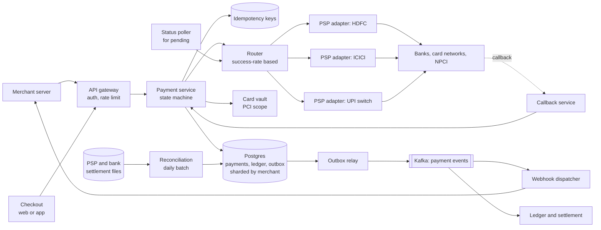
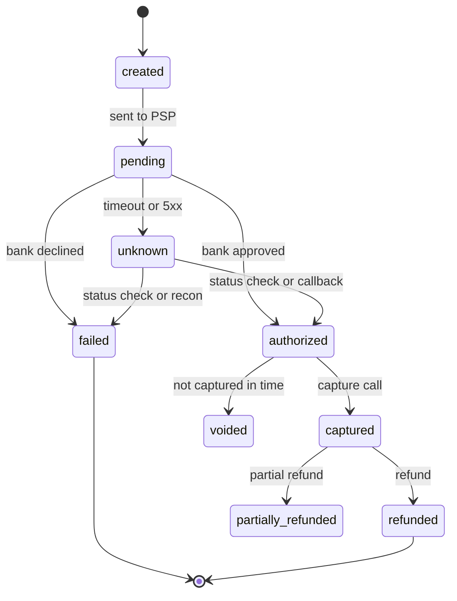

# 08 · Payment System (Razorpay/Stripe)

> **Level:** Medium (but the bar is high at fintechs) · **Time box:** 45 min · **Asked at:** Razorpay, Juspay, PhonePe, Paytm, Cred, Cashfree, Amazon Pay, Stripe, and the payments teams at Swiggy, Flipkart, Uber
> **Concepts used:** [H38 payments domain](../../6-building-blocks/H38-payments-domain/README.md) · [H22 idempotency](../../4-async/H22-delivery-semantics/README.md) · [H23 distributed transactions](../../4-async/H23-distributed-transactions/README.md) · [H11 SQL deep dive](../../3-databases/H11-indexing/README.md) · [H27 resilience](../../5-reliability/H27-resilience/README.md) · [H20 message queues](../../4-async/H20-message-queues/README.md) · [H36 batch processing](../../6-building-blocks/H36-batch-stream/README.md)
> **Visuals:** [delivery semantics](../../4-async/H22-delivery-semantics/visual.html) · [saga and outbox](../../4-async/H23-distributed-transactions/visual.html) · [circuit breaker](../../5-reliability/H27-resilience/visual.html) · [isolation levels](../../3-databases/H12-transactions-isolation/visual.html)
> **Code it:** [circuit breaker + retry](../../5-reliability/H27-resilience/lab-circuit-breaker/README.md) · LLD warm-up: [payment wallet](../../../lld/problems/19-payment-wallet/README.md) · Next: [digital wallet / UPI](../28-digital-wallet/README.md)

## How to practise this

1. Set a 45-minute timer. Open [`my-design.md`](./my-design.md) and fill it in **without** looking below.
2. Then open each hint one at a time and compare. Write down what you missed in the Review section.
3. Do it again from memory on the repeat day in the plan. The second attempt is where it sticks.

This is your home ground. The interviewer will expect more than "use Kafka". They want to hear what happens when the bank times out, when the same webhook arrives three times, and how money is counted. Practise saying the failure cases out loud.

## The prompt

"Design a payment gateway like Razorpay. Merchants integrate with it to accept payments from customers by card, UPI and netbanking. The gateway talks to banks and card networks through payment service providers (PSPs) and settles money to merchants."

## Step 1: questions to ask

- Are we the gateway (merchant-facing, like Razorpay) or the merchant's internal payment service (like Swiggy's)? This changes who owns the ledger.
- Which methods: cards, UPI, netbanking, wallets? Do we need auth + capture as two steps (cards), or one step (UPI)?
- Scale: payments per day, and the peak (sale days, IPL, Diwali)?
- Do we store card numbers? (PCI DSS scope. Usually: no, use a vault or network tokens.)
- Refunds, partial refunds, settlements to merchants (T+1, T+2), payouts?
- Multiple PSPs/acquirers with routing, or one?
- Consistency: is it ever OK to lose or double-count a payment? (No.)
- Latency target for the checkout API?

<details><summary>Assumed answers</summary>

- We are the gateway. We hold the ledger of what we owe each merchant.
- Methods: cards (auth then capture), UPI (single step, async result), netbanking (redirect).
- 20M payment attempts/day. Sale-day peak is ~10× average.
- No raw card storage in our core services. Cards go to a PCI-scoped vault that returns a token. Under RBI rules, merchants also cannot store card numbers, so we use network tokens.
- Full and partial refunds. Settlement to merchants T+1 or T+2, in batches.
- 3 to 4 PSPs/acquiring banks with smart routing.
- Correctness over availability. Never charge twice, never lose a successful payment. Short unavailability is acceptable; a wrong balance is not.
- Create-payment API p99 under 300 ms (our part). The bank part can take seconds to minutes, so the final result is asynchronous.
</details>

## Step 2: estimates

<details><summary>Show the numbers</summary>

| | Calculation | Result |
|---|---|---|
| Payment QPS | 20M / 86,400 | **~230/s** avg, **~2.5k/s** sale-day peak (×10) |
| API calls per payment | create order + create payment + status polls (~3) + capture | ~6 calls, so **~1.5k/s** avg, **~15k/s** peak at the API |
| Ledger entries | ~4 rows per successful payment (capture splits into merchant, fee, GST) + settlement + refunds | ~100M rows/day, **~1.2k/s** avg |
| Webhooks out | ~3 events per payment (created, authorised, captured) | 60M/day, **~700/s** avg, ~7k/s peak |
| Storage per payment | payment ~1 KB + attempts ~1 KB + ledger 4 × 200 B + events/webhook logs ~2 KB | **~5 KB** |
| Storage per year | 20M × 5 KB × 365 | **~36 TB/yr**, plus replicas. Keep 8–10 years for audit and tax |
| Money volume | 20M × ₹1,000 average ticket | **₹2,000 Cr/day**. One bug in 0.01% of payments = ₹20 lakh/day wrong |

Takeaway to say out loud: "The QPS is modest. A sharded Postgres handles 2.5k writes/s. The hard part is **correctness under failure**: idempotency, a double-entry ledger, unknown bank states and reconciliation. I'll spend my time there."
</details>

## Step 3: API

<details><summary>Show the API</summary>

```http
POST /v1/orders                          # merchant server → us, before checkout
Authorization: Basic <key_id:secret>
Idempotency-Key: <merchant-generated uuid>
{ "amount": 49900, "currency": "INR", "receipt": "swiggy_ord_7781" }   # amount in paise, integer
→ 201 { "id": "order_Nx81", "status": "created" }

POST /v1/payments                        # checkout (browser/app) → us
Idempotency-Key: <uuid>
{ "order_id": "order_Nx81", "method": "upi", "vpa": "ravi@okhdfc" }
→ 202 { "id": "pay_Q2a9", "status": "pending", "next_action": { "type": "upi_collect" } }
     # 202, not 200: the result comes later

GET  /v1/payments/{id}                   # status poll; the source of truth for the merchant
POST /v1/payments/{id}/capture           # cards: capture an authorised payment
{ "amount": 49900 }
POST /v1/payments/{id}/refunds           # full or partial
Idempotency-Key: <uuid>
{ "amount": 10000 }

# Outbound webhook: us → merchant
POST https://merchant.example/webhooks
X-Signature: hmac_sha256(body, webhook_secret)
{ "event_id": "evt_91", "event": "payment.captured", "payload": { "id": "pay_Q2a9", "status": "captured", ... } }

# Inbound callback: PSP/bank → us
POST /internal/psp/{psp}/callback        # verify signature, store raw, ack fast
```
Rules: amounts are integers in the smallest unit (paise). Never floats. Every mutating call takes an `Idempotency-Key`. The response to a create is `pending`, not `success`; the merchant learns the result from the webhook or a status poll.
</details>

## Step 4: data model

<details><summary>Show the data model</summary>

| Table | Key | Main fields | Notes |
|---|---|---|---|
| `orders` | `order_id` | merchant_id, amount, currency, receipt, status | One order can have many payment attempts (user retries with another method) |
| `payments` | `payment_id` | order_id, merchant_id, amount, method, **status**, version, psp, created_at | The state machine. Status changes only through a conditional update |
| `payment_attempts` | `attempt_id` | payment_id, psp, psp_reference, request/response, status, sent_at | One row per call to a PSP. `attempt_id` is the reference we send to the PSP |
| `idempotency_keys` | `(merchant_id, key)` unique | request_hash, status (in_progress/done), response, expires_at | Kept 24h–7 days |
| `ledger_accounts` | `account_id` | owner (merchant/PSP/platform), type (asset/liability/revenue), currency | e.g. `merchant_payable:m_42`, `psp_receivable:hdfc`, `fee_revenue` |
| `ledger_entries` | `entry_id` | journal_id, account_id, direction (debit/credit), amount, created_at | Append-only. For every `journal_id`, sum(debit) = sum(credit) |
| `outbox` | `id` | aggregate_id, event_type, payload, published_at | Written in the same DB transaction as the state change |
| `webhook_deliveries` | `(event_id, endpoint)` | attempt_count, next_retry_at, last_status | Delivery log; merchant dashboard shows it |
| `recon_items` | `(source, external_ref)` | amount, our_payment_id, match_status | Loaded from PSP and bank settlement files |

**DB choice:** Postgres (or MySQL), sharded by `merchant_id`. Reasons:
- We need ACID transactions: the status change, the ledger entries and the outbox row must commit together or not at all.
- Unique constraints do the real deduplication work (`idempotency_keys`, `psp_reference`).
- 2.5k writes/s at peak is small for a few shards. NoSQL buys scale we do not need and costs us multi-row transactions.
- Shard by `merchant_id` so one merchant's payments, refunds and ledger account live together. Platform accounts (fee revenue, PSP receivable) are hot; see deep dive 2.

Cold data (older than ~6 months) moves to cheaper storage (S3 + Athena, or a warehouse) for audit queries.
</details>

## Step 5: high-level design

<details><summary>Show the diagram</summary>



The payment state machine (cards; UPI skips `authorized` and goes to `captured`):



**Write (create a UPI payment):**
1. Checkout calls `POST /v1/payments` with an `Idempotency-Key`. The API inserts the key with status `in_progress`. If the key exists with the same request hash, return the stored response. If it is still in progress, return 409 and let the client retry.
2. In one DB transaction: insert the `payments` row (`created`), insert a `payment_attempts` row, insert an outbox row (`payment.created`).
3. The router picks a PSP (success rate, cost, health). The adapter sends the request with our `attempt_id` as the reference. Payment moves to `pending`.
4. The API returns 202 `pending`. The user approves in their UPI app.
5. The PSP calls back. The callback service verifies the signature, stores the raw payload, and returns 200 at once. Then it updates the payment: `UPDATE payments SET status='captured', version=version+1 WHERE id=? AND status IN ('pending','unknown')`. In the same transaction it writes the ledger entries and the outbox row.
6. The outbox relay publishes to Kafka. The webhook dispatcher sends `payment.captured` to the merchant.

**Read:** the merchant calls `GET /v1/payments/{id}`. Serve it from the primary (or a replica with a read-your-writes check on `version`). A stale read here makes a merchant ship food for an unpaid order, so do not put a long-TTL cache on payment status.
</details>

## Step 6: deep dives (the part that gets scored)

<details><summary>Deep dive 1: idempotency end to end, and the "exactly-once" illusion</summary>

Duplicates come from three directions. You must close all three.

| Where the duplicate comes from | Example | Defence |
|---|---|---|
| Client → us | The app times out and retries "Pay". The merchant server retries create-order | `Idempotency-Key` table with a unique index on `(merchant_id, key)`. Store the request hash and the full response |
| Us → PSP | Our call to the bank times out. Do we call again? | Send our `attempt_id` as the PSP's merchant reference / idempotency key. Before any retry, call the PSP's status API with that reference. Never create a new attempt until the old one is definitely failed |
| PSP → us | The bank sends the same success callback 3 times, or the callback and our poller arrive together | Unique constraint on `psp_reference` + conditional state update (`WHERE status IN (...)`). The second one updates 0 rows and becomes a no-op |

How the idempotency key works:

| Case | Behaviour |
|---|---|
| New key | Insert `in_progress` (the unique index makes this the lock), process, save the response, mark `done` |
| Same key, same request, `done` | Return the saved response. Do not process again |
| Same key, still `in_progress` | Return 409 "request in progress". The client retries later |
| Same key, different request body | Return 422. It is a client bug |
| Crash while `in_progress` | After a timeout (say 60 s), a sweeper checks the real payment state and finishes or releases the key |

Do not use a Redis `SETNX` alone for payment idempotency. Redis can lose the key on failover, and then you charge twice. Redis in front for speed is fine; the DB unique constraint is the real guard.

**The exactly-once illusion.** No network gives exactly-once delivery. What we build is **at-least-once delivery + idempotent processing = effectively-once effects**. Kafka's exactly-once only covers Kafka-to-Kafka processing. It does not cover the HTTP call to the bank or the webhook to the merchant. So every consumer dedupes on a business key (`payment_id + event_type`, or `event_id`).

Say: "Exactly-once is not something the network gives us. I get it by retrying everywhere and making every step idempotent: a key table at the edge, our attempt ID as the PSP reference, and conditional state updates for callbacks."
</details>

<details><summary>Deep dive 2: the double-entry ledger</summary>

Why: a `balance` column that you `UPDATE` loses history. When it is wrong, you cannot tell why. A ledger is append-only. Every money movement is a journal of two or more entries whose debits equal credits. The balance is derived from entries.

Worked example. Customer pays ₹1,000. Our fee is 2% (₹20) plus 18% GST on the fee (₹3.60). The merchant gets ₹976.40.

| Journal | Account | Debit | Credit |
|---|---|---|---|
| 1. Payment captured | `psp_receivable:hdfc` (asset: HDFC owes us) | ₹1,000.00 | |
| | `merchant_payable:m_42` (liability: we owe the merchant) | | ₹976.40 |
| | `fee_revenue` | | ₹20.00 |
| | `gst_payable` | | ₹3.60 |
| 2. PSP settles to our escrow/nodal account | `bank:escrow` | ₹1,000.00 | |
| | `psp_receivable:hdfc` | | ₹1,000.00 |
| 3. Payout to the merchant (T+1) | `merchant_payable:m_42` | ₹976.40 | |
| | `bank:escrow` | | ₹976.40 |
| 4. Refund ₹200 later | `merchant_payable:m_42` | ₹200.00 | |
| | `psp_receivable:hdfc` (the PSP nets it from the next settlement) | | ₹200.00 |

In each journal, debits equal credits. That is the check: `SUM(debits) = SUM(credits)` per journal, and across the whole ledger at any moment.

Rules:
- Entries are immutable. A mistake is fixed by a new reversing journal, never by `UPDATE` or `DELETE`.
- Store amounts as `BIGINT` paise. Round fees once, in a defined way, and put the rounding difference in an explicit account.
- The ledger write happens in the same DB transaction as the payment status change. Or the status change emits an event, and the ledger consumer is idempotent on `journal_id = hash(payment_id, event_type)`. The first is simpler when both live in the same shard.

| Design choice | Option A | Option B | Pick |
|---|---|---|---|
| Balance | Compute `SUM(entries)` every time | Keep a `balances` row updated in the same transaction, with a version | B for reads; run A in a nightly job to check B |
| Hot accounts (`fee_revenue` gets every payment) | One row, locked on every write | Split into N sub-accounts (`fee_revenue#0..15`) and sum on read, or post platform entries in batches every minute | Sub-accounts. Merchant accounts are not hot, so they stay single |
| Ledger store | Same Postgres as payments | Separate ledger service (like Stripe's ledger, or open-source TigerBeetle) | Same DB to start. Split when the team and volume grow |

Say: "I will never update a balance in place. Every movement is a balanced journal, entries are append-only, corrections are reversals, and a nightly job proves the cached balances equal the sum of entries."
</details>

<details><summary>Deep dive 3: PSP integration, routing, and unknown states</summary>

The bank call is the dangerous part. Three things can happen: a clear success, a clear failure, or **no clear answer** (timeout, 5xx, connection reset). The third is common in India: bank downtimes and slow UPI responses are a daily fact.

| PSP response | Our status | Action |
|---|---|---|
| 200, success | `authorized` / `captured` | Write ledger, emit event |
| 200, declined (insufficient funds, wrong PIN) | `failed` | Tell the user. They may retry with a new attempt |
| 4xx validation error | `failed` | Our bug or bad input. Alert if the rate jumps |
| Timeout, 5xx, connection reset | **`unknown`** | Do NOT mark failed. Do NOT retry on another PSP. Start status checks |

Why not retry on another PSP? The first bank may have debited the customer. A second attempt can debit them again. The customer sees two debits and calls support. Only retry on a new PSP when the first attempt is **definitely** failed.

Resolving `unknown`:
1. A status poller calls the PSP status API with our reference, with backoff: 5 s, 15 s, 30 s, 1 min, 5 min… for up to ~30 min (UPI collect requests expire in minutes; cards are faster).
2. A late callback can arrive at any time. The conditional update makes the poller and the callback safe to race.
3. Still unknown after the window? Show the user "payment pending, we will confirm". Do not fulfil the order. T+1 reconciliation (deep dive 5) gives the final answer. If money was debited but we marked it failed, auto-refund it (UPI has an NPCI-defined auto-reversal and TAT for failed transactions).

Routing and resilience:

| Concern | Approach |
|---|---|
| Which PSP? | Score each PSP per method and bank (e.g. "HDFC credit cards via acquirer X") on the last few minutes of success rate, latency and cost. Juspay and Razorpay both talk about success-rate-based routing |
| A PSP or bank is down | Circuit breaker per PSP + bank pair. When open, the router sends traffic elsewhere. Half-open lets a few test payments through |
| Slow PSP | Tight timeouts (connect 1 s, read 10–30 s depending on method). A slow bank must not use up all the worker threads: bulkhead per PSP |
| Different PSP APIs | Adapter per PSP behind one internal interface: `authorize`, `capture`, `refund`, `status`. Map PSP error codes to our own codes |

Say: "A timeout is not a failure. I mark it unknown, poll with the same reference, accept the late callback through a conditional update, and only fail over to another PSP when the first attempt is definitely dead. Recon is the final backstop."
</details>

<details><summary>Deep dive 4: webhooks in and out, with the outbox</summary>

**The dual-write problem.** We must update the DB *and* publish an event. If we commit and then crash before publishing, the merchant never hears about the payment. If we publish first and the commit fails, the merchant ships an order that is not paid.

Fix: the **transactional outbox**. Write the event to an `outbox` table in the same transaction as the status change. A relay (polling, or CDC with Debezium) reads new outbox rows and publishes to Kafka. This is at-least-once, so consumers dedupe on `event_id`.

| Option | Pros | Cons |
|---|---|---|
| Publish after commit in app code | Simple | Lost events on crash. Not acceptable for money |
| 2PC between DB and broker | Atomic | Slow, few brokers support it, coordinator is a single point of failure |
| **Outbox + relay (recommended)** | Atomic with the DB write; no lost events | Small delay (~100 ms–1 s); duplicates possible, so consumers must be idempotent |

**Outbound webhooks to merchants:**
- Sign the body with HMAC-SHA256 and a per-merchant secret. Include a timestamp to stop replays.
- Retry with exponential backoff + jitter for about 24 hours, then mark the endpoint failing and email the merchant. Store every attempt so the dashboard can show it.
- Per-merchant queues or concurrency limits, so one slow merchant endpoint does not delay everyone.
- Ordering is not guaranteed (`captured` can arrive before `authorized`). Put the current status in every payload and tell merchants to fetch `GET /payments/{id}` when in doubt.

**Inbound callbacks from PSPs:**
- Verify the signature (and source IP allowlist where the bank offers it).
- Store the raw body first, return 200 fast, then process asynchronously. Banks retry if you are slow, which creates more duplicates.
- Never trust the callback amount blindly. Check it against our payment row. A mismatch goes to manual review.

Say: "State change, ledger entries and the outbox row commit in one transaction. A relay publishes to Kafka. Webhooks are at-least-once, signed, retried with backoff, and carry an event ID so the merchant can dedupe."
</details>

<details><summary>Deep dive 5: reconciliation</summary>

Our DB is one view of the truth. The PSP and the bank have their own. Reconciliation compares them every day and is the last line of defence.

Three-way recon:
1. **Our ledger** (payments marked captured, refunds) vs
2. **PSP settlement files** (what the PSP says it processed and will settle, usually a daily CSV/SFTP file or report API) vs
3. **Bank statement** of our escrow/nodal account (what money actually arrived; match by UTR).

Pipeline: download files → parse per-PSP format into `recon_items` → match on `psp_reference` (our attempt ID) or UTR, plus amount → classify.

| Mismatch | Likely cause | Action |
|---|---|---|
| PSP says success, we say failed/unknown | Lost callback, poller gave up | Mark captured (late success). Then fulfil, or auto-refund if the order was cancelled |
| We say success, PSP has no record | Bug, or a fake/misrouted callback | Freeze settlement for it. Manual investigation. Alert |
| Amount differs | Partial capture, currency or fee error | Manual review queue |
| PSP settled less than expected | PSP fees, chargebacks, holds | Book the difference to the right account (fees, disputes) |
| Bank credit does not match the PSP file | Settlement delayed or batched | Wait one cycle; if still open, raise with the PSP |

Volume: 20M rows/day is a batch job (Spark, or chunked SQL jobs), not a streaming problem. Run it daily (T+1) and, for big PSPs, intraday. Target an auto-match rate above 99.9%. Everything else goes to an ops queue with an ageing SLA.

Say: "Recon is how we find the payments our real-time path got wrong. It matches our ledger against PSP files and bank statements by reference and amount, fixes late successes automatically, and sends the rest to ops."
</details>

## Follow-ups interviewers ask

1. The customer was debited but your system says failed. What happens? (Unknown → poll → late callback → T+1 recon marks it a late success, then fulfil or auto-refund. Show the customer "pending", not "failed", while unknown.)
2. How do you make refunds safe? (Refund has its own idempotency key and state machine. Check `sum(refunds) <= captured amount` inside a row lock on the payment, so two parallel partial refunds cannot exceed the total.)
3. How does a merchant's Idempotency-Key work across your shards? (The key table lives on the merchant's shard, since we shard by `merchant_id`.)
4. Postgres primary fails mid-payment. (Synchronous replica in another AZ, so committed data is not lost. In-flight requests fail; clients retry with the same key; PSP references make the bank call safe.)
5. How do you handle 10× traffic on sale day? (Stateless API autoscaling, pre-warmed DB connections, per-merchant rate limits, queue webhooks, and talk to PSPs beforehand about their TPS limits.)
6. Card data and PCI DSS? (A separate vault in a small PCI-scoped network. The rest of the system sees only tokens. Under RBI tokenisation rules, use network tokens for saved cards.)
7. Multi-currency or international? (Ledger accounts per currency. FX conversion is its own journal with an explicit FX rate and an FX gain/loss account.)
8. Chargebacks and disputes? (A dispute is a new state + journal: debit `merchant_payable`, credit `disputes_reserve`. Reverse it if the merchant wins.)

## Common mistakes

- Using `float` or `double` for money.
- Marking a payment failed on timeout, then retrying on another PSP. That is how customers get charged twice.
- Writing to the DB and then publishing to Kafka in two steps with no outbox.
- Updating a `balance` column with no ledger behind it, so there is no audit trail.
- Saying "Kafka gives exactly-once" as if it covers the bank call and the webhook.
- Choosing an eventually consistent NoSQL store for payment state and then needing multi-row transactions.
- Ignoring reconciliation. Every real payment company runs it daily; the interviewer will ask.
- Returning `success` from the create API for an async method like UPI.
