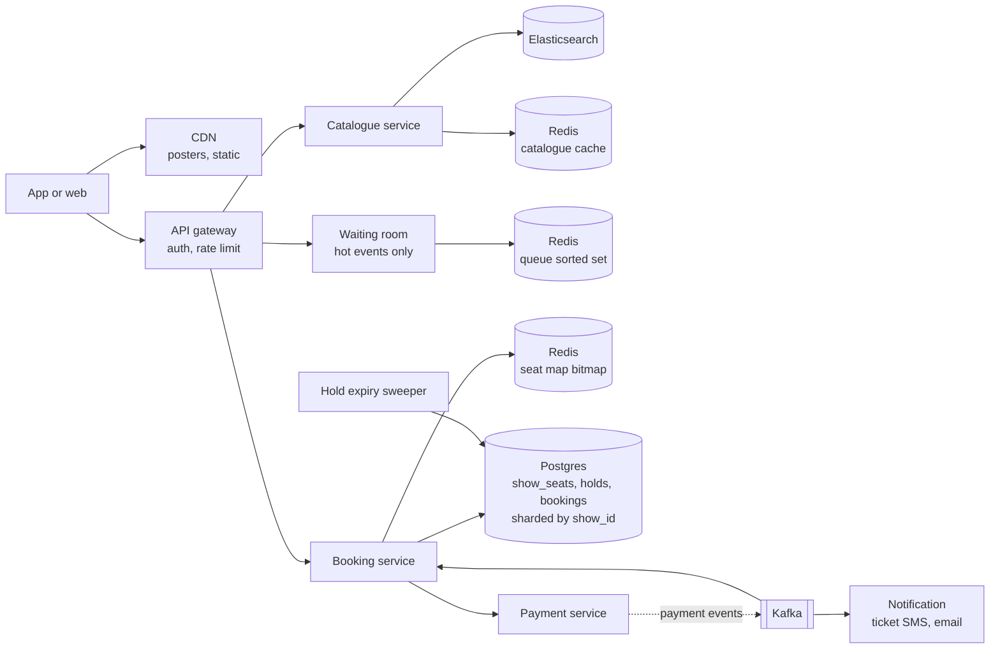

# 09 · Ticket Booking (BookMyShow)

> **Level:** Medium · **Time box:** 45 min · **Asked at:** BookMyShow, Paytm Insider, District (Zomato), Flipkart, Amazon, Atlassian, Uber, PhonePe
> **Concepts used:** [H11 SQL deep dive (locking)](../../3-databases/H11-indexing/README.md) · [H29 distributed locks](../../5-reliability/H29-consensus-locks/README.md) · [H09 caching](../../2-scaling/H09-caching/README.md) · [H26 rate limiting](../../5-reliability/H26-rate-limiting/README.md) · [H23 distributed transactions](../../4-async/H23-distributed-transactions/README.md) · [H22 idempotency](../../4-async/H22-delivery-semantics/README.md)
> **Visuals:** [seat locking and race conditions](../../../lld/5-machine-coding/L32-concurrency-in-node/visual.html) · [isolation levels](../../3-databases/H12-transactions-isolation/visual.html) · [saga and outbox](../../4-async/H23-distributed-transactions/visual.html)
> **Code it:** LLD version: [BookMyShow seat locking](../../../lld/problems/13-bookmyshow/README.md) · Related: [payment system](../08-payment-system/README.md) · [hotel reservation](../23-hotel-booking/README.md)

## How to practise this

1. Set a 45-minute timer. Open [`my-design.md`](./my-design.md) and fill it in **without** looking below.
2. Then open each hint one at a time and compare. Write down what you missed in the Review section.
3. Do it again from memory on the repeat day in the plan. The second attempt is where it sticks.

## The prompt

"Design a movie and event ticket booking system like BookMyShow. Users browse movies and shows in their city, pick seats on a seat map, pay, and get a ticket. Two users must never get the same seat."

## Step 1: questions to ask

- Movies only, or also concerts and sports with very hot on-sale moments?
- Do users pick specific seats (seat map), or only a count ("general admission")?
- How long can a user hold seats while paying?
- Scale: bookings per day? How hot is the hottest sale (users per seat)?
- Do cinemas also sell through their own counters or other apps? (Then we do not own the full inventory.)
- Cancellations and refunds?
- Max seats per booking?

<details><summary>Assumed answers</summary>

- Both. Movies are steady traffic. Concerts (a Coldplay or Diljit tour) and big releases create spikes: ~1M users for ~50k seats in the first minutes.
- Seat map with specific seats. General admission is a simpler counter.
- Hold for **10 minutes** while the user pays.
- 2M tickets/day normally, across ~10k screens.
- Some cinema chains run their own inventory system; we integrate through their API. For the core design, assume we own the inventory and mention the partner case at the end.
- Cancellation up to 2 hours before the show, with a fee.
- Max 10 seats per booking.
</details>

## Step 2: estimates

<details><summary>Show the numbers</summary>

| | Calculation | Result |
|---|---|---|
| Bookings | 2M tickets/day ÷ ~2.5 tickets per booking | **~800k bookings/day**, ~10/s avg, ~100/s at Friday evening peak |
| Browse reads | ~50 page/seat-map views per booking | 40M/day, **~500/s** avg, ~5k/s peak |
| Shows per day | 10k screens × 5 shows | **50k shows/day** |
| Seat-show rows | 50k × 200 seats × 100 B | **~1 GB/day**, ~365 GB/yr. Small |
| Hot sale: queue joins | 1M users in the first ~2 min | **~8k/s** joins (bursty, plus retries and refreshes, so plan for ~50k/s at the edge) |
| Hot sale: hold attempts | 50k seats ÷ ~3 per booking = ~17k bookings; but many users click the same best seats | Thousands of conflicting writes per second on **one show** |

Takeaway to say out loud: "Normal traffic is small. The design is about two things: **no double booking** under concurrent holds, and **surviving the hot sale** where a million users want fifty thousand seats in one show, so the load is concentrated on one partition."
</details>

## Step 3: API

<details><summary>Show the API</summary>

```http
GET  /v1/cities/{city}/movies?date=2026-10-20
GET  /v1/movies/{id}/shows?city=blr&date=2026-10-20
GET  /v1/shows/{showId}/seats                 # seat map with availability, short-lived cache
→ 200 { "layout": {...}, "available": "base64 bitmap", "version": 8812 }

POST /v1/shows/{showId}/holds                 # hold seats for 10 minutes
Idempotency-Key: <uuid>
{ "seatIds": ["F7", "F8"] }
→ 201 { "holdId": "h_91", "expiresAt": "...", "amount": 60000 }
→ 409 { "unavailable": ["F8"] }               # someone else got it

POST /v1/holds/{holdId}/payment               # starts payment, see 08-payment-system
DELETE /v1/holds/{holdId}                     # user goes back; release seats

GET  /v1/bookings/{bookingId}                 # ticket with QR code

# Hot sale only
POST /v1/events/{eventId}/queue               # join the waiting room
→ 202 { "queueToken": "...", "position": 48210 }
GET  /v1/queue/{queueToken}                   # poll; later returns an admission token
```
</details>

## Step 4: data model

<details><summary>Show the data model</summary>

| Table | Key | Main fields |
|---|---|---|
| `venues`, `screens` | `screen_id` | city, name, seat layout (rows, seat types, prices) |
| `movies` / `events` | `id` | title, language, duration, cast |
| `shows` | `show_id` | screen_id, movie_id, start_time, price map |
| `show_seats` | `(show_id, seat_id)` | **status** (available/held/booked), hold_id, hold_expires_at, booking_id, version |
| `holds` | `hold_id` | user_id, show_id, seat_ids, amount, expires_at, status (active/paid/expired/released) |
| `bookings` | `booking_id` | hold_id (unique), user_id, show_id, seats, payment_id, status, qr_code |
| `booked_seats` | `(show_id, seat_id)` | booking_id. The last guard against a double sale |

**DB choice:** Postgres (or MySQL), partitioned/sharded by `show_id`.
- Booking needs a transaction across several seat rows, and a conditional update. That is what a relational DB does best.
- All seats of a show live on one shard, so a hold never crosses shards.
- The data is small (~1 GB/day), so the DB is not a storage problem. The problem is contention on one show.
- The catalogue (movies, shows, venues) is read-heavy and rarely changes: serve it from a cache, and use Elasticsearch for search by name, language and genre.
</details>

## Step 5: high-level design

<details><summary>Show the diagram</summary>



**Write (hold and book):**
1. The user picks F7 and F8. The booking service runs one conditional update in a transaction:
   ```sql
   UPDATE show_seats
   SET status = 'held', hold_id = :h, hold_expires_at = now() + interval '10 min'
   WHERE show_id = :s AND seat_id IN ('F7','F8')
     AND (status = 'available' OR (status = 'held' AND hold_expires_at < now()));
   ```
   If rows updated = 2, insert the `holds` row and commit. If fewer, roll back and return 409 with the seats that are gone.
2. Update the seat-map bitmap in Redis (best effort; it is only a display cache).
3. The user pays (see [08 payment system](../08-payment-system/README.md)). The payment ID is tied to `hold_id`.
4. On the `payment.captured` event: `UPDATE show_seats SET status='booked', booking_id=:b WHERE hold_id=:h AND status='held'`. Insert `bookings` with a unique `hold_id`, so a duplicate event does nothing.
5. Send the ticket by SMS, email and push.

**Read (seat map):** read the availability bitmap from Redis (one key per show, ~25 bytes for 200 seats). Cache it for 1–2 seconds. A slightly stale map is fine because the hold step re-checks in the DB. The catalogue comes from Redis and Elasticsearch; posters from the CDN.
</details>

## Step 6: deep dives (the part that gets scored)

<details><summary>Deep dive 1: seat holds with a TTL (the main question)</summary>

A hold is a reservation with an expiry. Two hard parts: making the hold atomic, and releasing it when the user walks away.

Making it atomic: the conditional `UPDATE ... WHERE status = 'available'` above. The DB takes a row lock on each seat while updating. Two users who try for F8 at the same time are serialised by that row lock; the second sees `status = 'held'` and updates 0 rows. No `SELECT` then `UPDATE` race.

Releasing it:

| Approach | How | Pros | Cons |
|---|---|---|---|
| **Lazy expiry (recommended, with a sweeper)** | The hold condition treats `held AND hold_expires_at < now()` as free | No timer needed; correct even if the sweeper is late | Seat map shows "held" until someone touches it or the sweeper runs |
| Sweeper job | Every 30 s: set expired holds back to `available`, mark the hold `expired` | Keeps the seat map fresh | One more job to run; must be idempotent |
| Redis key TTL / keyspace events | `SET hold:{id} EX 600`, listen for expiry | Exact timing | Expiry events are not guaranteed to fire on time, and are lost if no subscriber is listening. Not a source of truth |
| Delayed message | Publish "check hold h_91" with a 10-min delay | Event-driven | Needs a broker with delay support; still needs the lazy check |

Edge case: **payment succeeds after the hold expired.** This happens (slow UPI, bank delays). On the late `payment.captured`:
- If the seats are still free (or still held by the same `hold_id`), book them.
- If someone else took them, auto-refund the payment and tell the user. Never double-book.
- To make this rare: when the user starts payment, extend the hold once (say +5 min). Show a countdown timer in the app.

Say: "A hold is a conditional update on the seat rows with an expiry time. Expired holds count as free inside the same WHERE clause, so correctness does not depend on a timer. A sweeper only keeps the seat map fresh. A payment that lands after expiry either books the still-free seats or gets an automatic refund."
</details>

<details><summary>Deep dive 2: Redis locks vs DB locks</summary>

| Approach | How | Pros | Cons |
|---|---|---|---|
| Pessimistic DB lock | `SELECT ... FOR UPDATE NOWAIT` on the seats, then update | Simple, correct | Holds locks across a round trip; under contention, many waiting transactions |
| **Conditional update (optimistic)** | One `UPDATE ... WHERE status = 'available'`, check row count | One statement, short lock, correct | All load for a hot show hits one shard |
| Version column (optimistic) | Read version, `UPDATE ... WHERE version = :v` | Works for read-modify-write | More retries under contention than the status condition |
| Redis lock per seat | Lua script: for each seat `SET seat:{show}:{seat} holdId NX PX 600000`; all or nothing | Very fast (~100k ops/s per shard); absorbs the hot-sale burst | Redis is not durable; a failover can lose locks and allow a double hold. Needs the DB as the final check |
| Redlock / ZooKeeper locks | Distributed lock service | Stronger lock | Overkill; Redlock's safety is debated (Martin Kleppmann's critique) |

Recommendation:
- Normal shows: the DB conditional update alone. ~100 bookings/s is nothing for Postgres.
- Hot events: Redis as a **fast filter** in front, and the DB as the **source of truth**. The Lua script rejects most losers in Redis in ~1 ms. Winners then do the DB conditional update. If Redis lost a lock, the DB still says no, so there is never a double booking. The worst case is a wasted payment page, not a duplicate seat.
- As a last guard, write one row per sold seat into `booked_seats` with primary key `(show_id, seat_id)` in the confirm transaction. A second booking for the same seat fails on the key, whatever bug got it that far.

Say: "The DB is the source of truth because it is durable and transactional. Redis is a fast gate for hot shows only. Even if Redis forgets a lock, the conditional update in the DB still prevents a double booking."
</details>

<details><summary>Deep dive 3: the virtual waiting room for hot shows</summary>

A Coldplay sale sends ~1M users at one show at 12:00. If they all hit the booking service, the one shard for that show melts, and users see errors and retry, which makes it worse. Ticketmaster and BookMyShow both use a queue page for big on-sales.

How it works:
1. Before the sale opens, users join the waiting room. Everyone who joins before 12:00 gets a **random** position (a fair lottery, so refreshing early gives no advantage). After 12:00, FIFO.
2. Positions live in a Redis sorted set: `ZADD queue:{event} <score> <userId>`. One queue per event.
3. An admission controller lets in N users per minute. N = what the booking service can handle, and it also slows down as seats run out (no point admitting 200k users for the last 500 seats).
4. An admitted user gets a signed **admission token** (JWT with event ID, user ID, expiry ~10 min). The hold API rejects requests without a valid token.
5. Users poll `GET /queue/{token}` every 5–10 s (or get an SSE/WebSocket push) to see their position. Serve this from Redis, not the DB.
6. Show "sold out" to the remaining queue as soon as inventory reaches zero.

| Concern | Choice |
|---|---|
| Bots and scalpers | Login required, OTP-verified phone, captcha at queue join, limit per user (e.g. 4 tickets), device fingerprint |
| Static load | The waiting-room page is static on the CDN. Only the small position poll hits our servers |
| Fairness vs simplicity | Random-before-open, FIFO-after is fair and easy to explain |
| Seat choice under contention | For very hot events, offer "best available" (the system picks seats) instead of a seat map, so users do not all click the same 10 seats |

Say: "For a hot sale I put a waiting room in front: queue positions in a Redis sorted set, a controller that admits users at the rate the booking shard can handle, and a signed admission token that the hold API checks. The DB only sees the traffic it can serve."
</details>

<details><summary>Deep dive 4: payment and booking consistency</summary>

Booking and payment are two services. We cannot use one DB transaction across them. Use a **saga**:

| Step | Action | Compensation if a later step fails |
|---|---|---|
| 1 | Hold seats (booking service) | Release the hold |
| 2 | Create and capture payment (payment service), idempotency key = `hold_id` | Refund |
| 3 | Confirm booking: `held → booked` | (final step) |
| 4 | Send ticket | Retry; never undo a booking for a failed SMS |

- Use `hold_id` as the payment idempotency key, so a user who taps "Pay" twice is charged once.
- The booking service consumes `payment.captured` from Kafka and confirms idempotently (unique `hold_id` on `bookings`).
- The payment service publishes through an outbox, so the event is never lost.
- If the payment status is unknown (see [08 deep dive 3](../08-payment-system/README.md)), keep the hold a bit longer and show "confirming payment". If it resolves to success after the hold is gone, use the late-payment rule from deep dive 1.

Say: "Hold, pay, confirm is a saga. Each step is idempotent on hold_id, and each has a compensation: release the seats, or refund the money."
</details>

<details><summary>Deep dive 5: serving the seat map and catalogue</summary>

- Catalogue (movies, shows per city) changes a few times a day. Cache it in Redis and at the CDN with a TTL of minutes. Invalidate on show changes.
- Seat map: the layout is static per screen (cache forever, version it). Availability is a **bitmap** per show in Redis: bit i = seat i is free. 200 seats = 25 bytes. A stadium with 60k seats = 7.5 KB. Cheap to send.
- Update the bitmap after each hold/release/booking. If Redis and the DB disagree, the DB wins at hold time. A periodic job rebuilds bitmaps from the DB.
- For live updates on a hot show, push bitmap deltas over SSE/WebSocket, or let clients poll every 2–3 s with `If-None-Match` on the version.

Say: "The seat layout is static and cached forever. Availability is a bitmap per show in Redis, a few bytes to a few KB, refreshed after every hold. It can be a second stale, because the DB re-checks at hold time."
</details>

## Follow-ups interviewers ask

1. The cinema also sells at its counter through its own system. (We do not own inventory. Call the partner's hold/confirm API as part of the saga; their hold is the real lock. Cache their availability briefly. Handle their timeouts like an unknown payment state.)
2. How do you stop one user from holding 50 seats and never paying? (Max seats per hold, one active hold per user per show, rate limit holds per user/device.)
3. General admission (no seat numbers)? (A counter: `UPDATE inventory SET available = available - :n WHERE event_id = :e AND available >= :n`. For very hot counters, split into several sub-counters or pre-allocate tokens in Redis.)
4. The shard for a hot show goes down during the sale. (Synchronous replica in another AZ with automatic failover. Pause admissions in the waiting room during failover.)
5. Leaving a single empty seat between booked seats? (A business rule checked in the booking service before the update. It is a product question; ask before designing it.)

## Common mistakes

- `SELECT` to check availability, then `UPDATE` in a separate step. That is the classic double-booking race.
- Using a Redis lock as the only guard, with no DB check.
- Relying on Redis key expiry events to release holds.
- Forgetting what happens when payment succeeds after the hold expired.
- Designing for average load and having no answer for the Coldplay sale.
- Sharding seats by `seat_id` so one hold spans many shards.
- Spending the whole interview on the catalogue and search.
