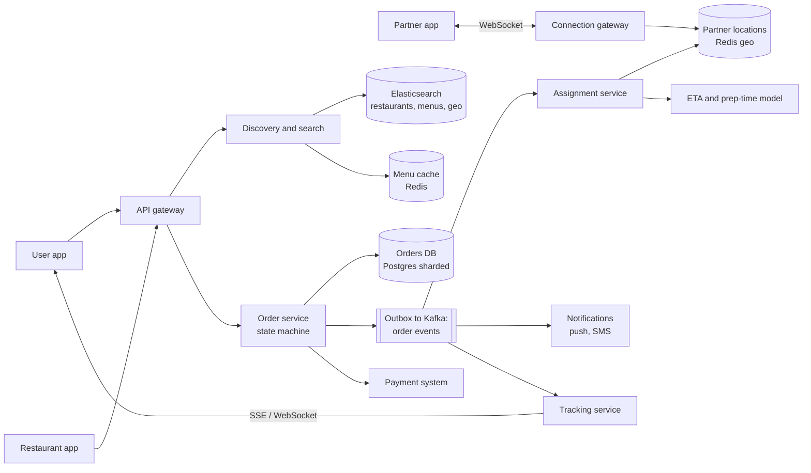
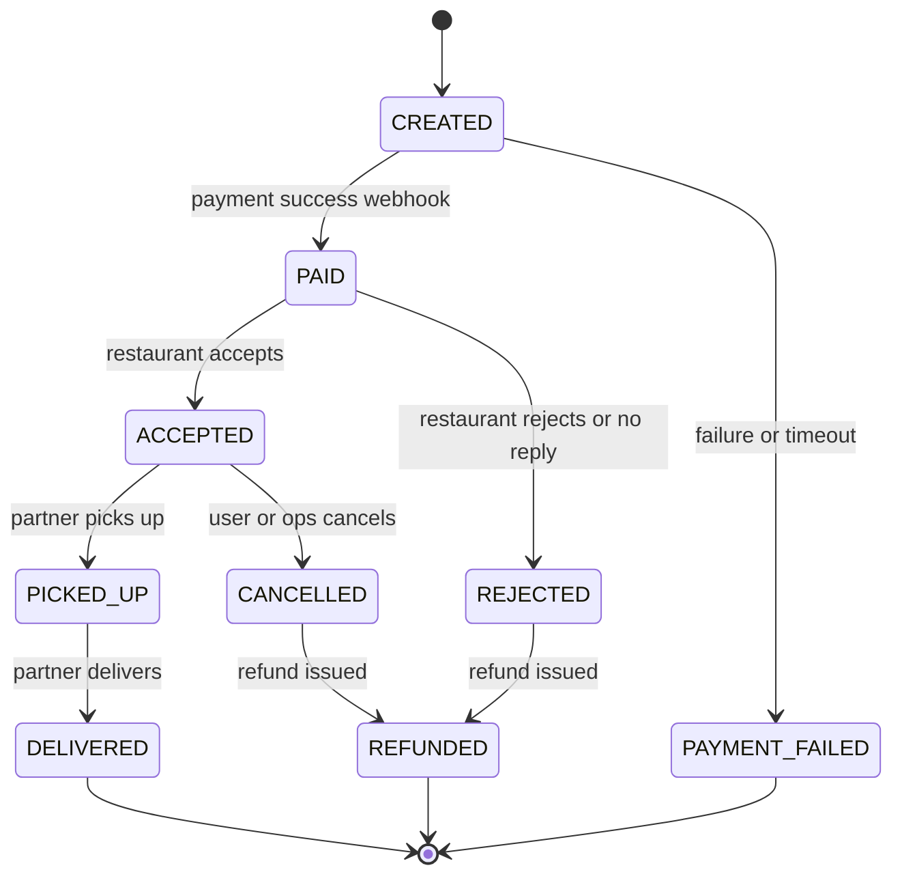

# 11 · Food Delivery (Swiggy/Zomato)

> **Level:** Medium · **Time box:** 45 min · **Asked at:** Swiggy, Zomato, Zepto, Blinkit, Flipkart, Uber, PhonePe
> **Concepts used:** [H34 geospatial](../../6-building-blocks/H34-geospatial/README.md) · [H33 search](../../6-building-blocks/H33-search-typeahead/README.md) · [H23 sagas and outbox](../../4-async/H23-distributed-transactions/README.md) · [H24 event-driven](../../4-async/H24-event-driven-cqrs/README.md) · [H05 real-time](../../1-basics/H05-realtime-communication/README.md) · [H09 caching](../../2-scaling/H09-caching/README.md) · [H38 payments](../../6-building-blocks/H38-payments-domain/README.md)
> **Visuals:** [state machine](../../../lld/4-behavioral/L22-state/visual.html) · [saga and outbox](../../4-async/H23-distributed-transactions/visual.html) · [geohash and quadtree](../../6-building-blocks/H34-geospatial/visual.html)
> **Code it:** [geohash encode and neighbours](../../6-building-blocks/H34-geospatial/lab-geohash/README.md) · LLD version: [food delivery](../../../lld/problems/18-food-delivery/README.md) · related: [ride hailing](../10-ride-hailing/README.md), [payment system](../08-payment-system/README.md)

## How to practise this

1. Set a 45-minute timer. Open [`my-design.md`](./my-design.md) and fill it in **without** looking below.
2. Then open each hint one at a time and compare. Write down what you missed in the Review section.
3. Do it again from memory on the repeat day in the plan. The second attempt is where it sticks.

## The prompt

"Design a food delivery app like Swiggy or Zomato. Users browse nearby restaurants and menus, place an order and pay. The restaurant accepts and prepares it, a delivery partner picks it up, and the user tracks the order live."

## Step 1: questions to ask

- Scale? Orders per day, peak hours, cities, number of restaurants?
- Which parts to focus on: discovery and search, ordering and payment, delivery assignment, or tracking?
- Can one order have items from more than one restaurant? (Usually no.)
- Payment: UPI, cards, wallets, cash on delivery?
- How is a delivery partner chosen? Can one partner carry two orders (batching)?
- How fresh must menu and availability be? (An item out of stock, a restaurant closing early.)

<details><summary>Assumed answers</summary>

- 3M orders/day, 500 cities, 300k restaurants. Lunch (12–2) and dinner (8–10) peaks at ~4× average
- Focus on the order flow, delivery assignment and live tracking. Discovery at a medium level
- One restaurant per order
- UPI, cards, wallets and COD, handled by the [payment system](../08-payment-system/README.md)
- System assigns the partner. Batching of 2 orders from the same restaurant or nearby ones is allowed
- Menu changes (stock, price) should show within ~1 minute. Restaurant open/close within seconds
</details>

## Step 2: estimates

<details><summary>Show the numbers</summary>

| | Calculation | Result |
|---|---|---|
| Order QPS | 3M / 86,400 | ~35/s avg, **~150–200/s** peak |
| Browse/search QPS | 30M DAU × 20 page views / 86,400 | ~7k/s avg, **~30k/s** peak |
| Active orders at peak | 200/s × ~40 min × 60 | **~500k** orders in flight |
| Partners online at peak | | ~300k |
| Partner location writes | 300k / 5s | **~60k/s** |
| Tracking pushes | 500k active orders, one update per 5s | ~100k/s to user apps |
| Menu data | 300k restaurants × 100 items × 1 KB | **~30 GB**: fits in a search cluster and a cache |
| Orders storage | 3M × 5 KB (items, addresses, events) × 365 | **~5.5 TB/year** |

Takeaway to say out loud: "Order QPS is small, but each order is a long **state machine** across four parties: user, restaurant, partner and payment. Reads for discovery are 100× orders, so they come from **cache and a search index**. Partner locations look like ride hailing at 60k writes/s."
</details>

## Step 3: API

<details><summary>Show the API</summary>

```http
GET  /v1/restaurants?lat=12.97&lng=77.59&cuisine=biryani&cursor=…
GET  /v1/restaurants/{id}/menu
GET  /v1/search?q=paneer&lat=…&lng=…

POST /v1/carts/{cartId}/checkout
Idempotency-Key: <uuid>
→ 201 { "orderId": "o_1", "amount": 349.00, "payment": { "intentId": "pi_9", "upiIntent": "upi://pay?…" } }
GET  /v1/orders/{orderId}                       # live updates over SSE or WebSocket
POST /v1/orders/{orderId}/cancel

# Restaurant app
POST /v1/orders/{orderId}/accept   { "prepMinutes": 15 }
POST /v1/orders/{orderId}/reject   { "reason": "item_out_of_stock" }
POST /v1/orders/{orderId}/ready

# Partner app
→ WS { "type": "location", "lat": …, "lng": …, "ts": … }
POST /v1/assignments/{id}/accept | /picked-up | /delivered
```
Checkout is idempotent: a double tap or a retry on a slow network returns the same `orderId` and the same payment intent.
</details>

## Step 4: data model

<details><summary>Show the data model</summary>

`restaurants`: `id` | `name` | `location` | `geohash` | `cuisines` | `rating` | `is_open` | `avg_prep_min`
`menu_items`: `id` | `restaurant_id` | `name` | `price` | `in_stock` | `veg`
`orders`: `order_id` | `user_id` | `restaurant_id` | `partner_id` | `status` | `amount` | `items (JSON)` | `address` | `version` | timestamps
`order_events`: append-only, one row per state change (support, disputes, analytics)
`partners`: `id` | `status` (offline, idle, assigned, on_delivery) | `current_orders`
`partner_locations` (Redis): `geo cell → partner ids`, `partner_id → {lat, lng, ts}`

**DB choice:** orders and payments need transactions and correct state transitions, so Postgres/MySQL, sharded by `order_id` (or by city). Restaurants and menus are read-heavy and searched by text plus distance, so the source of truth is in SQL, copied by CDC into Elasticsearch (with `geo_point`) for discovery and into Redis for menu reads. Partner locations are in memory (Redis), the same as the [ride-hailing](../10-ride-hailing/README.md) geo index.
</details>

## Step 5: high-level design

<details><summary>Show the diagram</summary>


**Write:** user checks out → order service creates the order in `CREATED` and a payment intent with `idempotencyKey = orderId` → user pays by UPI → the payment system's webhook moves the order to `PAID` → the outbox publishes `OrderPaid` → the restaurant app gets the order and accepts with a prep time → the assignment service picks a partner so they arrive when the food is ready → partner picks up and delivers. Every step is a conditional state update plus an event.
**Read:** discovery goes to Elasticsearch with a geo filter ("open restaurants that deliver to this point"), with menus from Redis. Tracking: the user's app subscribes to the order; the tracking service sends state changes and the partner's location every few seconds.
</details>

## Step 6: deep dives (the part that gets scored)

<details><summary>Deep dive 1: the order state machine and the payment saga</summary>


| Approach for order + payment | How | Pros | Cons |
|---|---|---|---|
| One distributed transaction (2PC) | lock order, payment and restaurant together | Atomic | PSPs and restaurant apps don't support 2PC; blocks on failure |
| **Saga with compensation (choice)** | a sequence of local steps; on failure, run the undo step (refund) | Each service owns its data; works with external PSPs | Intermediate states are visible; compensations must be idempotent |

- Steps: create order → take payment → restaurant accepts → assign partner. Compensation: if the restaurant rejects or doesn't respond in ~3 minutes, refund automatically and tell the user.
- Every transition is `UPDATE orders SET status = ? WHERE id = ? AND status = ?`, plus an `order_events` row and an outbox row in the same transaction. A relay publishes the outbox to Kafka. No event is lost and no event goes out for a rolled-back change.
- Payment unknown state (UPI pending): keep the order in `CREATED` and wait for the webhook, with a status poll as backup. Never mark it failed just because the PSP call timed out. See the [payment system](../08-payment-system/README.md).

Say: "The order is a state machine, and the order-to-payment-to-restaurant flow is a saga, orchestrated by the order service. Each step is a conditional update plus an outbox event. If the restaurant rejects, the compensation is an idempotent refund."
</details>

<details><summary>Deep dive 2: assigning delivery partners (and batching)</summary>

| Approach | How | Pros | Cons |
|---|---|---|---|
| Nearest idle partner, immediately | assign at `PAID` | Simple | Partner waits 15 minutes at the restaurant; wasted capacity at peak |
| **Assign just in time (choice)** | assign so `partner ETA to restaurant ≈ food ready time` | Partner doesn't wait; food doesn't wait | Needs a good prep-time model |
| **Batched assignment (choice at peak)** | every ~30s per zone, solve partners × orders together, allow 2 orders per partner when restaurants and drops are close | Better global cost; fewer partners per order at peak | Small delay; harder to explain to partners |

- Cost to minimise per pair: partner ETA to restaurant, the wait at the restaurant, the extra detour for a batched second order, and the promised delivery time. Swiggy's engineering blog describes this kind of assignment as a matching problem solved in batches.
- Prep time is predicted per restaurant, per time of day, and per order size, and is corrected by the restaurant's own estimate.
- Offer to the chosen partner with a lock (`SET partner:{id}:lock NX PX 30000`), the same as ride hailing. The DB conditional update on the order is the final guard.
- If nobody accepts, widen the search radius and add a small incentive.

Say: "I don't assign at payment time. I assign so the partner arrives when the food is ready, using a prep-time model. At peak I batch per zone every 30 seconds and allow two orders per partner when they are on the way."
</details>

<details><summary>Deep dive 3: discovery, menus and search</summary>

- "Restaurants that deliver to me" is not just "near me". Each restaurant has a delivery polygon or radius, and serviceability changes with rain and partner supply. Precompute `geohash cell → serviceable restaurant ids` and refresh it every few minutes.
- Elasticsearch: `geo_distance` filter + `is_open` + text match on name, cuisine and dish, then rank by a mix of distance, rating, ETA, and personal history. See [search indexing](../../6-building-blocks/H33-search-typeahead/README.md).
- Menus: cache per restaurant in Redis (and at the CDN for images). On an item going out of stock, update the DB and invalidate the cache key. Users see it within seconds.
- Validate again at checkout: price and stock are rechecked on the server. The cache can be a little stale; the checkout cannot.

Say: "Discovery is serviceability first, then search. A precomputed map from cell to serviceable restaurants feeds an Elasticsearch query, menus are cached in Redis, and price and stock are checked again at checkout."
</details>

<details><summary>Deep dive 4: live tracking at 500k active orders</summary>

| Transport | Fit |
|---|---|
| Polling every 10s | Simple; fine as a fallback; 50k req/s at peak |
| **SSE (choice)** | one-way server → user, works over HTTP/2, auto-reconnect; tracking is one-way |
| WebSocket | needed for the partner app (two-way); overkill for the user |

- Partner app sends location every ~5s to the connection gateway → Redis geo (for assignment) → a per-order channel → the tracking service → the user's SSE stream.
- Send state changes (accepted, picked up) as events, and locations at most every 5s. The client interpolates the marker.
- The ETA shown to the user is recomputed on each state change and every minute, not on every location ping.

Say: "The partner app sends location every 5 seconds. Users get state changes and positions over SSE, at most one every 5 seconds, and the ETA is recomputed on state changes, not on every ping."
</details>

## Follow-ups interviewers ask

1. The payment succeeded but the webhook is late by 10 minutes. (Poll the PSP status API after ~1 minute; the webhook handler and the poller both make the same idempotent transition.)
2. The restaurant accepted, then an item is out of stock. (Partial order with user consent, or cancel and refund; the state machine needs this edge.)
3. How do you handle the IPL-final dinner spike? (Autoscale stateless services; the order DB is small; the real limit is partners, so show longer ETAs or turn off far restaurants.)
4. A partner's phone dies mid-delivery. (Stale-location alert after ~1 minute; ops calls; reassign if the food was not yet picked up.)
5. How would you add grocery 10-minute delivery (Instamart, Blinkit)? (Dark stores replace restaurants; inventory per store becomes the hard part; assignment is short-range.)

## Common mistakes

- Designing only the happy path. Rejections, timeouts, cancellations and refunds are what interviewers ask about.
- Using a distributed transaction across order, payment and restaurant.
- Assigning the nearest partner at order time and making them wait at the restaurant.
- Querying the orders DB for restaurant discovery instead of a search index and cache.
- Marking an order failed when the payment call timed out. Unknown is not failed.
- Forgetting the outbox: updating the DB and publishing to Kafka as two separate steps.
