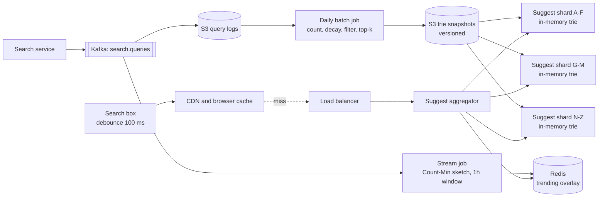

# 12 · Search Autocomplete

> **Level:** Medium · **Time box:** 45 min · **Asked at:** Flipkart, Amazon, Swiggy, Zomato, Myntra, Meesho, Google, Microsoft, LinkedIn
> **Concepts used:** [H33 search and typeahead](../../6-building-blocks/H33-search-typeahead/README.md) · [H35 Count-Min sketch](../../6-building-blocks/H35-probabilistic-ds/README.md) · [H36 batch and stream](../../6-building-blocks/H36-batch-stream/README.md) · [H09 caching](../../2-scaling/H09-caching/README.md) · [H10 CDN](../../2-scaling/H10-cdn/README.md) · [H16 sharding](../../3-databases/H16-partitioning-sharding/README.md) · [H02 estimation](../../1-basics/H02-back-of-envelope/README.md)
> **Visuals:** [caching patterns](../../2-scaling/H09-caching/visual.html) · [sharding strategies](../../3-databases/H16-partitioning-sharding/visual.html)
> **Code it:** [trie with top-k](../../6-building-blocks/H33-search-typeahead/lab-trie/README.md) · [Count-Min sketch + top-k](../../6-building-blocks/H35-probabilistic-ds/lab-count-min/README.md)

## How to practise this

1. Set a 45-minute timer. Open [`my-design.md`](./my-design.md) and fill it in **without** looking below.
2. Then open each hint one at a time and compare. Write down what you missed in the Review section.
3. Do it again from memory on the repeat day in the plan. The second attempt is where it sticks.

## The prompt

"Design the search box autocomplete for an e-commerce app like Flipkart. As the user types, show the top 5 to 10 suggestions for the prefix, fast."

## Step 1: questions to ask

- Suggest past **queries** (what people searched) or **items** (product names)? Or both?
- How are suggestions ranked: popularity only, or also freshness and personalisation?
- How fresh must the data be? Is a daily rebuild fine, or must a trending query show up within minutes?
- Languages: English only, or Hindi and Hinglish ("saree under 500", "mobile cover redmi")? Typos?
- Latency target? Scale (DAU, searches per user)?
- Any filtering (offensive terms, banned products)?

<details><summary>Assumed answers</summary>

- Suggest popular past queries. Products and categories are a follow-up.
- Rank by popularity with time decay. Personalisation is a follow-up.
- Daily rebuild for the main data. Trending terms (a new phone launch, a Big Billion Days deal) should appear within ~15 minutes.
- English and Hinglish in Latin script; basic typo tolerance is a deep dive.
- **p99 under 100 ms** end to end, so the server part must be ~10–20 ms.
- 100M DAU, 10 searches per user per day.
- Filter offensive and blocked terms.
</details>

## Step 2: estimates

<details><summary>Show the numbers</summary>

| | Calculation | Result |
|---|---|---|
| Searches/day | 100M × 10 | **1B searches/day** |
| Autocomplete requests | ~20 chars typed, but debounce → ~4 requests per search | **4B/day ≈ 46k/s** avg, **~150k/s** peak (sale day) |
| Query log | 1B × ~50 B (query, ts, user, locale) | **~50 GB/day** raw |
| Distinct queries kept | Drop queries seen < N times; keep top ~10M | 10M queries × ~25 chars |
| Prefixes to serve | 10M queries × ~(1 + shared tail) → roughly 50M distinct prefixes after sharing | **~50M prefixes** |
| Size of prefix → top-10 table | 50M × (prefix 15 B + 10 suggestions × ~30 B) ≈ 50M × 315 B | **~16 GB**. Fits in RAM on one big box; replicate it |
| Cache hit rate | Short prefixes (1–3 chars) are few and very hot | ~70–80% can be served from CDN/browser cache |

Takeaway to say out loud: "It is extremely read-heavy and latency-critical, and the data fits in memory. So I split it into two paths: a **fast read path** that does an in-memory prefix lookup with precomputed top-k, and an **offline pipeline** that turns query logs into that structure."
</details>

## Step 3: API

<details><summary>Show the API</summary>

```http
GET /v1/suggest?q=iph&limit=10&locale=en-IN
→ 200
Cache-Control: public, max-age=300          # short prefixes are the same for everyone
{ "prefix": "iph", "suggestions": ["iphone 15", "iphone 15 cover", "iphone charger", ...] }

# Internal, async: the search service logs every submitted query
POST /internal/query-log   (or a Kafka topic: search.queries)
{ "query": "iphone 15 cover", "userId": "u1", "ts": ..., "clicked": true }
```
- Lowercase and normalise the prefix on the client and server (trim, collapse spaces), so caches hit more.
- Personalised suggestions cannot be CDN-cached. Keep them as a separate small call, or mix them in on the client.
</details>

## Step 4: data model

<details><summary>Show the data model</summary>

| Store | Key | Value | Why |
|---|---|---|---|
| Query log (S3/HDFS, partitioned by hour) | — | raw query events | Cheap, append-only input for the batch job |
| Aggregated counts (warehouse table) | `(query, day)` | count, clicks | Input for ranking with decay |
| **Prefix index** (in memory on the suggest servers) | `prefix` | top-k list of `(query, score)` | The read path; built offline, loaded as a snapshot |
| Trending overlay (Redis) | `prefix` | top-k from the last hour | Small, updated by the stream job |
| Blocklist (config store) | term | — | Filter applied at build time and at serve time |

**Storage choice:** the serving structure is a trie (or a flat prefix → top-k hash map) held **in the memory of the suggest service**, loaded from an immutable snapshot file on S3. Each build makes a new version; servers swap atomically. Redis is an option for the trending overlay. A general-purpose DB is too slow for 150k/s at 10 ms and is not needed, because the data is read-only between builds.
</details>

## Step 5: high-level design

<details><summary>Show the diagram</summary>



**Write (offline):** every submitted search goes to Kafka. Raw events land in S3. Once a day, a Spark job counts queries per day, applies time decay (e.g. score = Σ count_d × 0.9^age_in_days), drops rare queries and blocked terms, and computes the top-k for every prefix. It writes a versioned snapshot. Suggest servers download it and swap it in with no downtime. In parallel, a stream job keeps approximate counts for the last hour with a Count-Min sketch and writes trending top-k per short prefix to Redis.

**Read:** the client waits ~100 ms after the last keystroke, then calls `/suggest`. Browser cache and CDN serve most short prefixes. On a miss, the aggregator finds the shard that owns the prefix, does an O(prefix length) lookup to get the precomputed top-k, merges in trending results from Redis, filters, and returns. No scanning of subtrees at request time.
</details>

## Step 6: deep dives (the part that gets scored)

<details><summary>Deep dive 1: the data structure (trie with top-k at each node)</summary>

| Approach | Lookup | Memory | Notes |
|---|---|---|---|
| Plain trie, DFS the subtree at query time | O(p + size of subtree) | Small | Too slow for short prefixes: "s" has millions of descendants |
| **Trie with top-k cached at every node** | O(p) | Larger (k entries per node) | The standard answer (Alex Xu vol. 1 ch. 13). Build cost moves offline |
| Flat hash map `prefix → top-k` | O(1) | Similar to above, no tree pointers | Simplest to shard and to store in Redis or a KV store |
| Inverted index / Elasticsearch completion suggester | Fast, with fuzzy matching | Managed | A good real-world choice; less to explain in an interview |

Building top-k: go bottom-up. Each node's top-k = merge of its children's top-k plus queries that end at the node. Keep k = 10–20 so the client can filter some out and still show 5–10.

Limit the prefix length (e.g. 30 chars). Long prefixes are rare; for them fall back to the search engine.

Say: "I precompute the top-k at every prefix offline, so a request is a single O(prefix-length) lookup with no subtree scan. In practice I'd store it as a prefix to top-k map, which is easy to shard and snapshot."
</details>

<details><summary>Deep dive 2: the data pipeline (batch plus trending)</summary>

| Path | Freshness | Tool | Accuracy |
|---|---|---|---|
| Batch | Daily (or every few hours) | Spark over S3 logs | Exact counts, decay, full rebuild |
| Stream | ~1–15 min | Flink/Kafka Streams with a Count-Min sketch + min-heap for heavy hitters | Approximate, only for the top items |

- Count-Min sketch: fixed memory (a few MB) for approximate counts of millions of queries. It can over-count, never under-count. Good enough to find heavy hitters.
- Spike detection: compare the last hour's count with the usual rate for that query. A big ratio means trending.
- Never update the main trie per query in real time. Writes to a shared trie at 10k/s with locks would hurt the read path.
- Protect against manipulation: count distinct users per query, not raw requests, so one bot cannot push a term up.

Say: "The main index is rebuilt in batch with exact counts and time decay. A small streaming layer with a Count-Min sketch catches trending queries within minutes, and the read path merges the two."
</details>

<details><summary>Deep dive 3: sharding and replication</summary>

16 GB fits on one machine, so the first reason to shard is not size. It is throughput and the build/load time. Still, know the options:

| Shard by | Pros | Cons |
|---|---|---|
| First character ranges (a–f, g–m…) | A prefix maps to one shard; easy | Very uneven: far more queries start with "s" than "x" |
| Ranges sized by traffic (from historical data) | Even load | Needs a shard map; rebalance when patterns change |
| Hash of the first 2–3 chars | Even spread | Still one shard per prefix; very hot prefixes need more replicas |

- Replicate each shard 3+ times across AZs. It is read-only between builds, so there is no consistency problem: just a version number.
- Blue/green load: load the new snapshot next to the old one, warm it, flip, then free the old one.
- The hottest prefixes (1–2 chars) hardly reach the servers at all thanks to the CDN.

Say: "The index is read-only between builds, so replication is easy: three or more copies per shard, versioned snapshots and a blue/green swap. I size shard ranges by traffic, not by alphabet, to avoid skew."
</details>

<details><summary>Deep dive 4: latency, caching and the client</summary>

- **Debounce** 100–150 ms on the client: fewer requests, no visible lag.
- **Browser cache**: keep earlier results; when the user deletes a character, show cached results instantly.
- **CDN**: non-personalised results for a prefix are the same for everyone in a locale. `Cache-Control: max-age=300–3600`. This removes most of the load.
- **Prefetch**: the response for "ip" can include top results for "iph", "ipa", so the next keystroke is served locally.
- **Cancel old requests** on the client so a slow answer for "ip" does not overwrite the answer for "iph".
- Keep the payload tiny (~1 KB). Use HTTP/2 keep-alive.

Say: "Most of the latency budget is saved on the client and the CDN: debounce, browser cache, CDN-cached results for short prefixes, prefetching the next keystroke, and cancelling stale requests."
</details>

<details><summary>Deep dive 5: Hinglish, typos and personalisation</summary>

- Normalise: lowercase, strip accents, collapse spaces, map common spellings ("moblie" → "mobile") at build time.
- Typos: for short prefixes, look up candidates within edit distance 1 (precomputed variants, like SymSpell), or let the Elasticsearch suggester do fuzzy matching. Rank exact-prefix matches higher.
- Hinglish and transliteration: index both "chappal" and the Devanagari form; map a Hindi query typed in Latin script to the same products. Flipkart has published work on vernacular and Hinglish search.
- Personalisation: a separate small store of the user's recent searches (last 20, in Redis), merged on the client or in the aggregator. Keep the shared results CDN-cacheable.

Say: "Typos and Hinglish are handled when the index is built: normalise, add spelling variants and transliterations, and rank exact prefix matches first. Personal history is a small separate call, so the shared results stay cacheable."
</details>

## Follow-ups interviewers ask

1. A term becomes offensive or legally blocked. How fast can you remove it? (Serve-time blocklist checked on every response, pushed to all servers in seconds. The next build drops it permanently.)
2. How do you rebuild with zero downtime? (Versioned snapshots, load side by side, atomic swap, roll back by pointing to the old version.)
3. Support "iphone" matching when the user typed "phone"? (That is infix or token search, not prefix. Index each token start, or hand it to the search engine.)
4. Different suggestions per city ("biryani" in Hyderabad vs "dosa" in Bengaluru for Swiggy)? (Build top-k per region for short prefixes, or add a region boost at merge time. Watch the memory growth.)
5. Why not query Elasticsearch directly for every keystroke? (You can at small scale. At 150k/s with p99 10 ms, a precomputed in-memory structure is cheaper and more predictable.)

## Common mistakes

- Doing a DFS of the trie at request time.
- Updating the serving trie on every query in real time.
- Forgetting debounce and caching, then sizing servers for every keystroke.
- No filtering of offensive or blocked terms.
- Sharding by first letter without noticing the skew.
- Spending all the time on the trie and never describing where the counts come from.
