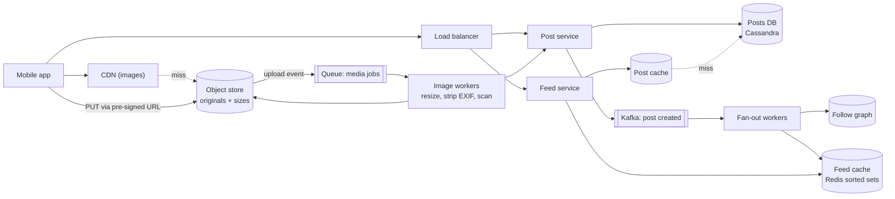

# 16 · Photo Sharing (Instagram)

> **Level:** Medium · **Time box:** 45 min · **Asked at:** Meta, ShareChat, Moj, Flipkart, Swiggy (as an "image-heavy product" variant)
> **Concepts used:** [H02 estimation](../../1-basics/H02-back-of-envelope/README.md) · [H32 blob storage](../../6-building-blocks/H32-blob-storage/README.md) · [H10 CDN](../../2-scaling/H10-cdn/README.md) · [H37 fan-out and hot keys](../../6-building-blocks/H37-data-at-scale/README.md) · [H16 sharding](../../3-databases/H16-partitioning-sharding/README.md) · [H20 message queues](../../4-async/H20-message-queues/README.md)
> **Visuals:** [feed fan-out](../../6-building-blocks/H37-data-at-scale/visual.html) · [caching patterns](../../2-scaling/H09-caching/visual.html)
> **Related problem:** [07 news feed](../07-news-feed/README.md) (do that one first; this one adds the media pipeline)

## How to practise this

1. Set a 45-minute timer. Open [`my-design.md`](./my-design.md) and fill it in **without** looking below.
2. Then open each hint one at a time and compare. Write down what you missed in the Review section.
3. Do it again from memory on the repeat day in the plan. The second attempt is where it sticks.

## The prompt

"Design Instagram. Users upload photos with a caption, follow other users, and see a feed of photos from people they follow. They can like and comment."

## Step 1: questions to ask

- Scale? DAU, uploads per day, feed views per day?
- Photos only, or video and stories too?
- Feed order: reverse-chronological or ranked?
- Max photo size? Do we keep the original?
- Do likes and comment counts need to be exact and real-time?
- Private accounts? Search? (Usually out of scope.)

<details><summary>Assumed answers</summary>

- 500M DAU. 100M photo uploads/day. Each user opens the feed ~10 times/day
- Photos only. Video and stories are out of scope (see [14 video streaming](../14-video-streaming/README.md))
- Feed: reverse-chronological first, ranking as a follow-up
- Upload up to 10 MB; we keep the original plus 4 resized versions
- Like counts can be a few seconds stale. The like action itself must not be lost
- Private accounts: yes (a follower check on read). Search: out of scope
</details>

## Step 2: estimates

<details><summary>Show the numbers</summary>

| | Calculation | Result |
|---|---|---|
| Upload QPS | 100M / 86,400 | **~1.2k/s** avg, ~3k/s peak |
| Feed QPS | 500M × 10 / 86,400 | **~60k/s** avg, ~150k/s peak |
| Image views | each feed page shows ~10 photos: 60k × 10 | **~600k image GETs/s**, almost all from CDN |
| Storage per photo | original ~2 MB + 4 sizes (~500 KB total) | ~2.5 MB |
| Storage per day | 100M × 2.5 MB | **~250 TB/day** |
| Storage per year | 250 TB × 365 | **~90 PB/year** (blob store, not a DB) |
| Metadata per photo | id, user, caption, location, ts ≈ 500 B | 100M × 500 B = **50 GB/day** |
| Egress | 600k/s × ~100 KB (feed size) | **~60 GB/s**, so a CDN is not optional |

Takeaway to say out loud: "Bytes and metadata are two different problems. Photos go to object storage behind a CDN. The hard part is the **feed read path at 60k QPS** and the **upload pipeline**."
</details>

## Step 3: API

<details><summary>Show the API</summary>

```http
POST /v1/media/upload-url                    # step 1: ask for a pre-signed URL
→ 200 { "mediaId": "m_123", "uploadUrl": "https://s3…?X-Amz-Signature=…", "expiresIn": 900 }

PUT <uploadUrl>                               # step 2: client uploads bytes straight to S3

POST /v1/posts                                # step 3: create the post
Idempotency-Key: <uuid>
{ "mediaIds": ["m_123"], "caption": "Goa!", "location": "…" }
→ 201 { "postId": "p_987", "status": "PROCESSING" }

GET  /v1/feed?cursor=<opaque>&limit=20         # cursor pagination, never offset
→ 200 { "posts": [ { "postId", "author", "urls": { "thumb", "medium", "full" }, "likeCount" } ], "nextCursor": "…" }

POST   /v1/posts/{id}/likes                   # idempotent per (user, post)
DELETE /v1/posts/{id}/likes
POST   /v1/posts/{id}/comments
POST   /v1/users/{id}/follow
```
Pre-signed URLs keep the 10 MB bodies away from your API servers. The API only handles small JSON.
</details>

## Step 4: data model

<details><summary>Show the data model</summary>

| Table | Key | Fields | Store |
|---|---|---|---|
| `users` | `user_id` | name, bio, is_private | Postgres (small, relational) |
| `posts` | `post_id` (Snowflake, time-sortable) | user_id, caption, media_keys, created_at, status | Cassandra, partition by `user_id`, cluster by `post_id DESC` |
| `follows` | `(follower_id, followee_id)` | created_at | Two tables: `followers_of` and `following_of`, each partitioned by its first id |
| `feed` | `user_id` | list of post_ids (latest ~500) | Redis sorted set, score = post time |
| `likes` | `(post_id, user_id)` | ts | Cassandra; the counter lives elsewhere (deep dive 4) |
| Photo bytes | `media/{mediaId}/{size}.jpg` | | S3 (or GCS) + CDN |

**DB choice:** posts are append-heavy and read by `user_id` + time. A wide-column store (Cassandra) fits that pattern and scales writes linearly. Users and the social graph's small metadata can stay in Postgres. Never store image bytes in a database.
</details>

## Step 5: high-level design

<details><summary>Show the diagram</summary>


**Write (upload):** app asks for a pre-signed URL → uploads bytes straight to S3 → S3 emits an event → image workers make 4 sizes, strip EXIF/GPS, run a safety scan → mark the media READY → post service saves the post and publishes `post_created` → fan-out workers push the post id into each follower's Redis feed.
**Read (feed):** feed service reads the top 20 post ids from the user's sorted set → batch-fetches post metadata from the post cache (multi-get) → merges in posts from followed celebrities (pull) → returns CDN URLs. The app then loads the images from the CDN, not from us.
</details>

## Step 6: deep dives (the part that gets scored)

<details><summary>Deep dive 1: the upload and image-processing pipeline</summary>

| Approach | Pros | Cons |
|---|---|---|
| Upload through API servers | Simple; one auth point | 10 MB bodies tie up Node workers; you pay for bandwidth twice |
| **Pre-signed URL to S3 (recommended)** | API stays small; S3 scales on its own; resumable multipart for slow mobile networks | Two-step flow; you must clean up uploads that never become posts (S3 lifecycle rule) |

- Resize **asynchronously** with a queue. Keep the job idempotent: the output key is `media/{id}/{size}`, so a retry overwrites the same file.
- Generate common sizes eagerly (thumb 150px, feed 640px, full 1080px). Rare sizes can be made on demand at the edge (an image CDN) and cached.
- Serve WebP/AVIF to clients that support them. That saves 25–35% of bytes, which matters at 60 GB/s.
- Strip EXIF. It can contain the user's home GPS location.

Say: "Bytes never touch my API servers. The client uploads to S3 with a pre-signed URL, and an idempotent worker makes the sizes. The post goes live only when its media is READY."
</details>

<details><summary>Deep dive 2: building the feed (push vs pull vs hybrid)</summary>

| Model | Write cost | Read cost | Breaks when |
|---|---|---|---|
| Pull (fan-out on read) | 1 write | Merge N followees' posts on every open | User follows 1,000 people; 60k QPS × 1,000 reads |
| Push (fan-out on write) | 1 write per follower | 1 Redis read | A celebrity with 100M followers posts: 100M writes |
| **Hybrid (recommended)** | Push for normal users | Pull only for the few celebrities you follow | Needs a threshold (e.g. > 1M followers = celebrity) |

- Push only to **active** followers (opened the app in the last 30 days). Inactive users get their feed rebuilt by pull when they return.
- Keep only ~500 ids per feed in Redis. Older pages come from a pull query.
- Memory: 500M users × 500 ids × 8 B ≈ 2 TB of raw ids. A Redis sorted set costs several times the raw size per entry, so cap the list, push only to the ~200M active users, and plan for a few TB across a sharded cluster.

Say: "Hybrid fan-out. Push post ids to active followers. Celebrities' posts are pulled and merged at read time, so one celebrity post doesn't create 100M writes."
</details>

<details><summary>Deep dive 3: serving images at 600k requests per second</summary>

- Image URLs are **immutable** (`/media/{id}/640.webp`). Set `Cache-Control: max-age=1 year`. A new version gets a new key, so you never purge.
- CDN hit ratio > 95%. Add an origin shield (a mid-tier cache) so that misses from 200 edge PoPs collapse into one fetch from S3.
- Private accounts: use signed CDN URLs with a short expiry, created by the feed service after the follower check.
- Storage tiers: move originals older than 90 days to infrequent-access storage. Most views happen in the first few days.
</details>

<details><summary>Deep dive 4: likes and counters on hot posts</summary>

A viral post gets 50k likes/s. `UPDATE posts SET likes = likes + 1` on one row will melt.

| Approach | How | Trade-off |
|---|---|---|
| Redis `INCR` per post | Atomic, fast | One hot key is still one shard; fine up to ~100k/s |
| **Sharded counter** | `likes:{post}:{0..N}`, sum on read | Spreads the load; the read sums N keys |
| **Async aggregation (recommended for the DB)** | Write the like event to Kafka; a consumer batches `+k` per post every second | Count lags by ~1 s; the source of truth is the `likes` table |

The `(post_id, user_id)` row makes the like idempotent: a double tap is the same row. The count is a derived value that you can rebuild from that table.

Say: "The like row is the truth and makes it idempotent. The counter is a cache, updated in batches, so a hot post doesn't hit one row 50k times a second."
</details>

## Follow-ups interviewers ask

1. A user deletes a post. How does it leave everyone's feed? (Don't fan out deletes. Filter at read time: the post cache returns a tombstone, and the feed service skips it.)
2. How do you rank the feed? (Pull ~500 candidates from the feed cache, score them with a model service on features like affinity and recency, then return the top 20.)
3. Duplicate uploads of the same photo? (Content hash of the bytes; dedupe at storage level only, never across users' privacy settings.)
4. Multi-region? (Upload to the nearest region's bucket and replicate asynchronously. Metadata has a home region per user.)
5. A new user follows 50 people. Their feed is empty. (Build it once by pull, then switch to push.)

## Common mistakes

- Sending image bytes through the API servers or storing them in the database.
- Pure push fan-out with no answer for celebrities.
- Forgetting the CDN and then quoting 60 GB/s of egress from your own servers.
- Offset pagination on the feed (`?page=50`). New posts shift the pages; use a cursor.
- A synchronous resize inside the upload request.
