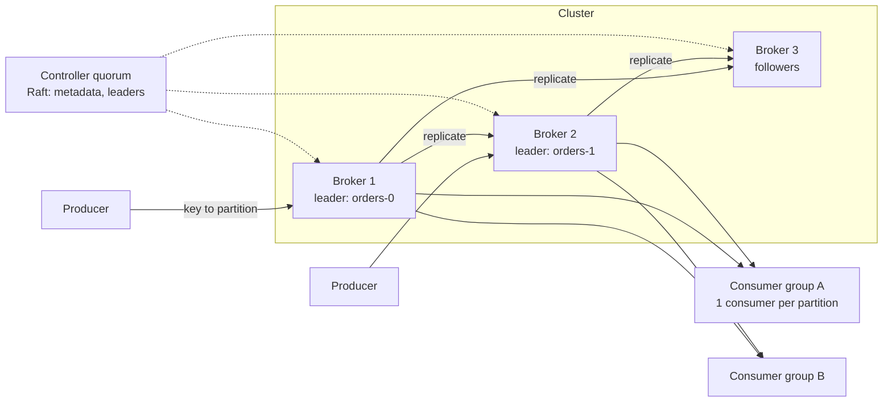

# 18 · Distributed Message Queue (Kafka)

> **Level:** Hard · **Time box:** 45 min · **Asked at:** Flipkart, Uber, PhonePe, Razorpay, Atlassian, Confluent-style infra teams
> **Concepts used:** [H20 message queues](../../4-async/H20-message-queues/README.md) · [H21 Kafka deep dive](../../4-async/H21-kafka/README.md) · [H22 delivery semantics](../../4-async/H22-delivery-semantics/README.md) · [H15 replication](../../3-databases/H15-replication/README.md) · [H29 consensus](../../5-reliability/H29-consensus-locks/README.md) · [H16 partitioning](../../3-databases/H16-partitioning-sharding/README.md)
> **Visuals:** [Kafka consumer groups](../../4-async/H21-kafka/visual.html) · [delivery semantics](../../4-async/H22-delivery-semantics/visual.html) · [Raft leader election](../../5-reliability/H29-consensus-locks/visual.html)
> **Code it:** LLD: [pub-sub queue (Kafka-lite)](../../../lld/problems/15-pub-sub-queue/README.md)

## How to practise this

1. Set a 45-minute timer. Open [`my-design.md`](./my-design.md) and fill it in **without** looking below.
2. Then open each hint one at a time and compare. Write down what you missed in the Review section.
3. Do it again from memory on the repeat day in the plan. The second attempt is where it sticks.

## The prompt

"Design a distributed message queue like Kafka. Producers publish messages to topics. Many consumer groups read them. Messages must not be lost, and the system must scale horizontally."

## Step 1: questions to ask

- Throughput and message size?
- Ordering: global, per key, or none?
- Delivery guarantee: at-most-once, at-least-once, exactly-once?
- Retention: delete after consume (queue) or keep for N days (log)? Can consumers replay?
- Push to consumers, or consumers pull?
- Latency target end to end?

<details><summary>Assumed answers</summary>

- 1M messages/s in, average 1 KB. 5 consumer groups read everything
- Ordering **per key** (e.g. all events of one order in order). No global order
- At-least-once by default; exactly-once as a follow-up
- Log model: keep messages 7 days, consumers can replay from any offset
- Consumers **pull**
- p99 end-to-end < 100 ms
</details>

## Step 2: estimates

<details><summary>Show the numbers</summary>

| | Calculation | Result |
|---|---|---|
| Write throughput | 1M × 1 KB | **~1 GB/s** in |
| With replication factor 3 | 1 GB/s × 3 | **3 GB/s** of disk writes across the cluster |
| Read throughput | 5 groups × 1 GB/s | **~5 GB/s** out (mostly from page cache) |
| Retention storage | 1 GB/s × 86,400 × 7 × 3 | **~1.8 PB** |
| Brokers by disk | 1.8 PB / ~40 TB per broker | **~45 brokers** |
| Brokers by network | (3 GB/s in + 5 GB/s out) / ~500 MB/s usable per broker | **~16**, so disk decides: ~50 brokers |
| Partitions | 1M msg/s / ~10k msg/s per consumer | **≥ 100 partitions** for the big topic, so 100 consumers can work in parallel |

Takeaway to say out loud: "This is a **sequential-disk and network** problem. An append-only log with replication gives durability. Partitions give parallelism and per-key order."
</details>

## Step 3: API

<details><summary>Show the API</summary>

```text
produce(topic, key, value, headers) → { partition, offset }
    acks = 0 | 1 | all             # durability vs latency
    idempotent producer: (producerId, sequence) per partition

fetch(topic, partition, fromOffset, maxBytes) → [ { offset, key, value, ts } ]   # long-poll

commitOffset(group, topic, partition, offset)
joinGroup(group, topics) → assigned partitions                                     # rebalance

createTopic(name, partitions, replicationFactor, retention)
```
Binary protocol over TCP, with batching. Producers batch for a few ms (`linger.ms`) and compress the batch. Batching is where the throughput comes from.
</details>

## Step 4: data model

<details><summary>Show the data model</summary>

On each broker, one directory per partition replica:

```text
orders-7/
  00000000000000000000.log     # segment: appended message batches
  00000000000000000000.index   # sparse: offset → byte position
  00000000000000000000.timeindex
  00000000000052428800.log     # next segment, rolled at ~1 GB or 1 hour
```

- **Offset** = position in the partition. It only grows.
- **Retention** deletes whole old segments. No per-message delete, so no random I/O.
- Compacted topics keep only the last value per key (good for "latest state" topics).

Metadata (topics, partition → leader, in-sync replica set, consumer group offsets) lives in a small consensus-backed store: the KRaft controller quorum in modern Kafka (ZooKeeper in older versions). Group offsets are themselves stored in an internal compacted topic.

**Why not a DB?** We only append and read in order. A file per segment with OS page cache beats any B-tree for this pattern.
</details>

## Step 5: high-level design

<details><summary>Show the diagram</summary>


**Write:** the producer hashes `key` to a partition, finds that partition's leader from cached metadata, sends a batch. The leader appends it to the active segment (page cache). Followers fetch from the leader and append. With `acks=all`, the leader replies when all in-sync replicas (ISR) have the batch.
**Read:** a consumer in a group owns some partitions. It long-polls `fetch(fromOffset)` on the leader. The broker sends bytes from page cache straight to the socket (zero-copy `sendfile`). The consumer processes, then commits its offset.
</details>

## Step 6: deep dives (the part that gets scored)

<details><summary>Deep dive 1: why an append-only log is fast</summary>

- **Sequential writes**: disks (even HDDs) do hundreds of MB/s sequentially but only ~100–200 random IOPS.
- **Page cache**: consumers near the tail read data the OS still has in memory. No app-level cache needed.
- **Zero-copy**: `sendfile` moves bytes from page cache to the NIC without copying through user space.
- **Batching + compression**: one network call and one disk append for hundreds of messages.
- **Consumers keep their own offsets**: the broker doesn't track per-message acks, so reads are cheap and replay is free.

Say: "A partition is an append-only log on disk. Writes are sequential, reads come from page cache with zero-copy, and consumers own their offsets. That is why one broker can push hundreds of MB/s."
</details>

<details><summary>Deep dive 2: replication and durability</summary>

| Setting | Meaning | Trade-off |
|---|---|---|
| `acks=0` | fire and forget | fastest, can lose data |
| `acks=1` | leader has it | lose data if the leader dies before followers copy |
| **`acks=all` + `min.insync.replicas=2` (recommended)** | at least 2 replicas have it | +1 RTT; no loss if one broker dies |

- **ISR** (in-sync replicas): followers that are caught up. A slow follower is dropped from the ISR, so it can't block writes.
- **High-water mark**: consumers only see messages committed to all ISR members. So a consumer never reads a message that could disappear after failover.
- **Leader failover**: the controller picks a new leader **from the ISR**. `unclean.leader.election=false` means never elect an out-of-sync replica (no silent data loss, but the partition is unavailable until an ISR member returns).
- Rack-aware placement: put the 3 replicas in 3 availability zones.

Say: "RF 3, acks=all, min ISR 2, replicas in 3 AZs, and leaders only elected from the ISR. We can lose any one broker or AZ with no lost acknowledged message."
</details>

<details><summary>Deep dive 3: ordering, partitions and consumer groups</summary>

- Order is guaranteed **within a partition only**. Same key → same partition → in order.
- One partition is read by **at most one consumer per group**. So the partition count caps a group's parallelism.
- Rebalance: when a consumer joins or dies, a group coordinator reassigns partitions. Use cooperative (incremental) rebalancing so that not everyone stops.
- Hot key: one merchant sends 30% of traffic, so one partition is hot. Fixes: a better key (`merchantId + orderId`), or split that key with a suffix if strict order per merchant isn't needed.
- Adding partitions later changes `hash(key) mod N`. Keys move, which breaks per-key order across the change. So over-provision partitions at creation.
</details>

<details><summary>Deep dive 4: delivery semantics and exactly-once</summary>

| Guarantee | How | Risk |
|---|---|---|
| At-most-once | commit offset **before** processing | crash = message lost |
| **At-least-once (default)** | process, **then** commit | crash = message processed twice |
| Exactly-once (within Kafka) | idempotent producer (producerId + sequence per partition) + transactions that write output and offsets atomically | more latency; only covers Kafka-to-Kafka |
| Effectively-once (with a DB) | at-least-once + idempotent consumer (dedupe on message id, or upsert) | needs a dedupe store |

Say: "I give at-least-once and make consumers idempotent with a dedupe key. Kafka transactions give exactly-once only for read-process-write inside Kafka. As soon as a side effect goes to a DB or a bank, the consumer must be idempotent."
</details>

<details><summary>Deep dive 5: queue features (retries, DLQ, delay)</summary>

A log doesn't have per-message ack. Teams coming from RabbitMQ will ask for:
- **Retry**: on failure, publish to `orders.retry.1m`, `orders.retry.10m` topics. A consumer reads them after the delay.
- **Dead-letter topic**: after N failed tries, send to `orders.dlq` and alert. Never block the partition on one bad message (a "poison pill").
- **Delayed messages**: time-bucketed topics, or a separate scheduler (see [24 job scheduler](../24-job-scheduler/README.md)).
- If you need per-message ack, priorities and routing, that's RabbitMQ/SQS territory. Say so.
</details>

## Follow-ups interviewers ask

1. Kafka vs RabbitMQ vs SQS? (Kafka: replayable log, huge throughput, per-partition order. RabbitMQ: per-message ack, routing, priorities, smaller scale. SQS: managed, no ops, FIFO groups for order.)
2. A consumer is slow and lag grows. What do you do? (Add consumers up to the partition count, batch the DB writes, or add partitions on a new topic. Alert on lag, not on CPU.)
3. Why did Kafka drop ZooKeeper? (KRaft keeps metadata in a Raft-replicated internal log. One system to run, faster failover, more partitions per cluster.)
4. How do you store 30 days cheaply? (Tiered storage: old segments go to S3, recent ones stay on local disk.)
5. Multi-region? (Run one cluster per region and mirror topics asynchronously, e.g. MirrorMaker 2. Offsets differ across clusters, so consumers must translate them.)

## Common mistakes

- Promising global ordering at 1M msg/s.
- Saying "exactly-once" without explaining where the idempotency lives.
- Deleting messages when consumed, which breaks multiple consumer groups and replay.
- More consumers than partitions and expecting more throughput.
- Electing an out-of-sync replica as leader and not mentioning the data loss.
