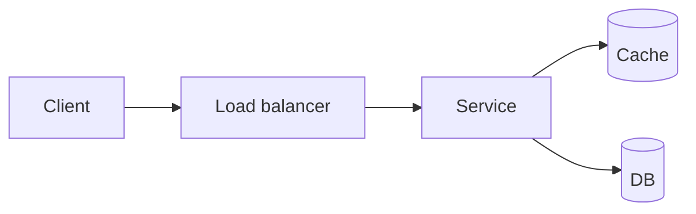

# My design: Real-time Leaderboard

> Date: YYYY-MM-DD · Attempt #1 · Time taken: __ min (target 45)
> Do this **before** opening the hints in README.md. Then compare, and write down what you missed at the bottom.

## 1. Requirements (5 min)
**Functional (top 3–4):**
-
**Non-functional (with numbers):** scale, latency p99, availability, consistency, durability
-
**Out of scope:**
-

## 2. Estimates (5 min)
| | Value | Working |
|---|---|---|
| DAU | | |
| Write QPS (avg / peak) | | |
| Read QPS (avg / peak) | | |
| Storage / year | | |
| Bandwidth | | |
| Cache memory | | |

## 3. API (3 min)
```http
POST /v1/...
GET  /v1/...
```

## 4. Data model + DB choice (5 min)
| Table / collection | Key | Fields | Why this DB |
|---|---|---|---|

## 5. High-level diagram (10 min)

Walk one write and one read through the diagram, step by step:
1.

## 6. Deep dives (15 min): pick the 2–3 the interviewer cares about
### Deep dive 1:
### Deep dive 2:

## 7. Bottlenecks, failures, trade-offs (2 min)
- Single points of failure:
- What happens when ____ goes down:
- Trade-off I chose and why:

---
## Review (after comparing with README hints)
- What I missed:
- What I'd say differently:
- Concepts to revise: (link the concept cards)
- Score myself (1–5): requirements _ · estimates _ · API/data _ · architecture _ · deep dives _ · communication _
