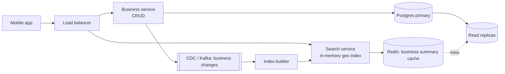

# 22 · Proximity Service (Yelp / nearby)

> **Level:** Medium · **Time box:** 45 min · **Asked at:** Swiggy, Zomato, Uber, Ola, Magicpin, Google Maps teams, Flipkart (Quick commerce store lookup)
> **Concepts used:** [H34 geospatial indexing](../../6-building-blocks/H34-geospatial/README.md) · [H02 estimation](../../1-basics/H02-back-of-envelope/README.md) · [H09 caching](../../2-scaling/H09-caching/README.md) · [H15 replication](../../3-databases/H15-replication/README.md) · [H33 search](../../6-building-blocks/H33-search-typeahead/README.md)
> **Visuals:** [geohash and quadtree](../../6-building-blocks/H34-geospatial/visual.html) · [replication](../../3-databases/H15-replication/visual.html)
> **Code it:** [geohash encode, decode, neighbours](../../6-building-blocks/H34-geospatial/lab-geohash/README.md)

## How to practise this

1. Set a 45-minute timer. Open [`my-design.md`](./my-design.md) and fill it in **without** looking below.
2. Then open each hint one at a time and compare. Write down what you missed in the Review section.
3. Do it again from memory on the repeat day in the plan. The second attempt is where it sticks.

## The prompt

"Design a service that returns businesses (restaurants, shops) near a user's location, within a given radius. Business owners can add and update their listings."

## Step 1: questions to ask

- How many businesses? How many searches per second?
- Radius options? Max results per page?
- Filters (category, open now, rating)? Ranking (distance only, or rating too)?
- How fast must a new or edited business appear in search?
- Do businesses move? (No. Moving objects like drivers are a different problem: see [10 ride hailing](../10-ride-hailing/README.md).)

<details><summary>Assumed answers</summary>

- 200M businesses worldwide, 100M DAU, 5 searches per user per day
- Radius 0.5, 1, 2, 5, 20 km. Up to 20 results per page
- Filter by category and "open now"; rank by distance, with rating as a tie-breaker
- Edits can take up to a few minutes to show (they happen rarely)
- Businesses don't move
</details>

## Step 2: estimates

<details><summary>Show the numbers</summary>

| | Calculation | Result |
|---|---|---|
| Search QPS | 100M × 5 / 86,400 | **~6k/s** avg, ~20k/s peak (lunch and dinner) |
| Write QPS | ~1M edits/day / 86,400 | **~12/s**, tiny |
| Business row | name, address, category, hours, rating, lat/lng ≈ 1 KB | 200M × 1 KB = **~200 GB** |
| Geo index entry | business id 8 B + geohash 8 B (+ lat/lng 16 B) | 200M × ~32 B ≈ **~6.4 GB**, fits in RAM on one machine |
| Read:write | 20k vs 12 | **> 1,000:1** |

Takeaway to say out loud: "It's extremely read-heavy and the geo index is small enough to keep in memory. So I'll build a **read-optimised geo index**, replicate it widely, and keep business details in a normal DB with a cache."
</details>

## Step 3: API

<details><summary>Show the API</summary>

```http
GET /v1/search/nearby?lat=12.9716&lng=77.5946&radius=2000&category=cafe&openNow=true&cursor=…
→ 200 { "results": [ { "id": "b_1", "name": "…", "distanceM": 340, "rating": 4.4 } ], "nextCursor": "…" }

GET    /v1/businesses/{id}
POST   /v1/businesses                 # owner; Idempotency-Key header
PATCH  /v1/businesses/{id}
DELETE /v1/businesses/{id}
```
Search returns only a small summary. The app calls `GET /businesses/{id}` for the detail page, which is easy to cache.
</details>

## Step 4: data model

<details><summary>Show the data model</summary>

| Table | Key | Fields | Store |
|---|---|---|---|
| `businesses` | `business_id` | name, address, lat, lng, category, hours, rating, owner_id, updated_at | Postgres (sharded by `business_id` if needed) + read replicas |
| `geo_index` | `(geohash6, business_id)` | lat, lng, category | In-memory index in the search service, or Redis `GEOADD`, or a Postgres table with an index on `geohash` |

**DB choice:** business data is relational, 200 GB, and rarely written. Postgres with read replicas is fine. The geo index is a derived structure, rebuilt from the businesses table. For filters + geo together, Elasticsearch's `geo_distance` query is a common production choice.
</details>

## Step 5: high-level design

<details><summary>Show the diagram</summary>


**Write:** owner edits a business → business service writes Postgres → CDC (e.g. Debezium) publishes the change to Kafka → the index builder updates the geo index on every search node (or each node consumes the topic itself). Delay: seconds to a minute.
**Read:** search service converts `(lat, lng, radius)` to a geohash precision → takes the user's cell + 8 neighbours → gets candidate ids from the in-memory index → filters by exact distance (haversine) and category → sorts by distance → fetches summaries from Redis (multi-get) → returns 20.
</details>

## Step 6: deep dives (the part that gets scored)

<details><summary>Deep dive 1: how to index locations</summary>

| Index | How it works | Pros | Cons |
|---|---|---|---|
| 2D range query on lat and lng | `WHERE lat BETWEEN … AND lng BETWEEN …` | Simple | Two separate indexes; DB intersects big sets; slow |
| **Geohash** | Encode lat/lng into a base32 string; nearby points share a prefix | A plain string index or Redis works; easy to shard by prefix | Edge problem: neighbours across a cell border have different prefixes, so always search the 8 neighbour cells too |
| **Quadtree** | Split a cell into 4 when it holds more than K (e.g. 100) businesses | Adapts to density: small cells in Bengaluru, huge ones in the desert | In-memory tree; build time at startup; harder to update online |
| S2 / H3 cells | Hierarchical cells on a sphere (Google S2: squares; Uber H3: hexagons) | Even cell sizes; covers a circle with a set of cell ids | More library code |

Geohash precision vs cell size: 4 chars ≈ 39 km × 20 km, 5 ≈ 4.9 km × 4.9 km, 6 ≈ 1.2 km × 0.6 km. Pick the precision whose cell is at least the radius, then search the cell + 8 neighbours.

Say: "Geohash. I pick the precision from the radius, search the user's cell and its 8 neighbours, then filter by exact distance. A quadtree is better if density is very uneven; I'd mention it as the alternative."
</details>

<details><summary>Deep dive 2: dense and sparse areas</summary>

- Koramangala at precision 6 may have 2,000 businesses; a village may have 0 within 5 km.
- Fix for sparse: if fewer than 20 results, widen the search (drop one geohash char = a 32× bigger cell) until you have enough or hit the max radius.
- Fix for dense: use a finer precision, or cap candidates per cell sorted by rating, then compute distances only for those.
- A quadtree solves both at build time, because each leaf has at most K businesses.
</details>

<details><summary>Deep dive 3: scaling the read path</summary>

- The whole geo index is ~6 GB, so **replicate it** to every search node. No sharding needed; each node can answer any query. Add nodes to add QPS.
- Shard only if you add heavy data (e.g. full text) to the index. Shard by region (geohash prefix), not by business id, so one query hits one shard.
- Cache by `(geohash6, category, radius)`: many users in the same area ask the same question. TTL a few minutes. Hit ratio is high at lunch time in a city.
- Business summaries: Redis cache in front of read replicas.

Say: "The index fits in memory, so every search node holds a full copy. I scale by adding replicas and caching results per cell."
</details>

<details><summary>Deep dive 4: filters and ranking</summary>

- Store `category` and `open hours` in the index entry, so filtering doesn't need a DB call per candidate.
- "Open now" depends on the business's local time zone and hours; precompute an hourly bitmap per business.
- Ranking beyond distance: `score = w1 × (1 / distance) + w2 × rating + w3 × popularity`. If ranking needs text relevance too ("biryani near me"), move to Elasticsearch with `geo_distance` + text query, and accept a bigger cluster.
</details>

## Follow-ups interviewers ask

1. How would you support moving objects (delivery partners)? (Location updates every 4 s go to an in-memory store keyed by geohash, e.g. Redis GEO; old entries expire. See [10 ride hailing](../10-ride-hailing/README.md).)
2. Search along a route, not a circle? (Cover the route polyline with a set of S2 or geohash cells and query those.)
3. How do you update the in-memory index without a restart? (Consume the CDC topic and apply upserts and deletes; rebuild nightly from a snapshot to fix drift.)
4. Multi-region? (Each region serves its own part of the world; business data is replicated where it's searched.)
5. Why not just use Postgres + PostGIS? (A fine answer for this size: a GiST index on a geography column. Say when you'd move off it: very high QPS or complex ranking.)

## Common mistakes

- Querying only the user's geohash cell and missing businesses just across the border.
- Computing the distance to all 200M businesses.
- Sharding the geo index by business id, so every query hits every shard.
- Treating businesses as moving objects and over-building a real-time location pipeline.
- Forgetting that the read:write ratio is over 1,000:1.
