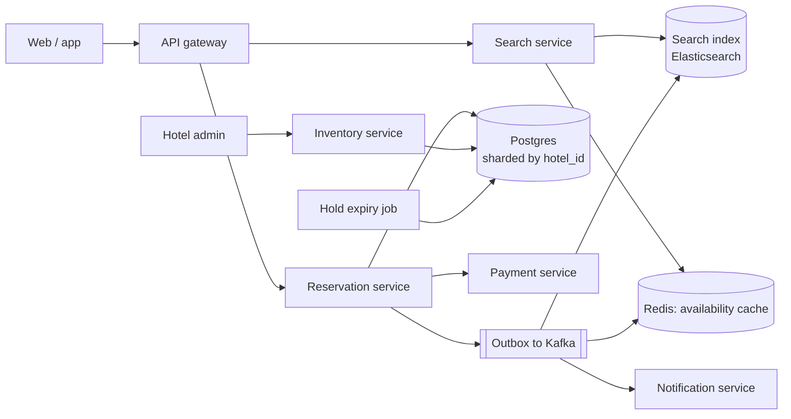

# 23 · Hotel Reservation

> **Level:** Medium · **Time box:** 45 min · **Asked at:** MakeMyTrip, OYO, Goibibo, Booking.com, Airbnb, Agoda, Cleartrip
> **Concepts used:** [H11 SQL, transactions and locking](../../3-databases/H11-indexing/README.md) · [H04 idempotency in APIs](../../1-basics/H04-api-design/README.md) · [H23 distributed transactions](../../4-async/H23-distributed-transactions/README.md) · [H09 caching](../../2-scaling/H09-caching/README.md) · [H33 search](../../6-building-blocks/H33-search-typeahead/README.md) · [H16 sharding](../../3-databases/H16-partitioning-sharding/README.md)
> **Visuals:** [isolation levels](../../3-databases/H12-transactions-isolation/visual.html) · [seat locking](../../../lld/5-machine-coding/L32-concurrency-in-node/visual.html) · [saga and outbox](../../4-async/H23-distributed-transactions/visual.html)
> **Related problem:** [09 ticket booking](../09-ticket-booking/README.md) (seats are unique items; hotel rooms are counted inventory per night)

## How to practise this

1. Set a 45-minute timer. Open [`my-design.md`](./my-design.md) and fill it in **without** looking below.
2. Then open each hint one at a time and compare. Write down what you missed in the Review section.
3. Do it again from memory on the repeat day in the plan. The second attempt is where it sticks.

## The prompt

"Design a hotel reservation system for a chain or a booking site. Users search hotels by city and dates, see prices, and book a room type. Hotels manage their inventory and prices."

## Step 1: questions to ask

- How many hotels and rooms? Bookings per day?
- Does the user book a **room type** (e.g. "Deluxe King") or a specific room number?
- Overbooking allowed? (Hotels often allow ~5–10%.)
- Payment at booking or at the hotel? Cancellation rules?
- Is search in scope, or only availability and booking?
- Do prices change per date (dynamic pricing)?

<details><summary>Assumed answers</summary>

- 50k hotels, 5M rooms total. ~1M bookings/day at peak season
- Book a **room type**; a room number is assigned at check-in
- No overbooking in the core design (configurable % as a follow-up)
- Pay online at booking; free cancellation until 24 h before check-in
- Search by city + dates is in scope; the full ranking engine is not
- Price per room type per night, set by the hotel
</details>

## Step 2: estimates

<details><summary>Show the numbers</summary>

| | Calculation | Result |
|---|---|---|
| Booking QPS | 1M / 86,400 | **~12/s** avg, ~100/s peak (sales) |
| Search QPS | look-to-book ratio ~100:1 | **~1.2k/s** avg, ~10k/s peak |
| Detail / availability QPS | ~10 per booking | ~120/s avg |
| Inventory rows | 50k hotels × ~20 room types × 365 nights | **~365M rows** for one year ahead |
| Row size | ids + date + total + reserved + price ≈ 50 B | 365M × 50 B ≈ **~18 GB** |
| Bookings per year | 1M × 365 × ~500 B | **~180 GB/year** |

Takeaway to say out loud: "Writes are small, about 100 per second at peak. The challenge is **no double-booking** under concurrency and keeping **search fast** with a cache. A relational DB with ACID transactions is the right core."
</details>

## Step 3: API

<details><summary>Show the API</summary>

```http
GET /v1/hotels/search?city=goa&checkIn=2026-12-24&checkOut=2026-12-27&guests=2&cursor=…
→ 200 { "hotels": [ { "hotelId", "name", "fromPrice", "available": true } ] }

GET /v1/hotels/{id}/availability?checkIn=…&checkOut=…
→ 200 { "roomTypes": [ { "roomTypeId", "name", "pricePerNight": [ … ], "left": 3 } ] }

POST /v1/reservations
Idempotency-Key: <uuid>                 # double-click on "Book" must not book twice
{ "hotelId", "roomTypeId", "checkIn", "checkOut", "guests", "rooms": 1 }
→ 201 { "reservationId": "r_1", "status": "PENDING_PAYMENT", "holdExpiresAt": "…" }

POST /v1/reservations/{id}/cancel

# Hotel side
PUT /v1/hotels/{id}/room-types/{rt}/inventory   { "date": "…", "total": 20, "price": 7500 }
```
</details>

## Step 4: data model

<details><summary>Show the data model</summary>

```sql
room_type_inventory (
  hotel_id, room_type_id, date,
  total_rooms   INT,
  reserved      INT,
  price         NUMERIC,
  version       INT,
  PRIMARY KEY (hotel_id, room_type_id, date),
  CHECK (reserved <= total_rooms)          -- the DB itself refuses an overbooking
)

reservations (
  reservation_id PK, idempotency_key UNIQUE,
  user_id, hotel_id, room_type_id, check_in, check_out, rooms,
  status,         -- PENDING_PAYMENT | CONFIRMED | CANCELLED | EXPIRED
  amount, created_at, hold_expires_at
)
```

**DB choice:** Postgres or MySQL. We need multi-row transactions (one booking touches one row per night), a `CHECK` constraint and a unique idempotency key. Shard by `hotel_id`: a booking never spans two hotels, so every transaction stays on one shard.
</details>

## Step 5: high-level design

<details><summary>Show the diagram</summary>


**Write (book):** check the idempotency key → in one transaction, for each night `UPDATE inventory SET reserved = reserved + 1 WHERE … AND reserved + 1 <= total_rooms` → insert the reservation as `PENDING_PAYMENT` with a 10-minute hold → write an outbox event → commit → redirect to payment. On payment success: `CONFIRMED`. On failure or timeout: the expiry job releases the rooms.
**Read (search):** Elasticsearch finds hotels in the city with filters → the availability cache (Redis, updated from outbox events) says which have rooms for those dates → show prices. The cache can be a little stale; the booking transaction is the final check.
</details>

## Step 6: deep dives (the part that gets scored)

<details><summary>Deep dive 1: preventing double-booking</summary>

Two users book the last Deluxe room for 24 Dec at the same moment.

| Approach | How | Pros | Cons |
|---|---|---|---|
| Read then write in app code | `SELECT reserved`; if < total, `UPDATE` | Simple | Race: both read 19/20, both write 20/20 |
| Pessimistic lock | `SELECT … FOR UPDATE` on each night's row, then update | Correct; easy to reason about | Holds locks; lock order matters (always lock nights in date order to avoid deadlocks) |
| **Atomic conditional update (recommended)** | `UPDATE … SET reserved = reserved + 1 WHERE reserved < total_rooms`; check that rows affected = number of nights; else roll back | One statement per night; no explicit locks held across app code | Must check the affected-row count |
| Optimistic (version column) | `UPDATE … WHERE version = :v`; retry on conflict | Good under low contention | Many retries during a flash sale |
| DB constraint as a safety net | `CHECK (reserved <= total_rooms)` | The DB refuses an overbooking even if app code has a bug | Not a design on its own |

Say: "One transaction per booking, a conditional update per night, and a CHECK constraint as a safety net. Whatever the app does, the database won't let `reserved` go above `total`."
</details>

<details><summary>Deep dive 2: idempotency and the payment flow</summary>

- The client sends an `Idempotency-Key`. A unique index on it means a retried request returns the **same** reservation instead of creating a second one.
- Hold then pay: rooms are held for 10 minutes in `PENDING_PAYMENT`. The payment service calls back with the result (webhook). The callback is idempotent too (keyed by `reservation_id`).
- Hold expiry: a job runs every minute: `status = PENDING_PAYMENT AND hold_expires_at < now()` → set `EXPIRED`, decrement `reserved`. Do both in one transaction.
- Payment succeeded after the hold expired? Re-try the inventory update. If rooms are gone, refund automatically. This is a saga with a compensation step.

Say: "Hold, pay, confirm. Each step is idempotent, the hold has a timeout, and a late payment either confirms or triggers an automatic refund."
</details>

<details><summary>Deep dive 3: fast search with a cache</summary>

- Search reads 100× more than bookings write. Don't run inventory queries on the primary for every search.
- Keep a Redis structure per `(hotel, room_type, date) → left`. Update it from outbox events after each commit.
- Search shows "available" from the cache. It's allowed to be slightly stale. The booking transaction is the source of truth; if it fails, show "just sold out" and suggest other rooms.
- Cache search results per `(city, dates, guests)` for 1–5 minutes during big sales.
</details>

<details><summary>Deep dive 4: overbooking, channel managers and scale</summary>

- **Overbooking**: hotels expect some no-shows. Store `overbook_pct` per room type and check `reserved < total × (1 + pct)`.
- **Channel managers**: the same room is sold on many sites (MakeMyTrip, Booking.com, the hotel's own site). Inventory sync is through a channel manager. Expect a small chance of conflicts and keep a manual resolution flow.
- **Hot hotel**: a New Year's Eve sale on one resort means hot rows. The conditional update serialises on the row; at ~100 bookings/s for one room type that's still fine for Postgres. For extreme flash sales, put a queue in front and process bookings per room type in order.
</details>

## Follow-ups interviewers ask

1. Specific room numbers instead of room types? (Then it's like [09 ticket booking](../09-ticket-booking/README.md): a row per room per night, and lock the specific row.)
2. Why not NoSQL? (Bookings need a multi-row atomic update across nights and a constraint. Possible with DynamoDB transactions, but SQL is the natural fit at ~100 writes/s.)
3. A user books 3 rooms for 4 nights. (12 conditional updates in one transaction, in a fixed order; all succeed or the whole thing rolls back.)
4. How do you handle price changes between search and booking? (Quote a price with an expiry in the hold; charge the quoted price if the hold is still valid.)
5. Multi-region? (Shard by hotel; each hotel's home region owns its writes. Reads and search can be served from replicas everywhere.)

## Common mistakes

- Read-then-write in app code with no lock or condition.
- A distributed lock in Redis as the only protection, with no DB constraint.
- No hold expiry, so abandoned checkouts block rooms forever.
- Using the cache as the source of truth for availability.
- Forgetting idempotency on the "Book" button.
