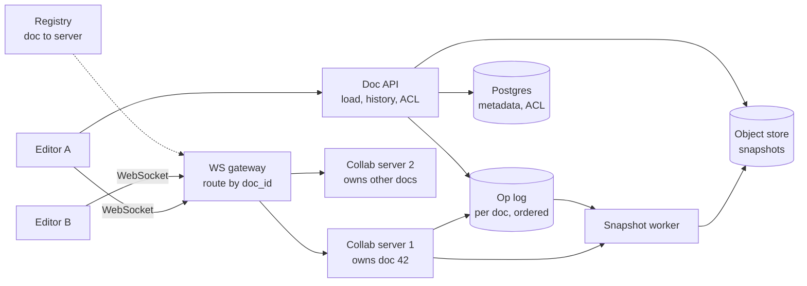

# 25 · Collaborative Editor (Google Docs)

> **Level:** Hard · **Time box:** 45 min · **Asked at:** Atlassian (Confluence), Google, Microsoft, Notion, Zoho, Freshworks
> **Concepts used:** [H05 real-time: WebSockets](../../1-basics/H05-realtime-communication/README.md) · [H24 event sourcing](../../4-async/H24-event-driven-cqrs/README.md) · [H18 consistency models](../../3-databases/H18-cap-pacelc-consistency/README.md) · [H17 consistent hashing](../../3-databases/H17-consistent-hashing/README.md) · [H32 blob storage](../../6-building-blocks/H32-blob-storage/README.md) · [H08 load balancing](../../2-scaling/H08-load-balancing/README.md)
> **Visuals:** [polling, SSE and WebSockets](../../1-basics/H05-realtime-communication/visual.html) · [consistent hashing](../../3-databases/H17-consistent-hashing/visual.html)
> **Code it:** LLD: [text editor (undo/redo)](../../../lld/problems/22-text-editor/README.md)

## How to practise this

1. Set a 45-minute timer. Open [`my-design.md`](./my-design.md) and fill it in **without** looking below.
2. Then open each hint one at a time and compare. Write down what you missed in the Review section.
3. Do it again from memory on the repeat day in the plan. The second attempt is where it sticks.

## The prompt

"Design a collaborative document editor like Google Docs. Many people edit the same document at the same time and see each other's changes and cursors live. The document must never lose an edit."

## Step 1: questions to ask

- How many documents and concurrent editors per document?
- Rich text (bold, tables, images) or plain text?
- Offline editing? How long can a user stay offline?
- Version history? Comments? Permissions (view / comment / edit)?
- Latency: how fast must others see my keystroke?
- Must every user end with exactly the same document? (Yes: that's the core requirement, called convergence.)

<details><summary>Assumed answers</summary>

- 1B documents, 10M DAU, ~1M documents open at peak. Usually 1–5 editors per document; max 100 editors, more can view
- Rich text, but design the core on plain text first
- Offline for short periods (minutes to hours) must work
- Version history yes; comments and permissions yes but not the focus
- Remote edits visible in < 200 ms in the same region
- Convergence is required: all copies end up identical
</details>

## Step 2: estimates

<details><summary>Show the numbers</summary>

| | Calculation | Result |
|---|---|---|
| Active editors at peak | ~1M open docs × ~1.5 editors | **~1.5M WebSocket connections** |
| Ops per second | each active typist ~3 ops/s (batched keystrokes), ~30% typing at a moment | 1.5M × 0.3 × 3 ≈ **~1.4M ops/s** |
| Op size | type, position, chars, doc version, user ≈ 100 B | 1.4M × 100 B ≈ **~140 MB/s** of op log |
| Op log per day | assume ~1/4 of peak on average: ~350k ops/s × 86,400 × 100 B | **~3 TB/day**, so compact it into snapshots |
| Document size | avg ~100 KB (text + formatting) | 1B × 100 KB = **~100 TB** of snapshots |
| Connections per server | ~50k WebSockets per node | **~30 collab servers**, plus headroom |

Takeaway to say out loud: "Each document is small and has few editors, so it can be **owned by one server**. The real problem is **merging concurrent edits so every copy converges**. That's OT or CRDT."
</details>

## Step 3: API

<details><summary>Show the API</summary>

```http
GET  /v1/docs/{id}                      # snapshot + current revision
→ 200 { "rev": 1842, "content": …, "permissions": "edit" }

GET  /v1/docs/{id}/history?cursor=…
POST /v1/docs/{id}/versions             # named version

WS   /v1/docs/{id}/collab               # sticky to the document's owner server
→ client sends:  { "type": "op", "baseRev": 1842, "clientSeq": 17, "ops": [ { "insert": "Hi", "at": 120 } ] }
← server sends:  { "type": "ack", "clientSeq": 17, "rev": 1843 }
← server sends:  { "type": "op", "rev": 1844, "userId": "u_2", "ops": [ … ] }
← server sends:  { "type": "presence", "userId": "u_2", "cursor": 98 }
```
`clientSeq` lets the server dedupe a resent op after a reconnect. `baseRev` tells the server which version the client's edit was made on.
</details>

## Step 4: data model

<details><summary>Show the data model</summary>

| Data | Key | Store | Why |
|---|---|---|---|
| Doc metadata | `doc_id` | Postgres | Owner, title, ACLs; relational |
| Op log | `(doc_id, rev)` | Cassandra / Bigtable, or Postgres partitioned by doc | Append-only, read in order per doc; the source of truth (event sourcing) |
| Snapshots | `(doc_id, rev)` | S3 / object store | Full document every ~1,000 ops, so loading doesn't replay the whole history |
| Presence (cursors) | `doc_id` | Collab server memory only | Ephemeral; losing it is fine |
| Doc → server map | `doc_id` | Consistent hashing over collab servers, or etcd | Route all editors of one doc to one server |

**Load a document:** latest snapshot + ops after its revision. **Version history:** any old revision = nearest snapshot + replay.
</details>

## Step 5: high-level design

<details><summary>Show the diagram</summary>


**Write (an edit):** A types "Hi" → the client applies it locally right away (optimistic) and sends `{op, baseRev}` → the gateway routes to the doc's owner server → the server transforms the op against any ops committed after `baseRev` (OT), assigns the next revision, appends to the op log, acks A, and broadcasts the transformed op to B → B transforms it against its own pending ops and applies it.
**Read (open a doc):** the API checks the ACL, returns the latest snapshot + the ops since → the client opens a WebSocket to the doc's owner server and gets live ops from that revision.
</details>

## Step 6: deep dives (the part that gets scored)

<details><summary>Deep dive 1: OT vs CRDT (the main question)</summary>

Text is "abc". A inserts "X" at 0. B deletes the char at 2 ("c"), at the same time. If B applies A's op as-is, fine. But if A applies B's "delete at 2" after inserting X, it deletes "b". The copies **diverge**. Both OT and CRDT fix this.

| | OT (Operational Transformation) | CRDT (Conflict-free Replicated Data Type) |
|---|---|---|
| Idea | Ops use positions. Before applying a concurrent op, **transform** it against ops already applied (B's delete at 2 becomes delete at 3) | Every character gets a unique, ordered id (e.g. `(counter, siteId)`). Ops refer to ids, not positions, so they commute |
| Needs a server? | In practice yes: a central server orders ops (the Jupiter / Google Wave model) | No: peers can merge in any order (good for offline and P2P) |
| Offline | Hard after long offline periods; many ops to transform | Natural; merge when you reconnect |
| Memory | Document is just the text | Metadata per character; deleted chars stay as tombstones (modern ones like Yjs, Automerge compress this well) |
| Correctness | Transform functions are hard to get right for rich text | Convergence follows from the math; intent can still be surprising (interleaving) |
| Used by | Google Docs, Etherpad, older Office Online | Figma (a CRDT-inspired model with a server), Notion-like apps via Yjs, Apple Notes, Zed |

Say: "With a central server per document, OT is proven and memory-light; that's Google Docs. If offline-first or peer-to-peer matters, I'd use a CRDT like Yjs. For this prompt, with a server and short offline periods, I'd pick OT with a single owner per document, and mention CRDT as the offline option."
</details>

<details><summary>Deep dive 2: one owner server per document</summary>

- OT needs one place that decides the order of ops. Route all editors of a doc to **one collab server**, using consistent hashing on `doc_id` or a registry in etcd.
- The server keeps the doc's recent ops in memory, so transforms are fast.
- Server dies: the registry gives the doc to another server; it loads snapshot + op log and continues. Clients reconnect and resend unacked ops (deduped by `clientSeq`).
- Hot doc (company all-hands notes, 100 editors + 5,000 viewers): editors on the owner; viewers get ops via a fan-out tier (pub/sub), not from the owner directly.

Say: "One owner per doc gives a single order of ops. Failover is rebuild-from-log, and clients resend unacked ops idempotently."
</details>

<details><summary>Deep dive 3: storing ops, snapshots and history</summary>

| Approach | Load time | Storage | History |
|---|---|---|---|
| Save whole doc on every change | fast | huge write amplification | only snapshots |
| Op log only | slow (replay all ops) | small writes | perfect |
| **Op log + periodic snapshots (recommended)** | snapshot + few ops | moderate | any revision |

- Write the op to the log **before** the ack. Durability = the log.
- Snapshot every ~1,000 ops or ~1 minute idle. Old ops can be compacted into coarser history after 30 days.
- This is event sourcing: the log is the truth; snapshots are a cache.
</details>

<details><summary>Deep dive 4: latency, presence and offline</summary>

- **Optimistic local apply**: your own typing never waits for the network. Only remote ops take ~100–200 ms.
- **Batch keystrokes**: send every ~50 ms, not every key. Fewer ops to transform.
- **Presence** (cursors, selections, "who's here"): send at most every ~100 ms, never store it, and drop it if the connection is slow. It is not part of the document.
- **Offline**: the client queues ops locally (IndexedDB). On reconnect it sends them with the old `baseRev`; the server transforms them against everything that happened since. Very long offline periods are where CRDTs are easier.
</details>

<details><summary>Deep dive 5: permissions and comments</summary>

- Check the ACL when the WebSocket opens and again on each op type (a commenter can't send text ops). Permission change → the server closes or downgrades the socket.
- Comments are anchored to a text range. Store them separately; the anchor moves with edits (transform the range like a cursor).
</details>

## Follow-ups interviewers ask

1. Why not last-write-wins on the whole document? (Two people typing in different paragraphs would overwrite each other's work.)
2. Why not lock paragraphs? (It works for some tools, e.g. old wikis, but it kills the live typing experience.)
3. How does undo work with others editing? (Undo only *your* ops: invert your op and transform it against the later ops from others.)
4. How do you scale WebSocket gateways? (Stateless gateways with sticky routing by doc id; the collab servers hold the state.)
5. How do you test OT correctness? (Property-based tests: random concurrent ops on many simulated clients must converge.)

## Common mistakes

- Using last-write-wins and calling it collaborative.
- Sending every keystroke as an HTTP request.
- Storing only full snapshots, or only the op log with no snapshots.
- Not saying where ops get their order (no single owner, no ids).
- Treating cursor presence as durable data.
