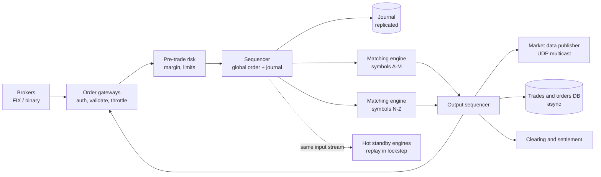

# 26 · Stock Exchange / Order Matching

> **Level:** Hard · **Time box:** 45 min · **Asked at:** Zerodha, Groww, Upstox, Dhan, CoinDCX, WazirX, trading firms (Tower, Graviton), Coinbase
> **Concepts used:** [H29 consensus and replication of state](../../5-reliability/H29-consensus-locks/README.md) · [H24 event sourcing](../../4-async/H24-event-driven-cqrs/README.md) · [H22 idempotency](../../4-async/H22-delivery-semantics/README.md) · [H38 payments and ledgers](../../6-building-blocks/H38-payments-domain/README.md) · [H16 partitioning](../../3-databases/H16-partitioning-sharding/README.md) · [H05 real-time](../../1-basics/H05-realtime-communication/README.md)
> **Visuals:** [Raft leader election](../../5-reliability/H29-consensus-locks/visual.html) · [replication](../../3-databases/H15-replication/visual.html)
> **Related problem:** [28 digital wallet](../28-digital-wallet/README.md) (the ledger side)

## How to practise this

1. Set a 45-minute timer. Open [`my-design.md`](./my-design.md) and fill it in **without** looking below.
2. Then open each hint one at a time and compare. Write down what you missed in the Review section.
3. Do it again from memory on the repeat day in the plan. The second attempt is where it sticks.

## The prompt

"Design a stock exchange. Brokers send buy and sell orders for stocks. The exchange matches them, reports trades, and publishes live market data. It must be fast, fair and never lose an order."

> **Note:** some interviews mean the **broker** side (like Zerodha: users place orders, the broker forwards them to NSE/BSE). Ask which one. This page designs the exchange; the broker variant is a follow-up.

## Step 1: questions to ask

- How many symbols? Orders per second at peak?
- Order types: limit and market only, or stop-loss, IOC, etc.?
- Latency target for an order to be matched and acknowledged?
- Fairness: is strict price-time priority required?
- Who are the clients: brokers over a binary protocol (like FIX), or end users?
- Do we do risk checks and settlement, or only matching?

<details><summary>Assumed answers</summary>

- 5,000 symbols. Peak 1M order messages/s (new, cancel, modify), in bursts at market open
- Limit and market orders, plus cancel. IOC as a follow-up
- p99 order-to-ack **< 1 ms** inside the exchange (real exchanges aim for tens of microseconds)
- Strict **price-time priority**: best price first; at the same price, first come first served
- Brokers connect over a binary protocol (FIX or a native one)
- Basic pre-trade risk checks (does the broker have margin?) yes. Clearing and settlement (T+1) happen downstream, out of scope
</details>

## Step 2: estimates

<details><summary>Show the numbers</summary>

| | Calculation | Result |
|---|---|---|
| Peak order rate | given | **1M msgs/s** |
| Per symbol | heavily skewed: top 50 symbols get ~50% | busiest symbol ~**50k msgs/s** |
| Trades | ~10% of orders result in a trade | ~100k trades/s peak |
| Message size | ~100 B | 1M × 100 B = **~100 MB/s** into the journal |
| Journal per day | trading day ~6.25 h; avg ~200k/s × 22,500 s × 100 B | **~450 GB/day** |
| Order book memory | ~10k live orders per symbol × 5,000 × ~100 B | **~5 GB**, all in RAM |
| Market data out | 1M updates/s to ~1,000 broker connections | multicast, not 1,000 unicast copies |

Takeaway to say out loud: "The data is small and fits in memory. The hard part is **deterministic, single-threaded matching per symbol** at microsecond latency, with a **sequenced journal** so we can replay it exactly after a crash."
</details>

## Step 3: API

<details><summary>Show the API</summary>

```text
# Broker → exchange (binary / FIX over TCP, persistent session)
NewOrder     { clOrdId, brokerId, account, symbol, side: BUY|SELL, type: LIMIT|MARKET, price, qty, tif: DAY|IOC }
CancelOrder  { clOrdId, origClOrdId, symbol }
ModifyOrder  { clOrdId, origClOrdId, price, qty }

# Exchange → broker
ExecReport   { clOrdId, orderId, status: ACK|PARTIAL|FILLED|CANCELLED|REJECTED, fillQty, fillPrice, seq }

# Market data (UDP multicast, with a TCP replay service for gaps)
L1 { symbol, bestBid, bestAsk, lastPrice, seq }
L2 { symbol, levels: [ { price, qty } × 5 ], seq }
Trade { symbol, price, qty, tradeId, seq }
```
`clOrdId` is unique per broker session. The exchange drops a duplicate `clOrdId`, which makes resends after a reconnect safe.
</details>

## Step 4: data model

<details><summary>Show the data model</summary>

**Order book (in memory, per symbol):**
- Bids: price levels sorted high → low. Asks: low → high. Each level is a **FIFO queue** of orders (time priority).
- A hash map `orderId → node in its level's list`, so cancel is O(1).
- Price levels in a sorted map (tree), or an array indexed by tick if the price range is bounded (faster).

**Journal (on disk):** the ordered, sequenced log of every input message. This is the source of truth. The order book is just the result of replaying it.

| Store | Data | Why |
|---|---|---|
| Sequenced journal | every input with a global seq number | Replay = exact rebuild; audit |
| Order book | in RAM in the matching engine | microsecond access |
| Trades + order history | Postgres/columnar, written asynchronously from the journal | Reports, regulators, broker queries |
| Risk / margin | in-memory per broker, backed by DB | pre-trade checks without a DB hit |

**Why no DB in the hot path?** A DB write is 100s of µs to ms. The journal is a sequential append (or a replicated in-memory log), and everything else is built from it later.
</details>

## Step 5: high-level design

<details><summary>Show the diagram</summary>


**Write (an order):** the gateway authenticates the broker session, checks the message and rate limit → risk checks the broker's margin (in memory) → the **sequencer** gives it the next sequence number and appends it to the replicated journal → the matching engine that owns the symbol processes inputs in sequence order: match against the opposite side at the best price, then queue any leftover quantity in the book → executions go out to the broker (ExecReport) and to market data.
**Read (market data):** after each event, the engine emits book changes and trades with a sequence number. The publisher sends them over UDP multicast to all brokers. A broker that sees a gap in seq numbers asks the replay service (TCP) for the missing messages.
</details>

## Step 6: deep dives (the part that gets scored)

<details><summary>Deep dive 1: the matching engine</summary>

Price-time priority with a limit order to BUY 100 @ ₹500:
1. Look at the best ask. If best ask ≤ 500, match against the **oldest** order at that level, fill `min(qty)`, emit a trade.
2. Repeat until the order is filled or best ask > 500.
3. Put any leftover quantity on the bid side at 500, at the **back** of the queue.

| Design choice | Why |
|---|---|
| **Single thread per symbol (or per group of symbols)** | No locks; the order of processing is the input order; deterministic |
| All in memory, no I/O on the hot path | Microsecond latency |
| Pre-allocated objects, no GC pauses (e.g. object pools in Java, or C++/Rust) | GC pauses break latency targets |
| Busy-spin threads pinned to CPU cores; lock-free ring buffers between stages (the LMAX Disruptor pattern) | Avoid context switches and queue locks |

Say: "One thread owns each symbol's book. It reads a sequenced stream, so its output is deterministic. No locks, no DB, no GC in the hot path."
</details>

<details><summary>Deep dive 2: the sequencer and determinism</summary>

- The sequencer gives every input a **global, gap-free sequence number** and writes it to the journal before the engine acts on it.
- Because the matching engine is deterministic (same inputs in the same order → same outputs), **replaying the journal rebuilds the exact state**. No need to persist the book itself.
- Fairness: orders are ordered by when they reached the sequencer, not by which gateway thread was faster.
- The journal is replicated (e.g. to 2 other machines, or with a Raft-style protocol) before the order is acknowledged, so one machine failure loses nothing.

Say: "The sequencer is the single source of order. Matching is a pure function of the journal. That gives fairness, durability and a simple recovery: replay."
</details>

<details><summary>Deep dive 3: high availability without losing microseconds</summary>

| Approach | Failover time | Cost |
|---|---|---|
| Restart and replay from journal | seconds to minutes | trading halts while replaying |
| Snapshot + replay since snapshot | seconds | snapshots must not stall the engine (take them on the standby) |
| **Hot standby in lockstep (recommended)** | sub-second | 2× hardware; standby consumes the same sequenced stream and computes the same state |

- The primary and standby process the same input stream. Only the primary sends outputs. If the primary dies, the standby is already at the same seq, so it takes over.
- Leader election for the sequencer itself: Raft or a simple primary/backup with a fencing mechanism. Two active sequencers would break fairness.
</details>

<details><summary>Deep dive 4: market data fan-out</summary>

- 1M updates/s to 1,000 subscribers is 1B msgs/s with unicast. Use **UDP multicast**: send once, the network copies.
- Every message has a seq number. Brokers detect gaps and recover from a TCP replay service or a snapshot channel.
- Levels: L1 (best bid/ask), L2 (top N levels), L3 (every order). Most retail apps use L1/L2.
- A broker like Zerodha then fans this out to millions of app users over WebSockets, with throttling (e.g. one update per symbol per 100–500 ms) because a phone can't render 50k updates/s.
</details>

<details><summary>Deep dive 5: risk checks and money</summary>

- Pre-trade risk must be in memory (per-broker margin, position limits, price bands such as circuit limits). A DB call here would cost more than the whole match.
- After a trade, positions and money move in a **ledger** downstream (clearing). That is a normal double-entry system and doesn't need microseconds; see [28 digital wallet](../28-digital-wallet/README.md).
- Kill switch: a broker or the exchange can cancel all open orders for an account instantly.
</details>

## Follow-ups interviewers ask

1. Design the **broker** (Zerodha) instead. (Order management system: user → validate + margin check against the user's ledger → route to the exchange → track order state from ExecReports → push updates over WebSocket. The broker's scale problem is millions of users and market-data fan-out, not microsecond matching.)
2. How do you shard? (By symbol. A single symbol is never split, because one book must have one order.)
3. Why not a DB with row locks per order? (Latency in ms, non-deterministic interleaving, and no replay.)
4. A market order with no liquidity? (Match what's available; cancel the rest, or reject if there is a price-protection band.)
5. Market open burst? (Pre-open call auction: collect orders for a few minutes, compute a single equilibrium price, then start continuous matching.)

## Common mistakes

- Putting a database or Kafka round-trip inside the matching loop.
- Multi-threaded matching on one book with locks.
- No sequencer, so ordering (and fairness) depends on network timing.
- Persisting the order book instead of the inputs.
- Unicasting market data to every subscriber.
