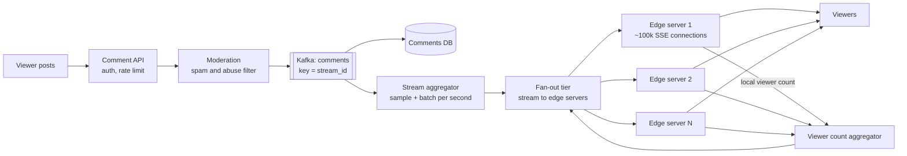

# 27 · Live Comments and Viewer Count

> **Level:** Medium · **Time box:** 45 min · **Asked at:** JioHotstar, ShareChat, Moj, Dream11, Swiggy (live order tracking variant), Meta
> **Concepts used:** [H05 real-time: SSE and WebSockets](../../1-basics/H05-realtime-communication/README.md) · [H20 message queues and pub/sub](../../4-async/H20-message-queues/README.md) · [H35 HyperLogLog](../../6-building-blocks/H35-probabilistic-ds/README.md) · [H37 hot keys and counters](../../6-building-blocks/H37-data-at-scale/README.md) · [H26 rate limiting](../../5-reliability/H26-rate-limiting/README.md) · [H08 load balancing](../../2-scaling/H08-load-balancing/README.md)
> **Visuals:** [polling, SSE and WebSockets](../../1-basics/H05-realtime-communication/visual.html) · [observer and pub-sub](../../../lld/4-behavioral/L21-observer/visual.html) · [rate limiting](../../5-reliability/H26-rate-limiting/visual.html)
> **Related problems:** [06 chat system](../06-chat-system/README.md) · [21 leaderboard](../21-leaderboard/README.md)

## How to practise this

1. Set a 45-minute timer. Open [`my-design.md`](./my-design.md) and fill it in **without** looking below.
2. Then open each hint one at a time and compare. Write down what you missed in the Review section.
3. Do it again from memory on the repeat day in the plan. The second attempt is where it sticks.

## The prompt

"Users watch a live stream (an IPL match or a creator's live video). They can post comments that all other viewers see within a second or two. The page also shows a live viewer count."

## Step 1: questions to ask

- How many concurrent viewers on the biggest stream? How many live streams at once?
- Comments per second on the biggest stream?
- Must every viewer see every comment? (On a big stream, nobody can read 5,000 comments per second.)
- Order: must everyone see comments in the same order?
- Viewer count: exact or approximate? How fresh?
- Moderation? Replies and reactions?

<details><summary>Assumed answers</summary>

- Biggest stream: **25M concurrent viewers** (an India final). ~10k live streams at once, most with < 1k viewers
- Big stream: ~10k comments/s posted
- No: on big streams each viewer sees a **sample** (~10–20 comments/s). On small streams, everyone sees all comments
- Roughly by time is fine; no strict global order
- Viewer count: approximate, updated every ~5 s
- Basic moderation (spam/abuse filter) yes; replies out of scope; reactions (hearts) as a follow-up
</details>

## Step 2: estimates

<details><summary>Show the numbers</summary>

| | Calculation | Result |
|---|---|---|
| Open connections | 25M on one stream + others | **~30M persistent connections** |
| Connection servers | ~100k connections per tuned server (mostly idle sockets) | **~300 edge servers** |
| Comment writes | biggest stream | **~10k/s**, ~50k/s across all streams |
| Naive fan-out | 10k/s × 25M viewers | **250B deliveries/s**: impossible, so we must sample |
| Sampled fan-out | 20 comments/s × 25M | **500M deliveries/s**; batch them: 1 push per second with ~20 comments = **25M pushes/s** across 300 servers ≈ 83k/s per server |
| Comment storage | 50k/s × 200 B × 86,400 | **~860 GB/day** (keep 30 days for replays) |
| Viewer heartbeats | 30M every 30 s | **1M/s**, so count at the edge, not centrally |

Takeaway to say out loud: "Writes are easy. The problem is **fan-out to 25M open connections**. So: sample and batch comments per stream, push through a tree of servers, and count viewers at the edge."
</details>

## Step 3: API

<details><summary>Show the API</summary>

```http
POST /v1/streams/{streamId}/comments
Idempotency-Key: <uuid>
{ "text": "What a six!" }
→ 202 { "commentId": "c_1" }        # 202: accepted; it shows up via the live channel

GET /v1/streams/{streamId}/comments?before=<cursor>&limit=50    # history / replay

# Live channel (one per viewer)
GET /v1/streams/{streamId}/live     (SSE)    or    WS /v1/streams/{streamId}/live
← event: comments   data: { "items": [ { "id", "user", "text", "ts" } × ~20 ] }   # once per second
← event: viewers    data: { "count": 24813211 }                                  # every ~5 s
```
**SSE vs WebSocket:** viewers mostly receive; they post rarely. SSE (one-way, over normal HTTP, auto-reconnect) plus a normal POST for posting is enough and is simpler to run behind CDNs and load balancers. WebSockets are fine too, especially if the app already uses them.
</details>

## Step 4: data model

<details><summary>Show the data model</summary>

| Data | Key | Store | Why |
|---|---|---|---|
| Comments | `(stream_id, ts_bucket)` → `comment_id` | Cassandra / DynamoDB | Append-heavy, read by stream + time |
| Live channel | topic per stream | Redis pub/sub or Kafka (per-stream key) → fan-out tier | Push new comments to edge servers |
| Subscription map | `stream_id → set of edge servers` | In memory at the fan-out tier, or Redis | Send each batch only to servers that have viewers of that stream |
| Viewer count | `stream_id` | Each edge server counts locally; an aggregator sums | No central hot key |
| Moderation state | `user_id` | Redis | Muted/banned users; rate limits |

**DB choice:** comments are write-once and read by stream and time window. A wide-column store fits. Most viewers never read history; they only see the live push.
</details>

## Step 5: high-level design

<details><summary>Show the diagram</summary>


**Write:** a viewer posts → the comment API checks auth and a per-user rate limit → moderation filter → Kafka keyed by `stream_id` → stored in the comments DB → the aggregator for that stream collects comments for 1 second, picks a sample (e.g. friends' comments, verified users, then random), and emits one batch.
**Read:** the batch goes to the fan-out tier → it sends one copy to each edge server that has viewers of that stream → each edge server writes the batch to all its local connections for that stream. Viewer count: each edge server knows how many connections it holds per stream, reports every 5 s, the aggregator sums them and sends the total down the same path.
</details>

## Step 6: deep dives (the part that gets scored)

<details><summary>Deep dive 1: fan-out to 25M viewers</summary>

| Approach | How | Breaks when |
|---|---|---|
| Clients poll every 2 s | `GET /comments?since=` | 25M / 2 s = 12.5M req/s; most return nothing new |
| Every edge server subscribes to every stream | Redis pub/sub broadcast | 300 servers × 10k streams of mostly useless traffic |
| **Subscription-aware fan-out tree (recommended)** | Edge servers subscribe only to streams their viewers watch; the fan-out tier sends each batch once per edge server | Needs a subscription registry; a big stream is on every edge server (that's fine: 1 msg per server per second) |

- Group connections on the same edge server by stream (the load balancer can route by `stream_id` for small streams, so they're on few servers).
- Each batch is serialised **once** per server and written to many sockets.
- Slow clients: a bounded buffer per connection; if it's full, drop old batches. Never let one slow phone block a server.

Say: "Push, not poll. One batch per stream per second, sent once to each edge server that has viewers, and then written to local sockets. Fan-out cost is per server, not per viewer."
</details>

<details><summary>Deep dive 2: sampling comments on huge streams</summary>

- Humans can read maybe 5–10 comments a second. Showing all 10k/s is useless and expensive.
- Per stream, per second: keep everything in the DB, but **send** a sample: the viewer's own comments (always, added on the client side), friends' comments, creators/verified, highly-liked, then random.
- Small streams (< ~1k comments/min): no sampling, send all.
- Personalisation (friends' comments) can be done at the edge server: the batch contains a larger candidate set; the edge picks per user. Or keep it simple and only sample globally.

Say: "Store all comments, but deliver a sample of ~20 per second on huge streams. The poster always sees their own comment right away, added locally."
</details>

<details><summary>Deep dive 3: the viewer count</summary>

| Approach | How | Trade-off |
|---|---|---|
| `INCR`/`DECR` on one Redis key | per join/leave | One hot key at 1M ops/s; drift when a client disappears without "leave" |
| **Count at the edge (recommended)** | Each edge server knows its open connections per stream; sends counts every 5 s; aggregator sums | No hot key; self-correcting, because a dead connection disappears from the count |
| HyperLogLog of user ids | `PFADD` per heartbeat | Unique viewers (not concurrent); ~0.8% error with 12 KB per key; good for "total unique viewers today" |

- "Concurrent viewers" = live connections. "Unique viewers" = HLL. Ask which one the product means.
- Show a rounded number ("24.8M watching"), so small errors don't matter.
</details>

<details><summary>Deep dive 4: abuse, spam and rate limits</summary>

- Per-user token bucket (e.g. 1 comment per 2 s on big streams; "slow mode").
- A fast filter in the write path (blocked words, links, repeated text) and an async ML check that can remove a comment after it's sent.
- Shadow-ban: a banned user still sees their own comments, but nobody else gets them.
- Creator moderation tools: delete, mute user. A delete is sent down the same live channel as a "remove id" event.
</details>

<details><summary>Deep dive 5: reconnects and the thundering herd</summary>

- A wicket falls, 25M phones wake up, or an edge server dies and 100k clients reconnect at once.
- Clients reconnect with **exponential backoff + jitter**. SSE sends `Last-Event-ID`; the server replays the last few batches from a small in-memory buffer.
- Edge servers are stateless apart from connections, so the load balancer spreads reconnects; autoscale before a known big match.
- Pre-warm: for scheduled big events, scale the edge fleet up in advance.
</details>

## Follow-ups interviewers ask

1. Reactions (hearts) at 1M/s? (Aggregate at the edge: each server sums hearts per stream per second; send only counts. The animation is client-side.)
2. Comments synced with the video timeline for replays? (Store the stream offset with each comment; on replay, the client fetches comments for the current time window.)
3. Why Kafka and not only Redis pub/sub? (Kafka keeps comments durable and replayable for storage and moderation. Redis pub/sub is fire-and-forget; fine for the live fan-out hop.)
4. Multi-region? (Comments go to a home region per stream; batches are replicated to edge servers in every region. Viewers far away see comments ~100–200 ms later, which is fine.)
5. How is this different from [06 chat system](../06-chat-system/README.md)? (Chat: every message to every member, with order and delivery receipts. Live comments: lossy, sampled, one-to-millions.)

## Common mistakes

- Promising every comment to every viewer at 10k comments/s.
- Polling.
- One Redis counter for the viewer count.
- One pub/sub message per viewer instead of per edge server.
- Ignoring reconnect storms after a spike or a server crash.
