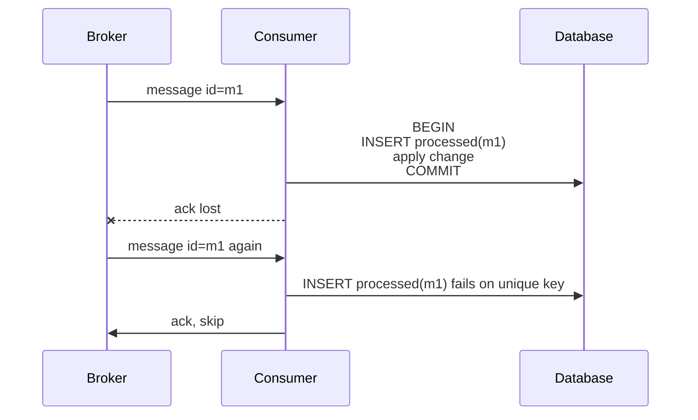

# 19 · Idempotency and Delivery Semantics

> **Read time:** 35 min · **Visual:** [v11 delivery semantics](../../visuals/v11-delivery-semantics.html) · **Code it:** [lld/problems/19-payment-wallet](../../lld/problems/19-payment-wallet/README.md) (ledger + idempotency)
> **Shows up in:** payment system, digital wallet, notification system, any queue consumer, any retried API call

## The idea in one line

Networks lose messages and acknowledgements, so you cannot get exactly-once **delivery**. You get at-least-once delivery and make the **processing** idempotent: doing it twice has the same effect as doing it once.

## The problem it solves

A client calls `POST /payments`. The server charges the card, but the response is lost (timeout, pod restart, load balancer reset). The client cannot tell "never happened" from "happened, reply lost". If it retries, the customer may pay twice. If it does not retry, a real payment may be lost.

The same thing happens with queues. A consumer processes a message, then crashes before it sends the ack. The broker redelivers it. Without protection, you send two SMS or credit a wallet twice.

## How it works

### The three delivery semantics

| Semantic | How you get it | What can go wrong |
|---|---|---|
| At-most-once | Ack (or commit the offset) **before** processing. Never retry. | Messages are lost on a crash |
| At-least-once | Ack **after** processing. Retry on timeout. | Duplicates |
| Exactly-once (effectively-once) | At-least-once + idempotent or deduplicated processing | Needs a dedupe store and care with side effects |

"Exactly-once" in product docs nearly always means *effectively-once inside one system*. Kafka's exactly-once covers read-from-Kafka, process, write-to-Kafka. It does **not** cover an email you sent or an HTTP call to a bank.

### Idempotent by nature

- `PUT /users/42 {name}`, `DELETE /x/1`, `SET balance = 500`: repeating them changes nothing.
- `UPDATE orders SET status='PAID' WHERE id=? AND status='PENDING'`: a conditional update is idempotent. The second run updates 0 rows.
- `POST`, `INCR`, `balance = balance + 100`: **not** idempotent. These need a key.

### Idempotency keys for APIs

1. The client creates a unique key per logical operation (a UUID) and sends it as `Idempotency-Key: <uuid>`. It reuses the **same** key on every retry.
2. The server inserts `(key, request_hash, status='IN_PROGRESS')` into a table with a **unique constraint** on the key.
3. If the insert succeeds: run the operation, then save the response (status code + body) against the key.
4. If the key already exists:
   - status `COMPLETED` and same hash → return the saved response. Do not run again.
   - status `IN_PROGRESS` → return `409 Conflict` (or wait). Another request is running.
   - different request hash → return `422`. The client reused a key for a different request.

```sql
CREATE TABLE idempotency_keys (
  merchant_id   BIGINT,
  idem_key      VARCHAR(64),
  request_hash  CHAR(64),
  status        VARCHAR(16),      -- IN_PROGRESS | COMPLETED
  response_code INT,
  response_body JSONB,
  created_at    TIMESTAMPTZ,
  PRIMARY KEY (merchant_id, idem_key)
);
```

Scope the key per client (merchant, user). Two merchants can pick the same UUID string by mistake.

Best case: write the key row and the business change **in the same database transaction**. Then "charged but key not saved" cannot happen. If the side effect is an external call (a PSP), the key protects your side, and you also pass your own reference id to the PSP so it can dedupe on its side.

### Deduplicating queue consumers (the inbox table)



The dedupe insert and the business change must commit **together**. If they are separate, a crash between them brings the duplicate back.

Producers must give each message a stable id (`event_id`, `payment_id + event_type`). A random id created on each send defeats deduplication.

## Numbers to remember

- Stripe keeps idempotency keys for at least **24 hours**. Keep yours longer than the client's whole retry window.
- SQS FIFO deduplicates by message dedup id for a **5-minute** window. SQS standard queues are at-least-once.
- Kafka: the idempotent producer (`enable.idempotence=true`, default since Kafka 3.0) stops duplicates from producer retries. It does not stop duplicates from your consumer.
- An idempotency table: 10M requests/day × ~1 KB ≈ 10 GB/day. Use a TTL or partition by day and drop old partitions.

## Trade-offs and when not to use it

| Option | Use when | Weakness |
|---|---|---|
| At-most-once | Metrics, logs, presence pings: losing some is fine | Data loss on crash |
| At-least-once + idempotent handler | The default for business events | You must design the handler and the dedupe store |
| Natural idempotency (conditional update, upsert, absolute set) | State changes with a clear "from → to" | Not possible for increments or external calls |
| Idempotency-key table | Public write APIs, payments | Extra write per request; key storage and TTL |
| Kafka transactions (EOS) | Kafka-to-Kafka stream processing | Does not reach external systems; adds latency |
| Dedupe in Redis `SET NX` with TTL | High volume, a small duplicate risk is acceptable | Not atomic with the DB write; Redis can lose data on failover |

## In real systems

- **Stripe**: the `Idempotency-Key` header on all POST requests; same key + different params gives an error.
- **Razorpay**: supports idempotency keys on payouts; payment events from webhooks carry ids you dedupe on.
- **Kafka**: idempotent producer (producer id + sequence number per partition) and transactions for read-process-write.
- **SQS FIFO**: `MessageDeduplicationId` with a 5-minute window.
- **AWS APIs**: many create calls take a `ClientToken` for the same reason.

## What to say in the interview

"Delivery is at-least-once everywhere, so every write path is idempotent. Clients send an `Idempotency-Key`. I store it with a unique constraint and the saved response, in the same transaction as the business change. A retry returns the stored response. Consumers keep a processed-messages table keyed by event id and write to it in the same transaction as the side effect. For external calls I pass our own reference id, so the provider can dedupe and I can query status after a timeout."

## Common follow-ups

<details><summary>Two retries with the same key arrive at the same time. What happens?</summary>

Both try to insert the key. The unique constraint lets only one win. The loser sees `IN_PROGRESS` and gets a `409` (or polls until the first finishes). Never use "read, then insert" without a constraint, because both reads can see "not found".
</details>

<details><summary>The handler calls an external API, then crashes before saving the result. Now what?</summary>

On the retry, the key is still `IN_PROGRESS` with no response. Do not call the provider again with a new reference. Call it with the **same** reference (most PSPs dedupe on it), or call its status API first. This is the "unknown state" problem; see [35 payments domain](35-payments-domain.md).
</details>

<details><summary>Why not just make the message broker exactly-once?</summary>

The broker can't see your side effects. Even with Kafka EOS, if your consumer writes to Postgres and then crashes before committing the offset, the message comes back. You still need the dedupe row in Postgres, or you store the consumed offset in Postgres in the same transaction.
</details>

<details><summary>How long should you keep dedupe records?</summary>

Longer than the longest possible redelivery: client retry window, broker retention, and webhook retry period (some PSPs retry for days). Partition the table by day and drop old partitions, which is cheaper than row-by-row deletes.
</details>

## Self-test (answer before opening)

<details><summary>1. Is `UPDATE accounts SET balance = balance - 100 WHERE id = 7` idempotent? How do you make it safe?</summary>

No. Each run takes 100 more. Record a transaction id with a unique constraint in the same transaction (`INSERT INTO ledger_entries(txn_id, …)`), or use a conditional update on a version number.
</details>

<details><summary>2. A consumer commits the Kafka offset first, then writes to the DB. Which semantic is that?</summary>

At-most-once. A crash after the commit and before the write loses the message.
</details>

<details><summary>3. A client retries with the same idempotency key but a different amount. What should the server do?</summary>

Reject it (Stripe returns an error; `422` is a common choice). The key is bound to the hash of the first request.
</details>

## Go deeper

- DDIA, chapter 11 (Stream Processing): "Fault Tolerance" and "Idempotence"; chapter 12: "Exactly-once execution of an operation" and "Operation identifiers"
- Stripe docs: "Idempotent requests"; Stripe engineering blog: "Designing robust and predictable APIs with idempotency"
- Related cards: [17 message queues](17-message-queues.md), [18 Kafka deep dive](18-kafka-deep-dive.md), [20 distributed transactions](20-distributed-transactions.md), [04 API design](04-api-design.md)
- Older notes in this repo: `archive/notes/hld-parts/part2.md`, "Delivery Guarantees" and "Handling Duplicates: Idempotency"; `archive/notes/hld-parts/part6b.md`, "1.5 Delivery Guarantees" and "3.6 Task Execution with Exactly-Once Guarantee"
