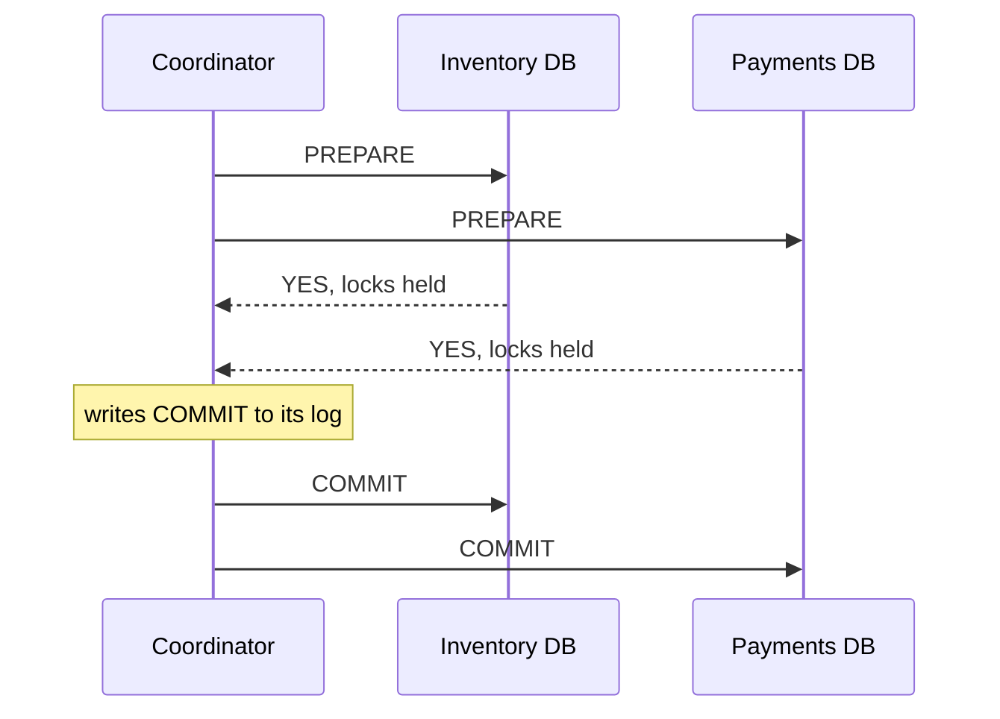
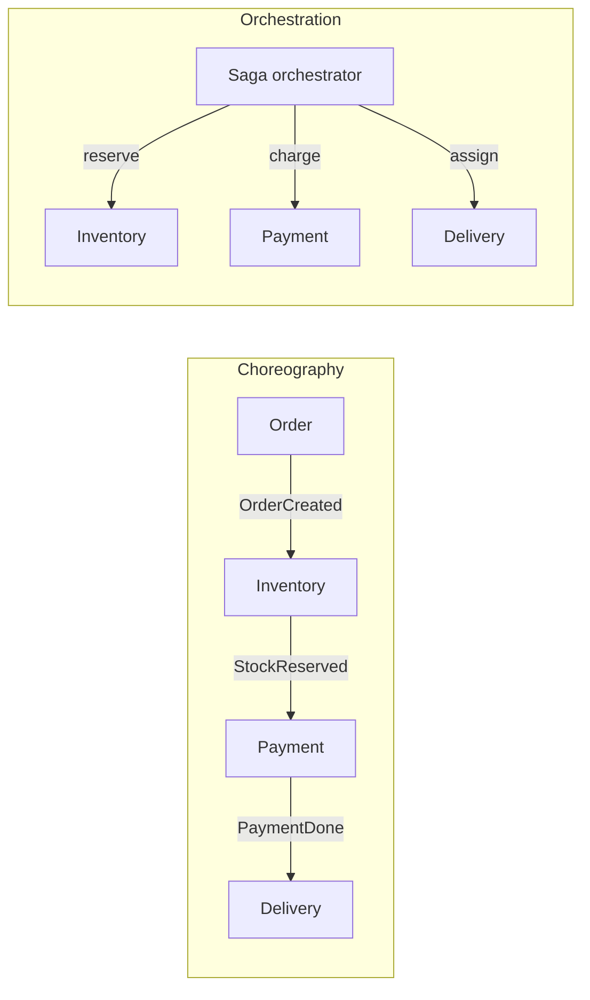
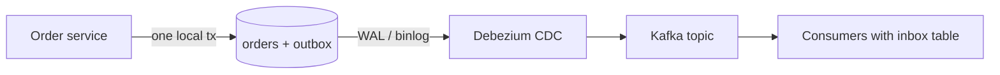

# 20 · Distributed Transactions (2PC, Saga, Outbox)

> **Read time:** 45 min · **Visual:** [v12 saga and outbox](../../visuals/v12-saga-outbox.html) · **Code it:** [lld/problems/19-payment-wallet](../../lld/problems/19-payment-wallet/README.md)
> **Shows up in:** payment system, food delivery orders, ticket and hotel booking, digital wallet, any flow that spans services

## The idea in one line

When one business action touches several services, you either lock them all and commit together (2PC, rarely), or run a chain of local transactions with undo steps (Saga), and you publish events reliably with an outbox.

## The problem it solves

"Place order" must reserve stock, charge the customer and create a delivery. Each lives in a different service with its own database. There is no `BEGIN … COMMIT` across them.

The second problem is quieter. A service updates its DB and then publishes an event:

```ts
await db.update(order, 'PAID');     // succeeds
await kafka.send('order.paid');     // pod dies here: event lost forever
```

This is the **dual-write problem**. Swapping the order does not help: then the event can go out for a change that rolled back.

## How it works

### Two-phase commit (2PC)



1. **Prepare**: each participant writes the change durably, keeps its locks, and votes yes or no.
2. **Commit**: if all vote yes, the coordinator logs the decision and tells everyone to commit. Any "no" means abort.

**The blocking problem**: after a participant votes yes, it may not decide alone. If the coordinator crashes now, the participant is **in doubt**. It holds row locks until the coordinator comes back. Other transactions on those rows wait. 3PC tries to fix this but assumes bounded network delays, so it is rarely used.

Other costs: at least 2 round trips, the slowest participant sets the latency, and every participant must support XA. Most message brokers and third-party APIs (a PSP, a bank) do not.

Where 2PC is fine: inside one database product (Postgres partitions, Spanner, CockroachDB). Spanner runs 2PC over Paxos groups, so the coordinator itself is replicated and does not stay down.

### Saga

A saga is a sequence of **local** transactions `T1, T2, T3`. Each one commits on its own. If `Tk` fails, run **compensations** `Ck-1 … C1` in reverse.

| Step | Action | Compensation |
|---|---|---|
| T1 | Order: create `PENDING` | Mark `CANCELLED` |
| T2 | Inventory: reserve items | Release reservation |
| T3 | Payment: charge | Refund |
| T4 | Delivery: assign | (last step, no compensation needed) |

Rules:
- A compensation is a **semantic undo** (a refund), not a rollback. The charge did happen and is visible.
- Compensations and steps must be **idempotent** and retried until they succeed. A compensation that can fail forever needs a human queue.
- The **pivot** step is the point of no return (often the charge). Steps after it must be retriable, not compensatable.
- Sagas have **no isolation**. Others can see `PENDING` data. Use semantic locks (a `PENDING` status other flows respect) and re-check values before acting.

**Choreography vs orchestration**



| | Choreography | Orchestration |
|---|---|---|
| Control | Each service reacts to events | One orchestrator holds the state machine |
| Good for | 2–4 steps, loosely owned | Many steps, branching, timeouts |
| Weakness | Flow is hidden across services; cyclic dependencies | Orchestrator is one more service to run |
| Tools | Kafka / RabbitMQ events | Temporal, AWS Step Functions, Camunda, a DB-backed state machine |

For payments, prefer orchestration. You want one place that answers "where is this order stuck?".

### Transactional outbox

Write the event into an `outbox` table **in the same local transaction** as the business change. A separate relay publishes it.

```sql
BEGIN;
UPDATE orders SET status = 'PAID' WHERE id = 42;
INSERT INTO outbox (id, aggregate_id, type, payload) VALUES (uuid(), 42, 'order.paid', '{...}');
COMMIT;
```



Two ways to relay:
- **Polling publisher**: `SELECT … FROM outbox WHERE published = false ORDER BY id LIMIT 100`, publish, mark published. Simple. Adds DB load and some delay.
- **CDC (Debezium)**: reads the Postgres WAL or MySQL binlog and publishes rows to Kafka. No polling, low delay, keeps commit order. Needs Kafka Connect to run.

The relay can publish a row and crash before marking it. So delivery is **at-least-once**, and consumers must dedupe.

### Inbox (dedupe) table

The consumer inserts `event_id` into `inbox` with a unique key, in the same transaction as its own change. A duplicate fails the insert and is skipped. See [19 idempotency](19-idempotency-delivery-semantics.md).

## Numbers to remember

- 2PC: 2 round trips minimum plus 2 forced log writes per participant. Locks are held across both phases.
- Outbox delay: polling every 100–500 ms gives sub-second delay; CDC is usually tens of milliseconds.
- Saga with 4 steps has up to 3 compensations. Each needs its own retry and alert path.

## Trade-offs and when not to use it

| Option | Use when | Weakness |
|---|---|---|
| Single DB transaction | All data fits in one DB (often true early on) | Couples services to one schema |
| 2PC / XA | Few participants, all support XA, same data centre | Blocking on coordinator failure, lock time, no support from brokers or external APIs |
| Saga (orchestrated) | Long or branching business flows, external calls | No isolation; must design compensations |
| Saga (choreographed) | Short flows, teams own their own reactions | Hard to see and debug the whole flow |
| Outbox + polling | Any service that must publish after a DB change | Polling load, slight delay |
| Outbox + CDC | High volume, ordered events | Debezium and Kafka Connect to operate |

## In real systems

- **Uber Cadence / Temporal**: workflow engines widely used to run sagas as code with durable state.
- **Debezium**: open-source CDC for Postgres, MySQL, MongoDB; has an "outbox event router" built for this pattern.
- **Google Spanner, CockroachDB**: 2PC across shards, made non-blocking by replicating the coordinator with consensus.
- **Payment companies**: a payment is usually an orchestrated state machine with a ledger write as the local transaction at each step.

## What to say in the interview

"I won't use 2PC across services. The PSP doesn't support it, and a coordinator crash leaves locks held. I'll model checkout as an orchestrated saga: create order as pending, reserve stock, charge, confirm. If the charge fails, I release stock and cancel the order. Every state change writes an outbox row in the same transaction, and Debezium streams the outbox to Kafka. Consumers dedupe on event id with an inbox table, so at-least-once delivery is safe."

## Common follow-ups

<details><summary>What if a compensation fails?</summary>

Retry it with backoff. It must be idempotent. After N attempts, move the saga to a `NEEDS_ATTENTION` state, alert, and put it on an ops queue. Do not drop it. For money, the ledger must show the open item until it is resolved.
</details>

<details><summary>How do you stop two sagas from overselling the last item?</summary>

Make the reservation itself atomic in the inventory DB: `UPDATE stock SET reserved = reserved + 1 WHERE sku=? AND available - reserved >= 1`. The saga never "reads then decides" across services. Reservations get a TTL, so an abandoned saga frees the stock.
</details>

<details><summary>Polling outbox or CDC, which one?</summary>

Start with polling: no new infrastructure and easy to reason about. Move to CDC when volume is high, the polling query hurts the DB, or you need lower delay. Either way, consumers dedupe.
</details>

<details><summary>Does the outbox keep event order?</summary>

Per aggregate, yes, if you publish with the aggregate id as the Kafka key, so all events for one order go to one partition in commit order. Global order across aggregates is not kept, and you rarely need it.
</details>

## Self-test (answer before opening)

<details><summary>1. In 2PC, a participant voted YES and the coordinator died. Can it commit or abort alone?</summary>

No. It is in doubt. Another participant may have voted NO (abort) or the coordinator may have logged COMMIT. It must wait, holding locks, or ask the other participants.
</details>

<details><summary>2. Why is "publish to Kafka, then write to DB" also wrong?</summary>

The DB write can fail or roll back after the event is out. Consumers act on a change that never happened.
</details>

<details><summary>3. Which saga step should be the pivot in an order flow, and why?</summary>

The payment capture. Before it, everything is cheap to undo (release stock, cancel order). After it, steps should be retriable forward (assign delivery, send receipt), because undoing means a refund.
</details>

## Go deeper

- DDIA, chapter 9: "Atomic Commit and Two-Phase Commit (2PC)" and "Distributed Transactions in Practice"; chapter 11: "Change Data Capture"
- Chris Richardson, *Microservices Patterns*, chapter 3 (transactional outbox) and chapter 4 ("Managing transactions with sagas")
- Garcia-Molina and Salem, "Sagas" (1987), the original paper
- Debezium documentation: "Outbox Event Router"
- Related cards: [19 idempotency](19-idempotency-delivery-semantics.md), [21 event-driven and CQRS](21-event-driven-cqrs.md), [35 payments domain](35-payments-domain.md)
- Older notes in this repo: `archive/notes/hld-parts/part8.md`, "4. Distributed Transactions" and "Exercise 3: When to Use 2PC"; `archive/notes/hld-parts/part3.md`, "Topic 3: Saga Pattern for Distributed Transactions"
