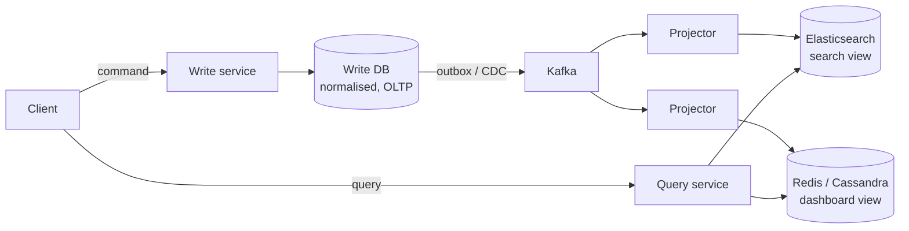

# 21 · Event-Driven Architecture, CQRS and Event Sourcing

> **Read time:** 35 min · **Visual:** [v12 saga and outbox](../../visuals/v12-saga-outbox.html), [v10 Kafka consumer groups](../../visuals/v10-kafka-consumer-groups.html) · **Code it:** [lld/problems/15-pub-sub-queue](../../lld/problems/15-pub-sub-queue/README.md)
> **Shows up in:** payment system, food delivery, news feed, stock exchange, digital wallet, any "update many systems when X happens" design

## The idea in one line

Services announce facts ("OrderPlaced") instead of calling each other. CQRS splits the write model from one or more read models built from those facts. Event sourcing goes further and stores the facts themselves as the source of truth.

## The problem it solves

- **Coupling**: the order service calls notification, analytics, loyalty and search on every order. Each new consumer means a change and a deploy in the order service, and one slow consumer slows checkout.
- **One model for everything**: the same normalised tables serve writes (strict, transactional) and reads (wide, joined, filtered, searched). Reads need joins and indexes that slow writes.
- **Lost history**: a row says `balance = 500`. It doesn't say how it got there. Auditors and debuggers want the history.

## How it works

### Event-driven architecture

An **event** is a fact in the past tense, owned by the producer: `PaymentCaptured{paymentId, amount, at}`. A **command** is a request to one owner: `CapturePayment`. Commands can be rejected; events cannot.

Three styles (from Martin Fowler's "What do you mean by Event-Driven?"):

| Style | Payload | Trade-off |
|---|---|---|
| Event notification | Only ids: `{orderId}` | Small events; consumers call back for data (coupling returns) |
| Event-carried state transfer | Full state needed by consumers | Consumers are independent; bigger events, data copies everywhere |
| Event sourcing | Events are the database | Full history and replay; hardest to run |

Publish events with the outbox pattern ([20](20-distributed-transactions.md)), key them by aggregate id for per-entity order, and make consumers idempotent ([19](19-idempotency-delivery-semantics.md)).

### CQRS



- The **write side** checks rules and stores state in a model built for correctness.
- **Projectors** consume events and build read models, each shaped for one screen or query.
- Read models are **eventually consistent**. Lag is usually milliseconds to seconds.
- A read model can be dropped and rebuilt by replaying events.

Handle read-your-writes: return the new state in the command response, or have the client wait until the read model's version ≥ the version the write returned, or read that one item from the write side.

### Event sourcing

Store every change as an event in an append-only log per aggregate. Current state is a fold over the events.

```
account 7:  Opened(0) → Deposited(1000) → Withdrew(300) → Deposited(50)
state = fold(events) = balance 750
```

- **Writes**: load events for the aggregate, rebuild state, check the rule, append the new event with `expectedVersion` (optimistic concurrency). Two writers at the same version: one fails and retries.
- **Snapshots**: every N events (e.g. 100), save the folded state, so loading reads a snapshot plus a few events.
- **Versioning**: events are kept forever, so old shapes must still be readable. Use "upcasters" that convert v1 events to v2 when read.
- **Deleting personal data (GDPR, DPDP)**: you can't edit an immutable log. Encrypt personal fields with a per-user key and delete the key ("crypto-shredding").

A ledger is a domain where this is natural: entries are already immutable events ([35](35-payments-domain.md)).

## Numbers to remember

- Read-model lag in a healthy Kafka pipeline: tens of ms to a few seconds. Under a consumer outage: unbounded. Monitor consumer lag.
- Snapshot every ~100–1000 events. Loading 10k events per request is too slow.
- Kafka retention for replay: set per topic. Use compacted topics (latest per key) or long retention when topics are the source for rebuilds.

## Trade-offs and when not to use it

| Option | Use when | Weakness |
|---|---|---|
| Sync calls (REST/gRPC) | You need the answer now (price check, auth) | Coupling, cascading failures |
| Events (pub-sub) | Many consumers react to one fact | Eventual consistency; harder to trace |
| CQRS | Read and write shapes differ a lot; read scale ≫ write scale | Two models to keep in sync; lag |
| Event sourcing | Audit is a requirement; you need "state as of time T"; ledgers | Schema evolution, replay time, steep learning curve |
| Plain CRUD + audit table | Most services | Audit table can drift from the real change |

Don't use event sourcing for a whole system. Use it for the one or two aggregates where history is the product.

## In real systems

- **Kafka** as the event backbone at Uber, LinkedIn, Swiggy and most Indian fintechs.
- **EventStoreDB**, **Axon**: databases and frameworks built for event sourcing.
- **Banks and ledgers**: append-only journals with derived balances are event sourcing by another name.
- **Elasticsearch read models** fed by CDC from the main DB are the most common CQRS setup in practice.

## What to say in the interview

"The order service owns writes in Postgres. Every state change writes an outbox event; Debezium puts it on Kafka, keyed by order id. Search, notifications and analytics each consume and build their own read models. That is CQRS without full event sourcing. Read models lag by up to a second, so the order page reads its own order from the write side right after checkout. I'd only event-source the ledger, where history is required anyway."

## Common follow-ups

<details><summary>How do you handle out-of-order or duplicate events in a projector?</summary>

Key by aggregate id so one entity's events go to one partition in order. Store the last applied version per aggregate in the read model and skip events with a version ≤ stored. That one check handles both duplicates and replays.
</details>

<details><summary>How do you add a new read model a year later?</summary>

Start a new consumer group from the earliest offset (needs long retention or a compacted topic), or bootstrap from a DB snapshot and then consume from the snapshot's position. Debezium supports an initial snapshot followed by streaming.
</details>

<details><summary>Event sourcing: how do you query "all accounts with balance > X"?</summary>

You don't query the event store. Build a projection (a table of current balances) and query that. The event store answers only "give me the events for aggregate X".
</details>

## Self-test (answer before opening)

<details><summary>1. "SendWelcomeEmail" or "UserRegistered": which is an event?</summary>

`UserRegistered`. It's a fact in the past tense. `SendWelcomeEmail` is a command to one service.
</details>

<details><summary>2. A user updates their profile and refreshes. The old name shows. Why, and one fix?</summary>

The page reads from a CQRS read model that hasn't applied the event yet. Fix: return the new state in the write response, or read from the write model for the user's own profile.
</details>

<details><summary>3. Two requests withdraw from the same event-sourced account at version 5. What stops a double spend?</summary>

Append with `expectedVersion = 5`. The first succeeds and makes it version 6. The second fails the version check, reloads, re-checks the balance and retries or rejects.
</details>

## Go deeper

- DDIA, chapter 11: "Databases and Streams", "Change Data Capture" and "Event Sourcing"
- Martin Fowler's articles: "CQRS", "Event Sourcing", "What do you mean by Event-Driven?"
- Greg Young's CQRS documents and talks
- Related cards: [17 message queues](17-message-queues.md), [18 Kafka deep dive](18-kafka-deep-dive.md), [20 distributed transactions](20-distributed-transactions.md)
- Older notes in this repo: `archive/notes/hld-parts/part3.md`, "MODULE 3.2: EVENT-DRIVEN ARCHITECTURE (EDA)" ("Topic 1: Event Sourcing Pattern", "Topic 2: CQRS", "Topic 5: Handling Event Ordering & Consistency"); `archive/notes/hld-parts/part8.md`, "1. Event Sourcing & CQRS"
