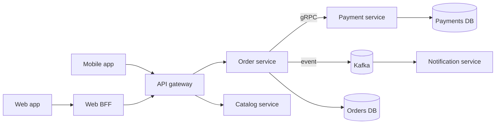

# 22 · Microservices, API Gateway, Service Discovery

> **Read time:** 35 min · **Visual:** [v01 life of a request](../../visuals/v01-request-lifecycle.html) · **Code it:** [hld/code/09-circuit-breaker](../code/09-circuit-breaker/README.md) (what protects calls between services)
> **Shows up in:** almost every HLD answer: food delivery, ride hailing, payment system, e-commerce, notification system

## The idea in one line

Split a system into small services that each own one business capability and its own data, deploy them independently, and put a gateway in front and a discovery mechanism between them.

## The problem it solves

A monolith is fine for a small team. It hurts when:
- 80 engineers merge into one repo and one deploy. One bad change blocks everyone's release.
- One part needs 50 instances (search) and another needs 2 (admin), but you must scale all of it together.
- A memory leak in reports takes down checkout.

Microservices fix these by giving each team a service it can **deploy, scale and fail** on its own. The price is that every call is now a network call.

## How it works

### Drawing the boundaries

- Split by **business capability / bounded context** (DDD): Orders, Payments, Catalog, Delivery. Not by technical layer ("DB service", "validation service").
- **Database per service**. Other services never read your tables. They call your API or consume your events.
- A good boundary has **high cohesion** (changes stay inside) and **low coupling** (few sync calls across).
- Start with a **modular monolith** when the domain is new. Extract services when a module needs its own scale, team or release cycle.

The bad outcome is a **distributed monolith**: services that must be deployed together, share a DB, or call each other in long sync chains.

### Request path

### API gateway

One entry point for clients. It handles cross-cutting work so services don't each repeat it:
- TLS termination, routing (`/orders/*` → order service), request/response transformation
- Authentication (validate JWT), coarse authorization
- Rate limiting per API key or user ([23](23-rate-limiting.md))
- Request ids and tracing headers ([31](31-observability.md))
- Response aggregation for a screen (or leave that to a BFF)

**BFF (backend for frontend)**: a thin gateway per client type (mobile, web, partner) that shapes responses for that client. Keeps mobile-only fields out of shared services.

Keep business logic **out** of the gateway, or it becomes a new monolith.

### Service discovery

Instances come and go (autoscaling, deploys, crashes), so IPs change.

| Style | How | Examples |
|---|---|---|
| Server-side | Caller hits a stable name; a load balancer or proxy picks an instance | Kubernetes Service (DNS name + kube-proxy), AWS ALB |
| Client-side | Caller asks a registry for instances and balances itself | Netflix Eureka + Ribbon, Consul with a client library |
| Service mesh | A sidecar proxy next to each pod does discovery, retries, mTLS | Istio or Linkerd with Envoy sidecars |

On Kubernetes, `http://payment-service.payments.svc.cluster.local` already gives you server-side discovery. Registration is automatic through **readiness probes**: a pod gets traffic only when ready.

### Communication

- **Sync** (REST, gRPC): when the caller needs the answer to continue (price, auth, stock check). gRPC for internal calls: binary, typed contracts, HTTP/2.
- **Async** (events, queues): when the caller doesn't need to wait (send receipt, update search, analytics).
- Every sync call needs a **timeout, a retry policy and a circuit breaker** ([24](24-resilience-patterns.md)).
- Version your APIs and events. Make changes backward compatible (add fields, never rename or remove in place).

## Numbers to remember

- Availability in series multiplies: 5 services at 99.9% each in one sync chain ≈ **99.5%** (0.999⁵). That is ~3.6 hours of downtime a month instead of ~43 minutes.
- Each in-region sync hop adds roughly 1–5 ms of network plus the callee's own latency. A chain of 6 hops adds up fast at p99.
- Keep sync call depth to 2–3 on the hot path. Push the rest async.

## Trade-offs and when not to use it

| Option | Use when | Weakness |
|---|---|---|
| Monolith | Small team, new product, unclear domain | Shared deploys and scaling; one failure domain |
| Modular monolith | One deployable with strict module boundaries | Still one runtime and one release |
| Microservices | Many teams, different scale needs per area | Network failures, distributed data, ops cost, tracing needed |
| Gateway only | Few client types | Can grow client-specific logic |
| Gateway + BFF per client | Mobile, web and partners need different shapes | More services to run |
| Service mesh | Many services, need mTLS and uniform retries everywhere | Sidecar CPU/latency cost; complex to operate |

## In real systems

- **Kubernetes Services + CoreDNS**: the default discovery for most teams today.
- **Kong, AWS API Gateway, Envoy, NGINX**: common gateways. Netflix Zuul was an early well-known one.
- **Istio / Linkerd**: service meshes with Envoy (Istio) or their own proxy (Linkerd).
- **Netflix Eureka**: the classic client-side registry from the Netflix OSS stack.
- Indian product companies (Swiggy, Flipkart, Razorpay) run hundreds of services on Kubernetes with Kafka for async flows.

## What to say in the interview

"I'll split by business capability: orders, payments, catalog, delivery, notifications. Each owns its database. Clients go through an API gateway that validates the JWT, rate-limits and adds a request id. Services find each other through Kubernetes DNS. Checkout only makes sync calls where it needs an answer (stock and payment), with timeouts and circuit breakers. Everything else reacts to events on Kafka, so a slow notification service can't slow checkout."

## Common follow-ups

How do you run a query that needs data from three services?

Options: (1) API composition in the gateway or BFF: call each service in parallel and join in memory, fine for small result sets. (2) A CQRS read model that consumes all three services' events into one denormalised store ([21](21-event-driven-cqrs.md)). Never let one service read another's DB.

How do you keep data consistent across services without a shared DB?

Local transactions + outbox events + sagas with compensations ([20](20-distributed-transactions.md)). Accept eventual consistency where the business allows it, and keep strongly consistent invariants inside one service.

How do you do authN/authZ between services?

The gateway authenticates the user and passes a signed token (or its claims) downstream. Services check permissions for their own resources. Service-to-service identity uses mTLS (often from the mesh) or client-credentials tokens ([32](32-security-auth.md)).

When would you merge two services back?

When they always change and deploy together, call each other on every request, or share data that must be strongly consistent. That's one service split in the wrong place.

## Self-test (answer before opening)

1. Three teams share one Postgres schema across their "microservices". What's the problem?

It's a distributed monolith. A schema change by one team can break others; they can't deploy or scale independently; the DB is a shared failure point.

2. Name two things a gateway should do and one it should not.

Should: auth token validation, rate limiting, routing, TLS termination. Should not: business rules like pricing or order validation.

3. Why do readiness probes matter for service discovery?

Kubernetes adds a pod to the Service endpoints only when its readiness probe passes, so traffic doesn't reach pods that are still warming up or are overloaded.

## Go deeper

- Sam Newman, *Building Microservices* (2nd edition): chapters on modelling services and splitting the monolith
- Sam Newman, *Monolith to Microservices*: the strangler fig pattern
- Chris Richardson, *Microservices Patterns*: API gateway, service discovery, API composition
- Related cards: [04 API design](04-api-design.md), [07 load balancing](07-load-balancing.md), [24 resilience patterns](24-resilience-patterns.md)
- Older notes in this repo: `archive/notes/hld-parts/part3.md`, "MODULE 3.1: MICROSERVICES ARCHITECTURE" ("Topic 2: Service Boundaries & Domain-Driven Design (DDD)", "Topic 4: Service Discovery", "Topic 5: API Gateway Pattern", "Topic 7: Service Mesh (Advanced)")
