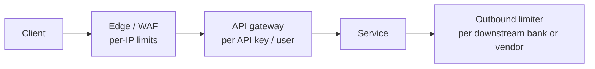

# 23 · Rate Limiting

> **Read time:** 35 min · **Visual:** [v09 rate limiting algorithms](../../visuals/v09-rate-limiting.html) · **Code it:** [hld/code/02-rate-limiter-algorithms](../code/02-rate-limiter-algorithms/README.md)
> **Shows up in:** distributed rate limiter, API gateway, payment APIs, login and OTP endpoints, notification system, web crawler (politeness)

## The idea in one line

Count requests per key (user, API key, IP) in a time window and reject or delay the ones over the limit, so one client can't hurt everyone else or the backend.

## The problem it solves

- A buggy client loops and sends 5,000 requests per second. Without a limit, it fills your thread pools and DB connections, and every other merchant sees timeouts.
- Attackers brute-force OTPs or passwords.
- A downstream (a bank, an SMS vendor) allows only 100 TPS. Going over gets you blocked or billed.
- Paid plans: "free tier = 100 requests per minute".

## How it works

### The five algorithms

| Algorithm | How | Burst behaviour | Memory per key |
|---|---|---|---|
| **Token bucket** | Bucket of capacity `B`, refilled at `r` tokens/sec. A request takes a token or is rejected | Allows bursts up to `B`, then `r`/sec | 2 numbers (tokens, last refill time) |
| **Leaky bucket** | Requests enter a queue that drains at a fixed rate | Smooths output; no bursts | Queue size |
| **Fixed window counter** | `INCR key:minute`; reject over N | Up to **2N** at a window edge | 1 counter |
| **Sliding window log** | Store every timestamp; count those in the last window | Exact | 1 entry per request (expensive) |
| **Sliding window counter** | Weighted mix of the previous and current window counts | Close to exact | 2 counters |

Sliding window counter estimate:

```
count ≈ prev_window_count × (1 − elapsed_in_current / window) + current_window_count
```

Example: limit 100/min. Previous minute had 80, current minute has 30 and we are 15 s in. Estimate = 80 × 0.75 + 30 = 90, so allow.

Token bucket refill, computed lazily on each request (no background timer):

```ts
const now = Date.now();
tokens = Math.min(capacity, tokens + ((now - lastRefill) / 1000) * ratePerSec);
lastRefill = now;
if (tokens >= 1) { tokens -= 1; allow(); } else { reject(); }
```

### Making it distributed

With 20 API pods, a counter in each pod's memory allows 20× the limit. Put the state in **Redis**, and make check-and-update **atomic**:

- Fixed window: `INCR` then `EXPIRE` on first use. Safe if run in a `MULTI` or a Lua script.
- Token bucket / sliding window: a **Lua script** (`EVAL`) that reads, computes and writes in one step. Redis runs a script without interleaving other commands.
- Shard keys across a Redis Cluster by the limiter key. One user's key lives on one node.

A plain "GET, compute in Node, SET" has a race: two pods read 99 and both allow.

**Latency budget**: one Redis round trip (~0.5–1 ms in-region) per request. For very hot paths, use a **local + global hybrid**: each pod keeps a local token bucket and syncs with Redis every few hundred ms. You trade a little accuracy for no per-request network call.

**If Redis is down**: fail **open** (allow) for most APIs, so a limiter outage isn't a full outage. Fail **closed** for abuse-sensitive endpoints such as OTP and login.

### Where to put it, and what to return



- Response: `429 Too Many Requests` with `Retry-After`. Many APIs also send `X-RateLimit-Limit`, `X-RateLimit-Remaining`, `X-RateLimit-Reset` (an IETF draft standardises `RateLimit` headers).
- Key choice: API key or user id for logged-in traffic; IP only at the edge (NAT and mobile carriers put many users behind one IP).
- Layer limits: per second (burst) **and** per day (quota).

**Rate limiting vs load shedding**: rate limiting is per client and fair. Load shedding drops low-priority traffic when the **server** is overloaded, whatever the client. You want both.

## Numbers to remember

- Fixed window worst case: **2×** the limit in a short span around the boundary.
- Memory: 10M active keys × ~50 bytes (key + 2 counters) ≈ **500 MB** in Redis. Fine for one cluster.
- Cloudflare reported that its sliding window counter wrongly allowed or limited about **0.003%** of requests in their tests: the approximation is good enough.
- Redis handles ~100k simple ops/sec per core, so one shard can serve tens of thousands of limiter checks per second.

## Trade-offs and when not to use it

| Option | Use when | Weakness |
|---|---|---|
| Token bucket | Public APIs that should allow short bursts (Stripe, AWS) | Two parameters to tune |
| Leaky bucket (queue) | Protecting a downstream that needs a steady rate (SMS vendor, bank) | Adds queueing delay; queue can fill |
| Fixed window | Simple quotas (per day) | Edge bursts |
| Sliding window log | Low volume, must be exact (e.g. 5 OTPs per hour) | Memory grows with requests |
| Sliding window counter | High volume, near-exact | Approximate |
| Local in-memory only | Single instance, or rough per-pod protection | Limit × pods in total |
| Central Redis | Accurate global limits | Extra hop; Redis must be HA |

## In real systems

- **Stripe** (blog "Scaling your API with rate limiters"): a request-rate limiter (token bucket in Redis), a concurrent-requests limiter, and two load shedders that keep capacity for critical traffic.
- **Cloudflare**: sliding window counter at the edge.
- **NGINX** `limit_req`: leaky bucket. **Envoy**: local token bucket plus a global rate limit service.
- **AWS API Gateway**: token bucket with rate and burst settings per stage and usage plan.
- **GitHub API**: per-user hourly quotas returned in `x-ratelimit-*` headers.

## What to say in the interview

"I'll rate-limit at the gateway with a token bucket per API key: say 100 requests per second with a burst of 200. State lives in Redis Cluster and I update it with a Lua script, so check-and-decrement is atomic across all gateway pods. Over the limit I return 429 with Retry-After. If Redis is unavailable I fail open for normal APIs but fail closed for OTP and login. Separately, outbound calls to each bank go through a leaky-bucket queue matched to that bank's TPS."

## Common follow-ups

<details><summary>Users are spread across regions. Is the limit global?</summary>

Usually per region is good enough: give each region a share of the limit, or sync counters asynchronously across regions and accept small over-limit. A strictly global limit needs a cross-region round trip on every request, which is too slow.
</details>

<details><summary>How do you change limits without a deploy?</summary>

Keep rules in a config store (DB, etcd, a config service) keyed by plan or API key. Gateways cache the rules and refresh every few seconds or on a watch.
</details>

<details><summary>Why is a sorted set (ZSET) sliding log expensive?</summary>

It stores one member per request. At 1,000 requests per minute per key and 1M keys, that's a billion entries. Each check also runs `ZREMRANGEBYSCORE` + `ZCARD`. Use it only for low-volume, high-value limits.
</details>

## Self-test (answer before opening)

<details><summary>1. Limit 100/min with a fixed window. How can a client send 200 in about one second?</summary>

100 at 00:59.5 and 100 at 01:00.1. Each lands in a different window, so both batches pass.
</details>

<details><summary>2. Token bucket, capacity 10, refill 1/sec, empty at t=0. How many requests can pass at t=5?</summary>

5. Five seconds refilled five tokens.
</details>

<details><summary>3. Why must the Redis check-and-update be one Lua script?</summary>

Otherwise two gateway pods can read the same count, both decide "allowed", and both write. The script runs atomically, so no other command runs in between.
</details>

## Go deeper

- Alex Xu, *System Design Interview* Vol. 1, chapter 4: "Design a Rate Limiter"
- Stripe engineering blog: "Scaling your API with rate limiters"; Cloudflare blog: "How we built rate limiting capable of scaling to millions of domains"
- Practice: [hld/problems/02-rate-limiter](../problems/02-rate-limiter/README.md), LLD version [lld/problems/04-rate-limiter](../../lld/problems/04-rate-limiter/README.md)
- Older notes in this repo: `archive/notes/hld-parts/part6b.md`, "Part 2: Rate Limiter - Token Bucket & Variants" and "2.4 Multi-Level Rate Limiting"; `archive/notes/hld-parts/part4.md`, "Module 4.3: Rate Limiting & Throttling (Deep Dive)"
