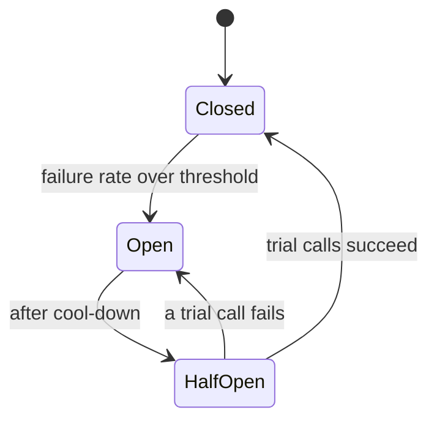

# 24 · Resilience: Timeouts, Retries, Circuit Breakers

> **Read time:** 35 min · **Visual:** [v13 circuit breaker and retries](../../visuals/v13-circuit-breaker.html) · **Code it:** [hld/code/09-circuit-breaker](../code/09-circuit-breaker/README.md)
> **Shows up in:** every design with service-to-service calls: payment system (PSP and bank calls), food delivery, ride hailing, notification system

## The idea in one line

Assume every remote call can be slow or fail. Put a deadline on it, retry only safe calls with backoff and jitter, stop calling a dependency that is clearly down, and isolate resources so one bad dependency can't sink the whole service.

## The problem it solves

A bank API starts taking 30 s instead of 300 ms. Your Node service has no timeout. Requests pile up in memory, sockets and DB connections stay open, the event loop gets slower, health checks fail, Kubernetes restarts pods, and now checkout is down for every payment method, not just that bank. This is a **cascading failure**. Retrying blindly makes it worse: every client now sends 3× the traffic to a service that is already struggling.

## How it works

### 1. Timeouts and deadlines

- Every outbound call gets a timeout. In Node: `AbortController` / `AbortSignal.timeout(ms)` with `fetch`, or the client library's timeout option.
- Set it from the callee's latency: a bit above its **p99**, not its average.
- **Propagate a deadline**: if the user request has 2 s left, a downstream call must not wait 5 s. gRPC carries deadlines natively; for HTTP pass a header such as remaining-ms.
- Separate **connect timeout** (short, ~100s of ms) from **request timeout**.

### 2. Retries with exponential backoff and jitter

```ts
// full jitter: sleep = random(0, min(cap, base * 2^attempt))
const sleep = Math.random() * Math.min(capMs, baseMs * 2 ** attempt);
```

- Retry only **transient** errors: timeouts, connection resets, 502/503/504, 429 (after `Retry-After`).
- Never retry 400/401/403/422. They will fail again.
- Retry only **idempotent** operations, or ones with an idempotency key ([19](19-idempotency-delivery-semantics.md)).
- **Jitter** spreads retries out so thousands of clients don't hit at the same moment (thundering herd).
- Cap attempts (2–3) and use a **retry budget**: retries may be at most ~10% of normal traffic.
- Retry at **one layer**. If the gateway, service A and service B each retry 3 times (3 attempts each), one failing call at the bottom becomes 3 × 3 × 3 = **27** calls.

### 3. Circuit breaker



- **Closed**: calls pass; count failures over a rolling window (e.g. last 20 calls or 10 s).
- **Open**: fail fast without calling (return a fallback or an error). Gives the dependency time to recover and frees your resources.
- **Half-open**: after a cool-down (e.g. 30 s), let a few trial calls through. Success closes the circuit; failure opens it again.
- Use a minimum call count before tripping, so 2 failures out of 3 calls at 3 a.m. don't open it.
- One breaker **per dependency** (per bank, per PSP), not one for everything.

### 4. Bulkheads

Give each dependency its own limited pool: max concurrent calls, its own connection pool, its own queue. When bank A hangs, only bank A's 50 slots fill up. In Node, a concurrency limiter per downstream (a semaphore like `p-limit`) does this.

### 5. Fallbacks and graceful degradation

- Recommendations down → show popular items from cache.
- One PSP's breaker open → route to another PSP.
- Pricing service slow → serve the last cached price with a short TTL, if the business allows it.
- For payments, a fallback is never "assume success". It is "mark pending, check later".

### 6. Load shedding and backpressure

When the server itself is overloaded, reject early (`503`) instead of queueing forever. Drop low-priority work first (analytics before checkout). Bounded queues give backpressure: when full, callers slow down.

### Health checks

- **Liveness**: "is the process stuck?" Keep it trivial. Do not check dependencies, or a DB blip restarts every pod.
- **Readiness**: "should I get traffic?" Can include warm-up and critical dependencies.

## Numbers to remember

- 3 layers × 3 attempts each = **27×** load on the bottom service.
- Timeout ≈ callee p99 + margin. If p99 is 400 ms, ~500–800 ms, not 30 s (some HTTP client defaults are very long or unlimited).
- Breaker example settings: open at ≥50% failures over ≥20 calls; cool-down 10–30 s; 1–5 trial calls.
- Retry budget: ~10% extra traffic at most.

## Trade-offs and when not to use it

| Pattern | Use when | Weakness |
|---|---|---|
| Timeout | Always | Too short: false failures; too long: resource pile-up |
| Retry + backoff + jitter | Transient errors on idempotent calls | Amplifies load if layered or unbounded |
| Circuit breaker | A dependency can be down for a while | Tuning; may block healthy calls during half-open |
| Bulkhead | Several dependencies share one process | Idle capacity reserved per pool |
| Fallback | A degraded answer is acceptable | Can hide real failures; must be monitored |
| Hedged requests (send a 2nd copy after p95) | Read-only calls, tail latency matters | Extra load; only for idempotent reads |
| Load shedding | Server near saturation | Some users get errors by design |

## In real systems

- **Netflix Hystrix** made circuit breakers and bulkheads popular; it is in maintenance mode, and **Resilience4j** is the common Java choice now.
- **Node.js**: `opossum` (circuit breaker), `p-retry`, `cockatiel` (retry, breaker, bulkhead, timeout policies).
- **Envoy / Istio**: retries, timeouts, outlier detection (eject bad hosts) and circuit breaking in the mesh.
- **AWS SDKs** use exponential backoff with jitter by default.
- **Payment orchestrators** (Juspay, Razorpay) route around a failing gateway or bank based on live success rates, which is a breaker plus fallback at the business level.

## What to say in the interview

"Every call to a bank or PSP has a timeout just above its p99 and a deadline taken from the user request. Retries happen only at the client edge of each dependency, at most 2, with exponential backoff and full jitter, and only for idempotent calls carrying our payment reference. Each PSP has its own circuit breaker and its own connection pool, so one slow bank can't use up all our sockets. When a PSP's breaker opens, routing sends new payments to the next PSP. A timed-out payment is marked pending and resolved by status checks, never retried as a new charge."

## Common follow-ups

<details><summary>Retry or circuit breaker: don't they fight each other?</summary>

They work together. Retries handle short blips on a single call. The breaker watches the failure rate across many calls and stops retries (and calls) when the dependency is clearly down. Put the retry inside the breaker so retried failures count toward the rate.
</details>

<details><summary>How do you stop a retry storm after an outage ends?</summary>

Jitter, retry budgets, breakers that let traffic in gradually through half-open, and server-side load shedding. Also make clients honour `Retry-After` and `429`.
</details>

<details><summary>What is the difference between a timeout and a deadline?</summary>

A timeout is per call ("wait 500 ms"). A deadline is per request across all hops ("this must finish by 12:00:01.200"). Each hop computes its own timeout from the time left.
</details>

## Self-test (answer before opening)

<details><summary>1. Why add jitter to exponential backoff?</summary>

Without it, all clients that failed at the same moment retry at the same moments (1 s, 2 s, 4 s), hitting the server in synchronized waves.
</details>

<details><summary>2. A PSP returns 400 "invalid card". Should you retry?</summary>

No. It's a permanent client error. Retrying only adds load and may trigger fraud checks.
</details>

<details><summary>3. Why should a liveness probe not check the database?</summary>

If the DB has a short outage, every pod fails liveness and gets restarted at once. That adds a restart storm to the DB problem. Use readiness for dependency checks.
</details>

## Go deeper

- AWS Builders' Library: "Timeouts, retries, and backoff with jitter" and "Using load shedding to avoid overload"
- Michael Nygard, *Release It!* (2nd edition): stability patterns (timeouts, circuit breaker, bulkheads)
- Google SRE book: "Handling Overload" and "Addressing Cascading Failures"; Dean and Barroso, "The Tail at Scale" (hedged requests)
- Related cards: [22 microservices](22-microservices.md), [23 rate limiting](23-rate-limiting.md), [31 observability](31-observability.md)
- Older notes in this repo: `archive/notes/hld-parts/part4.md`, "Module 4.1: Reliability Patterns (Deep Dive)" ("Circuit Breaker Pattern", "Retry Logic with Exponential Backoff & Jitter", "Bulkhead Pattern (Resource Isolation)", "Timeout Strategies", "Graceful Degradation")
