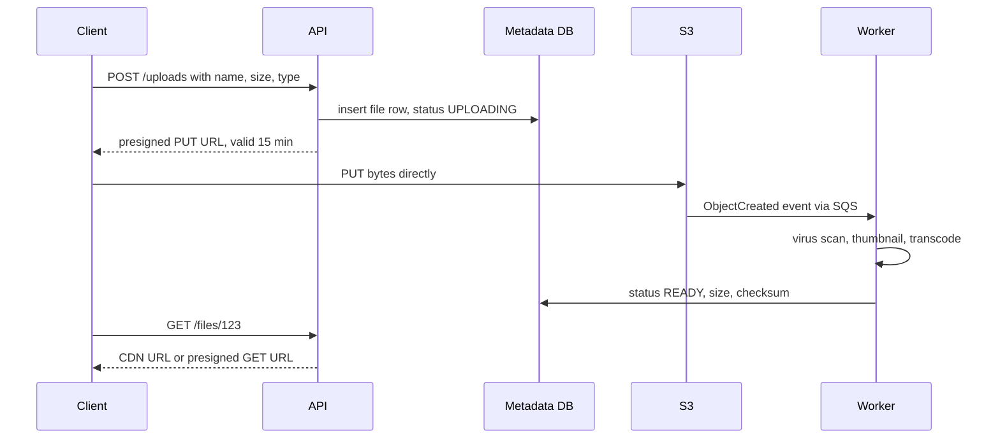

# 26 · Blob / Object Storage and Large Files

> **Read time:** 30 min · **Visual:** [v01 life of a request](../../visuals/v01-request-lifecycle.html) (CDN and origin path) · **Code it:** none (the upload flow below is the code to know)
> **Shows up in:** file storage and sync (Dropbox), video streaming, photo sharing, chat attachments, KYC document upload, invoice and statement PDFs

## The idea in one line

Store large binary files in an object store (S3, GCS, Azure Blob) and only their metadata in your database; let clients upload and download directly from the store using short-lived signed URLs, with a CDN in front for reads.

## The problem it solves

Putting a 200 MB video in a Postgres `BYTEA` column, or streaming it through your Node API servers, causes:
- huge DB backups and slow replication
- API pods that spend their memory and bandwidth copying bytes
- a single upload that fails at 95% and starts again from zero
- no cheap tier for files nobody opens after a month

Object storage is built for this: practically unlimited capacity, very high durability, pay per GB, and an HTTP API.

## How it works

### Block vs file vs object storage

| Type | Access | Example | Use for |
|---|---|---|---|
| Block | Raw disk blocks, mounted by one machine | EBS, local NVMe | Databases, OS disks |
| File | POSIX paths, shared mount | EFS, NFS | Legacy apps needing a shared filesystem |
| Object | `PUT/GET bucket/key` over HTTP; whole objects; metadata | S3, GCS, MinIO | Images, video, backups, logs, data lakes |

Objects are **immutable as a whole**: you replace an object, you don't edit byte 500 in place. Keys look like paths (`users/42/avatar.jpg`) but the namespace is flat.

### The upload flow (presigned URLs)

- The API never touches the bytes. It only signs a URL that allows one operation on one key for a short time.
- Do not trust the client's "upload done" call alone. Confirm from the storage event or a `HEAD` request.
- Limit what the signed URL allows: exact key, content type, max size (S3 presigned POST policies can enforce a size range).

### Large files: multipart and chunking

- **Multipart upload**: split into parts, upload in parallel, retry only failed parts, then "complete" to stitch them. S3 parts are 5 MB to 5 GB, up to 10,000 parts. Abort or expire unfinished uploads with a lifecycle rule, or you pay for orphaned parts.
- **Content-defined or fixed chunking** (Dropbox-style sync): split files into blocks (e.g. 4 MB), name each block by its **SHA-256 hash**, upload only blocks the server doesn't have. Gives resumable upload, **dedup** across users, and delta sync when a small part of a file changes.

### Downloads

- Public content (product images): serve through a **CDN** ([09](09-cdn.md)) with long cache TTLs and versioned keys (`logo.v3.png`).
- Private content (KYC documents, bank statements): short-lived **presigned GET** URLs, or a CDN with signed cookies/URLs. Never a public bucket.
- Video: transcode into several bitrates and segment for HLS/DASH, so players fetch small chunks.

### Durability, cost and lifecycle

- Durability comes from replication or **erasure coding** across devices and AZs. Erasure coding stores data + parity fragments (e.g. 6 data + 3 parity) and can lose some fragments; it costs ~1.5× raw space instead of 3× for triple replication.
- **Storage classes**: hot (S3 Standard) → infrequent access → archive (Glacier). Lifecycle rules move objects by age.
- **Versioning** + **object lock** for files that must not be deleted or changed (audit, regulatory records).

## Numbers to remember

- S3 is designed for **99.999999999%** (11 nines) durability of objects. Availability SLAs are lower (99.9% for Standard).
- S3 has **strong read-after-write consistency** for all PUTs and DELETEs (since December 2020).
- Max object size **5 TB**; max single PUT **5 GB**; multipart parts 5 MB–5 GB, max **10,000** parts.
- S3 supports at least **3,500 writes and 5,500 reads per second per prefix**. Spread hot keys across prefixes.
- Back-of-envelope: 1M photos/day × 2 MB = 2 TB/day ≈ 730 TB/year before replicas.

## Trade-offs and when not to use it

| Option | Use when | Weakness |
|---|---|---|
| Bytes in the DB | Tiny files (< ~100 KB), few of them, need transactions with the row | DB bloat, slow backups |
| Object store + metadata in DB | Almost always for files | Two systems to keep consistent (orphans, dangling rows) |
| Upload through your API | Need to inspect or transform the stream inline | API bandwidth and memory; slow |
| Presigned direct upload | Default | Must verify after upload; careful URL scoping |
| Replication (3×) | Small objects, fast reads, simple recovery | 3× storage |
| Erasure coding | Large, colder data at scale | Slower reconstruction; CPU cost |
| Self-hosted (MinIO, Ceph) | Data residency or cost at very large scale | You run durability yourself |

Handle the **metadata/blob mismatch**: a row without an object (upload never finished) or an object without a row (DB insert failed). A periodic sweeper fixes both: expire `UPLOADING` rows after N hours and delete unreferenced objects.

## In real systems

- **Dropbox**: block-level storage with hashed 4 MB blocks; moved most data from S3 to its own system (Magic Pocket).
- **Facebook Haystack** (paper, 2010): packs many small photos into large files to cut per-file metadata reads.
- **Netflix**: masters and encodes in S3, delivery through its own CDN (Open Connect).
- **Indian fintechs**: KYC documents and statements in S3 in an Indian region, encrypted with KMS keys, accessed via presigned URLs.

## What to say in the interview

"File bytes go to S3; Postgres keeps only metadata: owner, key, size, checksum, status. The client asks the API for a presigned PUT URL scoped to one key and valid for 15 minutes, then uploads directly. Files over 100 MB use multipart upload so a failed part can be retried alone. An S3 event triggers a worker that scans and processes the file and marks it READY. Reads go through a CDN for public files and short-lived presigned GET URLs for private ones. Lifecycle rules move files older than 90 days to a cheaper tier."

## Common follow-ups

How do you resume an upload that broke at 80%?

With multipart upload, the client keeps the upload id and list of finished parts (or asks the server via `ListParts`) and uploads only the missing parts. With hashed chunks, the server reports which chunk hashes it already has.

How do you stop users uploading a 10 GB file to a "profile photo" endpoint?

Sign a presigned POST with a content-length range and content type in the policy. Check size and type again in the processing worker, and delete anything that fails.

How would you deduplicate identical files across users?

Name chunks (or whole files) by their content hash. Before upload, the client sends hashes; the server returns which already exist. Keep a reference count per chunk so you delete it only when no file uses it.

## Self-test (answer before opening)

1. Why not stream uploads through the API servers?

They become bandwidth and memory bottlenecks and need to scale with bytes, not requests. Direct-to-S3 uploads move that load to the object store.

2. What two inconsistencies appear between the metadata DB and the object store?

Rows pointing to objects that don't exist (upload never finished), and objects with no row (row insert failed or row deleted). A sweeper job cleans up both.

3. When is storing a file in the database acceptable?

Small files, low volume, and you need them in the same transaction as the row (e.g. a tiny signature image). Otherwise use an object store.

## Go deeper

- AWS S3 User Guide: "Uploading and copying objects using multipart upload", "Sharing objects with presigned URLs", "Best practices design patterns: optimizing Amazon S3 performance"
- Beaver et al., "Finding a needle in Haystack: Facebook's photo storage" (OSDI 2010)
- Practice: [hld/problems/15-file-storage](../problems/15-file-storage/README.md), [hld/problems/14-video-streaming](../problems/14-video-streaming/README.md), [hld/problems/16-photo-sharing](../problems/16-photo-sharing/README.md)
- Older notes in this repo: `archive/notes/hld-parts/part3.md`, "Topic 1: BLOB Storage Patterns" and "Topic 5: Hot vs Cold Storage Tiers"; `archive/notes/hld-parts/part6b.md`, "Part 5: File Sharing & Image Services" and "5.2 Integrity & Deduplication"
