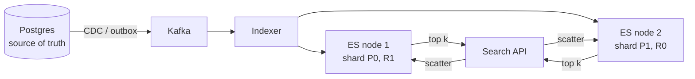

# 27 · Search, Inverted Index, Typeahead

> **Read time:** 35 min · **Visual:** none (diagram below) · **Code it:** [hld/code/07-trie-autocomplete](../code/07-trie-autocomplete/README.md)
> **Shows up in:** search autocomplete, e-commerce product search, food delivery (restaurant/dish search), web crawler, log search, transaction search in a merchant dashboard

## The idea in one line

For full-text search, map every word to the list of documents that contain it (an inverted index) and rank the matches; for typeahead, precompute the top suggestions for each prefix and serve them from memory.

## The problem it solves

`SELECT * FROM products WHERE name LIKE '%running shoe%'` can't use a normal B-tree index (the leading `%`), so it scans every row. It also can't handle "shoes" vs "shoe", typos, ranking by relevance, or facets ("brand", "price range") at scale. Typeahead has a stricter target: a suggestion on every keystroke, in well under 100 ms end to end.

## How it works

### Inverted index

```
doc1: "red running shoes"      doc2: "blue running jacket"     doc3: "red jacket"

term      → posting list (doc id, positions)
red       → [doc1:0, doc3:0]
run       → [doc1:1, doc2:1]      ← "running" stemmed to "run"
shoe      → [doc1:2]
jacket    → [doc2:2, doc3:1]
blue      → [doc2:0]
```

Query "red jacket" = intersect the posting lists of `red` and `jacket` → doc3 (and doc1, doc2 as partial matches for OR queries). Posting lists are sorted by doc id, so intersection is a fast merge.

**Analysis pipeline** (the same at index time and query time): tokenize → lowercase → remove stop words (optional) → stem or lemmatize ("running" → "run") → synonyms ("tv" → "television"). Typo tolerance uses fuzzy matching (edit distance) or n-grams.

### Ranking

- **TF-IDF**: a term counts more if it appears often in this doc (term frequency) and rarely across all docs (inverse document frequency).
- **BM25**: TF-IDF with saturation (the 10th "shoe" adds little) and document-length normalisation. It is the default similarity in Elasticsearch and Lucene.
- Then business signals: popularity, rating, availability, distance, personalisation. Often a second-stage ranker (learning-to-rank) re-scores the top few hundred.

### Elasticsearch / OpenSearch architecture



- An index is split into **primary shards** (fixed at creation; changing needs a reindex or split) with **replicas** for HA and read throughput.
- Each shard is a Lucene index made of immutable **segments**. New docs become searchable after a **refresh** (default every 1 s), so search is **near-real-time**. Segments merge in the background.
- A query goes to one copy of every shard (**scatter-gather**); each returns its top k; the coordinator merges.
- Elasticsearch is **not the source of truth**. Keep data in the DB and sync with CDC/outbox. You can always rebuild the index.
- Reindex with zero downtime: build a new index, then switch an **alias**.

### Typeahead

1. **Offline**: aggregate query logs (e.g. last 7 days, weighted by recency) into `(query, count)`. Build a **trie** where each node stores its **top-k** completions (k = 5–10). Rebuild daily or hourly.
2. **Online**: the suggestion service holds the trie in memory (or Redis keyed by prefix: `prefix → top-10 list`). Lookup is O(length of prefix).
3. **Client**: debounce keystrokes (~100–200 ms), cache responses by prefix in the browser, and cache popular short prefixes at the CDN.
4. **Trending**: a small real-time layer (stream counts over the last hour) merged with the offline top-k.
5. Filter offensive or blocked terms before publishing the trie.

Sharding a big trie: by first character(s), with care for skew (many queries start with "s", few with "x"), or by hash of the prefix.

## Numbers to remember

- Elasticsearch default refresh interval: **1 s**. Default max `from + size` for pagination (`index.max_result_window`): **10,000**. Use `search_after` for deep paging.
- Typeahead budget: ~100 ms from keystroke to suggestions on screen. The server part should be a few ms.
- Typical ES shard size guidance: tens of GB per shard (often 10–50 GB). Too many tiny shards waste memory.
- Trie memory: 10M distinct queries × ~20 chars, with top-k ids per node, fits in a few GB.

## Trade-offs and when not to use it

| Option | Use when | Weakness |
|---|---|---|
| SQL `LIKE` / B-tree prefix (`LIKE 'abc%'`) | Small data, prefix-only match | No relevance, no fuzzy, no contains |
| Postgres full-text (`tsvector`, GIN index) | Moderate data, want one less system | Weaker ranking and scaling than ES |
| Elasticsearch / OpenSearch | Full-text, facets, fuzzy, large scale | Another cluster; eventual consistency with DB; heavy on memory |
| Trie with cached top-k | Typeahead from query logs | Rebuild cost; memory |
| ES completion suggester / edge n-grams | Typeahead over a catalog (product names) | Larger index; less control over ranking |
| Managed (Algolia, Typesense) | Small team, instant search UI | Cost; less control |

## In real systems

- **Elasticsearch / OpenSearch**: product search at Flipkart-, Swiggy-, Zomato-scale companies; log search (ELK) almost everywhere.
- **Lucene**: the engine under Elasticsearch, OpenSearch and Solr.
- **LinkedIn** built its own search stack (Galene) on Lucene ideas; **Twitter** built Earlybird for real-time tweet search.
- **Google / Bing typeahead**: offline aggregated suggestions plus fresh trending signals, served from memory.

## What to say in the interview

"Postgres stays the source of truth. Product changes go through the outbox to Kafka, and an indexer writes them to Elasticsearch, so search is about a second behind. The index has a fixed number of primary shards sized to stay around 30 GB each, with one replica. Queries use BM25 plus boosts for rating and availability. For typeahead, a daily job builds a trie from the last week of queries with the top 10 completions stored at each node; the suggestion service keeps it in memory and the client debounces and caches by prefix."

## Common follow-ups

<details><summary>How do you keep search in sync with the database?</summary>

CDC or outbox events to Kafka, then an idempotent indexer that upserts by document id with a version (ES external versioning ignores older versions). A periodic reconciliation job compares counts or checksums and reindexes drifted docs.
</details>

<details><summary>How do you handle typos?</summary>

Fuzzy queries with an edit distance of 1–2 (ES `fuzziness: AUTO`), n-gram analysers, and a "did you mean" built from query logs.
</details>

<details><summary>Why is deep pagination slow?</summary>

To serve page 1,000, each shard must find its top `from + size` hits and the coordinator must sort all of them. Cost grows with depth. Use `search_after` with a sort key, like keyset pagination in SQL.
</details>

## Self-test (answer before opening)

<details><summary>1. Why does `LIKE '%shoe%'` scan the whole table?</summary>

A B-tree is sorted by the start of the string. A leading wildcard gives no starting point, so every row must be checked.
</details>

<details><summary>2. You indexed a product and a search 200 ms later doesn't find it. Bug?</summary>

Probably not. The document becomes searchable after the next refresh (default 1 s). Use `refresh=wait_for` on that write if the user must see it immediately.
</details>

<details><summary>3. In a typeahead trie, why store the top-k list at every node?</summary>

So a lookup is just "walk to the prefix node and return its list". Without it, you'd traverse the whole subtree on every keystroke.
</details>

## Go deeper

- Manning, Raghavan and Schütze, *Introduction to Information Retrieval*: chapters 1–2 (inverted index) and 6 (scoring, tf-idf)
- Alex Xu, *System Design Interview* Vol. 1, chapter 13: "Design a Search Autocomplete System"
- Elasticsearch docs: "Near real-time search", "Size your shards", "Paginate search results"
- Practice: [hld/problems/12-search-autocomplete](../problems/12-search-autocomplete/README.md), [hld/problems/13-web-crawler](../problems/13-web-crawler/README.md)
- Older notes in this repo: `archive/notes/hld-parts/part3.md`, "Topic 3: Search Engines (Elasticsearch)"; `archive/notes/hld-parts/part6b.md`, "Part 4: Search Autocomplete - Trie Implementation"; `archive/notes/hld-parts/part7.md`, "Module 7.6: Search & Discovery"
