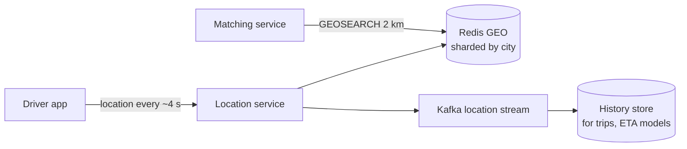

# 28 · Geospatial Indexing

> **Read time:** 35 min · **Visual:** [v17 geohash and quadtree](../../visuals/v17-geohash-quadtree.html) · **Code it:** [hld/code/06-geohash](../code/06-geohash/README.md)
> **Shows up in:** proximity service (Yelp, nearby), ride hailing (Uber/Ola driver matching), food delivery (restaurants and delivery partners near you), hotel search, store locators

## The idea in one line

Turn 2-D locations into keys that an ordinary index can search: cut the map into cells (geohash, quadtree, S2, H3), index points by cell, and answer "near me" by reading your cell and its neighbours, then filtering by exact distance.

## The problem it solves

"Find drivers within 2 km" with plain columns:

```sql
SELECT * FROM drivers WHERE lat BETWEEN ? AND ? AND lng BETWEEN ? AND ?;
```

A B-tree on `lat` narrows to a horizontal band across the whole country; a separate index on `lng` gives a vertical band. The DB intersects two huge sets. With millions of points and thousands of queries per second, that is too slow. You need an index where **points that are close in space are close in the index**.

## How it works

### Geohash

1. Split longitude range `[-180, 180]` in half: right half = 1, left = 0. Then split latitude `[-90, 90]`. Alternate, interleaving bits.
2. Every 5 bits become one base32 character. More characters = smaller cell.
3. Points in the same cell share a **prefix**. "Near" becomes a **prefix range query** on a normal string index or sorted set.

```
tdr1y   ≈ a 4.9 km × 4.9 km cell in Bengaluru
tdr1yv  ≈ one of the 32 smaller cells inside it (1.2 km × 0.6 km)
```

**The edge problem**: two points 10 m apart can sit on either side of a cell border and share no prefix. Fix: always query the **cell + its 8 neighbours** (9 cells), then compute exact distance (haversine) and sort.

Choose precision so a cell is about the size of your search radius. For 2 km, precision 5 (4.9 km cells) with 9 cells covers it; precision 6 cells are too small for a 2 km radius unless you query many more cells.

### Quadtree

A tree where each node is a rectangle. If a node holds more than K points (e.g. 100), split it into 4 children. Dense areas (central Mumbai) get deep, small cells; empty areas (a forest) stay as one big cell.

- Search: walk down to the leaf containing the user, then expand to neighbours until you have enough results.
- Usually built **in memory** on each server from the DB at startup (minutes for hundreds of millions of points), rebuilt periodically or updated incrementally.
- Good for **"find the 20 nearest"** where density varies a lot.

### S2 and H3

- **Google S2**: projects the Earth onto a cube, orders cells with a Hilbert curve. Cell ids are 64-bit integers; nearby cells have nearby ids. Levels 0–30. Good for covering arbitrary regions (delivery zones) with a set of cells.
- **Uber H3**: hexagonal cells at 16 resolutions (0–15). Every neighbour of a hexagon is the same distance away, which makes "rings" around a point, surge-pricing areas and supply/demand maps simple.

### Moving objects (drivers, delivery partners)



- Current location is **ephemeral**: keep it in memory (Redis), not in a row you update 100k times a second.
- Redis GEO stores members in a **sorted set** with a 52-bit geohash as the score. `GEOADD`, `GEOSEARCH ... BYRADIUS`. Shard by city or region so one key doesn't hold the whole country.
- Expire stale drivers: store a last-seen timestamp and drop those not updated in ~30 s.
- Write the stream to Kafka for history, ETA models and trip replay.

## Numbers to remember

| Geohash length | Cell size (approx.) |
|---|---|
| 4 | 39 km × 19.5 km |
| 5 | 4.9 km × 4.9 km |
| 6 | 1.2 km × 0.61 km |
| 7 | 153 m × 153 m |
| 8 | 38 m × 19 m |

- 1° of latitude ≈ **111 km**. 1° of longitude ≈ 111 km × cos(latitude) (≈ 100 km at Bengaluru, 13° N).
- Driver updates: 500k active drivers / 4 s ≈ **125k writes per second**. That's why it lives in memory.
- Point record: id + lat + lng + timestamp ≈ 30–50 bytes. 10M points ≈ a few hundred MB.

## Trade-offs and when not to use it

| Option | Use when | Weakness |
|---|---|---|
| Lat/lng range on B-tree | Tiny datasets | Two wide bands; slow |
| Geohash (string prefix / Redis GEO) | Simple radius search, easy to shard by prefix | Fixed cell sizes; edge problem; uneven density |
| Quadtree (in memory) | Uneven density, k-nearest | Must build and keep in memory; updates for moving points are costly |
| S2 | Region covering, polygons, delivery zones | Harder to explain and debug |
| H3 | Uniform neighbours, analytics over areas, surge zones | Hexagons don't nest perfectly |
| PostGIS (R-tree via GiST) / Elasticsearch `geo_point` | You also need polygons, joins, filters | Not built for 100k location writes per second |

For **static places** (restaurants, hotels) a geohash or PostGIS index in the DB is enough. For **moving things** (drivers) keep the index in memory and treat the DB as history.

## In real systems

- **Uber**: H3, built and open-sourced by Uber, for supply/demand, pricing and dispatch areas.
- **Google Maps**, **Foursquare**: S2 cells.
- **Redis GEO** commands are widely used for "nearby drivers / partners" in ride-hailing and delivery start-ups.
- **Swiggy / Zomato**: serviceability depends on delivery zones (polygons) plus distance from restaurant to customer; partners' live locations stream in every few seconds.
- **PostGIS** and **MongoDB 2dsphere** indexes for place search backed by a database.

## What to say in the interview

"Restaurants are static, so they live in Postgres with a geohash column (or PostGIS) and a read replica serves search: query the user's precision-5 cell plus its 8 neighbours, then filter by exact distance and rank. Delivery partners move, so their location goes to a location service every 4 seconds and into Redis GEO, sharded by city, with a TTL on stale partners. The matching service runs `GEOSEARCH` within 2 km and then scores candidates by ETA, not straight-line distance. The raw stream also goes to Kafka for history and ETA models."

## Common follow-ups

<details><summary>The 9 cells return 5,000 restaurants in central Mumbai and 0 in a village. Fix?</summary>

Adapt the precision: start with a fine cell and widen (shorter prefix) until you have enough results, or use a quadtree/S2 covering, which adapts to density. Cap results and rank them.
</details>

<details><summary>Why not store the driver location in Postgres with a GiST index?</summary>

100k+ updates per second would mean index updates, WAL writes and vacuum churn on every update. In-memory Redis handles this load easily, and the current position doesn't need durability; the next update arrives in seconds.
</details>

<details><summary>Straight-line distance says driver A is closer, but A is across a river. What do you do?</summary>

Use geo search only to get candidates (say 20 nearest), then compute road ETA with a routing service and pick by ETA. Geo index = filter, routing = ranking.
</details>

## Self-test (answer before opening)

<details><summary>1. Why query 9 geohash cells instead of 1?</summary>

The user can be near a cell edge. Close points across the border have a different prefix. The 8 neighbours cover that.
</details>

<details><summary>2. Two geohashes share the prefix `tdr1`. What does that tell you? What does it not?</summary>

They are in the same ~39 km × 19.5 km cell. It does not tell you they are far apart if the prefix differs: points on opposite sides of a border can be metres apart.
</details>

<details><summary>3. Which index for "drivers within 3 km, updated every 4 s"?</summary>

An in-memory geo index such as Redis GEO (geohash in a sorted set) sharded by city, with expiry of stale entries.
</details>

## Go deeper

- Alex Xu and Sahn Lam, *System Design Interview* Vol. 2, chapter 1 ("Proximity Service") and chapter 2 ("Nearby Friends")
- Uber engineering blog: "H3: Uber's Hexagonal Hierarchical Spatial Index"; S2 Geometry library documentation
- Redis docs: geospatial commands (`GEOADD`, `GEOSEARCH`)
- Practice: [hld/problems/22-proximity-service](../problems/22-proximity-service/README.md), [hld/problems/10-ride-hailing](../problems/10-ride-hailing/README.md), [hld/problems/11-food-delivery](../problems/11-food-delivery/README.md)
- Older notes in this repo: `archive/notes/hld-parts/part7.md`, "Problem 2: Uber/Lyft - Ride Matching" ("Geohash Search Concept")
