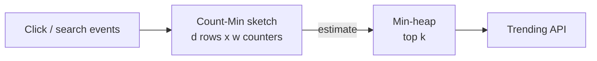

# 29 · Bloom Filter, HyperLogLog, Count-Min Sketch

> **Read time:** 30 min · **Visual:** [v16 Bloom filter](../../visuals/v16-bloom-filter.html) · **Code it:** [hld/code/03-bloom-filter](../code/03-bloom-filter/README.md), [hld/code/10-count-min-sketch](../code/10-count-min-sketch/README.md)
> **Shows up in:** web crawler (URL seen?), URL shortener (code taken?), ad click aggregation (top-k), metrics (unique visitors), LSM-tree databases, cache penetration protection, trending hashtags

## The idea in one line

When exact answers need too much memory, use a small structure that gives an approximate answer with a known error: "maybe in the set / definitely not" (Bloom), "about how many distinct" (HyperLogLog), "about how many times" (Count-Min).

## The problem it solves

- A crawler has seen 10 billion URLs. A hash set of them needs hundreds of GB of RAM.
- "Unique users today" across 500M events: a set of user ids per day, per page, per country explodes.
- "Top 100 search terms in the last hour" over a stream of millions of distinct terms: one counter per term is too much.

In all three, a small error (1%) is fine, and memory falls by 10–1000×.

## How it works

### Bloom filter: set membership

- A bit array of `m` bits, all 0, and `k` hash functions.
- **Add x**: set bits `h1(x) … hk(x)` to 1.
- **Check x**: if any of those bits is 0 → **definitely not** in the set. If all are 1 → **probably** in the set.
- **No false negatives**, some **false positives** (other items set the same bits).
- No delete (clearing a bit can remove other items). Use a **counting Bloom filter** (small counters instead of bits) or a **cuckoo filter** when you need deletes.

```
false positive rate  p ≈ (1 − e^(−k·n/m))^k
best k              = (m/n) · ln 2
bits per item       ≈ −1.44 · log2(p)       → ~9.6 bits for 1%, ~14.4 bits for 0.1%
```

Typical use: put the filter **in front of** an expensive lookup. "Not in filter" skips the disk/DB read entirely. "Maybe" does the real lookup.

### HyperLogLog: count distinct

- Hash each item. Look at the number of leading zeros in the hash. Seeing a hash with 20 leading zeros is rare (1 in 2^20), so it suggests you've seen around 2^20 distinct items.
- To reduce variance, split items into `m` registers by the first bits of the hash, keep the max leading-zero count per register, and combine with a harmonic mean.
- Standard error ≈ **1.04 / √m**.
- **Mergeable**: union of two HLLs = register-wise max. So you can keep one per hour and merge to get per day, without double counting users seen in both hours.
- Redis: `PFADD key item`, `PFCOUNT key`, `PFMERGE dest k1 k2`. Each key is at most **12 KB** with **0.81%** standard error.

### Count-Min sketch: frequency

- A table of `d` rows × `w` counters, one hash function per row.
- **Add x**: in each row, increment counter `h_i(x)`.
- **Estimate x**: take the **minimum** of its `d` counters.
- Collisions only add, so the estimate **never undercounts**; it may overcount.
- Error: with `w = ⌈e/ε⌉` and `d = ⌈ln(1/δ)⌉`, the overcount is at most `ε × total count` with probability `1 − δ`.
- **Top-k heavy hitters**: Count-Min for counts + a min-heap of size k. On each event, update the sketch, read the estimate, and push into the heap if it beats the smallest.



## Numbers to remember

- Bloom: **~10 bits per item for 1%** false positives, with k ≈ 7. 1 billion URLs ≈ 1.2 GB instead of ~100 GB of strings.
- HyperLogLog in Redis: **12 KB per key, 0.81%** standard error, counts up to billions.
- Count-Min: ε = 0.1% and δ = 0.1% → w ≈ 2,719, d ≈ 7 → ~19k counters ≈ 76 KB with 4-byte counters.

## Trade-offs and when not to use it

| Structure | Answers | Error | Use when | Not when |
|---|---|---|---|---|
| Hash set | Exact membership | None | Fits in memory | Billions of items |
| Bloom filter | "Maybe / definitely not" | False positives only | Skip costly lookups; dedupe hints | You need delete, or a false positive is unacceptable without a fallback check |
| Cuckoo filter | Same + delete | False positives | Need deletes | Very high fill rates |
| Exact `COUNT(DISTINCT)` | Exact distinct | None | Billing, finance | Real-time over huge cardinality |
| HyperLogLog | Distinct count | ~1% | Unique visitors, DAU dashboards | Need the actual list of users |
| Count-Min sketch | Frequency, top-k | Overcount | Trending, heavy hitters, abuse detection | Exact per-key counts (billing) |

Never use an approximate structure where money or a legal number depends on it. Use it for dashboards, filtering and hints, and keep exact counts in the batch path ([33](33-batch-stream-processing.md)).

## In real systems

- **Cassandra, HBase, RocksDB, LevelDB**: a Bloom filter per SSTable, so a read skips files that can't hold the key.
- **Redis**: HyperLogLog built in; Bloom, Cuckoo, Count-Min and Top-K in Redis Stack (RedisBloom).
- **Google Chrome Safe Browsing** used a Bloom filter (later other compact structures) to check URLs locally before asking the server.
- **Medium** has described using Bloom filters to avoid recommending articles a user has already read.
- **Druid, ClickHouse, BigQuery**: HLL-based approximate distinct counts (`APPROX_COUNT_DISTINCT`, `uniq`).

## What to say in the interview

"For the crawler's URL-seen check, I'll keep a Bloom filter sized for 5 billion URLs at 1% false positives, about 6 GB, sharded by URL hash. A 'no' means new, so we enqueue it. A 'maybe' means we skip it, and losing 1% of new URLs is acceptable for a crawler. For unique-visitor dashboards I'll keep one HyperLogLog per page per hour in Redis and merge them for daily numbers. Billing counts stay exact in the batch pipeline."

## Common follow-ups

<details><summary>The Bloom filter is full and the false-positive rate is climbing. What now?</summary>

Bloom filters can't grow in place. Create a bigger one and rebuild from the source of truth, or use a scalable Bloom filter (a chain of filters with tighter error rates), which RedisBloom supports.
</details>

<details><summary>Can a Bloom filter stop cache penetration (requests for keys that don't exist)?</summary>

Yes. Put all existing keys in a Bloom filter. A request for a key the filter says "definitely not" returns 404 without touching cache or DB. Keep the filter updated on inserts.
</details>

<details><summary>How do you get "top trending in the last hour", not "since the start"?</summary>

Keep one sketch per minute and sum the last 60 (sketches with the same hash functions add counter by counter), or use a sliding-window variant. Expire old minute sketches.
</details>

## Self-test (answer before opening)

<details><summary>1. A Bloom filter says "not present". Can it be wrong?</summary>

No. If the item was added, all its bits are 1. A 0 bit proves it was never added.
</details>

<details><summary>2. Why can you merge two HyperLogLogs but not add two exact distinct counts?</summary>

Adding counts double-counts items seen in both sets. HLL merge takes the max per register, which equals the HLL of the union.
</details>

<details><summary>3. Count-Min says term X appeared 10,500 times. What do you know about the true count?</summary>

It is at most 10,500. It may be lower because of collisions, never higher.
</details>

## Go deeper

- Burton Bloom, "Space/Time Trade-offs in Hash Coding with Allowable Errors" (1970); Flajolet et al., "HyperLogLog" (2007); Cormode and Muthukrishnan, "An Improved Data Stream Summary: The Count-Min Sketch" (2005)
- Redis docs: HyperLogLog; RedisBloom (Bloom, Cuckoo, Count-Min, Top-K)
- Practice: [hld/problems/13-web-crawler](../problems/13-web-crawler/README.md), [hld/problems/20-ad-click-aggregation](../problems/20-ad-click-aggregation/README.md)
- Older notes in this repo: `archive/notes/hld-parts/part6b.md`, "Part 3: Analytics System - Real-Time Aggregation" ("3.3 Top-K Algorithm (Count-Min Sketch)")
