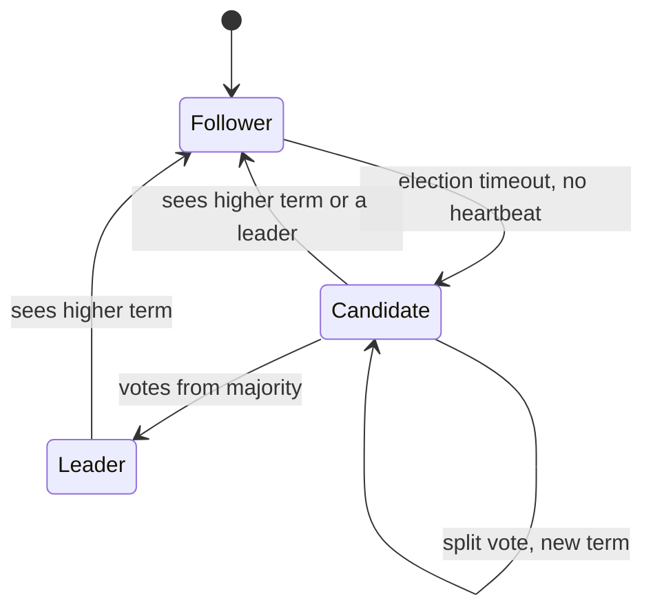
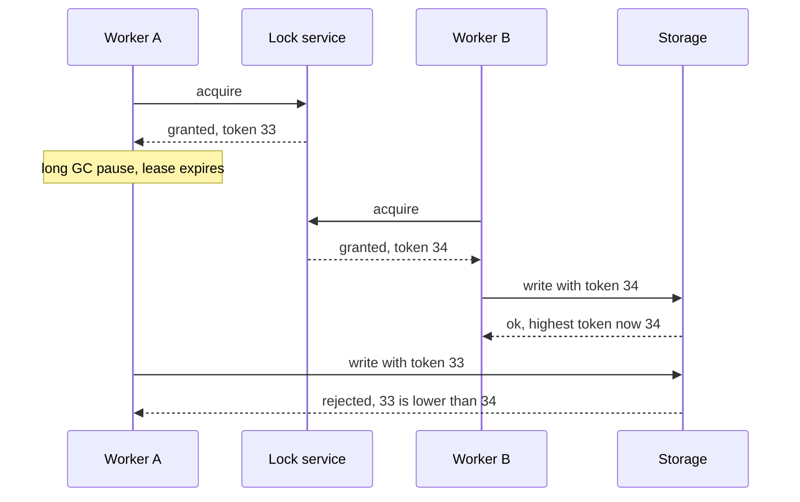

# 30 · Consensus, Leader Election, Distributed Locks

> **Read time:** 45 min · **Visual:** [v18 Raft leader election](../../visuals/v18-raft-leader-election.html) · **Code it:** none (use etcd or ZooKeeper; don't build consensus yourself)
> **Shows up in:** distributed job scheduler, key-value store, distributed message queue (Kafka KRaft), ticket booking (seat locks), config and feature-flag services, Kubernetes itself

## The idea in one line

Consensus lets a group of machines agree on one value or one ordered log even when some crash, as long as a **majority** is alive; you use it (through etcd or ZooKeeper) for leader election, config and locks, and you protect locks with **fencing tokens**.

## The problem it solves

- Two scheduler instances both think they are the leader and both run the daily payout job. Merchants get paid twice.
- A lock holder pauses for 15 s (GC, VM freeze), its lock expires, another worker takes it, and then the first one wakes up and writes anyway.
- Five config servers must agree on "feature X is ON" without a split brain during a network partition.

You cannot solve these with timeouts and "I think I'm leader" alone. You need a source of truth that only changes with majority agreement.

## How it works

### Raft in five points

1. **Terms**: time is split into numbered terms. Each term has at most one leader. A node that sees a higher term steps down and adopts it.
2. **Leader election**: a follower that hears no heartbeat for a randomised **election timeout** (the paper suggests 150–300 ms) becomes a candidate, increments the term, votes for itself and sends `RequestVote`. Each node votes **once per term**, and only for a candidate whose log is at least as up to date as its own. A majority of votes wins. Random timeouts make split votes rare.
3. **Log replication**: clients send writes to the leader. The leader appends to its log and sends `AppendEntries` to followers (empty `AppendEntries` = heartbeat).
4. **Commit**: an entry is committed once stored on a **majority**. Then it is applied to the state machine and the client gets success. A committed entry is never lost, because any future leader must have it (the vote rule ensures this).
5. **Majority**: `2f + 1` nodes tolerate `f` failures. A minority partition can't elect a leader or commit writes, which is what stops split brain.

### ZooKeeper and etcd: what you use them for

| Use | etcd | ZooKeeper |
|---|---|---|
| Consensus protocol | Raft | ZAB (similar idea) |
| Leader election | Lease + key with lowest revision (the `concurrency` package) | Ephemeral sequential znodes; lowest number is leader |
| Liveness | Leases with TTL, kept alive by the client | Sessions; ephemeral nodes vanish when the session ends |
| Change notifications | Watch on key or prefix | Watches on znodes |
| Known users | Kubernetes (all cluster state) | Older Kafka (before KRaft), HBase, Hadoop, Solr |

Use them for **small, critical metadata** (who is leader, which shard lives where, config), not for application data. Writes go through the leader and a majority, so throughput is limited (thousands to low tens of thousands of writes per second).

### Distributed locks and fencing tokens

A lock with a lease (TTL) is safe only if the protected resource **rejects stale holders**.

- The lock service hands out a **monotonically increasing token** with each grant (etcd: the key's revision; ZooKeeper: the znode's sequence number or `zxid`).
- The storage remembers the highest token it has seen and rejects lower ones. In SQL: `UPDATE ... SET ..., last_token = :t WHERE id = ? AND last_token < :t`.
- Without fencing, a paused process can always wake up and write after its lease ended. No TTL value fixes that.

### Redis locks and why Redlock is debated

- **Single Redis lock**: `SET lock:job123 <random-id> NX PX 30000`. Release with a Lua script that deletes only if the value equals your id (so you never delete someone else's lock). Fine for **efficiency** locks (avoid doing the same work twice; a rare duplicate is OK). On failover, an async replica may not have the lock, so two holders are possible.
- **Redlock**: acquire the same lock on a majority of N (usually 5) **independent** Redis masters within a time limit; the lock is valid for TTL minus elapsed time.
- **The debate**: Martin Kleppmann ("How to do distributed locking", 2016) argued Redlock depends on bounded clock drift, network delay and process pauses, and it provides no fencing token, so it is unsafe for **correctness**. Salvatore Sanfilippo (antirez) replied ("Is Redlock safe?") that the assumptions are reasonable in practice. The practical takeaway used in interviews: for correctness, use a consensus store (etcd/ZooKeeper) **plus fencing**, or a DB constraint; use Redis locks for efficiency.

## Numbers to remember

- Cluster size: **3** nodes tolerate 1 failure; **5** tolerate 2. 4 nodes still tolerate only 1, so use odd numbers.
- Raft election timeout in the paper: **150–300 ms**; etcd's default election timeout is 1,000 ms with a 100 ms heartbeat.
- A Raft write = 1 round trip from leader to a majority + fsync. Cross-region clusters pay the WAN round trip on every write.
- etcd recommended max database size is a few GB (default quota 2 GB). It is a metadata store.

## Trade-offs and when not to use it

| Option | Use when | Weakness |
|---|---|---|
| etcd / ZooKeeper / Consul | Leader election, config, membership, correctness locks | Small data only; one more cluster to run |
| DB row lock / unique constraint | The resource is already in that DB | Ties to DB availability; long-held locks block others |
| Single Redis `SET NX PX` | Efficiency locks, short tasks | Unsafe on failover; no fencing |
| Redlock | You already run several independent Redis nodes and accept its assumptions | Debated safety; no fencing token |
| Kubernetes Lease object | Leader election for a controller or a singleton job in K8s | Same lease caveats; built on etcd |
| No lock: idempotent ops + conditional writes | You can make the operation safe to run twice | Not always possible |

Often the best lock is **no lock**: a conditional update (`WHERE status = 'PENDING'`) or a unique key does the job.

## In real systems

- **Kubernetes**: all cluster state in etcd; controllers use `Lease` objects for leader election.
- **Kafka**: moved from ZooKeeper to **KRaft** (Raft-based controller quorum) for metadata.
- **CockroachDB, TiKV, Consul**: Raft per range or for the catalog. **Google Chubby** (paper, 2006): the lock service that inspired ZooKeeper.
- **Spanner**: Paxos groups per shard.

## What to say in the interview

"Only one scheduler may trigger payouts, so the instances elect a leader through an etcd lease. If the leader dies, its lease expires in about 10 seconds and another instance takes over. Because a paused old leader could still wake up, every payout run carries the lease revision as a fencing token, and the payouts table rejects writes with a lower token. The payout itself is also idempotent by batch id. For short efficiency locks, like avoiding two workers refreshing the same cache, a single Redis `SET NX PX` is enough."

## Common follow-ups

Why does a 3-node cluster stop accepting writes when 2 nodes fail?

A commit needs a majority (2 of 3). With one node alive it can't know whether the other two elected a new leader and committed different entries, so it must refuse writes to stay consistent (CP behaviour).

Can two Raft leaders exist at the same time?

Briefly, yes, in different terms: an old leader in a minority partition may still think it leads. It can't commit anything, because it can't reach a majority. When it sees the higher term, it steps down. Reads served by that old leader can be stale unless it confirms leadership first (ReadIndex or lease reads).

How do you choose a lock TTL?

Longer than the normal task time with margin, and renew it in the background while working. Fencing still matters, because no TTL protects against an arbitrarily long pause.

## Self-test (answer before opening)

1. How many failures does a 5-node Raft cluster tolerate? A 6-node one?

5 nodes: 2 (majority is 3). 6 nodes: still 2 (majority is 4). The sixth node adds cost without extra fault tolerance.

2. What does a fencing token protect against that a TTL can't?

A holder that pauses past its lease and then writes. The storage rejects its old, lower token.

3. Why randomise the election timeout?

If all followers timed out together, they'd all become candidates and split the vote again and again. Random timeouts let one start first and usually win.

## Go deeper

- Ongaro and Ousterhout, "In Search of an Understandable Consensus Algorithm" (the Raft paper, 2014); the Raft visualisation at the Raft project site
- DDIA, chapter 8: "The leader and the lock" and "Fencing tokens"; chapter 9: "Consensus" and "Membership and Coordination Services"
- Martin Kleppmann, "How to do distributed locking" (2016); antirez, "Is Redlock safe?" (2016)
- Older notes in this repo: `archive/notes/hld-parts/part8.md`, "1. Consensus Algorithms" and "Exercise 1: Raft Visualization Study"; `archive/notes/hld-parts/part6b.md`, "3.5 Leader Election (ZooKeeper)" and "4.2 Consensus Algorithm: Raft Basics"
- Practice: [hld/problems/24-job-scheduler](../problems/24-job-scheduler/README.md), [hld/problems/04-key-value-store](../problems/04-key-value-store/README.md)
