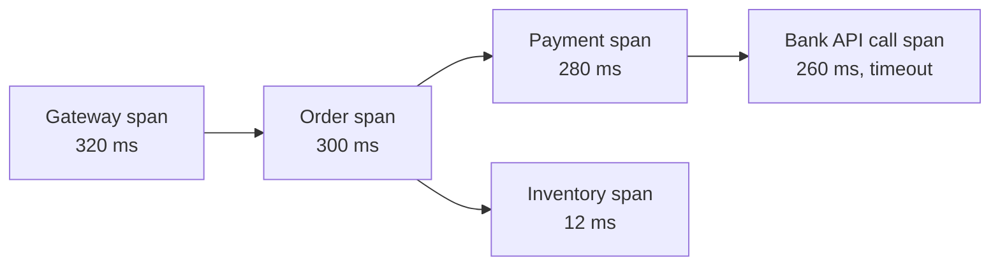

# 31 · Observability: Logs, Metrics, Traces, SLOs

> **Read time:** 35 min · **Visual:** [v01 life of a request](../../visuals/v01-request-lifecycle.html) (where each hop adds latency) · **Code it:** none (instrument one of your own Node services with OpenTelemetry)
> **Shows up in:** metrics and monitoring system, ad click aggregation, the "how would you monitor this?" question at the end of every HLD round

## The idea in one line

Emit metrics to know **that** something is wrong, traces to see **where**, and logs to see **why**; define SLOs on what users feel, and alert when the error budget burns too fast.

## The problem it solves

Checkout success drops from 98% to 91% at 9 p.m. during a sale. There are 40 services. Without observability you'd be SSH-ing into pods and grepping text logs. With it: a dashboard shows the drop, an alert fires within minutes, traces show the time is spent in the payment service's call to one bank, and the logs for those trace ids show `ETIMEDOUT` from that bank's endpoint.

## How it works

### The three signals

| Signal | What it is | Good for | Cost driver |
|---|---|---|---|
| **Metrics** | Numbers over time with labels: `http_requests_total{route,status}` | Dashboards, alerts, trends | Label **cardinality** |
| **Traces** | A tree of spans for one request across services | Finding the slow or failing hop | Volume; needs sampling |
| **Logs** | Timestamped events, ideally structured JSON | Detail of one error or decision | Volume (GB/day), retention |

Join them with ids: every log line carries `trace_id` and `span_id`; metrics can carry **exemplars** (a sample trace id per bucket).

### What to measure

- **RED** for every service: **R**ate (requests/s), **E**rrors (failed/s or %), **D**uration (latency histogram).
- **USE** for every resource (CPU, memory, disk, DB pool, queue): **U**tilisation, **S**aturation (queue length, waiting), **E**rrors.
- **Four golden signals** (Google SRE book): latency, traffic, errors, saturation.
- **Business metrics**: payment success rate per PSP, per bank, per method; orders per minute; refunds pending. These often catch problems that technical metrics miss.
- Queues: **consumer lag** (Kafka) and oldest message age.

### Latency: use percentiles from histograms

- Report **p50, p95, p99** (and p99.9 for high-volume paths), not the average. A 50 ms average can hide a 3 s p99.
- Record latency as a **histogram** (buckets) in each pod. Histograms can be summed across pods and then a percentile computed. You **cannot** average p99s from 20 pods to get the fleet p99.

### Cardinality

Every unique label combination is a separate time series. `route × status × method` = a few hundred series: fine. Adding `user_id` or `payment_id` as a label creates millions and can bring down Prometheus. Put high-cardinality values in **logs and traces**, not metric labels.

### Tracing

- Context travels in the W3C `traceparent` header (trace id, parent span id, flags). Message queues carry it in message headers.
- **OpenTelemetry** is the standard SDK and protocol (OTLP) for traces, metrics and logs. Node has auto-instrumentation for http, express, pg, redis, kafkajs and more.
- **Sampling**: head-based (decide at the start, e.g. keep 1%) is cheap but may drop the interesting failures. **Tail-based** (the collector decides after seeing the whole trace: keep all errors and slow ones) costs more but keeps what you need.

### Logs

- Structured JSON (in Node, `pino` is fast and common): `{level, msg, trace_id, merchant_id, payment_id, latency_ms}`.
- Never log secrets, card numbers, CVV, full Aadhaar or passwords. Mask PII.
- Ship with an agent (Fluent Bit, Vector) to Elasticsearch/OpenSearch, Loki or a vendor. Keep hot retention short (7–30 days) and archive to S3.

### SLI, SLO, SLA and error budgets

- **SLI**: a measured ratio, e.g. "% of payment API requests that return non-5xx within 1 s".
- **SLO**: the target, e.g. 99.9% over 30 days.
- **SLA**: a contract with penalties, usually looser than the SLO.
- **Error budget** = 1 − SLO. At 99.9%, you may "spend" 0.1% of requests (or ~43 minutes) per 30 days. If the budget is spent, slow down risky releases.
- **Burn-rate alerts** (SRE Workbook): page when the budget is burning fast, e.g. 14.4× the normal rate over 1 hour (that spends 2% of a 30-day budget in an hour). Warn on slower burns over 6 hours or 3 days.
- Alert on **symptoms** users feel (error rate, latency), not causes (CPU 80%). Causes go on dashboards.

## Numbers to remember

| Availability | Downtime per 30 days | Per year |
|---|---|---|
| 99% | 7.2 h | 3.65 days |
| 99.9% | 43.2 min | 8.76 h |
| 99.95% | 21.6 min | 4.38 h |
| 99.99% | 4.3 min | 52.6 min |

- Prometheus scrape intervals are commonly 15–30 s, so a metric alert needs at least a minute or two to fire reliably.
- 1,000 pods × 500 series each = 500k active series: a normal size for one well-run Prometheus setup; beyond that, shard or use Thanos, Cortex or Mimir.

## Trade-offs and when not to use it

| Option | Use when | Weakness |
|---|---|---|
| Pull metrics (Prometheus scrapes) | Long-lived services in K8s | Short-lived jobs need a push gateway |
| Push metrics (StatsD, OTLP push) | Serverless, batch jobs | Need to protect the receiver from floods |
| Head sampling | High volume, cost matters | Misses rare failures |
| Tail sampling | You need every error trace | Collector must buffer whole traces |
| Logs for everything | Small scale | Cost explodes; slow to query for trends |
| Self-hosted (Prometheus, Grafana, Loki, Tempo, Jaeger) | Cost control, data residency | You run it |
| Vendor (Datadog, New Relic, Grafana Cloud) | Small platform team | Cost grows with volume and cardinality |

## In real systems

- **Prometheus + Grafana**: the default open-source metrics stack; **Alertmanager** for routing alerts.
- **Jaeger**, **Grafana Tempo**, **Zipkin**: trace backends. **OpenTelemetry Collector** in the middle.
- **Google SRE** practices (SLOs, error budgets, burn-rate alerts) are now widely adopted, including at Indian product companies.
- Payment companies watch **success rate per bank / PSP / method** in near real time and use it to route traffic away from failing banks.

## What to say in the interview

"Every service exports RED metrics as Prometheus histograms, plus business metrics like payment success rate by PSP and bank. Traces use OpenTelemetry with the W3C traceparent header, also carried through Kafka headers, with tail sampling that keeps all errors and slow requests. Logs are JSON with trace ids and no card data. The SLO for the payment API is 99.95% of requests succeeding within 1 second over 30 days; we page on fast burn rates and send slow burns to a ticket queue."

## Common follow-ups

How would you find why p99 latency doubled after a deploy?

Compare the latency histogram by version label (canary vs stable). Pull exemplar traces from the slow buckets. Look at which span grew, then read that span's logs. Check saturation metrics (DB pool waits, event loop lag in Node) for the same pods.

What extra metric matters for Node.js services?

**Event loop lag / utilisation**. A blocked event loop raises latency for every request in the process, even when CPU looks fine. Also heap usage and GC pauses.

How do you monitor an async pipeline (Kafka consumers)?

Consumer lag per partition, oldest unprocessed message age, processing error rate, DLQ size, and an end-to-end freshness SLI (event time to "visible in read model").

## Self-test (answer before opening)

1. Why can't you average p99s across pods?

Percentiles don't combine linearly. A pod with little traffic and a high p99 would distort the result. Sum the histogram buckets across pods, then compute the percentile.

2. Is `payment_id` a good metric label?

No. Unbounded cardinality: one new time series per payment. Put it in logs and trace attributes.

3. SLO 99.9% over 30 days, and you've had 30 minutes of full outage. How much budget is left?

About 13 minutes (43.2 − 30), roughly 30% of the budget.

## Go deeper

- Google, *Site Reliability Engineering*: "Monitoring Distributed Systems" and "Service Level Objectives"; *The Site Reliability Workbook*: "Alerting on SLOs"
- OpenTelemetry documentation: concepts (traces, metrics, logs, context propagation); W3C Trace Context specification
- Practice: [hld/problems/19-metrics-monitoring](../problems/19-metrics-monitoring/README.md)
- Older notes in this repo: `archive/notes/hld-parts/part4.md`, "Module 4.2: Monitoring & Alerting" ("RED & USE Metrics", "Structured Logging", "Distributed Tracing", "SLI, SLO, SLA (Detailed)"); `archive/notes/hld-parts/part3.md`, "Topic 6: Distributed Tracing"
