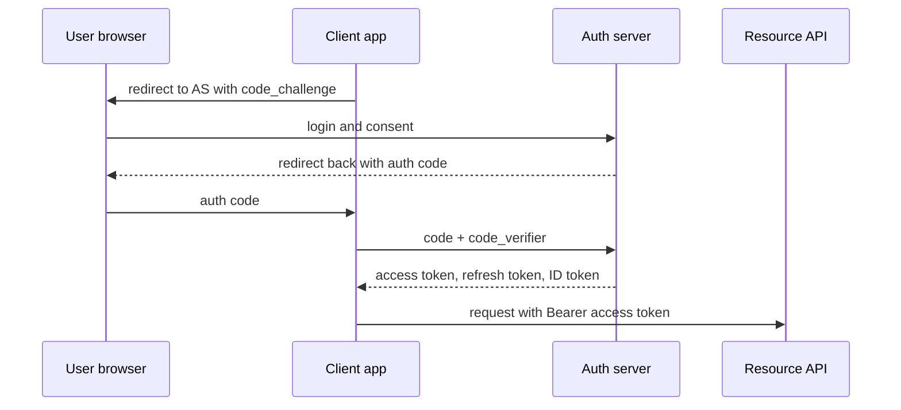

# 32 · Security: AuthN/AuthZ, OAuth2, JWT

> **Read time:** 35 min · **Visual:** none (flow below) · **Code it:** none (build a login + refresh flow in Express as practice)
> **Shows up in:** every design's API layer; payment system (merchant API keys, webhook signing), digital wallet, chat system, multi-tenant SaaS (Atlassian), "how do services trust each other?"

## The idea in one line

Authentication proves **who** is calling; authorization decides **what** they may do. Use short-lived signed tokens for users, scoped credentials or mTLS for services, and check permissions on every resource, not just at login.

## The problem it solves

- A session table checked on every request becomes a hot dependency for 50 services.
- A user changes `/api/orders/1001` to `/api/orders/1002` and sees someone else's order (an IDOR, part of **broken access control**, #1 in the OWASP Top 10 2021).
- A partner app needs to read a user's data without ever seeing the user's password.
- One leaked internal credential lets an attacker call every internal service.

## How it works

### Sessions vs tokens

| | Server session | JWT (self-contained token) |
|---|---|---|
| What the client holds | Opaque session id in a cookie | Signed token with claims |
| Server check | Look up session in Redis/DB | Verify signature + expiry locally |
| Revocation | Delete the session: instant | Hard: valid until `exp` unless you keep a denylist |
| Fits | Web apps, one backend | Many services, mobile, APIs |

### JWT basics

```
header.payload.signature            (each part base64url-encoded)
header:  {"alg":"RS256","kid":"key-2026-10"}
payload: {"sub":"user_42","scope":"orders:read","exp":1792300000,"iss":"auth.example.com","aud":"api"}
```

- **Signed, not encrypted.** Anyone can read the payload. Don't put secrets or PII in it.
- **HS256** (shared secret): every verifier can also forge tokens. **RS256 / ES256** (private key signs, public key verifies): services only get the public key, published as a **JWKS** with `kid` for key rotation.
- Always check `alg` (reject `none` and unexpected algorithms), `exp`, `iss`, `aud`.
- **Access token**: short-lived (5–15 min). **Refresh token**: long-lived, opaque, stored server-side, **rotated** on every use; reuse of an old refresh token means theft, so revoke the whole family.
- Store tokens in browsers as `HttpOnly; Secure; SameSite` cookies when you can (safe from XSS reading them; add CSRF protection), not in `localStorage`.

### OAuth 2.0 and OIDC

OAuth 2.0 is for **delegated authorization**: "let app X act on my behalf with these scopes". **OpenID Connect** (OIDC) adds authentication on top: an **ID token** (a JWT) that says who the user is.



| Flow | Use for |
|---|---|
| Authorization code + **PKCE** | Web apps, SPAs, mobile apps (the default now) |
| Client credentials | Service-to-service, merchant server to your API |
| Refresh token | Getting new access tokens without a new login |
| Device code | TVs, CLIs |
| Implicit, password grant | **Don't use.** Deprecated by the OAuth security best current practice and dropped in OAuth 2.1 |

### Authorization models

- **RBAC**: roles → permissions (`admin`, `support`, `viewer`). Simple; roles multiply over time.
- **ABAC**: rules on attributes (`user.org == resource.org && amount < limit`). Flexible; harder to audit. Tools: OPA (Rego), AWS Cedar.
- **ReBAC**: permissions from relationships ("member of team that owns doc"). Google **Zanzibar** and its open-source descendants (SpiceDB, OpenFGA). Good for sharing models like Google Drive or Confluence.
- Always check **ownership** in the service: `WHERE id = ? AND merchant_id = :callerMerchant`. The gateway alone can't know resource ownership.

### Service-to-service and other essentials

- **mTLS** between services (often issued and rotated by a service mesh): both sides prove identity with certificates.
- **API keys for merchants**: a key id + secret; store only a hash of the secret; allow multiple active keys for rotation; scope by environment (test/live).
- **Request signing** with HMAC (webhooks, partner APIs): sign the raw body + timestamp; verify with a constant-time compare ([35](35-payments-domain.md)).
- **Secrets**: in Vault, AWS Secrets Manager or KMS, never in git or env files baked into images.
- **Encryption**: TLS 1.2+ in transit; at rest with **envelope encryption** (a KMS master key encrypts per-record or per-table data keys).
- **Passwords**: hash with **argon2id** or **bcrypt** (slow, salted), never SHA-256 alone. Rate-limit login and OTP ([23](23-rate-limiting.md)); add MFA.

## Numbers to remember

- Access token TTL: **5–15 min**. Refresh token: days to weeks, rotated.
- bcrypt cost factor: tune so one hash takes roughly **100–250 ms** on your servers.
- RS256 verification is fast (microseconds to tens of microseconds); signing is slower. Cache the JWKS; refresh it on an unknown `kid`.
- OTP: 6 digits = 1M combinations. Without attempt limits it can be brute-forced; limit to ~3–5 tries per OTP.

## Trade-offs and when not to use it

| Option | Use when | Weakness |
|---|---|---|
| Server sessions in Redis | Web app, need instant logout | Lookup on each request; shared store |
| Stateless JWT | Many services, need local verification | Revocation; token size |
| JWT + short TTL + denylist by `jti` | Need both scale and revocation | Small extra lookup for the denylist |
| Opaque token + introspection | High-risk APIs, instant revocation | Network call per request (cache it briefly) |
| RBAC | Few, stable roles | Role explosion |
| ABAC / ReBAC | Multi-tenant, sharing, fine-grained rules | Policy engine to run and audit |
| mTLS | Internal zero-trust networks | Certificate management (use a mesh) |

## In real systems

- **Auth0, Okta, Keycloak, AWS Cognito**: identity providers implementing OAuth 2.0 / OIDC.
- **Google Zanzibar** (paper, 2019): authorization for Drive, YouTube, Calendar; SpiceDB and OpenFGA are open-source versions.
- **Stripe / Razorpay**: merchant API keys with separate test and live modes; webhook payloads signed with HMAC-SHA256.
- **Istio / Linkerd**: automatic mTLS between pods.

## What to say in the interview

"Users log in through an OIDC provider with the authorization code flow plus PKCE. The gateway verifies the RS256 access token against cached JWKS keys and passes the user id and scopes downstream. Access tokens live 10 minutes; refresh tokens are rotated and stored server-side so we can revoke them. Each service checks resource ownership itself, for example `merchant_id` on every query, so a changed id in the URL returns 404. Services talk over mTLS from the mesh, and secrets come from a secrets manager."

## Common follow-ups

<details><summary>How do you log a user out everywhere when they use JWTs?</summary>

Revoke all their refresh tokens (server-side), so no new access tokens are issued. Existing access tokens live at most their short TTL. If that's too long, keep a denylist of `jti` values (or a per-user "tokens issued before T are invalid" timestamp) in Redis until those tokens expire.
</details>

<details><summary>Where should authorization happen: gateway or service?</summary>

Both. The gateway does coarse checks (valid token, scope allows `orders:write`). The service does fine checks (this user owns this order), because only it knows the resource.
</details>

<details><summary>Why PKCE even for a server app?</summary>

It binds the authorization code to the client that started the flow, so a stolen code (from logs, a malicious app, a redirect) can't be exchanged. The OAuth security BCP recommends it for all clients.
</details>

## Self-test (answer before opening)

<details><summary>1. Is data inside a JWT payload secret?</summary>

No. It is only base64url-encoded and signed. Anyone with the token can read it. Use JWE if you really need encryption.
</details>

<details><summary>2. Why prefer RS256 over HS256 with 30 services?</summary>

With HS256 every service holds the secret and could mint tokens. With RS256 only the auth server has the private key; services get the public key.
</details>

<details><summary>3. `GET /orders/1002` returns another merchant's order. Name the bug and the fix.</summary>

IDOR / broken access control. Scope every query by the caller's identity (`WHERE id = ? AND merchant_id = ?`) and return 404 when it doesn't match.
</details>

## Go deeper

- RFC 6749 (OAuth 2.0), RFC 7636 (PKCE), RFC 7519 (JWT), RFC 9700 (OAuth 2.0 Security Best Current Practice); OpenID Connect Core 1.0
- OWASP Top 10 (2021) and the OWASP Cheat Sheet Series: "Authentication", "JSON Web Token", "Password Storage"
- "Zanzibar: Google's Consistent, Global Authorization System" (USENIX ATC 2019)
- Older notes in this repo: `archive/notes/hld-parts/part3.md`, "MODULE 3.4: AUTHENTICATION & AUTHORIZATION" ("Topic 2: JWT Structure & Claims", "Topic 3: OAuth 2.0 Flows", "Topic 5: RBAC vs ABAC"); `archive/notes/hld-parts/part8.md`, "2. OAuth2 & JWT Deep Dive"; `archive/notes/hld-parts/part4.md`, "Module 4.4: Security Best Practices"
