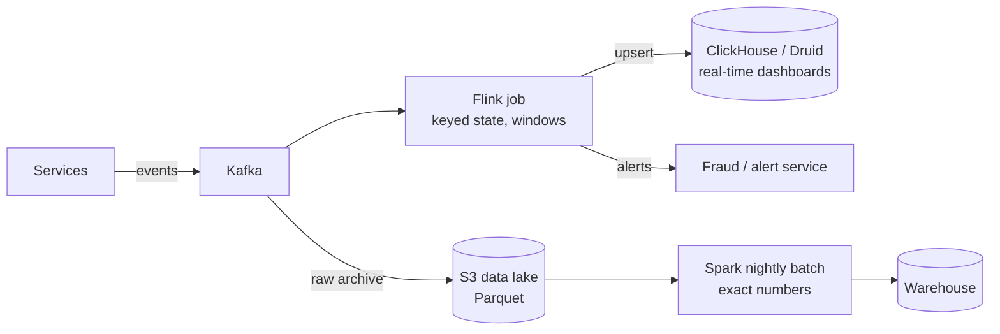

# 33 · Batch and Stream Processing

> **Read time:** 35 min · **Visual:** [v10 Kafka partitions and consumer groups](../../visuals/v10-kafka-consumer-groups.html) · **Code it:** [hld/code/10-count-min-sketch](../code/10-count-min-sketch/README.md) (a streaming top-k)
> **Shows up in:** ad click aggregation, metrics and monitoring, real-time leaderboard, payment reconciliation, fraud detection, recommendations, data warehouse pipelines

## The idea in one line

Batch processing runs over a **bounded** dataset (yesterday's files) for complete, correct answers; stream processing runs over an **unbounded** flow of events with windows and state for answers in seconds. Most real systems use both.

## The problem it solves

- "Clicks per ad per minute, for billing advertisers": must be fast for dashboards and exact for invoices.
- "Flag a card used in 5 cities within 10 minutes": must happen while the payment is in flight, not tomorrow.
- "Daily settlement and reconciliation report": must cover every transaction of the day, exactly once.

Running these as ad-hoc SQL on the production OLTP database slows it down and doesn't scale.

## How it works

### Batch

- Input is bounded: files in S3/HDFS, a DB snapshot, a day's Kafka data dumped to the lake.
- **MapReduce** model: map (emit key/value), shuffle (group by key across machines), reduce (aggregate). **Spark** does the same with in-memory datasets and a DAG of stages, much faster than classic Hadoop MapReduce.
- Orchestrated by **Airflow** (or Dagster, Step Functions) as scheduled DAGs with retries and backfills.
- Rerun-safe: write outputs to a new partition (`dt=2026-10-17/`) and swap, so a rerun replaces instead of duplicating.

### Stream

Core ideas:
- **Event time vs processing time**: event time = when it happened (in the event); processing time = when the job sees it. A phone offline for 10 minutes sends old events late. Aggregate by **event time** for correct results.
- **Windows**:
  - **Tumbling**: fixed, no overlap (every 1 minute).
  - **Sliding / hopping**: fixed size, overlapping (last 10 min, every 1 min).
  - **Session**: closes after a gap of inactivity (user session ends after 30 min idle).
- **Watermarks**: the job's estimate that "no more events older than T will arrive". When the watermark passes the window end, the window fires. Events later than that are **late data**: drop them, send to a side output, or update the result (allowed lateness).
- **State**: per-key counters, windows, joins. Kept locally (Flink uses RocksDB) and **checkpointed** to S3.
- **Exactly-once state**: Flink takes consistent snapshots (checkpoint barriers flow through the graph) of state + Kafka offsets together. After a failure, it restores both and replays. The **sink** must still be idempotent (upsert by key) or transactional (Kafka transactions, two-phase commit sinks) for end-to-end exactly-once.

### Lambda vs Kappa

| | Lambda | Kappa |
|---|---|---|
| Layout | Batch layer (correct) + speed layer (fast); merge in serving | One stream pipeline; reprocess by replaying the log |
| Pro | Batch fixes stream errors | One codebase |
| Con | Two codebases computing the same thing | Needs long log retention and a replay-capable engine |

Common practice now: streaming for real-time views, plus a batch **reconciliation** job for numbers that touch money.

### Storage for analytics

- **OLTP** (Postgres, MySQL): row-oriented, many small transactions.
- **OLAP** (ClickHouse, Druid, Pinot, BigQuery, Redshift, Snowflake): **columnar**, compressed, fast scans and aggregations over billions of rows.
- **Data lake**: files (Parquet, ORC) in S3, with a table format (**Apache Iceberg**, Delta Lake, Hudi) for schema evolution, partitions and ACID-like updates.
- **ETL vs ELT**: transform before loading (ETL), or load raw then transform inside the warehouse (ELT, with tools like dbt). ELT is more common with cloud warehouses.

## Numbers to remember

- Kafka → Flink → OLAP: end-to-end freshness of **seconds** is normal.
- Checkpoint interval: commonly **10 s – a few minutes**. Shorter = less replay after failure, more overhead.
- Columnar compression on event data: often **5–10×** smaller than row storage.
- Back-of-envelope: 10B events/day × 200 bytes = 2 TB/day raw; ~200–400 GB/day as compressed Parquet.

## Trade-offs and when not to use it

| Option | Use when | Weakness |
|---|---|---|
| Batch (Spark + Airflow) | Daily reports, ML training, reconciliation, backfills | Hours of delay |
| Micro-batch (Spark Structured Streaming) | Second-to-minute latency is fine; team knows Spark | Not true per-event; latency floor |
| Stream (Flink, Kafka Streams) | Seconds or less; event-time windows; fraud, alerts | State management, watermarks, harder ops |
| Kafka Streams | JVM services that need light stream processing, no extra cluster | Tied to Kafka; JVM only |
| Plain Node consumer (kafkajs) + Redis | Simple counters and per-event work | You rebuild windows, state and recovery yourself |
| Lambda architecture | Money numbers need batch correctness | Two pipelines |
| Kappa architecture | One logic path; log can be replayed | Replays of months of data are slow and costly |

## In real systems

- **Uber**: Kafka + Flink for real-time features and pricing signals; Apache Pinot for real-time analytics; Hudi created at Uber for the data lake.
- **LinkedIn**: created Kafka and Samza; Pinot also came from LinkedIn.
- **Netflix**: Flink for real-time pipelines; Iceberg was created at Netflix.
- **Payments**: real-time success-rate dashboards from streams; settlement and reconciliation as nightly batch jobs on PSP and bank files.

## What to say in the interview

"Click events go to Kafka keyed by ad id. A Flink job counts clicks in 1-minute tumbling windows by event time, with a watermark of 1 minute and late events sent to a side output, and upserts the results into ClickHouse for dashboards. Raw events also land in S3 as Parquet. A nightly Spark job recomputes exact counts from the raw data, and those numbers are used for billing. If they differ from the streaming numbers by more than a small threshold, we alert."

## Common follow-ups

How do you avoid double counting when the stream job restarts?

Checkpoint state and input offsets together, so after a restart the job resumes from a consistent point. Write to the sink with idempotent upserts keyed by `(ad_id, window_start)`, so replayed windows overwrite instead of adding. Dedupe input events by event id if producers may resend.

One key (a viral ad) gets 50% of events. What happens and how do you fix it?

One task gets all that key's work and lags (skew). Pre-aggregate with salted keys (`ad_id#0..#9`) in a first stage, then merge the partial counts in a second stage.

Why not just run the aggregation SQL on the production database every minute?

It competes with OLTP traffic, scans grow with data, and row stores are slow for large aggregations. Move events out through CDC or Kafka and aggregate in a system built for it.

## Self-test (answer before opening)

1. A click happened at 10:00:58 but arrived at 10:01:20. Which 1-minute window should count it?

The 10:00–10:01 window (event time), if it arrives before the watermark closes that window or within allowed lateness.

2. Tumbling vs sliding window for "transactions in the last 10 minutes, updated every minute"?

Sliding (hopping): size 10 minutes, slide 1 minute.

3. Flink has exactly-once checkpoints. Why can the sink still get duplicates?

After a failure Flink replays from the last checkpoint, re-emitting results already written to a non-transactional sink. The sink must be idempotent or transactional.

## Go deeper

- DDIA, chapter 10 (Batch Processing) and chapter 11 (Stream Processing): "Reasoning About Time", "Stream Joins", "Fault Tolerance"
- Tyler Akidau, "Streaming 101" and "Streaming 102" (O'Reilly articles), and the book *Streaming Systems*; Google's Dataflow model paper (VLDB 2015)
- Practice: [hld/problems/20-ad-click-aggregation](../problems/20-ad-click-aggregation/README.md), [hld/problems/19-metrics-monitoring](../problems/19-metrics-monitoring/README.md)
- Older notes in this repo: `archive/notes/hld-parts/part6a.md`, "MODULE 8.3: DATA ENGINEERING CONCEPTS - DEEP DIVE" ("ETL VS. ELT PIPELINES", "BATCH VS. STREAM PROCESSING", "PIPELINE ARCHITECTURES"); `archive/notes/hld-parts/part6b.md`, "3.2 Windowing Concepts"
