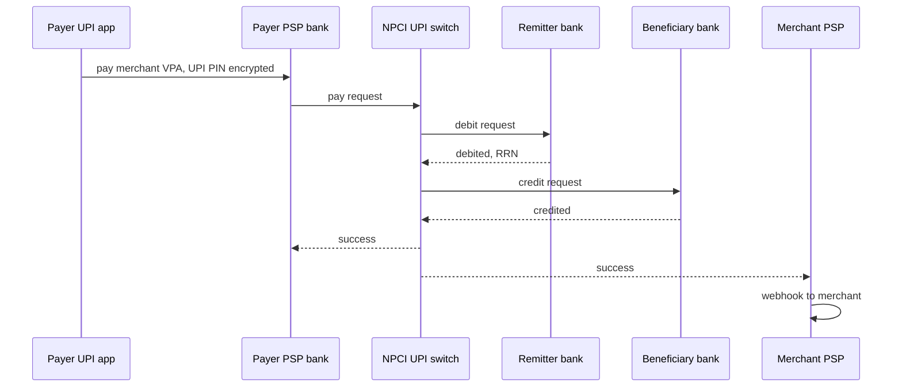
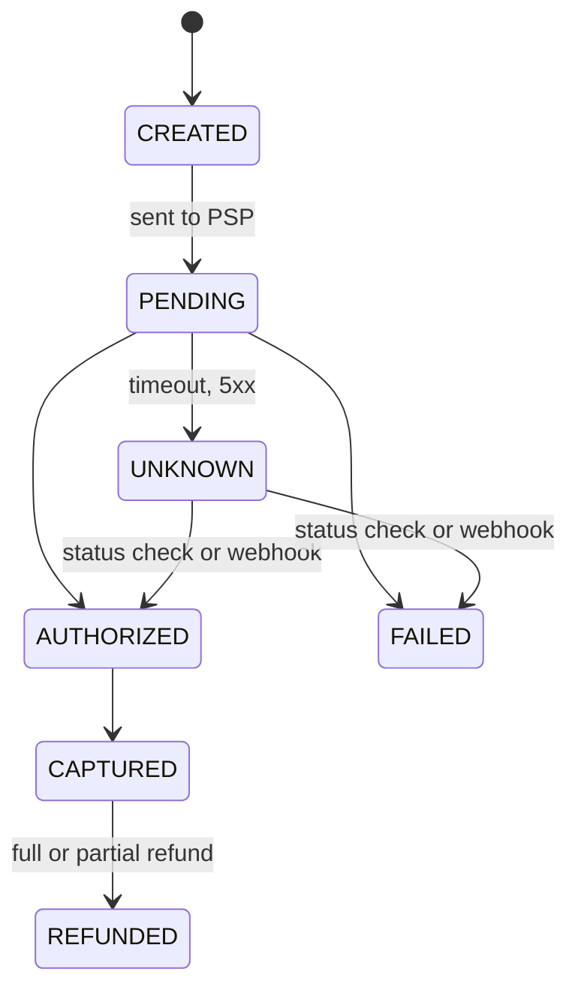

# 35 · Payments Domain (Ledger, PSPs, Reconciliation)

> **Read time:** 50 min · **Visual:** [v11 delivery semantics](../../visuals/v11-delivery-semantics.html), [v12 saga and outbox](../../visuals/v12-saga-outbox.html) · **Code it:** [lld/problems/19-payment-wallet](../../lld/problems/19-payment-wallet/README.md) (ledger + idempotency)
> **Shows up in:** payment system (Razorpay/Stripe), digital wallet / UPI, food delivery and ride-hailing checkout, ticket and hotel booking, payouts and refunds, any fintech round

## The idea in one line

Money moves through several parties you don't control, so a payment system is a **state machine** driven by unreliable external calls: every step is idempotent, every movement is a balanced **double-entry ledger** record, every "unknown" is resolved by status checks and webhooks, and **reconciliation** with the outside world is the final truth.

## The problem it solves

- The bank call times out. Was the customer debited? Retrying with a new id can charge twice; giving up can lose a real payment.
- A webhook says `captured` before your API call returns, or arrives twice, or arrives a day late.
- The balance column says ₹5,000, but nobody can explain how it got there.
- `0.1 + 0.2 = 0.30000000000000004` in JavaScript. Storing card numbers puts every server, log and engineer in PCI scope.

## How it works

### Who is who (card payments)

| Party | Role | Indian examples |
|---|---|---|
| Merchant | Sells; integrates a PSP | Swiggy, a D2C store |
| **PSP / payment gateway / aggregator** | Checkout, APIs, routing, merchant settlement | Razorpay, PayU, Cashfree, Stripe; Juspay (orchestration across PSPs) |
| **Acquirer** | Merchant-side bank that receives funds from the network | HDFC, ICICI, Axis as acquiring banks |
| **Card network** | Routes messages, sets rules, runs clearing | Visa, Mastercard, RuPay (NPCI) |
| **Issuer** | Customer's bank; approves or declines; runs 3DS/OTP | SBI, HDFC, Kotak |

### The payment lifecycle

```
authorise:  Merchant → PSP → Acquirer → Network → Issuer    issuer approves and places a hold
capture:    Merchant → PSP                                  merchant claims the held amount
settle:     Issuer → Network → Acquirer → PSP → Merchant    T+1 to T+2, minus MDR + GST
```

- **Authorise**: issuer checks funds and risk (with OTP/3DS: RBI requires an **additional factor of authentication** for most domestic card payments) and places a **hold**. No money has moved yet.
- **Capture**: merchant confirms the amount. Many merchants auto-capture; hotels and marketplaces capture later. Uncaptured auths expire after some days (depends on network and issuer), and PSPs refund them.
- **Clearing and settlement**: network moves funds issuer → acquirer; the PSP settles to the merchant minus MDR + GST.
- **Refund**: a new money movement back (full or partial), linked to the original. It is not an "undo". **Chargeback**: the customer disputes through the issuer; the merchant must respond with evidence or lose the funds.

### UPI



- **NPCI** runs the central switch. Apps (PhonePe, Google Pay, Paytm) are third-party apps working through **PSP banks**. The **remitter bank** debits, the **beneficiary bank** credits. Users are addressed by **VPA** (`name@bank`).
- **Intent / QR**: the merchant opens a deep link (`upi://pay?pa=merchant@psp&am=499.00&tr=order_123&cu=INR`) or shows a QR; the user picks an app and enters the PIN. Higher success, no VPA typing. **Never trust the app's return value**: confirm the final status server-side (PSP webhook or status API).
- **Collect**: the user types their VPA; the merchant's PSP sends a collect request; the user approves it in their app before it expires. More drop-off, and abused for fraud; NPCI decided in 2025 to stop **P2P** collect requests. Merchant collect continues.
- UPI has **pending / deemed** outcomes. Resolve them through the status-check API and reconciliation. RBI rules (2019 TAT harmonisation) require auto-reversal of failed UPI debits by T+1, with compensation for delays.

### Payment state machine and "unknown"



- A timeout is **not** a failure. Mark `UNKNOWN`, show "processing" to the user, and **never** charge again with a new reference.
- Resolve by: (1) PSP webhooks; (2) a poller calling the status API with backoff (e.g. 10 s, 30 s, 2 min, 10 min…); (3) the daily reconciliation file.
- Transitions only move forward. A late `failed` webhook for a `CAPTURED` payment is logged and ignored, not applied. Late success after you told the user "failed": capture-and-fulfil, or auto-refund. Pick one policy and apply it everywhere.
- **Idempotency at three points**: the merchant's `Idempotency-Key` on your API ([19](19-idempotency-delivery-semantics.md)); **our** attempt id as the PSP reference on every retry (a new attempt id only after a confirmed failure), so the PSP dedupes and we can query by it; and the PSP's event id in the webhook consumer.

### Webhooks done right

```ts
app.post('/webhooks/psp', express.raw({ type: 'application/json' }), (req, res) => {
  const expected = crypto.createHmac('sha256', SECRET).update(req.body).digest('hex');
  const got = Buffer.from(String(req.headers['x-psp-signature'] ?? ''), 'hex');
  const exp = Buffer.from(expected, 'hex');
  if (got.length !== exp.length || !crypto.timingSafeEqual(got, exp)) return res.sendStatus(400);
  queue.publish('psp-events', req.body);   // store first, process async
  res.sendStatus(200);                      // reply fast, or the PSP retries
});
```

- Verify an **HMAC-SHA256** over the **raw body** (re-serialised JSON won't match) with a constant-time compare. Razorpay sends `X-Razorpay-Signature`; Stripe's `Stripe-Signature` also signs a timestamp to block replays.
- Acknowledge fast, process from a queue, dedupe by event id, expect **out-of-order** events. PSPs retry failed deliveries with backoff (Stripe: up to 3 days). Webhooks can still be missed, so keep the status poller and reconciliation.

### Double-entry ledger

Every money movement is a **journal transaction** with two or more **entries** that sum to zero. Entries are append-only; mistakes are fixed with **reversal** entries, never `UPDATE`.

A ₹1,000 card payment on a PSP's books, with 2% MDR and 18% GST on the fee, in paise:

| Account | Debit | Credit |
|---|---|---|
| Acquirer receivable | 1,00,000 | |
| Merchant payable | | 97,640 |
| Fee revenue | | 2,000 |
| GST payable | | 360 |
| **Total** | **1,00,000** | **1,00,000** |

```sql
CREATE TABLE ledger_entries (
  entry_id      BIGINT PRIMARY KEY,
  txn_id        BIGINT NOT NULL,          -- journal transaction (unique per business event)
  account_id    BIGINT NOT NULL,
  amount_minor  BIGINT NOT NULL,          -- signed: +debit, -credit
  currency      CHAR(3) NOT NULL
);
-- invariant: SUM(amount_minor) GROUP BY txn_id, currency = 0
```

- Balance = sum of entries. For speed, keep a balance row updated **in the same DB transaction** as the entries, with `WHERE balance >= :amount` (or a version check) to stop overdrafts and races.
- The business event id (payment id + event type) is unique on the journal, so a replay can't post twice. A daily job checks that every account's cached balance equals the sum of its entries.

### Money as integer minor units

- Store **integers** in the smallest unit (paise, cents) as `BIGINT`, with an ISO 4217 currency. Not every currency has 2 decimals: JPY has 0, KWD and BHD have 3. Never use floats. Pick one rounding rule (often half-even) and allocate split remainders explicitly (₹100 / 3 = 3,333 + 3,333 + 3,334 paise).
- Node: `node-postgres` returns `BIGINT` as a **string** by default. Keep it a string or `BigInt`; don't cast blindly to `Number`.

### Reconciliation

Compare three sources daily: **internal ledger** ↔ **PSP settlement report** ↔ **bank statement**. Match on PSP payment id, merchant order id, and RRN/UTR, plus amount and status. Auto-resolve known patterns; everything else goes to an ops queue with ageing and alerts.

| Break | Typical cause | Action |
|---|---|---|
| In PSP, not in ledger | Missed webhook, `UNKNOWN` never resolved | Create or fix the record from PSP data |
| In ledger, not in PSP | Payment never reached PSP; test data | Mark failed; refund if the user was debited |
| Amount mismatch | Partial capture, fee or FX difference | Post an adjustment entry |
| Status mismatch | Late success or late failure | Apply the policy (fulfil or refund) |
| Settled amount ≠ expected | Fees, chargebacks, holds | Book fees; open a ticket with the PSP |

### PCI-DSS scope reduction

- Any system that **stores, processes or transmits** card numbers (PAN) is in PCI DSS scope (current version 4.0.x). CVV must never be stored after authorisation. Use the PSP's **hosted checkout, iframe fields or SDK**, so card data goes straight to the PSP. You get a **token** back. Your scope shrinks to the smallest self-assessment (SAQ A) instead of a full audit.
- India: since **1 October 2022**, RBI's card-on-file tokenisation rules mean merchants and PSPs (other than issuers and networks) may not store card numbers; saved cards use **network tokens**.

## Numbers to remember

- UPI: about **20 billion transactions a month** in 2025 (NPCI publishes monthly figures). Peak loads are many thousands of TPS.
- Card settlement: **T+1 to T+2** typical for merchants in India.
- Stripe: webhook retries for up to **3 days**; idempotency keys kept at least **24 h**. Size your dedupe tables for that.
- `2^53 − 1` paise ≈ ₹90 lakh crore: safe in a JS `Number`, but use `BigInt`/strings anyway at the DB boundary.

## Trade-offs and when not to use it

| Choice | Option A | Option B |
|---|---|---|
| Capture | Auto-capture: simple, fewer expired auths | Manual capture: needed when final amount changes (hotels, marketplaces) |
| PSP setup | One PSP: simple integration and recon | Multi-PSP with routing by success rate: higher success and resilience, more recon work |
| Balance | Sum entries on read: always correct, slow at scale | Cached balance in same tx: fast, needs a daily integrity check |
| Ledger store | Postgres with serializable or row locks: strong, simple | Sharded ledger by account: scales, but cross-shard transfers need sagas |

## In real systems

- **Razorpay** payment states: `created`, `authorized`, `captured`, `refunded`, `failed`; webhooks signed with HMAC-SHA256.
- **Stripe**: idempotency keys on every POST, signed webhooks with timestamps, PaymentIntents as an explicit state machine.
- **Juspay**: payment orchestration that routes each transaction to the gateway with the best live success rate for that card/bank/method.

## What to say in the interview

"A payment is a state machine in Postgres. The create API takes an Idempotency-Key, and every call to the PSP carries our attempt id. A timeout moves the payment to UNKNOWN, not FAILED: the user sees 'processing', a poller checks the PSP status with backoff, and webhooks, verified by HMAC on the raw body and deduped by event id, can also move it forward. Each state change writes balanced ledger entries in paise and an outbox event in the same transaction. A nightly job reconciles the ledger against the PSP settlement file and the bank statement, and sends breaks to an ops queue. Card data never touches our servers: we use the PSP's hosted fields and keep only tokens."

## Common follow-ups

<details><summary>The user pressed "Pay" twice, 300 ms apart. What stops a double charge?</summary>

The client sends the same idempotency key for the same checkout (created when the checkout page loads). The second request hits the unique constraint and returns the first result or a 409. The order also allows only one active payment attempt at a time.
</details>

<details><summary>Webhook says CAPTURED, but our API call to the PSP is still waiting. Race?</summary>

Both paths apply the same forward-only state machine with a conditional update (`WHERE status IN ('PENDING','UNKNOWN')`). Whichever arrives first wins; the other is a no-op. Ledger posting is keyed by event, so it happens once.
</details>

<details><summary>How do you design refunds?</summary>

A separate refund entity linked to the payment, with its own idempotency key and state machine (`CREATED → PROCESSED / FAILED`). Validate refunded total ≤ captured amount under a row lock. Post reversal ledger entries. Refunds also show up in reconciliation.
</details>

## Self-test (answer before opening)

<details><summary>1. Authorised vs captured: has money moved?</summary>

Authorised: no, only a hold on the customer's funds. Captured: the merchant has claimed it; actual funds move in clearing and settlement.
</details>

<details><summary>2. Why verify the webhook signature on the raw body, not on `req.body` after JSON parsing?</summary>

Parsing and re-serialising can change whitespace, key order or number formats, so the HMAC won't match. Sign and verify the exact bytes received.
</details>

<details><summary>3. A UPI intent payment: the UPI app returned "SUCCESS" to your app. Can you ship the order?</summary>

Not on that alone; the client-side response can be wrong or tampered with. Confirm through the PSP webhook or status API on the server first.
</details>

## Go deeper

- Alex Xu and Sahn Lam, *System Design Interview* Vol. 2: chapter "Payment System" and chapter "Digital Wallet"
- Stripe docs: "Idempotent requests", "Webhooks" (signature verification, retries); Razorpay docs: payment states and webhook validation
- NPCI UPI documentation (product overview, intent and collect flows); PCI SSC: PCI DSS v4.0 and SAQ A; RBI circulars on card-on-file tokenisation and TAT harmonisation for failed transactions
- Practice: [hld/problems/08-payment-system](../problems/08-payment-system/README.md), [hld/problems/28-digital-wallet](../problems/28-digital-wallet/README.md). Related cards: [19 idempotency](19-idempotency-delivery-semantics.md), [20 distributed transactions](20-distributed-transactions.md), [32 security](32-security-auth.md), [36 multi-region and data residency](36-deployment-multi-region.md)
- Older notes in this repo: `archive/notes/hld-parts/part7.md`, "Problem 2: Payment System (Stripe)"; `archive/notes/hld-parts/part6b.md`, "Part 4: Webhook System - Event Delivery" ("4.3 Key Implementation Details")
