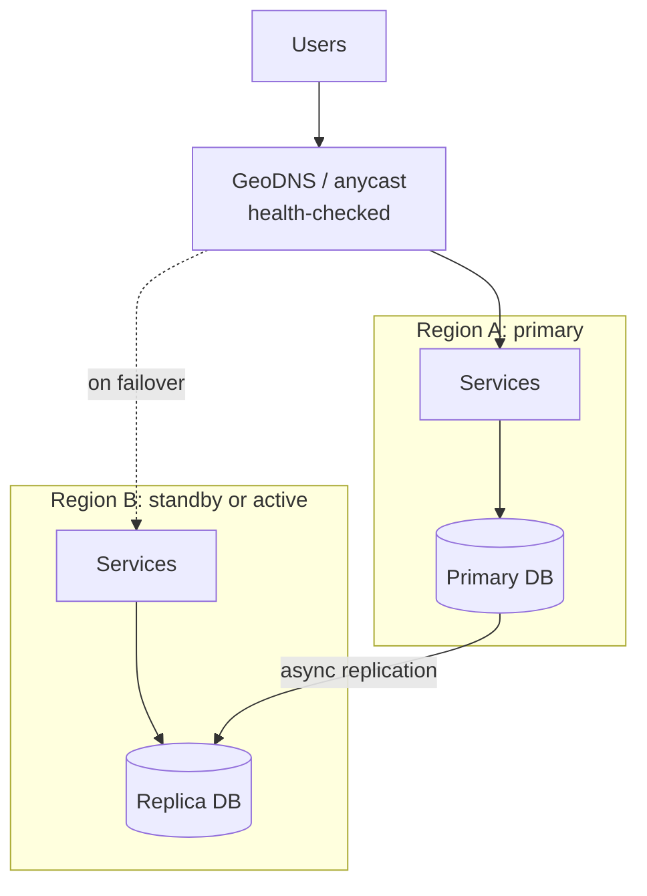

# 36 · Deployment, Autoscaling, Multi-Region, DR

> **Read time:** 40 min · **Visual:** [v05 leader-follower replication](../../visuals/v05-replication.html), [v07 CAP under a network partition](../../visuals/v07-cap-partition.html) · **Code it:** none (try a canary with Argo Rollouts on a local cluster)
> **Shows up in:** the "how do you deploy and survive a region outage?" part of every HLD round; payment system, digital wallet (data residency), video streaming, chat system, food delivery (sale-day spikes)

## The idea in one line

Ship changes gradually with a fast way back (rolling, blue-green, canary, feature flags), scale on the signal that actually limits you, and plan for losing a whole region with explicit RPO and RTO targets, within the data-residency rules that apply.

## The problem it solves

- A deploy at 8 p.m. has a bug in the UPI flow. Without canary and quick rollback, every user hits it for 20 minutes.
- An IPL final or a Big Billion Days sale brings 10× traffic in minutes. CPU-based autoscaling reacts too late, and new pods take 60 s to start.
- An AWS region has a major outage. Is your RPO "zero" or "the last 6 hours of payments"? Who decides to fail over, and how long does it take?
- A payment company wants a DR region in Singapore. RBI rules say payment data must stay in India.

## How it works

### Deployment strategies

| Strategy | How | Rollback | Cost | Risk |
|---|---|---|---|---|
| **Rolling** | Replace pods a few at a time (K8s `maxSurge`, `maxUnavailable`, default 25% each) | Roll forward/back again: minutes | No extra capacity | Old and new versions serve together |
| **Blue-green** | Full new stack (green) beside old (blue); switch the load balancer | Switch back: seconds | 2× capacity during release | Big-bang switch; DB shared by both |
| **Canary** | Send 1% → 5% → 25% → 100% to the new version; compare metrics at each step | Route 0% to canary: seconds | Small | Needs good metrics and automated analysis |
| **Feature flags** | Code is deployed off; turn on per user, merchant, % | Turn flag off: instant | Flag system | Flag debt; test both paths |

- **Canary analysis**: compare canary vs baseline on error rate, p99 latency and business KPIs (payment success rate). Abort automatically if worse. Tools: Argo Rollouts, Flagger, Spinnaker.
- **Deploy ≠ release**: deploy code dark, then release with a flag. Rollback becomes a flag flip, not a deploy.
- **Database changes use expand-contract**: (1) add the new column/table, (2) write both, (3) backfill, (4) read new, (5) remove old in a later release. Every step is compatible with the old and new code running together.

### Autoscaling

- **Pod level (K8s HPA)**: scale replicas on CPU, memory or custom metrics. **Node level**: Cluster Autoscaler or Karpenter adds machines for pending pods.
- Pick the signal that limits you:
  - CPU for CPU-bound services. For **Node.js**, CPU per pod tops out at ~1 core (one main thread), so also watch event-loop lag.
  - **Requests per second per pod** or **in-flight requests** for I/O-bound APIs.
  - **Queue depth / consumer lag** for workers (KEDA scales on Kafka lag, SQS depth and more).
  - Latency is a poor direct signal: it rises for many reasons, including slow dependencies that more pods won't fix.
- Scale out fast, scale in slowly (HPA's default scale-down stabilisation window is 5 minutes) to avoid flapping.
- **Pre-scale for known events**: scheduled scaling before a sale or a match, warmed caches and connection pools, raised DB and PSP limits. Reactive scaling is for the unknown.
- Limits that autoscaling doesn't fix: DB connections (use a pooler like PgBouncer), downstream TPS limits (banks), and Kafka partitions (max consumers per group = partitions).

### Multi-region

| Model | Writes | RPO | RTO | Hard part |
|---|---|---|---|---|
| Backup and restore | One region; backups copied to another | Hours | Hours | Restore drills |
| Pilot light | Core data replicated; compute off | Minutes | Tens of minutes | Bringing up compute fast |
| Warm standby (active-passive) | One region; scaled-down copy running | Seconds–minutes (async lag) | Minutes | Promotion, DNS, client caches |
| Active-active | Both regions take traffic | ~0 for region-local data | ~0 to minutes | Write conflicts, routing, consistency |

- **RPO** (Recovery Point Objective): how much data you can lose, in time. **RTO** (Recovery Time Objective): how long you can be down.
- Async replication = RPO equals the replication lag at failure time. RPO zero needs **synchronous** replication (or a consensus DB across regions), which adds the inter-region round trip to every write.
- **Active-active** without conflicts: give each user, merchant or account a **home region** (or cell) that owns its writes; other regions route to it. Or use a globally consistent DB (Spanner, CockroachDB) and pay the write latency. **Last-writer-wins** (DynamoDB global tables) is fine for profiles, **not** for balances.
- **Avoid split brain**: only one region may be primary for a dataset. Fence the old primary (revoke its write access) before promoting the new one. Make failover a rehearsed, mostly automated runbook with a human decision for money systems.
- Run **game days**: actually fail over. A DR plan that was never tested is a guess.

### Data residency: payments in India

- RBI's circular "Storage of Payment System Data" (April 2018) requires that **all data relating to payment systems** operated in India is **stored only in India**. This covers the full end-to-end transaction data.
- For cross-border transactions, a copy of the foreign leg may also be stored abroad. RBI's FAQs say that if processing happens abroad, the data must be deleted there and brought back to India within one business day or 24 hours, whichever is earlier.
- India's DPDP Act (2023) covers personal data generally; sector rules like RBI's still apply on top.
- Design result: for a payments company, **both** primary and DR regions are in India: AWS Mumbai (`ap-south-1`) and Hyderabad (`ap-south-2`), GCP Mumbai and Delhi, or Azure's Indian regions. Global CDNs may cache only non-sensitive static content. Logs, backups, analytics copies and vendor tools (monitoring, support) count as storage too.

## Numbers to remember

- Kubernetes rolling update defaults: **maxSurge 25%, maxUnavailable 25%**.
- HPA scale-down stabilisation default: **5 minutes**. HPA checks metrics every 15 s by default.
- Mumbai ↔ Hyderabad round trip is roughly 15–25 ms; Mumbai ↔ Singapore ~60 ms; India ↔ US east coast ~200 ms+. Sync replication across continents is very costly.
- DNS failover is bounded by TTL and client caching: use TTLs of 30–60 s on failover records, and expect some clients to ignore them.

## Trade-offs and when not to use it

| Option | Use when | Weakness |
|---|---|---|
| Rolling | Most stateless services | Mixed versions; slower rollback |
| Blue-green | Need instant switch and rollback; small number of big releases | Double capacity; DB migrations still shared |
| Canary | High-traffic services with good metrics | Needs automated analysis to be safe |
| Single region, multi-AZ | Most companies; AZ failures are the common case | Region outage = downtime |
| Active-passive multi-region | Need region survival; can accept minutes of RTO and small RPO | Standby cost; failover is risky if untested |
| Active-active | Very high availability, global users | Conflicts, cost, complexity |
| Cell-based architecture | Limit blast radius (each cell serves a subset of customers) | Routing layer; cross-cell operations |

## In real systems

- **Netflix**: active-active across AWS regions; regular region evacuation drills; Chaos Monkey for instance failures.
- **AWS** "Disaster Recovery of Workloads on AWS" whitepaper defines the four DR strategies above.
- **Indian payment companies** run in Indian cloud regions and data centres to meet RBI localisation, typically multi-AZ in Mumbai with DR in a second Indian region.
- **Slack** and **DoorDash** have written about moving to cell-based architectures to reduce blast radius.

## What to say in the interview

"Deploys are canaries with Argo Rollouts: 1%, 10%, 50%, 100%, with automatic rollback if error rate, p99 or payment success rate gets worse than baseline. Risky features also sit behind flags, and schema changes follow expand-contract. Pods scale on in-flight requests and Kafka lag, with scheduled pre-scaling before known sale events. We run multi-AZ in Mumbai and a warm standby in Hyderabad with async replication, so RPO is seconds and RTO is under 15 minutes through a rehearsed failover runbook. Both regions are in India because RBI requires payment data to be stored in India."

## Common follow-ups

Blue-green with a database: how do you switch without breaking either version?

Both colours share one database, so schema changes must be backward compatible before the switch (expand-contract). Remove old columns only after blue is gone for good. Switching back must still work with the new schema.

Region A comes back after you failed over to B. What now?

Don't let A accept writes. Rebuild A as a replica of B (writes made in A before failure but not replicated must be reconciled from logs or the outbox). Fail back later, in a planned window, if at all.

How do you test that autoscaling handles a 10× spike?

Load tests against a production-like environment that ramp to 10× (k6, Gatling, Locust), with downstream limits stubbed or coordinated. Measure time to scale, cold start time and which limit breaks first (DB connections, PSP TPS, Kafka partitions).

## Self-test (answer before opening)

1. Async replication with 3 s of lag, region dies. What's your RPO?

About 3 seconds of writes: the replication lag at the moment of failure. Those writes may need recovery from the old region later.

2. Canary or blue-green for a service with 50 requests per day?

Blue-green (or rolling with smoke tests). A 1% canary of 50 requests a day gives no useful signal.

3. Can an Indian payment aggregator use a Singapore region for DR of transaction data?

No. RBI requires payment system data to be stored only in India. Use a second Indian region.

## Go deeper

- AWS whitepaper: "Disaster Recovery of Workloads on AWS: Recovery in the Cloud"; AWS Well-Architected Reliability Pillar
- Kubernetes docs: "Deployments" (rolling update), "Horizontal Pod Autoscaling"; Argo Rollouts docs (canary analysis)
- RBI: "Storage of Payment System Data" circular (April 2018) and its FAQs
- Related cards: [12 replication](12-replication.md), [15 CAP and consistency](15-cap-pacelc-consistency.md), [06 scaling basics](06-scaling-basics.md), [35 payments domain](35-payments-domain.md)
- Older notes in this repo: `archive/notes/hld-parts/part4.md`, "Module 4.5: Disaster Recovery & Backups" ("RTO vs RPO", "Disaster Recovery Architectures"); `archive/notes/hld-parts/part2.md`, "Auto-Scaling Strategies", "Auto-Scaling Policies", "Multi-Region Replication" and "Disaster Recovery Strategy"
