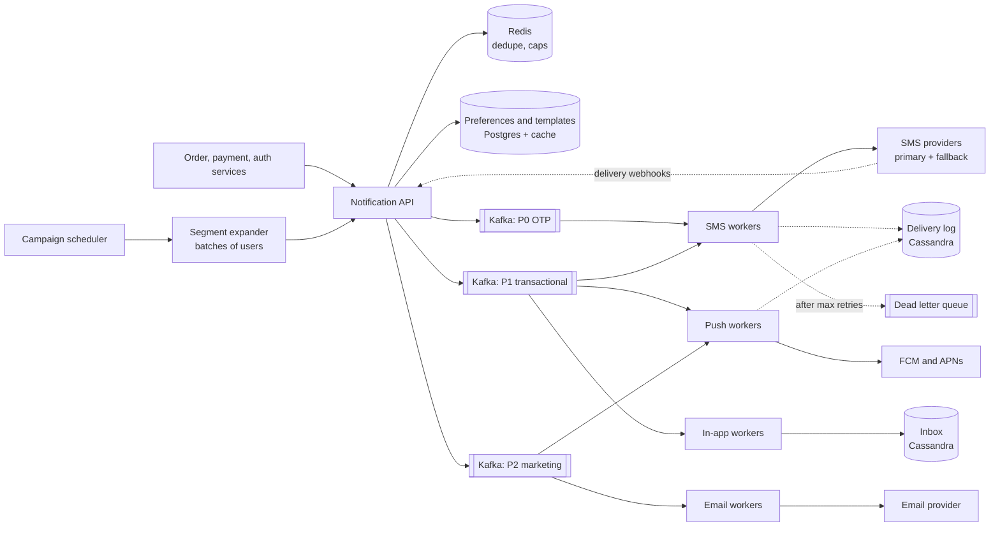

# 05 · Notification System

> **Level:** Medium · **Time box:** 45 min · **Asked at:** Swiggy, Zomato, PhonePe, Razorpay, Flipkart, Meesho, CRED
> **Concepts used:** [17 message queues](../../concepts/17-message-queues.md) · [18 Kafka](../../concepts/18-kafka-deep-dive.md) · [19 idempotency](../../concepts/19-idempotency-delivery-semantics.md) · [23 rate limiting](../../concepts/23-rate-limiting.md) · [24 resilience](../../concepts/24-resilience-patterns.md) · [02 estimation](../../concepts/02-back-of-envelope.md) · [31 observability](../../concepts/31-observability.md)
> **Visuals:** [Kafka consumer groups](../../../visuals/v10-kafka-consumer-groups.html) · [delivery semantics](../../../visuals/v11-delivery-semantics.html) · [circuit breaker and retries](../../../visuals/v13-circuit-breaker.html)
> **Code it:** [circuit breaker + retry with backoff](../../code/09-circuit-breaker/README.md) · LLD version: [notification service](../../../lld/problems/05-notification-service/README.md)

## How to practise this

1. Set a 45-minute timer. Open [`my-design.md`](./my-design.md) and fill it in **without** looking below.
2. Then open each hint one at a time and compare. Write down what you missed in the Review section.
3. Do it again from memory on the repeat day in the plan. The second attempt is where it sticks.

## The prompt

"Design a notification system for an app like Swiggy or PhonePe. Other services send notifications to users by push, SMS, email and in-app. It must handle OTPs, order updates and marketing campaigns."

## Step 1: questions to ask

- Which channels? Push (Android/iOS), SMS, email, in-app, WhatsApp?
- Which types, and how urgent? OTP vs order update vs marketing?
- Scale: notifications per day? Biggest campaign size?
- Who triggers them? Internal services by event, or also scheduled campaigns?
- User preferences: opt-out per channel, quiet hours, frequency caps?
- Delivery guarantee: at least once? Is a duplicate OTP or "order delivered" acceptable?
- Do we need delivery tracking (sent, delivered, opened)?
- Templates and languages? (India: English, Hindi, regional languages.)

<details><summary>Assumed answers</summary>

- Channels: push (FCM for Android, APNs for iOS), SMS, email, in-app inbox. WhatsApp is a follow-up.
- Three priorities: **P0 transactional** (OTP: must arrive in < 5 s), **P1 order and payment updates** (< 30 s), **P2 marketing** (minutes to hours is fine).
- 50M DAU. ~500M notifications/day normal. A marketing campaign can target 50M users at once.
- Triggered by events from other services, plus a campaign scheduler.
- Respect opt-outs, quiet hours (no marketing 9 PM to 9 AM), and caps (max 3 marketing pushes/day).
- At least once delivery with **dedupe**, so users rarely see duplicates.
- Track sent / delivered / failed / opened per notification.
- Templates with variables and locale. SMS in India must use **DLT-registered templates** (a TRAI rule), so free text SMS is not allowed.
</details>

## Step 2: estimates

<details><summary>Show the numbers</summary>

| | Calculation | Result |
|---|---|---|
| Average rate | 500M / 86,400 | **~6k/s** |
| Peak (dinner rush + a campaign) | 5–10× average | **~50k/s** |
| Campaign burst | 50M users sent over 30 min | 50M / 1,800 ≈ **28k/s** extra |
| OTP SMS | ~20M/day | ~250/s avg, ~1k/s peak; must be fastest |
| Notification log | 500M × ~500B (ids, channel, status, timestamps) | **~250 GB/day**, ~7.5 TB per 30 days |
| In-app inbox | keep 90 days, 20 per user per day × 1 KB | large: use a wide-column store, with TTL |
| SMS cost | 20M × ~₹0.15–0.25 | ₹3–5M/day: cost is a real design input |

Takeaway to say out loud: "The volume is high but each message is small. The hard parts are **priority isolation** (a 50M campaign must never delay an OTP), **third-party provider limits and failures**, and **no duplicates**."
</details>

## Step 3: API

<details><summary>Show the API</summary>

```http
POST /v1/notifications
Idempotency-Key: order-9812-delivered        # caller's business key → dedupe
{
  "userId": "u_123",
  "type": "ORDER_DELIVERED",                 # maps to a template + priority
  "channels": ["push", "inapp"],             # optional; default from type
  "data": { "orderId": "9812", "restaurant": "Meghana Foods" },
  "priority": "P1",
  "sendAt": null                              # or a future time
}
→ 202 { "notificationId": "n_7f3..." }        # accepted, not yet delivered

POST /v1/campaigns                            # marketing: a segment, not a user
{ "segmentId": "seg_bangalore_lapsed", "templateId": "t_offer_50", "sendAt": "...", "throttlePerSec": 20000 }

GET  /v1/notifications/{id}                   # status per channel
GET  /v1/users/{id}/inbox?cursor=...          # in-app inbox
PUT  /v1/users/{id}/preferences               # opt-outs, quiet hours
POST /v1/webhooks/{provider}                  # delivery receipts from SMS/email providers
```
Return **202**: the send is asynchronous.
</details>

## Step 4: data model

<details><summary>Show the data model</summary>

| Table | Key | Fields | Store |
|---|---|---|---|
| `templates` | template_id + locale + channel | body with variables, DLT template ID, version | Postgres (small, cached) |
| `user_preferences` | user_id | per-channel opt-in, quiet hours, caps, language | Postgres + Redis cache |
| `devices` | user_id → many | push token, platform, app version, last_seen | Postgres or DynamoDB |
| `notifications` | notification_id | user_id, type, priority, idempotency_key, created_at | Cassandra/DynamoDB (high write volume) |
| `deliveries` | notification_id + channel | status (QUEUED/SENT/DELIVERED/FAILED/OPENED), provider, provider_msg_id, attempts | Cassandra/DynamoDB, TTL 30 days |
| `inbox` | partition user_id, cluster by created_at desc | title, body, read flag | Cassandra, TTL 90 days |
| dedupe | `dedupe:{idempotency_key}` | | Redis `SET NX` with 24 h TTL |

**DB choice:** Postgres for small relational config (templates, preferences). A wide-column store (Cassandra or DynamoDB) for the write-heavy log and inbox, because they partition by user, accept ~50k writes/s easily, and have native TTL.
</details>

## Step 5: high-level design

<details><summary>Show the diagram</summary>


**Write (send):** a service calls the API with an idempotency key → API checks dedupe in Redis (`SET NX`) → loads user preferences and drops channels the user opted out of → checks frequency caps and quiet hours (marketing waits until morning) → renders the template in the user's language → writes the `notifications` row → publishes one message **per channel** to the Kafka topic for its priority → returns 202.
**Read (deliver):** a channel worker consumes from its topic → looks up device tokens or phone/email → calls the provider with a timeout → records SENT with the provider message ID → later the provider's webhook (or FCM response) updates the status to DELIVERED or FAILED. In-app messages are written to the inbox and pushed live if the user has an open socket.
</details>

## Step 6: deep dives (the part that gets scored)

<details><summary>Deep dive 1: priority isolation (OTP must not wait behind a campaign)</summary>

| Option | Pros | Cons |
|---|---|---|
| One queue for everything | Simple | A 50M campaign delays OTPs by minutes. Never acceptable |
| One queue with a priority field | Fewer topics | Kafka has no priorities; RabbitMQ priority queues are limited and slow down |
| **Separate topics + separate worker pools per priority** | Hard isolation; scale each pool alone | More topics and deployments |
| Separate provider accounts per priority | A campaign can't use up the OTP SMS quota | More vendor contracts |

Also: campaigns are **throttled at the source** (the segment expander sends at e.g. 20k/s), not just at the workers.

Say: "OTP, transactional and marketing traffic each get their own Kafka topic, worker pool and provider quota. A campaign can fill its own queue, but it can never slow an OTP."
</details>

<details><summary>Deep dive 2: reliability, retries and duplicates</summary>

Delivery is **at least once**: a worker can crash after calling the provider but before committing its Kafka offset. So duplicates must be limited by design:

| Layer | Technique |
|---|---|
| API | `Idempotency-Key` → Redis `SET NX` (24 h). Same event twice → one notification |
| Worker | Before sending, check `deliveries` status; skip if already SENT. Send the `notification_id` as the provider's reference/dedupe ID when the provider supports it |
| Retries | Exponential backoff with jitter: 1 s, 5 s, 30 s, 2 min… via retry topics (Kafka has no per-message delay) |
| Give up | After N attempts → dead letter queue, alert, and maybe a fallback channel (push failed → SMS for important updates) |
| Bad token | FCM says the token is unregistered → delete the device row; do not retry |

Retry only **retryable** errors (timeouts, 5xx, 429). Do not retry 4xx like an invalid number.

Say: "It's at-least-once with dedupe at the API and in the worker. Exactly-once to a phone is impossible, because the provider call and our status write can't be atomic. So we make duplicates rare, not zero."
</details>

<details><summary>Deep dive 3: third-party providers (SMS, FCM, APNs, email)</summary>

- **Multiple SMS providers** (e.g. two Indian aggregators). Route by success rate and latency per telecom operator; fail over when one is slow. A **circuit breaker** per provider.
- **Provider rate limits**: each has a TPS limit. Workers use a shared token bucket per provider (in Redis) so the whole fleet stays under it.
- **DLT compliance (India)**: each SMS must carry a registered sender ID (header) and template ID, and the text must match the template. Validate at render time, not at the provider.
- **OTP**: short TTL (e.g. 5 min), never retry with a new code silently, and offer a fallback channel (voice call or WhatsApp) after 30 s.
- **Cost**: SMS costs money, push is free. Prefer push when the app is active; use SMS only for OTP and critical updates.

Say: "Each provider sits behind an adapter with its own circuit breaker and a fleet-wide token bucket for its TPS limit. SMS routes to the best provider per operator, and templates are checked against DLT before sending."
</details>

<details><summary>Deep dive 4: preferences, caps and campaigns at 50M users</summary>

- **Segment expansion**: the campaign service reads the segment (from a data warehouse export or a precomputed user list), splits it into batches of 1,000 users, and enqueues batch jobs. Workers expand batches into per-user messages. This avoids one giant job.
- **Frequency caps**: Redis counter `cap:{userId}:marketing:{date}` with `INCR` + TTL. Over the cap → drop.
- **Quiet hours**: marketing for users in quiet hours goes to a **delay queue** (or a scheduler table keyed by send time) and is released later.
- **Preference cache**: preferences are read on every send (~50k/s). Cache them in Redis with invalidation on update.
- **Scheduled sends**: a scheduler table partitioned by minute; a poller picks due rows and enqueues. See [job scheduler](../24-job-scheduler/README.md).

Say: "A campaign is split into batches of a thousand users. Each user passes the preference, frequency-cap and quiet-hour checks before a message is created, and campaigns run on their own low-priority queue."
</details>

<details><summary>Deep dive 5: delivery tracking and observability</summary>

- Status flow: `QUEUED → SENT → DELIVERED → OPENED`, or `FAILED`. Webhook receipts can arrive out of order or twice; only move the status forward.
- Correlate by `provider_msg_id` returned at send time.
- Dashboards: send rate per channel and priority, provider latency and error rate, OTP time-to-deliver p99, queue lag per topic. Alert on OTP lag over 5 s.
- Analytics events (opens, clicks) go to Kafka → warehouse for campaign reports.

Say: "Every message has a status that only moves forward, matched to provider receipts by provider message ID. The main alert is OTP time-to-deliver p99 and the queue lag per priority."
</details>

## Follow-ups interviewers ask

1. A user has three devices. What happens? (Send to all active tokens; dedupe in-app on the client by notification ID.)
2. How do you avoid sending "order delivered" before "order picked up"? (Partition the Kafka topic by `userId` or `orderId` so events stay ordered; drop stale events using a sequence number.)
3. The SMS provider is down for 10 minutes. What happens to OTPs? (Circuit breaker opens → route to the backup provider. Queue lag alert fires.)
4. How do you stop a bad campaign that's already sending? (A kill switch: workers check a campaign status flag in Redis before each batch.)
5. How would you add WhatsApp? (A new channel worker behind the same interface. Templates must be pre-approved by Meta, similar to DLT.)

## Common mistakes

- One queue for OTPs and marketing.
- Calling SMS/email providers synchronously inside the API request.
- Promising exactly-once delivery.
- Ignoring provider rate limits, failover and cost.
- No user preferences, opt-outs or frequency caps.
- Forgetting India-specific rules: DLT templates for SMS, quiet hours for promotions.
