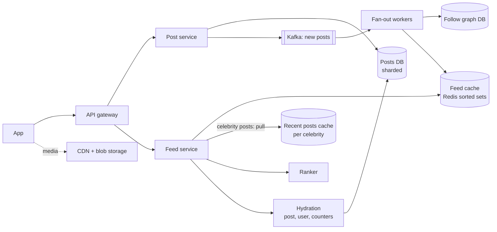

# 07 · News Feed (Twitter/Instagram)

> **Level:** Medium · **Time box:** 45 min · **Asked at:** Flipkart, ShareChat, Swiggy, Atlassian, Uber, and almost every company that asks "Twitter" as a classic
> **Concepts used:** [34 data modelling at scale](../../concepts/34-data-modeling-at-scale.md) · [08 caching](../../concepts/08-caching.md) · [17 message queues](../../concepts/17-message-queues.md) · [13 sharding](../../concepts/13-partitioning-sharding.md) · [04 API design (pagination)](../../concepts/04-api-design.md) · [26 blob storage](../../concepts/26-blob-storage.md)
> **Visuals:** [feed fan-out: push vs pull](../../../visuals/v15-feed-fanout.html) · [caching patterns](../../../visuals/v03-caching-patterns.html)
> **Code it:** [Snowflake ID generator](../../code/04-snowflake-id/README.md) · related: [photo sharing](../16-photo-sharing/README.md)

## How to practise this

1. Set a 45-minute timer. Open [`my-design.md`](./my-design.md) and fill it in **without** looking below.
2. Then open each hint one at a time and compare. Write down what you missed in the Review section.
3. Do it again from memory on the repeat day in the plan. The second attempt is where it sticks.

## The prompt

"Design the home feed for a Twitter- or Instagram-like app. Users follow other users. When they open the app, they see recent posts from the people they follow."

## Step 1: questions to ask

- Scale? DAU, posts per day, feed opens per user per day?
- Follow graph: average and maximum followers? Are there celebrities with tens of millions?
- Chronological or ranked feed?
- Posts with media? Likes and comments shown in the feed?
- How fresh must the feed be? Is a few seconds of delay OK?
- Pagination: infinite scroll?

<details><summary>Assumed answers</summary>

- 200M DAU, 100M new posts/day, each user opens the feed ~10 times/day
- Average 200 followers. Some accounts have 50M+ followers (cricketers, film stars)
- Ranked feed, but start with reverse-chronological and add ranking as a deep dive
- Posts have text plus image/video links (media lives in blob storage + CDN). Like counts are shown
- Eventual consistency is fine: a new post can show up within ~5 seconds
- Infinite scroll, 20 posts per page
</details>

## Step 2: estimates

<details><summary>Show the numbers</summary>

| | Calculation | Result |
|---|---|---|
| Post QPS | 100M / 86,400 | **~1.2k/s** avg, ~3.5k/s peak |
| Feed read QPS | 200M × 10 / 86,400 | **~23k/s** avg, ~70k/s peak |
| Fan-out writes (push model) | 100M posts × 200 followers | **20B inserts/day** ≈ 230k/s avg |
| Post storage/year | 100M × 1 KB (text + meta) × 365 | **~37 TB/year** (media separate) |
| Feed cache per user | 500 post IDs × 8B (+ overhead ≈ 2×) | ~8 KB |
| Feed cache total | 200M × 8 KB | **~1.6 TB** Redis, i.e. a cluster of ~30 nodes at 64 GB |
| One celebrity post, push model | 50M followers | **50M writes** for one post: a fan-out storm |

Takeaway to say out loud: "Reads are 20× writes, so precompute feeds. But fan-out on write explodes for celebrities. So the design is a **hybrid**: push for normal users, pull for celebrities, and a **feed cache** of post IDs."
</details>

## Step 3: API

<details><summary>Show the API</summary>

```http
POST /v1/posts
Idempotency-Key: <uuid>
{ "text": "…", "mediaIds": ["m_1"] }
→ 201 { "postId": "1720…", "createdAt": "…" }

GET /v1/feed?cursor=<opaque>&limit=20
→ 200 { "posts": [ { "postId": "…", "author": {…}, "text": "…", "mediaUrls": […], "likeCount": 120 } ],
        "nextCursor": "<opaque>" }

POST   /v1/users/{id}/follow
DELETE /v1/users/{id}/follow
POST   /v1/posts/{id}/like
```
**Cursor, not offset:** new posts arrive at the top all the time. With `?page=3` the user sees duplicates or misses posts. The cursor encodes the last seen post ID (or ranking score + ID) so the next page starts exactly after it.
</details>

## Step 4: data model

<details><summary>Show the data model</summary>

`posts`: `post_id (PK, Snowflake, time-sortable)` | `author_id` | `text` | `media_ids` | `created_at`. Index or partition by `author_id` for "posts by user X".
`follows`: `follower_id` | `followee_id` | `created_at`. Stored both ways: `followers_of(user)` and `following_of(user)`.
`feed` (Redis sorted set per user): `feed:{user_id}` → members = `post_id`, score = timestamp (or rank score). Capped at ~500 entries.
`counters`: `post_id → likes, comments`, kept in Redis and flushed to the DB in batches.

**DB choice:** posts in Cassandra or a sharded MySQL (Instagram ran sharded Postgres for years; Twitter used sharded MySQL). Shard by `post_id` or `author_id`; `author_id` makes "my posts" a single-shard read. The follow graph needs both directions, so store two tables, each sharded by its first column. The feed itself is a cache in Redis: it can be rebuilt from posts + follows, so losing it is a performance problem, not data loss.
</details>

## Step 5: high-level design

<details><summary>Show the diagram</summary>


**Write:** the client uploads media first (presigned URL) → `POST /posts` → post service writes the post to the DB → publishes `PostCreated` to Kafka → returns 201. Fan-out workers read the event, load the author's followers in pages, and `ZADD` the post ID into each follower's feed (then `ZREMRANGEBYRANK` to keep 500). If the author is a celebrity, skip the fan-out; only add the post to the author's recent-posts cache.
**Read:** feed service reads `feed:{user}` from Redis (IDs only) → merges in recent posts from the celebrities the user follows → ranks the merged list → takes 20 → hydrates IDs into full posts (batch get from the post cache, then the DB) → returns with a cursor.
</details>

## Step 6: deep dives (the part that gets scored)

<details><summary>Deep dive 1: push vs pull vs hybrid (the main question)</summary>

| Model | How | Pros | Cons |
|---|---|---|---|
| Pull (fan-out on read) | at read time, fetch recent posts of everyone you follow and merge | Cheap writes; always fresh; no wasted work for inactive users | Slow reads: following 500 people = 500 lookups per feed open |
| Push (fan-out on write) | at write time, insert the post ID into every follower's feed | Reads are one Redis call | Celebrity post = 50M writes; wasted work for inactive followers |
| **Hybrid (choice)** | push for normal authors; pull for authors above a follower threshold (say 100k) | Fast reads and bounded write cost | Two code paths; the merge step at read time |

- Most users follow only a few celebrities, so the pull side is a few cache reads, not hundreds.
- Skip fan-out to inactive users (no login in 30 days). Build their feed on demand when they return.
- The threshold is a config value, not a magic number. Tune it from the fan-out lag metric.

Say: "I'll do a hybrid. Normal authors push their post IDs into followers' Redis feeds. Authors with more than ~100k followers don't push; their posts are pulled and merged at read time. That caps the fan-out cost and keeps reads to a few cache calls."
</details>

<details><summary>Deep dive 2: the feed cache</summary>

| Choice | Option | Why |
|---|---|---|
| What to store | **post IDs only** (not full posts) | 8 bytes each; a post edit or delete doesn't need fixing in millions of feeds |
| Structure | Redis sorted set, score = time or rank | Range by score gives cursor pagination for free |
| Size | cap at ~500 IDs | Nobody scrolls further; older pages fall back to pull |
| Sharding | Redis Cluster, key = `feed:{user_id}` | Even spread; one user's feed lives on one node |
| Hydration | separate post cache (`post:{id}` hashes), batch `MGET` | Hot posts are shared by millions of feeds, so a high hit rate |
| Cold user | feed missing → rebuild by pull, then store | Lazy fill; nothing lost if Redis is flushed |

- Deletes: remove from the post store and mark deleted; hydration drops it. No need to touch every feed.
- Unfollow: filter at read time by the current following list, and clean up lazily.

Say: "The feed cache holds only post IDs in a sorted set per user. Content is hydrated from a shared post cache. So edits and deletes are cheap, and the cache can always be rebuilt."
</details>

<details><summary>Deep dive 3: ranking</summary>

- Two stages. **Candidate generation**: the ~500 IDs from the feed cache plus celebrity posts plus some suggested posts. **Ranking**: score each with a model on features such as author affinity (how often you interact with them), post age, engagement so far, and media type.
- Start simple in the interview: `score = affinity × engagement / (age + 2)^1.5` (a Hacker-News-style decay). Say a learned model replaces it later.
- Rank at read time for freshness, but cache the ranked page for a minute so scrolling back and forth is stable.
- With ranking, the cursor must hold the ranked snapshot (or score + ID), otherwise items jump between pages. Store the ranked list for the session under a short TTL.

Say: "Ranking is two stages: take candidates from the precomputed feed plus celebrity posts, then score them. I start with an affinity, engagement and time-decay formula and cache the ranked page per session, so pagination stays stable."
</details>

<details><summary>Deep dive 4: counters, hot posts and the celebrity read side</summary>

- Likes on a viral post: never `UPDATE posts SET likes = likes + 1` on one row. Increment a Redis counter (or shard the counter into N keys and sum), then flush to the DB every few seconds. See [data modelling at scale](../../concepts/34-data-modeling-at-scale.md).
- A celebrity's recent posts are read by millions of feeds. Keep them in a small replicated cache (and local in-process cache on feed servers with a ~5s TTL) to avoid a hot key on one Redis node.
- Fan-out workers: partition the Kafka topic by author, page through followers in batches of ~1k, and pipeline `ZADD`s. Measure fan-out lag (post time → last follower updated) as the main SLO.

Say: "Hot counters are sharded in Redis and flushed to the DB in batches. Celebrity posts sit in a replicated cache and a local cache. Fan-out lag is the SLO I watch."
</details>

## Follow-ups interviewers ask

1. A user follows 2,000 people, 30 of them celebrities. How long does a feed load take? (One `ZREVRANGE` + 30 small cache reads in parallel + one batch hydration: well under 100ms.)
2. A normal user suddenly goes viral and gains 5M followers. (The threshold is checked at post time, so their next post goes through pull. Existing feeds are fine.)
3. How do you handle a post deleted for policy reasons? (Mark deleted in the post store and purge from the post cache; hydration filters it out everywhere at once.)
4. How do you show "3 new posts" at the top? (Client polls a cheap endpoint that counts feed entries with score > newest seen, or a push via SSE.)
5. Multi-region? (Posts are written in the home region and replicated; fan-out runs in each region against the local feed cache.)

## Common mistakes

- Picking push or pull without doing the celebrity maths. 50M writes for one post is the whole point.
- Storing full post objects in each feed. Edits, deletes and storage all become a problem.
- Offset pagination on a feed that changes every second.
- Updating like counts on the post row synchronously.
- Forgetting media: it goes to blob storage and a CDN, never through the feed service.
