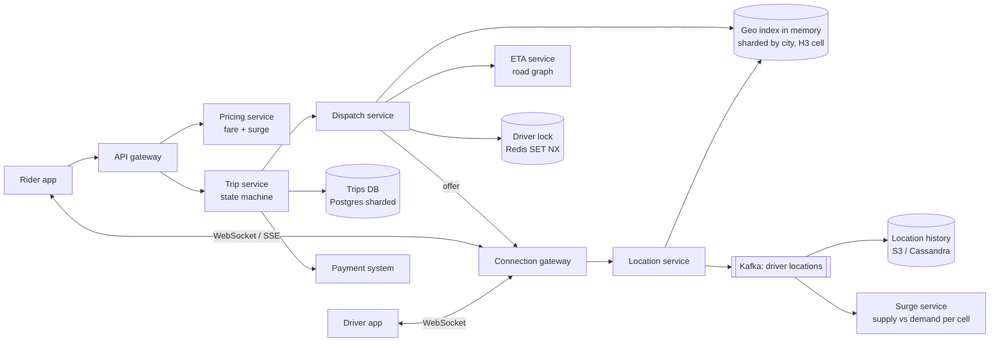
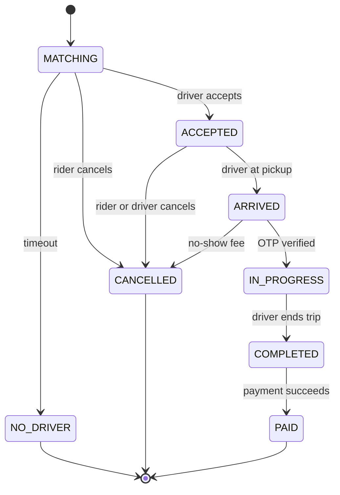

# 10 · Ride Hailing (Uber/Ola)

> **Level:** Hard · **Time box:** 60 min · **Asked at:** Uber, Ola, Rapido, Swiggy, Zomato, Flipkart, Atlassian
> **Concepts used:** [28 geospatial](../../concepts/28-geospatial.md) · [05 real-time](../../concepts/05-realtime-communication.md) · [30 distributed locks](../../concepts/30-consensus-coordination.md) · [18 Kafka](../../concepts/18-kafka-deep-dive.md) · [13 sharding](../../concepts/13-partitioning-sharding.md) · [20 sagas](../../concepts/20-distributed-transactions.md) · [35 payments](../../concepts/35-payments-domain.md)
> **Visuals:** [geohash and quadtree](../../../visuals/v17-geohash-quadtree.html) · [state machine](../../../visuals/v25-state-machine.html) · [seat locking (same idea as locking a driver)](../../../visuals/v28-seat-locking.html)
> **Code it:** [geohash encode and neighbours](../../code/06-geohash/README.md) · LLD version: [ride sharing](../../../lld/problems/17-ride-sharing/README.md) · related: [proximity service](../22-proximity-service/README.md)

## How to practise this

1. Set a 60-minute timer. Open [`my-design.md`](./my-design.md) and fill it in **without** looking below.
2. Then open each hint one at a time and compare. Write down what you missed in the Review section.
3. Do it again from memory on the repeat day in the plan. The second attempt is where it sticks.

## The prompt

"Design a ride-hailing app like Uber or Ola. A rider requests a ride from A to B. The system finds a nearby driver, the driver accepts, and both see each other live on the map until the trip ends and the rider pays."

## Step 1: questions to ask

- Scale? Rides per day, drivers online at peak, cities?
- How often do drivers send their location?
- Vehicle types (auto, bike, mini, sedan)? Shared rides (pooling)?
- Matching rule: nearest driver, or best ETA? How long does a driver get to accept?
- Surge pricing in scope? Fare estimate before booking?
- Payment: cash, UPI, wallet, card? Is payment part of this design?
- Must a driver never get two rides at once? (Yes, almost always.)

<details><summary>Assumed answers</summary>

- 10M rides/day across ~100 cities (India scale). 1M drivers online at peak
- Drivers send location **every 4 seconds** while online
- Types: bike, auto, mini, sedan. No pooling in the first version
- Match by ETA, not straight-line distance. Offer to one driver at a time, 15 seconds to accept
- Fare estimate and surge: yes. Surge per area, recomputed every minute or two
- Payment: cash and UPI/wallet. Charging is done by the [payment system](../08-payment-system/README.md); we only trigger it
- Strong rule: one driver, one active trip. One ride request, one driver
</details>

## Step 2: estimates

<details><summary>Show the numbers</summary>

| | Calculation | Result |
|---|---|---|
| Location writes | 1M drivers / 4s | **250k/s** at peak |
| Location payload | driverId, lat, lng, heading, speed, ts ≈ 100B | 250k × 100B = **25 MB/s** ingest |
| Live geo index size | 1M drivers × ~200B (with index overhead) | **~200 MB**: fits in memory on one box; the problem is write rate, not size |
| Ride requests | 10M / 86,400 | ~115/s avg, **~500/s** peak (office hours, rain) |
| Matching reads | each request searches ~10–50 nearby cells, retries 2–3 drivers | ~5k geo queries/s peak: small |
| Rider location watchers | ~1M active trips at peak, each gets driver updates every 4s | ~250k pushes/s to riders |
| Location history | ~100k/s avg × 100B × 86,400 | **~860 GB/day** to cold storage (for disputes, ETA training) |
| Trips table | 10M × 1 KB × 365 | **~3.6 TB/year** |

Takeaway to say out loud: "The hot path is **250k location writes per second** into an in-memory geo index. Matching is low QPS but needs **strong consistency**: one driver, one trip. So I split a fast, lossy location pipeline from a careful, transactional trip and dispatch flow."
</details>

## Step 3: API

<details><summary>Show the API</summary>

```http
# Driver app (WebSocket or gRPC stream; HTTP POST also works)
→ { "type": "location", "lat": 12.9716, "lng": 77.5946, "heading": 90, "speed": 8.2, "ts": 1720000000 }
→ { "type": "status", "value": "online" | "offline" }
← { "type": "offer", "rideId": "r_1", "pickup": {…}, "fare": 182, "expiresIn": 15 }
POST /v1/rides/{rideId}/accept      # driver
POST /v1/rides/{rideId}/arrived | /start | /end

# Rider app
POST /v1/fare-estimates  { "pickup": {…}, "drop": {…}, "vehicleType": "auto" }
→ { "estimateId": "e_9", "fare": 182, "surge": 1.3, "etaMin": 4, "validFor": 120 }
POST /v1/rides
Idempotency-Key: <uuid>
{ "estimateId": "e_9", "paymentMethod": "upi" }
→ 202 { "rideId": "r_1", "status": "MATCHING" }
GET  /v1/rides/{rideId}                     # status; live updates over WebSocket/SSE
POST /v1/rides/{rideId}/cancel
```
The fare estimate is locked by `estimateId` for ~2 minutes, so the price the rider saw is the price they book. `POST /rides` is idempotent: a double tap on "Book" must not create two rides.
</details>

## Step 4: data model

<details><summary>Show the data model</summary>

`drivers`: `driver_id` | `vehicle_type` | `city` | `rating` | `status` (offline, available, offered, on_trip)
`driver_locations` (in memory, Redis): `cell_id → set of driver_ids`, plus `driver_id → {lat, lng, ts, status}` with a TTL of ~30s
`rides`: `ride_id` | `rider_id` | `driver_id` | `status` | `pickup` | `drop` | `fare_estimate` | `surge` | `final_fare` | timestamps per state | `version`
`ride_events`: append-only log of every state change (audit, disputes)
`location_history`: Kafka → S3/Parquet (or Cassandra by `(driver_id, day)`)

**DB choice:** live locations are ephemeral and hot, so they go in memory (Redis or a custom in-memory service sharded by city or cell). Losing them costs at most 4 seconds; drivers re-send. Rides need transactions and strong consistency (state changes, "one driver one trip"), so Postgres/MySQL sharded by city or `ride_id`. Uber moved trip storage to its own sharded store (Schemaless, later Docstore), but a sharded relational DB is a good interview answer.
</details>

## Step 5: high-level design

<details><summary>Show the diagram</summary>


**Write (location):** driver app sends a location every 4s → gateway → location service updates `driver_id → position` and moves the driver between H3 cells if the cell changed → also publishes to Kafka for history, surge and the rider's live map. No DB write on this path.
**Read (match):** rider books → trip service creates the ride in `MATCHING` → dispatch queries the geo index for available drivers in the pickup cell and its neighbours → ranks the top ~10 by ETA → locks the best one (`SET driver:{id}:lock rideId NX PX 20000`) → sends the offer → on accept, the trip service moves the ride to `ACCEPTED` in a DB transaction (conditional on the current state) → both apps get the update. On timeout or reject, release the lock and offer the next driver.
</details>

## Step 6: deep dives (the part that gets scored)

<details><summary>Deep dive 1: the geo index for 250k updates per second</summary>

| Option | How | Pros | Cons |
|---|---|---|---|
| SQL with lat/lng index or PostGIS | `WHERE lat BETWEEN … AND lng BETWEEN …` | Familiar, exact | 250k updates/s with index rewrites will melt it |
| Quadtree in memory | split a cell when it has > N drivers | Adapts to density (dense Bengaluru, sparse villages) | Rebalancing on every move; harder to shard |
| Geohash + Redis GEO | `GEOADD` / `GEOSEARCH` (geohash under a sorted set) | Built-in, simple | Rectangles distort; one big sorted set per city is a hot key |
| **H3 hexagons (choice)** | map position → hex cell id (resolution ~8, ~0.7 km²); `cell → drivers` | Every neighbour is the same distance away; `kRing` gives neighbours; Uber built it for this | Extra library; pick resolution with care |

- Index = `cell_id → set of available driver_ids` plus `driver_id → last position`. An update only touches the index when the driver crosses a cell boundary, which is rare. Most updates are just "overwrite the position".
- Shard by city first (no ride crosses Mumbai and Delhi), then by cell inside a big city. A few large in-memory nodes per city, with a replica each.
- Drop stale drivers: if `ts` is older than ~30s, treat the driver as offline.
- Search: pickup cell + `kRing(1)`, then `kRing(2)` if too few drivers. Then rank by ETA on the road graph, not by straight-line distance (a driver across a river or flyover is not close).

Say: "Live locations live only in memory, indexed by H3 cell, as the Uber engineering blog on H3 describes. Most updates just overwrite a position. Only a cell change touches the index. I shard by city, and history goes to Kafka, never to the hot path."
</details>

<details><summary>Deep dive 2: dispatch, and never giving one driver two rides</summary>

| Approach | How | Pros | Cons |
|---|---|---|---|
| Broadcast to N drivers, first accept wins | send the offer to 5 drivers | Fast match | Drivers race; 4 of 5 lose; bad driver experience; needs a lock anyway |
| **Sequential offer with a lock (choice)** | lock the best driver, offer for 15s, then the next | One driver sees one offer; simple fairness | Slower when drivers reject |
| Batched matching | every ~2s, solve the assignment for all open requests in a cell (Hungarian or greedy) | Better global ETA; used at scale by Uber and Swiggy-style dispatch | More complex; adds up to 2s delay |

- Two locks protect two rules. **Driver lock** in Redis: `SET driver:{id}:lock {rideId} NX PX 20000`, so two dispatchers can't offer the same driver. **Ride state** in the DB: `UPDATE rides SET driver_id = ?, status = 'ACCEPTED', version = version + 1 WHERE ride_id = ? AND status = 'MATCHING' AND version = ?`. If 0 rows change, someone else won (or the rider cancelled).
- The Redis lock is a fast filter. The DB conditional update is the real guard. The lock has a TTL so a crashed dispatcher doesn't freeze a driver.
- Mark the driver `on_trip` in the same flow and remove them from the available set in the geo index.
- If no driver accepts within ~60–90 seconds, fail the request and tell the rider. Don't loop forever.

Say: "Dispatch picks the best driver by ETA and takes a short Redis lock on that driver before offering. The accept is a conditional update on the ride row, so even if the lock fails, only one driver can ever win the ride."
</details>

<details><summary>Deep dive 3: the trip state machine</summary>


- Every transition is a conditional update (`WHERE status = <expected>`) plus an append to `ride_events`, in one DB transaction. Publish the event to Kafka with the outbox pattern, so notifications, receipts and payments never miss a transition.
- Start-trip OTP (common in India) proves the rider is in the car.
- Final fare = distance from the location trail (snapped to roads) + time + surge locked at booking. Then call the payment system with `idempotencyKey = rideId`. Cash rides just record the amount owed.

Say: "The trip is a state machine. Every transition is a conditional update plus an event row in one transaction, published through the outbox, and payment is called with the ride ID as the idempotency key."
</details>

<details><summary>Deep dive 4: surge pricing and ETA</summary>

- **Surge:** a stream job (Flink, or Kafka Streams) counts open requests (demand) and available drivers (supply) per H3 cell per minute. `multiplier = f(demand / supply)`, smoothed across neighbour cells and over time, and capped (some Indian states regulate caps). Write the result to a cache `cell → multiplier` that the pricing service reads.
- Lock the surge in the fare estimate (`estimateId`, valid ~2 min), so it doesn't change between the quote and the booking.
- **ETA:** a road graph per city (OpenStreetMap or a vendor map) with travel times per road segment from live speeds (the location stream). Use contraction hierarchies or a similar precomputation for fast shortest-path queries. Cache ETAs between cell pairs for a few minutes.
- ETA is used twice: to rank drivers in dispatch, and to show the rider. Both can tolerate a small error; neither may be slow.

Say: "Surge comes from a stream job that compares demand and supply per H3 cell per minute, smoothed and capped. It is locked into the fare estimate. ETA uses a road graph with live segment speeds and is cached between cells."
</details>

<details><summary>Deep dive 5: live tracking for the rider</summary>

- The rider's app subscribes to its trip over WebSocket or SSE. The location service publishes the assigned driver's positions to a per-trip channel (Redis Pub/Sub or Kafka → gateway).
- Send at most one update per 4 seconds, and let the client interpolate the car's movement smoothly on the map.
- On bad mobile networks, the client falls back to polling `GET /rides/{id}` every 5–10 seconds.
- Battery and data: the driver app sends more often when on a trip and less often (every 10–15s) when idle.

Say: "The rider subscribes to a per-trip channel over WebSocket or SSE. We push at most one position every 4 seconds, the client interpolates, and polling is the fallback on weak networks."
</details>

## Follow-ups interviewers ask

1. The geo index node for Bengaluru crashes. (A replica takes over. Even if it is empty, drivers re-send within 4 seconds, so the index rebuilds itself in seconds.)
2. Two riders' requests both pick the same driver at the same millisecond. (Redis `SET NX` lets one dispatcher win; the DB conditional update is the final guard.)
3. The driver accepted but the accept response was lost on a bad network. (Accept is idempotent by `rideId + driverId`; the app retries and gets the same result.)
4. How do you do pooling? (Match along the route: candidate drivers whose current trip route passes near the new pickup with small detour; a much harder assignment problem.)
5. How do you detect GPS spoofing? (Impossible speeds between points, mock-location flags, mismatch with cell-tower data.)
6. Airport queues? (A FIFO queue of drivers per geofenced zone instead of nearest-first.)

## Common mistakes

- Writing every location update to a relational DB.
- Matching by straight-line distance and never mentioning ETA on roads.
- No answer for "how do you stop one driver getting two rides?", or using only an in-memory flag.
- Treating the location path and the trip path with the same consistency. One is lossy and fast; the other is transactional.
- Forgetting the trip state machine and cancellations, which are where most real bugs live.
- Running out of time before the deep dives. Keep requirements and estimates to 10 minutes.
