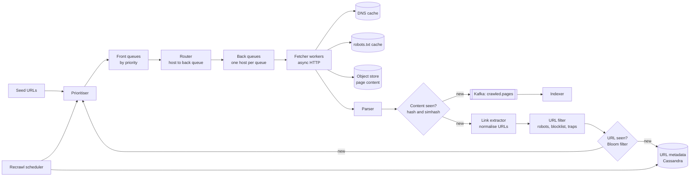

# 13 · Web Crawler

> **Level:** Medium · **Time box:** 45 min · **Asked at:** Google, Microsoft, Amazon, Atlassian, Flipkart (price and catalogue crawling), Meesho, and many startups doing data aggregation
> **Concepts used:** [29 Bloom filter](../../concepts/29-probabilistic-data-structures.md) · [17 message queues](../../concepts/17-message-queues.md) · [14 consistent hashing](../../concepts/14-consistent-hashing.md) · [26 blob storage](../../concepts/26-blob-storage.md) · [03 networking (DNS)](../../concepts/03-networking-basics.md) · [24 resilience](../../concepts/24-resilience-patterns.md) · [02 estimation](../../concepts/02-back-of-envelope.md)
> **Visuals:** [Bloom filter](../../../visuals/v16-bloom-filter.html) · [consistent hashing](../../../visuals/v04-consistent-hashing.html)
> **Code it:** [Bloom filter](../../code/03-bloom-filter/README.md) · [consistent hash ring](../../code/01-consistent-hashing/README.md)

## How to practise this

1. Set a 45-minute timer. Open [`my-design.md`](./my-design.md) and fill it in **without** looking below.
2. Then open each hint one at a time and compare. Write down what you missed in the Review section.
3. Do it again from memory on the repeat day in the plan. The second attempt is where it sticks.

## The prompt

"Design a web crawler. Start from a set of seed URLs, download pages, extract links, and keep crawling. The pages will be used to build a search index."

## Step 1: questions to ask

- What is it for: a search index, price monitoring, archiving, or ML training data? This sets what we store and how often we recrawl.
- How many pages per month? Only HTML, or also images and PDFs?
- Do we need to recrawl pages to keep them fresh? How often?
- Must we obey `robots.txt` and be polite to sites? (Always yes; ask anyway.)
- Do we render JavaScript-heavy pages?
- How long do we keep the content?

<details><summary>Assumed answers</summary>

- For a search index.
- **1 billion pages per month**. HTML only.
- Yes. Popular and fast-changing pages more often (news: hours), others weekly or monthly.
- Yes: obey `robots.txt`, at most one request at a time per host, with a delay.
- No JS rendering in the main design. It is a follow-up (a headless browser pool is ~10× more costly per page).
- Keep 5 years of content.
</details>

## Step 2: estimates

<details><summary>Show the numbers</summary>

| | Calculation | Result |
|---|---|---|
| Pages per second | 1B / (30 × 86,400) | **~400 pages/s** avg, ~800/s peak |
| Download bandwidth | 400 × 500 KB average page | **~200 MB/s ≈ 1.6 Gbps** |
| Storage per month | 1B × 500 KB | **~500 TB/month** raw; ~100 TB compressed (HTML compresses ~5×) |
| Storage for 5 years | 500 TB × 12 × 5 | **~30 PB** raw, so object storage, not a DB |
| Links found | ~50 links per page × 400/s | **~20k URLs/s** to check for "seen before" |
| Seen-URL set | ~10B URLs × ~100 B | ~1 TB as a plain set. A Bloom filter at 1% false positives needs ~10 bits per URL: **~12 GB** |
| Fetchers | ~1 s per fetch, ~100 concurrent fetches per worker (async I/O) | 400/s ÷ 100 = 4 workers in theory; plan **20–50** for slow sites, retries and headroom |

Takeaway to say out loud: "Download volume and storage are big but simple: object storage. The interesting parts are the **URL frontier** (priority and politeness), **deduplication** of URLs and content, and **not getting stuck** in traps or hammering one site."
</details>

## Step 3: API

<details><summary>Show the API</summary>

A crawler has few external APIs. The interfaces are internal:

```http
POST /v1/seeds                         # operators add seed URLs or domains
{ "urls": ["https://example.in/"], "priority": "high" }

GET  /v1/pages?url=https://...         # indexer or debug: latest stored version + metadata

# Internal
frontier.enqueue(url, priority, earliestFetchTime)
frontier.next(workerId) → url          # respects per-host politeness
fetcher.fetch(url) → { status, headers, body, fetchedAt }
Kafka topic: crawled.pages             # the indexer consumes this
```
</details>

## Step 4: data model

<details><summary>Show the data model</summary>

| Store | Key | Fields | Why |
|---|---|---|---|
| Page content (S3/HDFS) | `hash(url)/fetch_ts` | compressed HTML | 30 PB; cheap, durable, immutable blobs |
| URL metadata (Cassandra/Bigtable/HBase) | `url_hash` | url, last_fetch, last_status, content_hash, next_fetch, priority, fail_count | Billions of rows, simple key lookups, high write rate |
| Host table | `host` | robots.txt (cached), crawl delay, last_access, error rate | Politeness and robots checks |
| Seen-URL Bloom filter | — | bit array, ~12 GB, sharded | Fast "have I seen this URL?" |
| Content fingerprints | `simhash` | url_hash | Near-duplicate detection |
| Frontier queues | per priority / per host | URLs | On disk with an in-memory buffer (Kafka, or custom queue files) |

**DB choice:** a wide-column store (Cassandra, Bigtable) for URL metadata: billions of rows, key access, heavy writes, no joins. Object storage for page bodies. Do not put HTML in the database.
</details>

## Step 5: high-level design

<details><summary>Show the diagram</summary>



**Write (one crawl cycle):**
1. The prioritiser scores a URL (PageRank-like importance, change rate, site quality) and puts it in a front queue for its priority.
2. The router moves URLs from front queues to back queues. Each back queue holds URLs of **one host**. A heap of `(next_allowed_time, queue)` decides which host is due.
3. A fetcher takes a URL from a due host, checks `robots.txt` (cached per host), resolves DNS from the cache, downloads with a timeout and a size limit, and sets the host's next allowed time (e.g. now + crawl delay).
4. The page body goes to S3. The parser computes the content hash. If the content is new, it emits to Kafka for the indexer and extracts links.
5. Links are normalised (lowercase host, remove fragments, sort query params, drop session IDs), filtered, and checked against the Bloom filter. New URLs go to the metadata store and back to the prioritiser.

**Read:** the indexer consumes `crawled.pages` and reads bodies from S3. The recrawl scheduler scans the metadata store for `next_fetch < now` and feeds those URLs back in.
</details>

## Step 6: deep dives (the part that gets scored)

<details><summary>Deep dive 1: the URL frontier (priority and politeness)</summary>

A plain FIFO queue fails in two ways. It crawls unimportant pages as soon as important ones. And a page with 500 links to the same site makes us hit that site 500 times in a row, which is rude and gets us blocked.

The classic answer is the **Mercator** design (Heydon and Najork), also in Alex Xu vol. 1 ch. 9:

| Part | Job | How |
|---|---|---|
| Front queues | **Priority** | F queues, one per priority level. A biased selector picks high-priority queues more often |
| Back queues | **Politeness** | B queues, each holds URLs of one host only. Mapping table `host → queue` |
| Heap of hosts | When each host may be hit next | Min-heap on `next_allowed_time`. A fetcher pops the earliest due host, takes one URL, then pushes the host back with `now + delay` |

Rules of thumb: B ≈ 3 × number of fetcher threads, so fetchers never idle. Crawl delay per host from `robots.txt` (`Crawl-delay`), else ~1 s, and back off on 429/503.

The frontier is too big for memory (billions of URLs). Keep queues on disk with in-memory buffers at the head and tail, or use Kafka topics partitioned by host hash.

Say: "Front queues give priority, back queues give politeness: each back queue is one host, and a heap of next-allowed times makes sure we never hit a host faster than its crawl delay."
</details>

<details><summary>Deep dive 2: deduplication of URLs and content</summary>

| Problem | Approach | Notes |
|---|---|---|
| Same URL written differently | **Normalisation**: lowercase scheme and host, remove default port and `#fragment`, sort query params, strip tracking params (`utm_*`), resolve relative links | Cheap and removes a lot |
| Have we seen this URL? | **Bloom filter** (~12 GB for 10B URLs at 1% FPR), sharded with the URL space | A false positive means we skip a new URL; acceptable at 1%. It never lets a duplicate through |
| Same page at different URLs | **Exact content hash** (SHA-256 of normalised body) | Catches mirrors and copies |
| Almost the same page (ads, dates differ) | **SimHash** (64-bit). Pages within Hamming distance ≤ 3 are near-duplicates | Google's paper on near-duplicate detection for web crawling (Manku et al.) uses this |
| Same URL, content unchanged on recrawl | Conditional GET (`If-Modified-Since`, `ETag`) and compare content hash | Saves bandwidth; also tells us the page's change rate |

About 30% of the web is duplicate content, so this saves a lot of storage and indexing work.

Say: "I normalise URLs, check a sharded Bloom filter before enqueueing, and dedupe content by exact hash and SimHash, so mirrors and near-copies are not stored or indexed twice."
</details>

<details><summary>Deep dive 3: scaling out the crawl</summary>

- **Partition by host**: `hash(host) → crawler node`, with consistent hashing. All URLs of a host go to the same node. That node owns the host's politeness state, robots cache and back queue. No cross-node coordination per fetch.
- A newly found link for another host goes to the owning node (via Kafka partitioned by host hash).
- **Async I/O**: one worker can keep hundreds of fetches in flight (Node, Go, or Python asyncio). The crawl is network-bound, not CPU-bound. Parsing is CPU-bound, so run parsers as a separate pool.
- **DNS**: DNS lookups can take 10–200 ms and public resolvers rate-limit. Run a local caching resolver per node and cache by TTL. This is a known bottleneck in Mercator-style crawlers.
- **Geography**: put crawler nodes close to the sites they crawl (e.g. a Mumbai region for `.in` sites) to cut latency.
- **Checkpointing**: the frontier and Bloom filter are snapshotted regularly, so a crashed node restarts without losing its queue.

Say: "I partition by host with consistent hashing, so one node owns each host's politeness state. Fetchers use async I/O, parsers run as a separate CPU pool, each node has a local DNS cache, and queues are checkpointed."
</details>

<details><summary>Deep dive 4: robustness, traps and freshness</summary>

| Risk | Defence |
|---|---|
| Spider traps (infinite calendars, `?page=1,2,3...`, `/a/b/a/b/...`) | Max URL length, max depth per site, max pages per host per day, detect repeating path segments |
| Huge or endless responses | Max body size (e.g. 10 MB), read timeout, only `text/html` content types |
| Slow or broken sites | Timeouts; retry with backoff a few times; then lower the host's priority |
| Bad content (malware, spam farms) | Blocklists, a quality score in the prioritiser |
| Legal and polite crawling | Obey `robots.txt` (re-fetch it daily), identify ourselves in `User-Agent`, honour 429/503 |

**Freshness:** estimate each page's change rate from past fetches (content hash changed or not). Recrawl interval ~ 1/change rate, bounded (e.g. 1 hour to 30 days), weighted by importance. News homepages get hours; a static "about us" page gets a month. Sitemaps and RSS feeds give hints too.

Say: "Traps are handled with depth and per-host page limits plus URL pattern checks; freshness with a per-page recrawl interval learned from how often the content hash changes."
</details>

## Follow-ups interviewers ask

1. How do you crawl JavaScript-heavy pages? (A separate pool of headless browsers, only for pages that need it, detected by empty initial HTML. It is ~10× costlier, so keep it small.)
2. A site asks you to stop crawling. (Update the host blocklist, which every fetch checks. Also honour `robots.txt` changes on the next daily refresh.)
3. How do you recover the Bloom filter if a node dies? (Snapshot it to S3 every few minutes; rebuild missing parts from the URL metadata store.)
4. How do you prioritise a brand-new site? (Seed importance from the linking page's score and the domain's quality; boost if it appears in sitemaps.)
5. Crawling a single huge site like an e-commerce catalogue for price tracking? (Use the site's sitemap or API if allowed; politeness still applies; only recrawl changed product pages.)

## Common mistakes

- One big FIFO queue with no politeness, so the design DDoSes small sites.
- Storing HTML in a relational database.
- No URL normalisation, so the Bloom filter is fooled by `?utm_source=` variants.
- Forgetting DNS as a bottleneck.
- No defence against spider traps.
- Treating recrawl as "crawl everything again every month".
