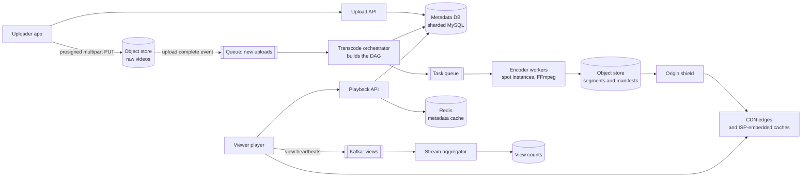

# 14 · Video Streaming (YouTube/Netflix)

> **Level:** Hard · **Time box:** 60 min · **Asked at:** Hotstar (JioHotstar), Netflix, Amazon (Prime Video), Google (YouTube), MX Player, ShareChat/Moj, Flipkart, Uber
> **Concepts used:** [26 blob storage](../../concepts/26-blob-storage.md) · [09 CDN](../../concepts/09-cdn.md) · [17 message queues](../../concepts/17-message-queues.md) · [33 batch and stream](../../concepts/33-batch-stream-processing.md) · [34 counters and hot keys](../../concepts/34-data-modeling-at-scale.md) · [08 caching](../../concepts/08-caching.md) · [36 multi-region](../../concepts/36-deployment-multi-region.md) · [02 estimation](../../concepts/02-back-of-envelope.md)
> **Visuals:** [life of a request](../../../visuals/v01-request-lifecycle.html) · [Kafka consumer groups](../../../visuals/v10-kafka-consumer-groups.html) · [estimation calculator](../../../visuals/v19-estimation-calculator.html)
> **Code it:** [Count-Min sketch for trending](../../code/10-count-min-sketch/README.md) · Related: [photo sharing](../16-photo-sharing/README.md) · [live comments and viewer count](../27-live-comments/README.md)

## How to practise this

1. Set a 60-minute timer. Open [`my-design.md`](./my-design.md) and fill it in **without** looking below.
2. Then open each hint one at a time and compare. Write down what you missed in the Review section.
3. Do it again from memory on the repeat day in the plan. The second attempt is where it sticks.

## The prompt

"Design a video platform like YouTube. Users upload videos. Other users watch them on phones, laptops and TVs, on fast and slow networks."

## Step 1: questions to ask

- Upload + watch (YouTube), or only watch a fixed catalogue (Netflix)? Live streaming too?
- Scale: DAU, videos watched per day, uploads per day, average length?
- Which devices and networks? (In India most viewers are on mobile data, often 3G/4G with drops.)
- Max upload size and length?
- How fast must a new upload be watchable?
- Features in scope: search, comments, likes, recommendations, view counts?
- DRM or paid content?

<details><summary>Assumed answers</summary>

- Upload and watch (VOD). Live is a deep dive at the end.
- 100M DAU, 5 videos per user per day, average watch 5 min. 500k uploads/day, average 5 min long.
- Phones first. Renditions from 144p/240p up to 1080p (4K is a nice-to-have). Adaptive bitrate is a must.
- Max 10 GB / 2 hours per upload.
- Watchable in a low rendition within a few minutes; all renditions within ~30 min.
- In scope: upload, transcode, stream, metadata, view counts. Out of scope: recommendations, comments, search ranking (mention only).
- No DRM for user content. Mention it for paid content.
</details>

## Step 2: estimates

<details><summary>Show the numbers</summary>

| | Calculation | Result |
|---|---|---|
| Video views | 100M × 5 | **500M views/day ≈ 6k/s** avg, ~15k/s peak (evening) |
| Watch minutes | 500M × 5 min | **2.5B min/day** |
| Egress bandwidth | 2.5B min × 60 s × ~2 Mbps average bitrate ÷ 8 | ~37 PB/day ≈ **~3.5 Tbps** avg, ~8–10 Tbps peak. Only a CDN can serve this |
| Uploads | 500k/day | **~6/s** avg. Writes are tiny next to reads |
| Raw upload size | 5 min × ~50 MB/min (1080p phone video) | ~250 MB each → **~125 TB/day** raw |
| Transcoded size | ~6 renditions; together ~1× the raw size after compression | ~125 TB/day more. **~90 PB/yr** total before replication. Move raw files to cold storage after transcoding |
| Transcode compute | 2.5M video-min/day × 6 renditions × ~1 core-min per video-min | ~15M core-min/day ≈ **~10k cores** running all day, more at peak |
| Metadata | 500k/day × 2 KB | ~1 GB/day. Small |
| Live peak (Hotstar IPL style) | Hotstar reported over 25M concurrent viewers in 2019; × ~1.5 Mbps | **~40 Tbps** from one event, with sudden spikes at key moments |

Takeaway to say out loud: "Reads dwarf writes, and the reads are big. Bandwidth is the main cost. So the design is: **transcode once into many renditions and small segments, then serve everything from the CDN** with adaptive bitrate. The origin and our services should almost never see video bytes."
</details>

## Step 3: API

<details><summary>Show the API</summary>

```http
POST /v1/uploads                               # start an upload
{ "fileName": "trip.mp4", "sizeBytes": 262144000, "contentType": "video/mp4" }
→ 201 { "videoId": "v_8Kq", "uploadId": "...", "partSize": 16777216,
        "partUrls": ["https://s3...presigned...part=1", ...] }   # presigned multipart URLs

PUT  <presigned part URL>                      # client → object store directly, parallel, resumable
POST /v1/uploads/{videoId}/complete            # list of part ETags
{ "parts": [{ "n": 1, "etag": "..." }, ...], "title": "Goa trip", "visibility": "public" }
→ 202 { "status": "processing" }

GET  /v1/videos/{videoId}                      # metadata + manifest URL
→ 200 { "title": "...", "status": "ready", "manifest": "https://cdn.../v_8Kq/master.m3u8", ... }

GET  https://cdn.../v_8Kq/master.m3u8          # HLS master playlist: one line per rendition
GET  https://cdn.../v_8Kq/360p/seg_00042.ts    # 2–6 s segments, served by the CDN

POST /v1/videos/{videoId}/views                # batched heartbeat from the player
{ "sessionId": "...", "watchedSec": 30, "rendition": "360p" }
```
Video bytes never pass through our API servers: upload goes straight to object storage, playback comes straight from the CDN.
</details>

## Step 4: data model

<details><summary>Show the data model</summary>

| Store | Key | Fields | Why |
|---|---|---|---|
| `videos` (metadata DB) | `video_id` | owner_id, title, description, status (uploading/processing/ready/failed), duration, renditions, created_at | Strong consistency on status changes; MySQL/Postgres sharded by `video_id` (YouTube used sharded MySQL through Vitess) |
| `channel_videos` | `(channel_id, created_at)` | video_id | List a channel's videos; Cassandra or a secondary table |
| `transcode_jobs` | `(video_id, task_id)` | type, rendition, segment_range, status, attempts | Tracks each DAG task; retry failed ones |
| Object store (S3/GCS) | `raw/{video_id}`, `out/{video_id}/{rendition}/seg_N` | bytes | Durable, cheap, the CDN origin |
| `view_counts` | `video_id` | count (approximate, updated every few seconds) | Written by the stream aggregator, cached in Redis |
| Search index (Elasticsearch) | `video_id` | title, tags, channel | Fed from metadata change events |

**DB choice:** a relational DB for metadata (small, needs transactions on status). Object storage for all video bytes (it is built for large immutable blobs and 11 nines of durability). Counters go through a stream, not row updates.
</details>

## Step 5: high-level design

<details><summary>Show the diagram</summary>



**Write (upload):**
1. The client calls `POST /uploads`. We create a `videos` row with status `uploading` and return presigned multipart URLs.
2. The client uploads 16 MB parts in parallel straight to the object store. A failed part is retried alone, so a dropped mobile connection does not restart a 2 GB upload.
3. On `complete`, the object store assembles the file and emits an event. Status becomes `processing`.
4. The orchestrator builds a DAG: validate → split into ~10 s chunks → encode each chunk × each rendition in parallel → package into HLS/DASH segments + manifests → thumbnails → done. Encoder workers pull tasks from a queue.
5. The low renditions (240p/360p) finish first and the video goes `ready` with those. Higher ones are added to the manifest as they finish.
6. A `video.ready` event updates search and notifies subscribers.

**Read (watch):**
1. The player calls the playback API (metadata from Redis, else the DB) and gets the master manifest URL, usually a signed CDN URL.
2. The player downloads the manifest from the CDN, picks a rendition based on measured bandwidth, and fetches 2–6 s segments one by one.
3. Every few segments it re-measures and switches rendition up or down (adaptive bitrate). The CDN serves ~95%+ of bytes; on a miss it goes to the origin shield, then the object store.
4. The player sends batched heartbeats to Kafka for view counts and watch analytics.
</details>

## Step 6: deep dives (the part that gets scored)

<details><summary>Deep dive 1: the transcoding pipeline</summary>

Transcoding one 2-hour 4K video on one machine takes hours. Split it.

| Approach | How | Pros | Cons |
|---|---|---|---|
| One job per video | One worker encodes the whole file into all renditions | Simple | Slow for long videos; one crash restarts everything |
| One job per rendition | Parallel per rendition | Faster | Still bound by video length |
| **Chunked DAG (recommended)** | Split at keyframes into ~10 s chunks; encode chunk × rendition in parallel; join | Minutes even for long videos; retry one small task | Needs an orchestrator and a merge step; chunk edges need keyframe alignment |

Details to mention:
- Renditions ladder, e.g. 144p/240p/360p/480p/720p/1080p, with H.264 for reach and VP9/AV1 for big savings on popular videos. Netflix tech blog describes per-title (and per-shot) encoding: pick the bitrate ladder based on how complex the content is.
- Keyframe every 2 s and the same GOP structure across renditions, so the player can switch between renditions at segment boundaries.
- Workers are stateless and run on spot/preemptible instances. A task is idempotent: output goes to a deterministic path, so a retry overwrites.
- Priority queues: a creator with 10M subscribers, or the first 360p rendition, goes first.
- Safety steps in the DAG: malware/format check, content moderation, copyright fingerprinting (like YouTube Content ID).

Say: "I split the video into chunks and run a DAG of small idempotent encode tasks on a fleet of spot workers. Low renditions finish first so the video is watchable in minutes."
</details>

<details><summary>Deep dive 2: adaptive bitrate streaming (HLS/DASH)</summary>

| Option | How | Verdict |
|---|---|---|
| Progressive download of one MP4 | HTTP range requests on one file | No quality switching; wastes data on slow networks |
| **HLS / MPEG-DASH (recommended)** | Video cut into 2–6 s segments per rendition; a manifest lists them | Plain HTTP, so any CDN can cache it. The player adapts per segment |
| RTMP / custom protocol | Persistent stream | Hard to cache, needs special servers; only used for live ingest today |

How the player adapts: it measures the download speed of the last few segments and its buffer level. If the buffer is low, it drops to a lower rendition. If the buffer is healthy and bandwidth is high, it steps up. Start low (e.g. 240p) for a fast first frame, then climb.

Segment length trade-off: short segments (2 s) mean faster switching and lower live latency, but more requests and more manifest updates. Long segments (6–10 s) mean fewer requests and better compression, but slower adaptation. 4–6 s is a common VOD choice.

India note: many users are on patchy 4G. A 144p/240p rendition, a data-saver mode, and offline downloads (Netflix and Hotstar both offer them) matter more than 4K.

Say: "I use HLS or DASH: small segments per rendition over plain HTTP, so the CDN caches them like any file and the player picks quality per segment from its buffer and measured bandwidth."
</details>

<details><summary>Deep dive 3: the CDN and the cost of bandwidth</summary>

At ~10 Tbps peak, bandwidth is the biggest bill. The goal is a very high CDN hit ratio.

| Layer | Role |
|---|---|
| Edge PoPs (commercial CDN like Akamai, CloudFront) | Close to users; cache popular segments |
| **ISP-embedded caches** | Servers inside Jio/Airtel networks. Netflix Open Connect puts appliances in ISPs and fills them off-peak; YouTube does the same with Google Global Cache. Traffic never leaves the ISP |
| Origin shield | One mid-tier cache per region, so many edge misses become one origin fetch |
| Origin (object store) | Source of truth; should see a tiny fraction of requests |

- Popularity follows a long tail. The top few % of videos take most views. Push popular content to the edges proactively (Netflix pre-positions content at night). Let the long tail stay at regional caches or the origin.
- Cache keys: `video_id/rendition/segment` are immutable, so cache them with a long TTL. Manifests for VOD are immutable too once all renditions are done.
- Signed URLs or tokens with an expiry stop hotlinking and support paid content. DRM (Widevine, FairPlay) for paid content.
- Multi-CDN: send traffic to the CDN that performs best per ISP and region; fail over if one has an outage.

Say: "Our servers never touch video bytes. Segments are immutable, so they cache well. Popular titles are pushed into ISP-embedded caches like Netflix Open Connect, and an origin shield protects the object store from edge misses."
</details>

<details><summary>Deep dive 4: view counts at scale</summary>

6k views/s average, but a viral video can get 50k/s on **one** row.

| Approach | Pros | Cons |
|---|---|---|
| `UPDATE videos SET views = views + 1` | Exact, simple | Hot row; the DB dies on a viral video |
| Redis `INCR` per video | Fast | One hot key still sits on one shard; Redis is not the durable record |
| **Kafka + stream aggregation (recommended)** | Heartbeats to Kafka (keyed by video_id); Flink sums per video per 10 s window; write totals to the DB/Redis | Scales; counts are a few seconds behind |
| Sharded counters | N sub-counters per video, sum on read | Good for very hot keys; more reads |

- A "view" is a business rule (e.g. watched 30 s), not a page load. Filter bots and repeated views from one session in the stream job, using a dedupe window on `(session_id, video_id)`.
- Monetised counts can be corrected later by a batch job; the public counter is approximate.
- Watch-time analytics go to an OLAP store (ClickHouse, BigQuery) from the same Kafka topic.

Say: "I never update a view counter row per view. Players send heartbeats to Kafka keyed by video, a stream job dedupes by session, applies the 30-second rule and sums per 10-second window, and the public count is a few seconds behind."
</details>

<details><summary>Deep dive 5: live streaming vs VOD (Hotstar IPL)</summary>

| | VOD | Live |
|---|---|---|
| Ingest | Upload a finished file | RTMP/SRT stream from the broadcaster, continuously |
| Transcode | Chunked DAG, can take minutes | Real-time: each rendition must encode faster than real time, on dedicated always-on encoders |
| Manifest | Static | Updated every segment; players re-fetch it |
| Latency | Not an issue | 10–30 s for standard HLS; 2–5 s with low-latency HLS/CMAF chunked segments |
| Load shape | Long tail, steady | One stream, tens of millions of viewers, huge spikes at a wicket or a last-over finish |

Handling the IPL peak:
- Every viewer requests the **same** few segments, so the CDN hit ratio is very high, but the edges need capacity planned with CDN partners and ISPs weeks before the final.
- **Pre-scale** everything before the match (Hotstar engineers have spoken about scaling ahead of the game instead of trusting autoscaling, which reacts too slowly). Use load tests at the expected peak.
- Protect the backend: login, playback-token and ads APIs see a surge when a big moment makes people open the app. Cache playback tokens, use request coalescing, and degrade gracefully (switch off personalised features, lower the default bitrate) under extreme load.
- Concurrency count and live comments are separate systems: see [live comments and viewer count](../27-live-comments/README.md).
- DVR (rewind live): keep the last N minutes of segments and list them in the manifest.

Say: "For live I replace the batch DAG with real-time encoders and a rolling manifest. The CDN still does the heavy lifting because everyone watches the same segments. The real risk is the control plane, so I pre-scale before the match and degrade non-essential features under load."
</details>

## Follow-ups interviewers ask

1. A 2 GB upload fails at 90% on a train. (Multipart upload: only the missing parts are re-sent. The client keeps the `uploadId` and asks which parts exist.)
2. How fast can a new video be watched? (The low rendition is encoded first and published; others are appended. A few minutes for a short video.)
3. How do you save storage? (Delete or archive raw files to cold storage after transcoding; skip high renditions for videos nobody watches; re-encode only popular videos with AV1.)
4. A region's CDN goes down. (Multi-CDN with DNS or client-side steering; the player retries a segment from a backup CDN host in the manifest.)
5. Resume watching on another device? (Store `(user_id, video_id) → position` every ~10 s in a KV store like Cassandra or DynamoDB.)
6. Copyright and harmful content? (Fingerprint matching and ML moderation as steps in the DAG before `ready`; takedown by flipping status and purging the CDN.)

## Common mistakes

- Streaming video bytes through your own API servers.
- One big MP4 with no renditions and no segments.
- Not estimating bandwidth, which is the number that drives the whole design.
- Encoding a 2-hour video as one task on one machine.
- `views = views + 1` on the video row.
- Treating live and VOD as the same pipeline.
- Spending the time on recommendations, which the prompt did not ask for.
