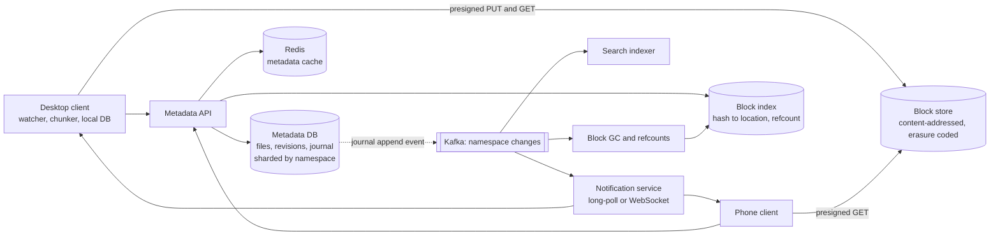

# 15 · File Storage and Sync (Dropbox)

> **Level:** Hard · **Time box:** 60 min · **Asked at:** Atlassian, Microsoft (OneDrive), Google (Drive), Amazon, Dropbox, Zoho, Flipkart, Freshworks
> **Concepts used:** [26 blob storage](../../concepts/26-blob-storage.md) · [05 real-time](../../concepts/05-realtime-communication.md) · [13 sharding](../../concepts/13-partitioning-sharding.md) · [12 replication](../../concepts/12-replication.md) · [21 event-driven](../../concepts/21-event-driven-cqrs.md) · [19 idempotency](../../concepts/19-idempotency-delivery-semantics.md) · [10 SQL deep dive](../../concepts/10-sql-deep-dive.md) · [02 estimation](../../concepts/02-back-of-envelope.md)
> **Visuals:** [polling, SSE and WebSockets](../../../visuals/v14-realtime-transport.html) · [sharding strategies](../../../visuals/v06-sharding.html) · [leader-follower replication](../../../visuals/v05-replication.html)
> **Code it:** LLD warm-up: [in-memory file system](../../../lld/problems/24-file-system/README.md) · Related: [collaborative editor](../25-collaborative-editor/README.md) · [video streaming (large uploads)](../14-video-streaming/README.md)

## How to practise this

1. Set a 60-minute timer. Open [`my-design.md`](./my-design.md) and fill it in **without** looking below.
2. Then open each hint one at a time and compare. Write down what you missed in the Review section.
3. Do it again from memory on the repeat day in the plan. The second attempt is where it sticks.

## The prompt

"Design a file storage and sync service like Dropbox or Google Drive. Users put files in a folder on their laptop or phone. The files sync to the cloud and to all their other devices. Users can share folders."

## Step 1: questions to ask

- Sync client on devices (Dropbox), or only web upload and download?
- Max file size? Typical file sizes?
- Scale: users, DAU, average storage per user, edits per day?
- How fast must a change show up on another device?
- Sharing: read-only links, or shared folders that several people edit?
- Version history? For how long? Restore deleted files?
- Real-time co-editing inside a file (Google Docs)? (Usually out of scope: that is a different problem.)
- Offline edits?

<details><summary>Assumed answers</summary>

- Desktop and mobile sync clients plus a web UI.
- Files up to 50 GB. Most are small (documents, photos), a few are huge (videos, disk images).
- 500M users, 50M DAU, 5 GB stored per user on average. Each active user changes ~10 files a day.
- A change shows up on other online devices within ~5–10 seconds.
- Shared folders with several editors, and share links.
- Keep versions for 30 days (longer on paid plans). Restore deleted files within 30 days.
- No co-editing within a file. If two people edit the same file, we keep both copies.
- Offline edits must sync when the device comes back online.
- Durability is the top requirement: never lose a file. Data must not leak between users.
</details>

## Step 2: estimates

<details><summary>Show the numbers</summary>

| | Calculation | Result |
|---|---|---|
| Logical storage | 500M × 5 GB | **2.5 EB** |
| After dedupe | Identical blocks across users and versions; assume ~30% saved | ~1.75 EB |
| Physical storage | × ~1.5 with erasure coding (vs 3× with plain replication) | **~2.6 EB** |
| File changes | 50M DAU × 10 | **500M/day ≈ 6k/s** avg, ~15k/s peak (office hours) |
| Upload bytes | 500M × ~1 MB actually sent (delta sync sends only changed blocks) | **~500 TB/day ≈ 50 Gbps** avg in |
| Download/sync bytes | Each change goes to ~2 other devices | **~1 PB/day** out |
| Metadata rows | 500M users × ~1,000 files × ~300 B (plus versions) | **~150 TB** of metadata. Big enough to shard |
| Online devices | ~30M devices with an open notification connection | at ~100k connections per server: **~300 servers** |

Takeaway to say out loud: "This is mostly **block storage plus a strongly consistent metadata service**. The bytes are huge but simple. The hard part is the metadata: syncing changes to many devices, handling conflicts, and dedupe. I'll split files into blocks and only move blocks that changed."
</details>

## Step 3: API

<details><summary>Show the API</summary>

```http
# 1. Ask which blocks the server is missing
POST /v1/blocks/check
{ "hashes": ["sha256:ab12...", "sha256:9f3c...", ...] }
→ 200 { "missing": ["sha256:9f3c..."],
        "uploadUrls": { "sha256:9f3c...": "https://blockstore...presigned..." } }

# 2. Upload only the missing blocks (straight to the block store)
PUT <presigned URL>                         # body = block bytes; server verifies the hash

# 3. Commit the new version of the file (metadata only)
POST /v1/files/commit
Idempotency-Key: <uuid>
{ "namespaceId": "ns_77", "path": "/Docs/plan.xlsx", "parentRev": 41,
  "blocks": ["sha256:ab12...", "sha256:9f3c..."], "size": 8123456 }
→ 200 { "rev": 42 }
→ 409 { "conflict": true, "latestRev": 43 }   # someone else committed first

# Sync: get changes since my cursor
GET  /v1/namespaces/{ns}/changes?cursor=c_1803
→ 200 { "entries": [...], "cursor": "c_1811", "hasMore": false }

# Notification: long-poll; returns when something changed
GET  /v1/notify?cursors=ns_77:c_1811,ns_90:c_220&timeout=60
→ 200 { "changed": ["ns_77"] }              # then the client calls /changes

GET  /v1/files/{fileId}/revisions
POST /v1/files/{fileId}/restore { "rev": 39 }
POST /v1/shares { "path": "/Trip", "with": ["priya@x.com"], "role": "editor" }
```
The upload and download of bytes go to the block store with presigned URLs. The API servers handle metadata only.
</details>

## Step 4: data model

<details><summary>Show the data model</summary>

A **namespace** is a root that syncs as a unit: a user's home folder, or a shared folder. Sharding and the change journal are per namespace.

| Table | Key | Fields | Notes |
|---|---|---|---|
| `namespaces` | `ns_id` | owner, type (home/shared), quota | |
| `namespace_members` | `(ns_id, user_id)` | role, mount path | Sharing |
| `files` | `(ns_id, path)` | file_id, latest_rev, is_deleted, is_dir | Current state of each path |
| `file_revisions` | `(file_id, rev)` | block_list (ordered hashes), size, modified_by, device_id, created_at | Version history |
| `journal` | `(ns_id, seq)` | file_id, path, rev, op (add/edit/delete/move) | Append-only change log; `seq` is the sync cursor |
| `blocks` | `hash` | storage location, size, ref_count | Dedupe index. Content-addressed |
| Block store | `hash` | block bytes (≤ 4 MB, compressed, encrypted) | S3, or a custom store (Dropbox moved to its own, Magic Pocket) |

**DB choice:**
- Metadata: a relational DB (MySQL/Postgres) **sharded by `ns_id`**. A commit must do several things atomically: check `parentRev`, insert a revision, update `files`, append to `journal`. Keeping a namespace on one shard makes that one local transaction. Dropbox runs its metadata on sharded MySQL (their Edgestore system sits on top).
- Blocks: object storage. Blocks are immutable and keyed by hash, so there is no update and no consistency problem.
- The `blocks` dedupe index: a large KV store (sharded by hash). Ref counts are updated asynchronously; garbage collection deletes blocks with zero refs after a grace period.
</details>

## Step 5: high-level design

<details><summary>Show the diagram</summary>



**Write (save a file on the laptop):**
1. The client's file watcher sees `plan.xlsx` changed. The client splits it into blocks (up to 4 MB) and hashes each with SHA-256.
2. It calls `/blocks/check`. The server says which hashes it does not have. Usually only one or two blocks changed.
3. The client uploads only the missing blocks to the block store with presigned URLs. The store verifies each hash.
4. The client calls `/files/commit` with the block list and `parentRev = 41`. In one transaction on the namespace shard: check the current rev is 41, insert rev 42, update `files`, append to `journal` with the next `seq`.
5. The journal append publishes a change event. The notification service wakes up every device that is long-polling on this namespace.

**Read (another device syncs):**
1. The phone has an open long-poll on `/notify`. It returns "ns_77 changed".
2. The phone calls `/changes?cursor=c_1811` and gets the list of entries since its cursor, with block lists.
3. It downloads only the blocks it does not already have locally, rebuilds the file, and saves the new cursor.
4. A device that was offline for a week does the same: it just has a longer list of changes to apply.
</details>

## Step 6: deep dives (the part that gets scored)

<details><summary>Deep dive 1: chunking and dedupe</summary>

Why chunk: a 2 GB file with one changed byte should not be re-uploaded. Big files can upload in parallel and resume after a failure. Identical blocks are stored once.

| Approach | How | Pros | Cons |
|---|---|---|---|
| Whole file | Upload the full file every time | Simple | Huge waste for big files; no resume |
| **Fixed-size blocks (4 MB)** | Split at 0, 4 MB, 8 MB… | Simple, fast; Dropbox uses 4 MB blocks | Insert one byte at the start and every block boundary shifts, so all blocks change |
| Content-defined chunking (CDC) | Rolling hash (Rabin fingerprint) picks boundaries where the hash matches a pattern; average ~4 MB | Inserts only change nearby chunks; much better dedupe | More CPU; variable chunk sizes |
| rsync-style delta within a block | Send a binary diff against the old block | Smallest upload | More complex; both sides need the old version |

Dedupe:
- The block key is its SHA-256 hash. If the hash exists, skip the upload. That covers "same file in two folders", "same photo sent to many people", and unchanged blocks between versions.
- Cross-user dedupe saves the most, but it leaks information: if an upload of a known file is skipped, a user can learn that someone else has it. Options: dedupe only within a user/namespace, or always pretend to upload. State the trade-off.
- Never trust the client's hash: the block store recomputes it on upload.
- Encrypt blocks at rest. Per-block keys with a key management service make cross-user dedupe harder; choose one.

Say: "I split files into ~4 MB blocks addressed by SHA-256. The client asks which hashes are missing and uploads only those. Fixed blocks are simple; content-defined chunking handles inserts better. Same hash means same bytes, so dedupe is free."
</details>

<details><summary>Deep dive 2: the sync protocol (journal + cursor + notification)</summary>

| Option | How | Pros | Cons |
|---|---|---|---|
| Clients poll `/changes` every 30 s | Simple HTTP | Easy | 30M devices × every 30 s = 1M req/s, mostly "nothing new"; slow to notice changes |
| **Long-poll notify + pull changes (recommended)** | Client holds `/notify` open ~60 s; server returns when a namespace changes; client then pulls `/changes` | Fast, cheap, works through proxies; this is what Dropbox described for its clients | Many open connections; reconnect storms after a deploy |
| WebSocket push of full changes | Server pushes the change entries | Lowest latency | Stateful connections; the server must buffer for slow clients |

Key ideas:
- The **journal** is an append-only log per namespace with a monotonic `seq`. A device's cursor is just "the last seq I applied". This makes sync restartable: crash, reconnect, ask again from the cursor.
- The notification is only a **hint** ("something changed"). The truth is always pulled from the journal. A lost notification is harmless: the next poll timeout or reconnect catches up.
- The notification servers keep `namespace → open connections` in memory. Kafka partitioned by `ns_id` delivers change events; each notify server subscribes to the namespaces of its connected devices (or a pub/sub like Redis keyed by namespace).
- Add jitter to reconnects so a deploy does not cause 30M devices to reconnect at the same second.

Say: "Each namespace has an append-only journal, and each device keeps a cursor into it. A long-poll tells the device that something changed; the device then pulls the changes since its cursor. Notifications can be lost safely because the journal is the source of truth."
</details>

<details><summary>Deep dive 3: conflicts and versioning</summary>

Two devices edit `plan.xlsx` offline, both based on rev 41.

- The commit API uses **optimistic concurrency**: `commit(parentRev = 41)`. The first commit wins and becomes rev 42. The second sees the current rev is 42, not 41, and gets 409.
- The losing client does not overwrite. It saves its version as a **conflicted copy**: `plan (Priya's laptop's conflicted copy 2026-10-18).xlsx`. Both versions are kept; the user merges by hand. This is Dropbox's behaviour.
- We do not try to merge binary files. Merging is only possible for formats we understand (that is the [collaborative editor](../25-collaborative-editor/README.md) problem).

| Strategy | Pros | Cons |
|---|---|---|
| Last writer wins | Simple | Silent data loss. Not acceptable for user files |
| **Optimistic concurrency + conflicted copy** | No data loss; easy to explain | The user must resolve by hand |
| Locking files while editing | No conflicts | Breaks offline editing; stale locks |
| Automatic merge (OT/CRDT) | Best UX for text | Only for structured formats; much more complex |

Versioning:
- Each commit adds a `file_revisions` row. Old revisions point to old block lists, so a version costs only the changed blocks.
- Delete = a tombstone revision (`is_deleted = true`). Restore = commit an old block list as a new revision.
- After 30 days, a job removes old revisions and decrements block ref counts. Blocks at zero refs are deleted after a grace period (to avoid races with a commit that is reusing them right now).

Moves and renames: a move is a metadata change only (journal entry `move`), no blocks are touched. Moving a folder with 100k files is one entry per file, or a folder-level entry that clients expand.

Say: "Commits carry the parent revision. The first one wins, and the loser saves a conflicted copy instead of overwriting, so no data is lost. Every revision points to its block list, so versions and restores are cheap."
</details>

<details><summary>Deep dive 4: block storage and durability</summary>

| Option | Pros | Cons |
|---|---|---|
| **Cloud object storage (S3/GCS)** | 11 nines of durability, no ops, fine to start | At exabyte scale the cost is very high |
| Own storage system | Much cheaper at exabyte scale; control over hardware | Years of engineering; Dropbox built Magic Pocket and moved most data off S3 |

Durability techniques either way:
- **Erasure coding** (e.g. Reed-Solomon 6+3): ~1.5× overhead instead of 3× replication, and it survives the loss of several disks or nodes. Spread fragments across racks and zones.
- Write to more than one zone before acknowledging the upload.
- Background scrubbing: re-read blocks and verify the hash to find silent corruption ("bit rot"), then repair from parity.
- Hot vs cold tiers: recent blocks on fast storage, old versions on cheaper storage.
- The metadata DB is just as important as the blocks: losing the block list loses the file. Synchronous replicas, point-in-time backups, and the journal let you rebuild.

Say: "Blocks are immutable and content-addressed, which makes storage simple: erasure code them across zones and scrub them. I'd start on S3 and only build our own store at Dropbox scale."
</details>

<details><summary>Deep dive 5: sharing, permissions and hot namespaces</summary>

- A shared folder is its own namespace, mounted into each member's tree. Commits go to the shared namespace's shard and journal; all members' devices follow that journal. This is why sharding by namespace (not by user) works.
- Check permission on every commit and every block download: the block download URL is presigned only after checking that the user can read a file that contains that block. A hash alone must never grant access.
- Share links: a token mapped to `(ns_id, path, permissions, expiry)`. Downloads go through a CDN for popular public links.
- Hot namespace: a company-wide shared folder with 50k members. Fan-out of notifications is large, but the commit rate is still small. Cache the latest journal entries in Redis so 50k devices pulling `/changes` do not all hit the DB shard.
- Large teams with huge namespaces may need splitting into sub-namespaces.

Say: "A shared folder is its own namespace, mounted into each member's tree, which is why I shard by namespace. Permissions are checked before any presigned block URL is issued, and hot namespaces serve recent journal entries from Redis."
</details>

## Follow-ups interviewers ask

1. A 20 GB upload over a weak connection. (Blocks upload in parallel and resume per block; the commit happens only after all blocks are present. The `/blocks/check` call tells a restarted client what is already there.)
2. How do you save bandwidth further? (Compress blocks before upload; LAN sync between devices on the same network, which Dropbox offers; download on demand for "online-only" files.)
3. The notification service goes down. (Clients fall back to polling `/changes` with backoff. Nothing is lost because the journal is the truth.)
4. The same commit is sent twice (retry after a timeout). (The `Idempotency-Key` returns the first result. Even without it, the second commit has a stale `parentRev` and would become a conflicted copy, so the key matters.)
5. A user hits their quota mid-upload. (Check quota at `/blocks/check` and again at commit, in the same transaction as the revision insert.)
6. How does the client know what changed locally? (A file watcher (inotify, FSEvents) plus a local SQLite DB of path → rev and block hashes, compared on start-up for changes made while the app was closed.)

## Common mistakes

- Uploading whole files on every change.
- Sending file bytes through the metadata API servers.
- Last writer wins, which silently loses a user's work.
- Pushing full change data through the notification channel and treating it as reliable.
- Sharding metadata by user, then shared folders span shards and commits need distributed transactions.
- Granting block access by hash alone.
- Forgetting garbage collection and ref counts for blocks shared across versions and users.
