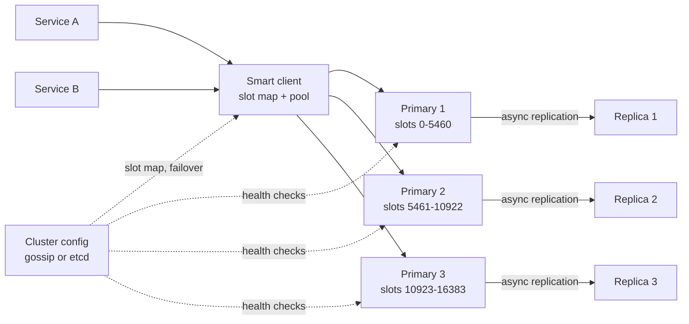

# 17 · Distributed Cache (Redis)

> **Level:** Medium · **Time box:** 45 min · **Asked at:** Flipkart, PhonePe, Razorpay, Atlassian, Amazon (often as "design Redis/Memcached")
> **Concepts used:** [08 caching](../../concepts/08-caching.md) · [14 consistent hashing](../../concepts/14-consistent-hashing.md) · [12 replication](../../concepts/12-replication.md) · [15 CAP and consistency](../../concepts/15-cap-pacelc-consistency.md) · [34 hot keys](../../concepts/34-data-modeling-at-scale.md) · [30 leader election](../../concepts/30-consensus-coordination.md)
> **Visuals:** [consistent hashing](../../../visuals/v04-consistent-hashing.html) · [caching patterns](../../../visuals/v03-caching-patterns.html) · [replication](../../../visuals/v05-replication.html) · [LRU internals](../../../visuals/v29-lru-cache.html)
> **Code it:** [consistent hash ring](../../code/01-consistent-hashing/README.md) · LLD: [LRU cache](../../../lld/problems/02-lru-cache/README.md)

## How to practise this

1. Set a 45-minute timer. Open [`my-design.md`](./my-design.md) and fill it in **without** looking below.
2. Then open each hint one at a time and compare. Write down what you missed in the Review section.
3. Do it again from memory on the repeat day in the plan. The second attempt is where it sticks.

## The prompt

"Design a distributed in-memory cache that many services can share. It should support get, set with TTL, and delete, and hold more data than one machine can."

## Step 1: questions to ask

- Data size and QPS? Read:write ratio?
- Value sizes? Any data types beyond strings (lists, sorted sets)?
- Is it a pure cache (data loss is OK) or a primary store?
- Latency target?
- Consistency: is it OK to read a stale value for a short time after a write?
- Eviction policy? Multi-tenant (many teams on one cluster)?

<details><summary>Assumed answers</summary>

- 10 TB of hot data, 5M ops/s at peak, 90% reads
- Values average 1 KB, max 1 MB. Strings only for the core design; data types as a follow-up
- A **cache**: losing some data on a crash is OK, but a full cold start must not take down the DB behind it
- p99 < 2 ms inside one data centre
- Eventual consistency between replicas is fine
- LRU eviction with TTL. Multi-tenant with per-tenant memory quotas
</details>

## Step 2: estimates

<details><summary>Show the numbers</summary>

| | Calculation | Result |
|---|---|---|
| Keys | 10 TB / 1 KB | **~10B keys** |
| Overhead | key + pointers + TTL + allocator waste ≈ 30–50% | plan for **~15 TB of RAM** |
| Nodes | 15 TB / ~100 GB usable per node (out of 128 GB) | **~150 primaries** |
| With replicas | 1 replica each | **~300 nodes** |
| Per-node QPS | 5M / 150 | **~35k ops/s**; one Redis core can do ~100k simple ops/s, so there is headroom |
| Network | 5M × 1 KB | **~5 GB/s** total, ~35 MB/s per node, well under a 10 Gbps NIC |

Takeaway to say out loud: "One node handles the QPS easily. We need many nodes because of **memory**, not CPU. So the main questions are **how to split keys across nodes** and **what happens when a node dies**."
</details>

## Step 3: API

<details><summary>Show the API</summary>

```text
GET    key                     → value | nil
SET    key value [EX seconds] [NX|XX]   # NX = only if absent (used for locks and dedupe)
DEL    key
MGET   k1 k2 …                 # batch read, split by shard in the client
INCRBY key n                   # atomic counter
```
Binary protocol over TCP with persistent, pooled connections (like Redis RESP). No HTTP: a 2 ms budget can't afford a new connection or JSON parsing per call.
</details>

## Step 4: data model

<details><summary>Show the data model</summary>

Inside one node:
- A **hash table** from key → entry. Each entry has the value, the expiry time, and LRU links.
- A **doubly linked list** (or Redis's sampled approximation) for LRU order. Get and set are O(1).
- A **slab allocator** (Memcached) or jemalloc (Redis) to limit fragmentation.

Cluster metadata: `slot → node` map. Redis Cluster uses 16,384 hash slots: `slot = CRC16(key) mod 16384`. Each primary owns a range of slots. The map is small (~16k entries) and every client caches it.

**Why not a DB?** Everything is in RAM to hit 2 ms. Persistence is optional (snapshot or append-only file) and only speeds up warm restarts.
</details>

## Step 5: high-level design

<details><summary>Show the diagram</summary>


**Write:** the client hashes the key to a slot, looks up the owner in its cached slot map, sends `SET` to that primary. The primary writes to RAM, replies, then streams the write to its replica asynchronously.
**Read:** same hashing → primary (or a replica if the caller accepts stale reads). If the node answers `MOVED` (the slot moved), the client refreshes its slot map and retries once.
</details>

## Step 6: deep dives (the part that gets scored)

<details><summary>Deep dive 1: how to split keys across nodes</summary>

| Approach | Adding one node moves | Pros | Cons |
|---|---|---|---|
| `hash(key) mod N` | almost **all** keys | Simple | Changing N = cold cache = DB meltdown |
| Consistent hashing + virtual nodes | ~1/N of keys | Smooth rebalancing; used by Memcached clients, Dynamo | Ring math lives in every client |
| **Fixed hash slots (Redis Cluster)** | only the slots you choose to move | Explicit, small map; move slot by slot while serving | 16,384 is a fixed upper bound on shards |

Where does routing live? A **smart client** (one hop, fastest), a **proxy** like Twemproxy or Envoy (thin clients, one extra hop), or the server redirects with `MOVED`. Most teams use a smart client.

Say: "Fixed hash slots, mapped to nodes, with the map cached in a smart client. Scaling out moves whole slots, so only those keys go cold."
</details>

<details><summary>Deep dive 2: node failure and replication</summary>

- Each primary has 1–2 replicas, with **asynchronous** replication to keep writes under 1 ms.
- Failure detection: nodes gossip. If a majority of primaries think a node is down, a replica is promoted (Redis Cluster), or Sentinel/etcd does the election.
- Data loss: async replication means the last few ms of writes can be lost on failover. For a cache this is acceptable. Say this clearly.
- Split brain: an old primary on the minority side keeps taking writes. Redis limits this with `min-replicas-to-write`; a cache can accept the small window.

| Replication | Write latency | Loss on failover |
|---|---|---|
| **Async (recommended for a cache)** | lowest | last few ms of writes |
| Sync to 1 replica | +1 RTT | none for acked writes |
| Quorum (see [04 KV store](../04-key-value-store/README.md)) | +1 RTT | none; but it's now a database |

Say: "Async replicas with automatic promotion. We accept losing a few ms of writes on failover because the database behind the cache is the source of truth."
</details>

<details><summary>Deep dive 3: eviction and expiry</summary>

- **Eviction** when memory is full: LRU, LFU, or random. Redis uses approximate LRU: it samples 5 keys and evicts the oldest, which avoids keeping a full linked list.
- LFU is better when a few keys stay hot for a long time and a scan would otherwise flush them (scan resistance).
- **Expiry**: lazy (check TTL on read) + active (a background job samples keys with TTLs ~10 times a second and deletes the expired ones). Lazy alone leaks memory for keys nobody reads.
- Add **jitter** to TTLs (e.g. 300 s ± 10%) so that keys written together don't all expire together.
</details>

<details><summary>Deep dive 4: hot keys, stampedes and cold starts</summary>

| Problem | What happens | Fix |
|---|---|---|
| Hot key | One key gets 500k reads/s; one node maxes out | Local in-process cache for ~1 s; or copy the key as `key#1..key#k` on k nodes and read a random copy |
| Cache stampede | A hot key expires; 10k requests hit the DB at once | Single-flight (one request rebuilds, others wait), a short lock with `SET NX`, or refresh early before expiry |
| Cold start | A new cluster, or a mass failover, has 0% hit rate | Warm from a snapshot, or shift traffic gradually; rate limit DB reads |
| Big values | One 1 MB value blocks the single-threaded node | Cap value size; split large objects; compress |

Say: "The cache protects the DB, so I design for the moments it fails: hot keys get a local L1 copy, expiry gets single-flight, and a cold cluster gets warmed before full traffic."
</details>

## Follow-ups interviewers ask

1. Why is Redis single-threaded and still fast? (All data is in RAM, commands are tiny, and there are no locks. Network I/O is the bottleneck; Redis 6+ uses I/O threads for that.)
2. How do you keep the cache consistent with the DB? (Cache-aside: write the DB, then **delete** the key, don't update it. A delayed second delete, or CDC-driven invalidation, covers the race.)
3. How would you support `MGET` across shards? (The client groups keys by slot, sends parallel requests, and merges. Hash tags `{user1}:a` force related keys onto one slot.)
4. Multi-tenant noise? (Per-tenant key prefix, memory quotas, and separate clusters for the heaviest tenants.)
5. Redis vs Memcached? (Memcached: multi-threaded, strings only, no replication. Redis: data types, replication, persistence, Lua.)

## Common mistakes

- `hash mod N` with no plan for adding a node.
- Saying "strongly consistent" for an async-replicated cache.
- Treating the cache as the source of truth with no DB behind it.
- No answer for hot keys or stampedes; these are what the interviewer wants to hear.
- Forgetting memory overhead and sizing the cluster on raw data only.
