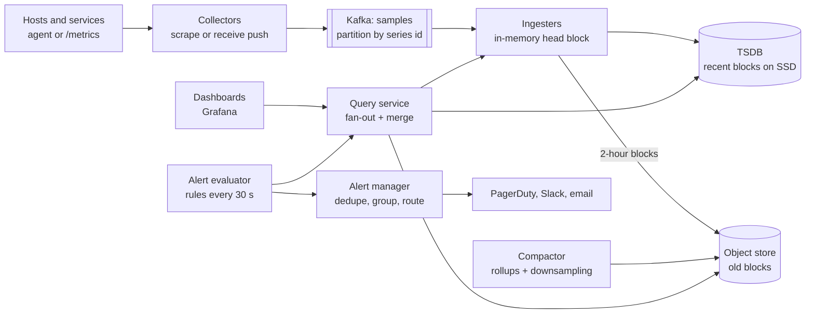

# 19 · Metrics and Monitoring

> **Level:** Hard · **Time box:** 45 min · **Asked at:** Atlassian, Uber, Flipkart, Razorpay, PhonePe (platform/SRE teams), Datadog-style infra roles
> **Concepts used:** [31 observability](../../concepts/31-observability.md) · [02 estimation](../../concepts/02-back-of-envelope.md) · [33 stream processing](../../concepts/33-batch-stream-processing.md) · [18 Kafka](../../concepts/18-kafka-deep-dive.md) · [13 sharding](../../concepts/13-partitioning-sharding.md) · [11 choosing a database](../../concepts/11-nosql-types.md)
> **Visuals:** [Kafka consumer groups](../../../visuals/v10-kafka-consumer-groups.html) · [sharding](../../../visuals/v06-sharding.html)
> **Related problem:** [20 ad click aggregation](../20-ad-click-aggregation/README.md) (same windowed-aggregation ideas)

## How to practise this

1. Set a 45-minute timer. Open [`my-design.md`](./my-design.md) and fill it in **without** looking below.
2. Then open each hint one at a time and compare. Write down what you missed in the Review section.
3. Do it again from memory on the repeat day in the plan. The second attempt is where it sticks.

## The prompt

"Design a metrics and monitoring system like Prometheus + Grafana or Datadog. Thousands of servers send metrics such as CPU, memory and request latency. Engineers see dashboards and get alerts."

## Step 1: questions to ask

- How many hosts and services? How many metrics per host?
- Collection interval? Push or pull?
- Retention, and at what resolution?
- Query patterns: dashboards over the last hour, or long-range reports?
- Alerting: how fast must an alert fire? Where do alerts go?
- Logs and traces too? (Usually out of scope.)

<details><summary>Assumed answers</summary>

- 100k hosts, ~100 metrics per host, plus app metrics with labels: **~10M active time series**
- One sample every 10 s
- Raw data for 7 days, 1-minute rollups for 30 days, 1-hour rollups for 1 year
- 90% of queries are dashboards over the last 1–24 hours
- Alerts fire within 1 minute; routed to PagerDuty/Slack/email
- Metrics only. Logs and traces are out of scope
</details>

## Step 2: estimates

<details><summary>Show the numbers</summary>

| | Calculation | Result |
|---|---|---|
| Ingest rate | 10M series / 10 s | **1M samples/s** |
| Raw sample size | 8 B timestamp + 8 B value = 16 B | with Gorilla compression ~**1.4 B/sample** |
| Raw per day | 1M × 86,400 × 1.4 B | **~120 GB/day** |
| Raw, 7 days | 120 GB × 7 | **~850 GB** (×3 replicas ≈ 2.5 TB) |
| 1-min rollups, 30 days | 10M × 1,440 × 30 × ~10 B (min/max/sum/count, compressed) | **~4 TB** |
| 1-hour rollups, 1 year | 10M × 8,760 × ~10 B | **~900 GB** |
| Index | 10M series × ~200 B of labels | **~2 GB**, fits in RAM |

Takeaway to say out loud: "Compressed, the data is small. The hard parts are **1M writes per second**, **high cardinality** (number of series), and **fast range queries** for dashboards and alerts."
</details>

## Step 3: API

<details><summary>Show the API</summary>

```http
# Ingest (push, from an agent on each host; batched and compressed)
POST /v1/write
Content-Encoding: snappy
[ { "metric": "http_requests_total",
    "labels": { "service": "checkout", "region": "ap-south-1", "status": "500" },
    "samples": [ [1729240000, 1234], … ] } ]

# Query (PromQL-style)
GET /v1/query_range?q=rate(http_requests_total{service="checkout",status="500"}[5m])&start=…&end=…&step=60s

# Alert rules
POST /v1/alerts
{ "name": "checkout-5xx", "expr": "rate(...[5m]) > 0.05", "for": "2m", "severity": "page", "route": "team-payments" }
```
</details>

## Step 4: data model

<details><summary>Show the data model</summary>

- **Series id** = hash of `metric name + sorted labels`. One series = one line on a graph.
- **Inverted index**: `label=value → [series ids]`. To answer `service="checkout" AND status="500"`, intersect the two posting lists.
- **Chunks**: per series, 2-hour blocks of `(ts, value)` pairs, compressed with delta-of-delta timestamps and XOR-encoded floats (Facebook's Gorilla paper).
- **Rollups**: per series, per 1 min / 1 h: `min, max, sum, count` (so you can still compute averages; never store only the average).

**DB choice:** a time-series database (Prometheus TSDB, VictoriaMetrics, M3, InfluxDB, or Cortex/Mimir/Thanos over object storage). A general SQL DB with one row per sample would need 1M row inserts/s and huge indexes. Old blocks go to S3, which is cheap for long retention.
</details>

## Step 5: high-level design

<details><summary>Show the diagram</summary>


**Write:** an agent on each host collects metrics → collectors batch them → Kafka, partitioned by series id (so one series always lands on one ingester) → the ingester appends to an in-memory head block and a write-ahead log → every 2 hours it flushes a compressed block to disk, later to S3.
**Read:** Grafana sends a PromQL query → the query service looks up matching series in the index → fetches chunks from ingesters (recent), SSD and S3 (old) → picks raw or rollup data based on the time range → aggregates and returns. Alerts use the same query path on a timer.
</details>

## Step 6: deep dives (the part that gets scored)

<details><summary>Deep dive 1: push vs pull collection</summary>

| | Pull (Prometheus scrapes `/metrics`) | Push (agent sends to collector) |
|---|---|---|
| Know if a target is down | Yes: a failed scrape is a signal | Need a separate heartbeat |
| Short-lived jobs (cron, Lambda) | Miss them; need a push gateway | Natural fit |
| Firewalls / NAT | Collector must reach every host | Hosts only call out |
| Control of load | Collector sets the rate | A buggy client can flood you; need rate limits |
| Service discovery | Needed (Kubernetes, Consul) | Not needed |

Say: "Pull inside our Kubernetes clusters, because it gives target health for free. Push for short-lived jobs and remote hosts. Both land in the same Kafka topic."
</details>

<details><summary>Deep dive 2: storage and compression</summary>

- Writes go to an in-memory head block + a WAL (so a crash loses nothing).
- **Delta-of-delta** timestamps: samples come every 10 s, so most deltas-of-deltas are 0, which takes 1 bit.
- **XOR floats**: a gauge changes slowly, so XOR with the previous value has many leading zeros. The Gorilla paper reports ~1.37 bytes per sample.
- Blocks are immutable after flush. Compaction merges small blocks and builds rollups.
- Retention = delete whole old blocks. No row-level deletes.
</details>

<details><summary>Deep dive 3: high cardinality (the real-world killer)</summary>

A developer adds `user_id` as a label. 10M users × 50 metrics = 500M new series. The index explodes, ingesters run out of memory, and the whole system falls over.

| Defence | How |
|---|---|
| Per-tenant series limits | Reject new series above a quota; return an error to the client |
| Label allow-list | Drop labels like `user_id`, `request_id`, `email` at the collector |
| Cardinality dashboards | Show top metrics by series count, so teams can fix them |
| Use the right tool | Per-user detail belongs in logs or traces, not metrics |

Say: "Cost depends on the number of series, not samples. I'd enforce series limits per tenant and drop unbounded labels at ingest."
</details>

<details><summary>Deep dive 4: fast queries over long ranges</summary>

- Query the right resolution: last 6 hours → raw; last 7 days → 1-minute rollups; last year → 1-hour rollups. A 1-year graph then reads ~8,760 points per series, not 3M.
- Shard queries by time and by series, run them in parallel, and merge. Cache results for repeated dashboards (each panel refreshes every 30 s).
- Percentiles: you can't average p99s. Store **histograms** (bucket counts) and compute the percentile at query time.
- Limit query cost: max series per query, timeouts.
</details>

<details><summary>Deep dive 5: alerting that people trust</summary>

- The evaluator runs rules every 15–30 s. `for: 2m` means the condition must be true for 2 minutes, which avoids flapping.
- Alert manager: **dedupe** (the same alert from 3 replicas of the evaluator), **group** (100 pods failing → 1 page), **silence** (during deploys), **route** (team → channel), **escalate** (no ack in 10 min → next on-call).
- Meta-monitoring: who watches the watcher? Run a small, separate system that checks the main one (a "dead man's switch" alert that should always be firing).
- Alert on symptoms (error rate, latency SLO burn) rather than causes (CPU 80%).
</details>

## Follow-ups interviewers ask

1. The ingest pipeline is behind. Do alerts still work? (Evaluate alerts on the ingester's in-memory data, before Kafka lag matters; alert on pipeline lag itself.)
2. How do you make ingesters highly available? (Replicate each series to 3 ingesters; dedupe at query time.)
3. Counter resets when a pod restarts? (`rate()` detects a drop in a counter and treats it as a reset.)
4. Multi-tenant? (Tenant id on every series, separate limits, and query isolation.)
5. How is this different from logs? (Logs are high-volume text; you index them for search, e.g. Elasticsearch/Loki. Metrics are numbers per series.)

## Common mistakes

- Storing every sample as a row in MySQL or Postgres.
- Averaging percentiles across hosts.
- No plan for cardinality.
- Alerting directly from raw thresholds with no dedupe or grouping, so on-call gets 500 pages at 3 am.
- Forgetting that the monitoring system itself must be monitored.
