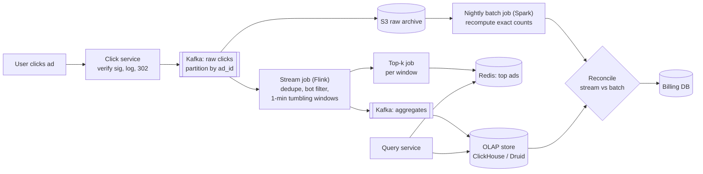

# 20 · Ad Click Aggregation

> **Level:** Hard · **Time box:** 45 min · **Asked at:** Meta, Google, Flipkart Ads, Swiggy Ads, InMobi, Amazon Ads
> **Concepts used:** [33 batch and stream processing](../../concepts/33-batch-stream-processing.md) · [18 Kafka](../../concepts/18-kafka-deep-dive.md) · [19 delivery semantics](../../concepts/19-idempotency-delivery-semantics.md) · [29 probabilistic structures](../../concepts/29-probabilistic-data-structures.md) · [34 hot keys](../../concepts/34-data-modeling-at-scale.md) · [11 choosing a database](../../concepts/11-nosql-types.md)
> **Visuals:** [Kafka consumer groups](../../../visuals/v10-kafka-consumer-groups.html) · [delivery semantics](../../../visuals/v11-delivery-semantics.html) · [bloom filter](../../../visuals/v16-bloom-filter.html)
> **Code it:** [Count-Min sketch + top-k](../../code/10-count-min-sketch/README.md) · [bloom filter](../../code/03-bloom-filter/README.md)

## How to practise this

1. Set a 45-minute timer. Open [`my-design.md`](./my-design.md) and fill it in **without** looking below.
2. Then open each hint one at a time and compare. Write down what you missed in the Review section.
3. Do it again from memory on the repeat day in the plan. The second attempt is where it sticks.

## The prompt

"Users click ads on our platform. Advertisers pay per click. Design a system that counts clicks per ad, per minute, and lets advertisers query them. It must also give the top 100 most-clicked ads in the last N minutes."

## Step 1: questions to ask

- How many clicks per second? How many ads?
- Query granularity: per minute? Filters (country, device)?
- How fresh must the numbers be?
- How accurate? These numbers become **invoices**.
- Late or duplicate events: how late can a click arrive? Do we dedupe?
- Fraud / bot filtering: in scope?

<details><summary>Assumed answers</summary>

- 1B clicks/day, peak 50k/s. 2M active ads
- Per-minute counts per ad, filterable by country and device. Kept for 1 year (minute data 30 days, then hourly)
- Dashboards within ~1 minute
- Billing must be **exact**: no double counting, no lost clicks. Dashboards can be approximate for a short time
- Events can arrive up to 5 minutes late (mobile offline); duplicates happen (client retries)
- Basic bot filtering yes; ML fraud detection out of scope
</details>

## Step 2: estimates

<details><summary>Show the numbers</summary>

| | Calculation | Result |
|---|---|---|
| Avg click QPS | 1B / 86,400 | **~12k/s** avg, **50k/s** peak |
| Raw event size | click_id, ad_id, user_id, ts, ip, ua, country ≈ 200 B | |
| Raw per day | 1B × 200 B | **~200 GB/day**; kept in S3 for replay and audit |
| Aggregates per minute | ~2M ads, but only ~10% clicked in any minute | ~200k rows/min |
| Aggregate rows per day | 200k × 1,440 | **~290M rows/day** × ~50 B ≈ **15 GB/day** |
| With country × device | ×10 combinations on average | ~150 GB/day, still easy for an OLAP store |

Takeaway to say out loud: "Ingest is moderate. The hard part is **correctness**: exactly-once counting, late events, and duplicates, because the result is money."
</details>

## Step 3: API

<details><summary>Show the API</summary>

```http
# Click (the redirect endpoint; logs then redirects to the landing page)
GET /c?ad=a_123&imp=<impressionId>&sig=<hmac>
→ 302 Location: https://advertiser.example/landing

# Query
GET /v1/ads/{adId}/clicks?from=2026-10-18T10:00Z&to=2026-10-18T11:00Z&granularity=1m&groupBy=country
→ 200 { "series": [ { "ts": "...", "country": "IN", "clicks": 412 } ] }

GET /v1/ads/top?window=5m&limit=100&country=IN
→ 200 { "ads": [ { "adId": "a_9", "clicks": 98213 } ] }
```
The click carries an `impressionId` signed by the ad server. That gives a natural dedupe key and stops people faking clicks for ads that were never shown.
</details>

## Step 4: data model

<details><summary>Show the data model</summary>

| Data | Key | Store | Why |
|---|---|---|---|
| Raw click events | `click_id` | Kafka (7 days) + S3 Parquet (1 year) | Replay, audit, recompute |
| Dedupe state | `impression_id` | Flink keyed state (RocksDB) with TTL ~1 h, or Redis `SET NX` | Drop duplicate clicks |
| Minute aggregates | `(ad_id, minute, country, device)` | ClickHouse / Druid / Pinot | Fast group-by over time; columnar |
| Top-k per window | `(window, country)` | Redis sorted set or in the OLAP store | Small, read often |
| Billing totals | `(advertiser, day)` | Postgres | Reconciled, financial |

**DB choice:** aggregates are append-mostly, queried by time range with group-bys. A columnar OLAP store fits. Writes are upserts keyed by `(ad, minute, dims)`, so a replayed window overwrites rather than adds.
</details>

## Step 5: high-level design

<details><summary>Show the diagram</summary>


**Write:** click service checks the signature, writes the raw event to Kafka (keyed by `ad_id`), and redirects. Flink dedupes on `impression_id`, drops bots, and counts per `(ad, minute, country, device)` in event-time windows. When the watermark passes the window end, it emits the counts. A sink upserts them into the OLAP store.
**Read:** advertiser dashboards query the OLAP store by ad and time range. Top-k reads a precomputed Redis sorted set. Billing uses the reconciled numbers from the nightly batch, not the live stream.
</details>

## Step 6: deep dives (the part that gets scored)

<details><summary>Deep dive 1: exactly-once counting</summary>

Duplicates come from three places: the client retries, the click service retries the Kafka write, and the stream job restarts and replays.

| Layer | Fix |
|---|---|
| Client retries | Dedupe on `impression_id` (one paid click per impression) in keyed state with a TTL |
| Producer retries | Kafka idempotent producer |
| Stream job restart | Flink checkpoints: state + Kafka offsets saved together, so a restart replays from the last checkpoint with the matching state |
| Sink | Idempotent upsert keyed by `(ad, minute, dims)`, or a transactional (two-phase commit) sink |

Say: "End-to-end exactly-once = idempotent producer + checkpointed state and offsets + an idempotent sink. The dedupe key is the signed impression id, so a click is billed once."
</details>

<details><summary>Deep dive 2: late events, windows and watermarks</summary>

- Use **event time** (when the click happened), not processing time. A click at 10:00:59 that arrives at 10:03 belongs to the 10:00 minute.
- **Watermark** = "I think I've seen all events up to time T". Set it to `max event time seen − 5 min`.
- Window closes when the watermark passes its end. Allowed lateness: events slightly after that **update** the window and re-emit (an upsert in the sink makes this safe).
- Events later than that go to a side output and are counted by the nightly batch.

| Watermark delay | Freshness | Accuracy |
|---|---|---|
| 10 s | dashboards are very fresh | more late events miss the window |
| **5 min (assumed)** | 5-minute delay on final numbers | almost all events counted |

Say: "Event-time tumbling windows with a 5-minute watermark. Late events update the window through an upsert. Very late ones are caught by the batch job."
</details>

<details><summary>Deep dive 3: Lambda vs Kappa (and reconciliation)</summary>

| | Lambda | Kappa |
|---|---|---|
| How | Stream for fresh numbers + batch for exact numbers | Stream only; to fix a bug, replay Kafka through a new job version |
| Pros | Batch is the safety net for billing | One codebase |
| Cons | Two codebases that must agree | Needs long Kafka retention and a reliable replay |

For money, most teams run a **reconciliation** step: the nightly batch over S3 recomputes daily totals per ad and compares them with the stream totals. A mismatch above a threshold raises an alert, and the batch number goes on the invoice.

Say: "Fresh numbers come from the stream. Invoices come from the batch, after reconciliation. If they differ, the batch wins and we alert."
</details>

<details><summary>Deep dive 4: top 100 ads and hot ads</summary>

- **Top-k**: each Flink task keeps a min-heap of size 100 for its partitions per window. A final step merges the local heaps into a global top 100. The exact counts are already there, so this is cheap.
- If the number of distinct keys were huge (e.g. top URLs across the internet), use a **Count-Min sketch** + heap for approximate heavy hitters with fixed memory.
- **Hot ad**: one ad during an IPL match gets 20% of clicks, so one partition is hot. Pre-aggregate in two stages: key by `ad_id + random(0..9)`, count, then merge the 10 partial counts by `ad_id`.
</details>

<details><summary>Deep dive 5: click fraud basics</summary>

- Signed click URLs (HMAC over `ad_id + impression_id + ts`), so clicks can't be made up.
- Simple rules in the stream: same IP or device clicking the same ad > N times/min; known data-centre IPs; clicks faster than humanly possible after an impression.
- Flag, don't delete: keep invalid clicks in the raw store with a reason, so you can explain invoices to advertisers.
</details>

## Follow-ups interviewers ask

1. The Flink job had a bug for 2 hours. How do you fix the numbers? (Deploy the fix, replay those 2 hours from Kafka or S3 into the same windows; upserts overwrite the wrong rows.)
2. Why not `INCR` in Redis per click? (Not replayable, not exactly-once across failures, and one hot key per viral ad.)
3. How do you count unique users who clicked an ad? (HyperLogLog per ad per window; mergeable across windows.)
4. Multi-region? (Aggregate per region, then merge. The dedupe key is global, so route by impression region or dedupe in the batch step.)
5. Query latency is high for 1-year ranges? (Rollups to hourly and daily tables; query the coarsest table that answers the question.)

## Common mistakes

- Processing-time windows, so a delayed batch of events lands in the wrong minute.
- Saying "Kafka gives exactly-once" without covering the sink and the dedupe key.
- Billing straight from the real-time stream with no reconciliation.
- Updating one counter row per ad in a relational DB at 50k/s.
- Ignoring duplicates from client retries.
