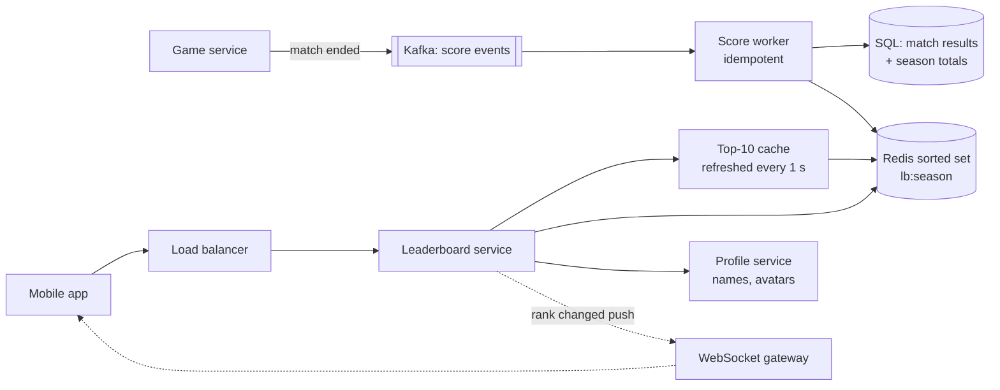

# 21 · Real-time Leaderboard

> **Level:** Medium · **Time box:** 45 min · **Asked at:** Dream11, MPL, Games24x7, Zupee, Amazon, Swiggy (rewards/streaks)
> **Concepts used:** [08 caching](../../concepts/08-caching.md) · [34 hot keys and counters](../../concepts/34-data-modeling-at-scale.md) · [13 sharding](../../concepts/13-partitioning-sharding.md) · [17 message queues](../../concepts/17-message-queues.md) · [05 real-time](../../concepts/05-realtime-communication.md)
> **Visuals:** [sharding](../../../visuals/v06-sharding.html) · [caching patterns](../../../visuals/v03-caching-patterns.html)

## How to practise this

1. Set a 45-minute timer. Open [`my-design.md`](./my-design.md) and fill it in **without** looking below.
2. Then open each hint one at a time and compare. Write down what you missed in the Review section.
3. Do it again from memory on the repeat day in the plan. The second attempt is where it sticks.

## The prompt

"Design a leaderboard for a mobile game. Players earn points by winning matches. Show the top 10 players, and show each player their own rank and the players just above and below them. Ranks must update in near real time."

## Step 1: questions to ask

- How many players in total? Daily active? Score updates per second?
- One global board, or per contest / per region / per season?
- Real-time: how stale can a rank be?
- Ties: how do we order players with the same score?
- Does a player's rank need to be exact, or is "top 5%" fine for players far down?
- Can scores go down? Is the score a sum or a max?

<details><summary>Assumed answers</summary>

- 100M total players, 10M DAU. Each plays ~10 matches/day
- One board per monthly season (the global one); per-contest boards as a follow-up
- Rank visible within ~1 s of the match ending
- Ties: the player who reached the score **first** ranks higher
- Exact rank for everyone (top 10 and "my rank")
- Scores only go up (sum of points per season)
</details>

## Step 2: estimates

<details><summary>Show the numbers</summary>

| | Calculation | Result |
|---|---|---|
| Score updates | 10M × 10 / 86,400 | **~1.2k/s** avg, ~10k/s at the evening peak |
| Rank reads | each match end + app opens: ~5× writes | **~6k/s** avg, ~50k/s peak |
| Players in this season's board | 10M DAU, ~30M active in a month | **~30M entries** |
| Memory per entry | Redis sorted set: member (~16 B id) + score + skiplist and hash overhead ≈ ~100 B | 30M × 100 B ≈ **3 GB** |

Takeaway to say out loud: "30 million entries fit in one Redis sorted set: about 3 GB and O(log n) updates. So the core is simple. The interesting parts are **ties**, **hot reads of the top 10**, and **scaling past one node** if the board grows to billions."
</details>

## Step 3: API

<details><summary>Show the API</summary>

```http
# Internal: called by the game service when a match ends (not by the client)
POST /v1/scores
Idempotency-Key: <matchId>:<userId>
{ "userId": "u_1", "seasonId": "2026-10", "delta": 30 }

GET /v1/leaderboards/2026-10/top?limit=10
→ 200 [ { "rank": 1, "userId": "u_77", "name": "…", "score": 98120 }, … ]

GET /v1/leaderboards/2026-10/users/u_1?around=5
→ 200 { "rank": 1823411, "score": 1450, "neighbours": [ … 5 above, 5 below … ] }
```
The client never sends its own score. Scores come from the server that ran the match. Otherwise anyone can post `delta: 1000000`.
</details>

## Step 4: data model

<details><summary>Show the data model</summary>

| Data | Key | Store | Why |
|---|---|---|---|
| Live board | `lb:{seasonId}` sorted set, member = userId, score = points | Redis | `ZINCRBY`, `ZREVRANK`, `ZREVRANGE` are all O(log n) |
| Match results (truth) | `(match_id, user_id)` | Postgres / MySQL | Audit; idempotency; rebuild the board |
| Season totals | `(season_id, user_id)` | Same DB | Durable copy of the score |
| User profile | `user_id` | User service + cache | Names and avatars for the top 10 |

**DB choice:** Redis sorted sets are the standard tool for ranked data. But Redis is the **index**, not the truth. The match results in a SQL DB are the truth, so the board can be rebuilt after data loss.
</details>

## Step 5: high-level design

<details><summary>Show the diagram</summary>


**Write:** game service publishes `match_ended` → score worker inserts the match result (unique on `(match_id, user_id)`, so a retry is a no-op) → updates the season total in the DB → `ZINCRBY lb:2026-10 30 u_1` in Redis.
**Read:** top 10 comes from a small cache that refreshes every second (`ZREVRANGE lb 0 9 WITHSCORES`), so 50k reads/s don't all hit the same key. "My rank" is `ZREVRANK lb u_1` + `ZREVRANGE lb rank-5 rank+5`. The service then fetches names for those ~11 user ids in one batch.
</details>

## Step 6: deep dives (the part that gets scored)

<details><summary>Deep dive 1: why a sorted set, and what it costs</summary>

| Approach | Update | Get rank | Top 10 | Problem |
|---|---|---|---|---|
| SQL `ORDER BY score DESC` + `COUNT(*) WHERE score > x` | O(log n) | **O(n)** scan for rank | fast with an index | rank for 30M rows per request is too slow |
| **Redis sorted set (skip list + hash)** | O(log n) | O(log n) | O(log n + 10) | single node; memory-bound |
| Precomputed rank table every N min | batch | O(1) | O(1) | stale ranks |

A skip list keeps a "span" on each link, so it can count how many members are ahead of you while it searches. That's how `ZRANK` is O(log n).

Say: "A Redis sorted set gives O(log n) update and rank. 30M players is ~3 GB, so one primary with a replica is enough. The SQL table is the source of truth."
</details>

<details><summary>Deep dive 2: tie-breaking</summary>

Two players with 1,450 points. Who is higher? Redis breaks ties by member name (lexicographic), which is not fair.

Fix: encode time into the score. Redis scores are 64-bit doubles, with exact integers up to 2^53.
```text
score = points × 10^10 + (MAX_TS − achieved_at_seconds)
```
Earlier achievement → larger remainder → higher rank. Check the range: 10^10 seconds is ~317 years, and points up to ~900k still stay under 2^53 (~9 × 10^15). If points can be bigger, use a composite key in a different store, or keep ties in a secondary sort.

Say: "I pack the score and the time into one number, so the sorted set breaks ties by 'who got there first'."
</details>

<details><summary>Deep dive 3: scaling past one Redis node</summary>

If the board had 1B players (e.g. an all-time global board), one node isn't enough.

| Approach | How | Trade-off |
|---|---|---|
| Shard by user id | Each shard has a sorted set of its users | Top 10 = merge top 10 of every shard (cheap). **My rank = sum of counts above my score on every shard** (`ZCOUNT` on N shards); fan-out per read |
| **Shard by score range** | Shard 1 = 0–1k, shard 2 = 1k–10k… | Rank = my rank in my shard + sizes of all higher shards (cached). Players move shards as scores rise; ranges must be rebalanced |
| Approximate rank for the long tail | Exact top 10,000; for others, a histogram of score buckets gives "top 12%" | Cheap and good enough for most products |

Say: "For 30M one node is fine. If it grows to billions, I keep the top N exact and give an approximate percentile to everyone else, using a score histogram."
</details>

<details><summary>Deep dive 4: many boards, seasons and resets</summary>

- One sorted set per board: `lb:{season}`, `lb:{contestId}`, `lb:{season}:{city}`. A score event updates all boards the user is in (usually 2–3 `ZINCRBY` in a pipeline).
- Season reset: don't delete and rebuild. Start writing to the new key `lb:2026-11`; keep the old key read-only, then archive it to the DB and expire it.
- Daily / weekly boards: a key per day; a weekly board = `ZUNIONSTORE` of 7 daily keys, done once an hour, not per request.
- Contest boards (e.g. a fantasy contest with 1M entries that locks at match end) can be frozen and served from a precomputed snapshot.
</details>

<details><summary>Deep dive 5: durability and rebuild</summary>

- Redis replica + AOF (`appendfsync everysec`) loses at most ~1 s of updates on a crash.
- Full rebuild: stream `season_totals` from the DB into a new sorted set with pipelined `ZADD`. 30M entries take a few minutes. Swap the key name when done.
- Reconcile: a nightly job compares Redis scores against DB totals for a sample of users and fixes drift.
</details>

## Follow-ups interviewers ask

1. Show "friends only" leaderboard? (Fetch the friend list (~200 ids), `ZMSCORE` their scores, sort in the app. No separate board needed.)
2. How do you stop cheating? (Scores only from the server that ran the match; anomaly checks on score jumps; idempotent match ids.)
3. Push rank changes to clients? (Only to users whose rank crosses a meaningful line, e.g. enters top 100. Pushing every rank change to 30M users is waste.)
4. Scores can decrease? (Still fine with `ZINCRBY` with a negative delta; the tie-breaker time must be the time of the last change.)
5. What if Redis is down? (Serve the last cached top 10; queue score events in Kafka and apply them when Redis is back.)

## Common mistakes

- `SELECT COUNT(*) WHERE score > ?` per request on a 30M-row table.
- Letting the client submit its own score.
- No tie-breaking rule.
- Treating Redis as the only copy of the scores.
- Sharding by user id and forgetting that "my rank" now needs every shard.
