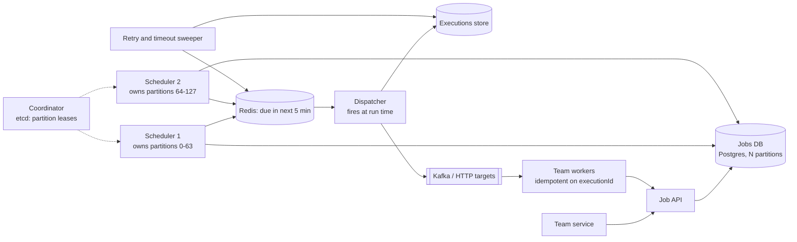

# 24 · Distributed Job Scheduler

> **Level:** Hard · **Time box:** 45 min · **Asked at:** Atlassian, Razorpay, PhonePe, Uber, Flipkart, Freshworks (cron-as-a-service, payout and reminder jobs)
> **Concepts used:** [30 leader election and locks](../../concepts/30-consensus-coordination.md) · [19 delivery semantics](../../concepts/19-idempotency-delivery-semantics.md) · [17 message queues](../../concepts/17-message-queues.md) · [13 partitioning](../../concepts/13-partitioning-sharding.md) · [24 retries and backoff](../../concepts/24-resilience-patterns.md) · [10 SQL locking](../../concepts/10-sql-deep-dive.md)
> **Visuals:** [Raft leader election](../../../visuals/v18-raft-leader-election.html) · [delivery semantics](../../../visuals/v11-delivery-semantics.html) · [circuit breaker and retries](../../../visuals/v13-circuit-breaker.html)
> **Code it:** LLD: [task scheduler](../../../lld/problems/16-task-scheduler/README.md) · [retry with backoff](../../code/09-circuit-breaker/README.md)

## How to practise this

1. Set a 45-minute timer. Open [`my-design.md`](./my-design.md) and fill it in **without** looking below.
2. Then open each hint one at a time and compare. Write down what you missed in the Review section.
3. Do it again from memory on the repeat day in the plan. The second attempt is where it sticks.

## The prompt

"Design a distributed job scheduler. Teams submit jobs to run once at a given time, or on a cron schedule. Jobs must run on time, must not be lost, and should not run twice."

## Step 1: questions to ask

- How many jobs? How many runs per second at peak?
- One-time jobs, recurring (cron), or both?
- How precise must the start time be? (1 second? 1 minute?)
- What is a job: an HTTP callback, a message to a queue, or code we run in a container?
- Max run time? Retries? Dependencies between jobs (DAGs)?
- Exactly-once or at-least-once?

<details><summary>Assumed answers</summary>

- 100M scheduled jobs stored; peak 50k job runs/s (e.g. midnight, and on the hour)
- Both one-time and cron
- Start within ~1 s of the scheduled time
- A job = "send this payload to this queue/HTTP endpoint" (the team's worker does the work). Running user containers is a follow-up
- Retries with backoff, max attempts configurable. DAGs out of scope (that's Airflow)
- **At-least-once** delivery with an execution id, so workers can be idempotent
</details>

## Step 2: estimates

<details><summary>Show the numbers</summary>

| | Calculation | Result |
|---|---|---|
| Stored jobs | 100M × ~1 KB (payload, schedule, target, retry policy) | **~100 GB** |
| Avg run rate | say 500M runs/day / 86,400 | **~6k/s** avg |
| Peak | many crons at `0 0 * * *` | **~50k/s** for a few seconds |
| Execution history | 500M × 200 B × 30 days | **~3 TB** (TTL after 30 days) |
| Due-soon window | next 1 min at peak ≈ 50k × 60 | ~3M jobs in memory/Redis, ~3 GB |

Takeaway to say out loud: "Storage is small. The hard parts are **finding due jobs fast** without scanning 100M rows, **spikes at round times**, and **not running a job twice** when a scheduler node dies."
</details>

## Step 3: API

<details><summary>Show the API</summary>

```http
POST /v1/jobs
Idempotency-Key: <uuid>
{ "name": "daily-settlement",
  "schedule": { "cron": "0 2 * * *", "tz": "Asia/Kolkata" },     # or { "runAt": "2026-10-19T09:00:00Z" }
  "target": { "type": "kafka", "topic": "settlement.run" },     # or { "type": "http", "url": "…" }
  "payload": { "merchantGroup": 7 },
  "retry": { "maxAttempts": 5, "backoff": "exponential" },
  "timeoutSec": 300 }
→ 201 { "jobId": "j_1", "nextRunAt": "2026-10-18T20:30:00Z" }   # 02:00 IST = 20:30 UTC the day before

GET    /v1/jobs/{id}
PATCH  /v1/jobs/{id}            # pause, resume, change schedule
DELETE /v1/jobs/{id}
GET    /v1/jobs/{id}/executions?cursor=…

# Called by the worker when it finishes
POST /v1/executions/{executionId}/complete   { "status": "SUCCEEDED" | "FAILED", "error": "…" }
```
</details>

## Step 4: data model

<details><summary>Show the data model</summary>

| Table | Key | Fields | Store |
|---|---|---|---|
| `jobs` | `job_id` | owner, schedule (cron/runAt, tz), target, payload, retry policy, status, `next_run_at` | Postgres, sharded by `job_id` |
| index | `(shard, next_run_at)` | | Lets each scheduler find "due before T" with a range scan |
| `executions` | `execution_id` = `job_id + scheduled_time` | attempt, status, started_at, finished_at, worker, error | Cassandra/DynamoDB with TTL (big, append-heavy) |
| Due queue | sorted set per partition, score = run time | job_id | Redis (only the next few minutes) |

**Execution id = `job_id + scheduled_time`.** It is deterministic, so if two schedulers fire the same run, both produce the same id, and the unique key stops the second one.
</details>

## Step 5: high-level design

<details><summary>Show the diagram</summary>


**Write (submit):** the API validates the cron, computes `next_run_at` in the job's time zone, and inserts the job into its partition (`hash(job_id) mod 128`).
**Run:** each scheduler holds leases for some partitions. Every few seconds it reads `next_run_at <= now + 5 min` from its partitions and loads them into the Redis due queue. The dispatcher pops jobs whose time has come, inserts an execution row (unique id = job + scheduled time), sends the payload to the target, and the scheduler sets the job's next `next_run_at`. The worker reports completion. The sweeper retries runs that failed or timed out.
</details>

## Step 6: deep dives (the part that gets scored)

<details><summary>Deep dive 1: finding due jobs without scanning everything</summary>

| Approach | How | Pros | Cons |
|---|---|---|---|
| Poll DB every second | `WHERE next_run_at <= now()` | Simple | 100M rows; needs a good index; hot under load |
| **Index on `next_run_at` + two tiers (recommended)** | DB scan every few seconds for the next 5 minutes → Redis sorted set → precise firing | DB scans are small and rare; firing is precise | Two places to keep in sync |
| Timing wheel in memory | Buckets per second, like Kafka's purgatory or Netty's HashedWheelTimer | O(1) insert and fire | State lost on crash; rebuild from DB |
| Delay queue (SQS delay, RabbitMQ delayed exchange) | Push with a delay | Managed | SQS delay is max 15 min; not for long schedules |

Say: "Two tiers. The DB is the truth and is scanned for the next 5 minutes only. A Redis sorted set or an in-memory timing wheel fires jobs on the second."
</details>

<details><summary>Deep dive 2: many schedulers, no double firing</summary>

| Approach | How | Trade-off |
|---|---|---|
| One leader scheduler | Leader election with etcd/ZooKeeper | Simple; but one node must handle 50k/s |
| `SELECT … FOR UPDATE SKIP LOCKED` | Each scheduler grabs a batch of due rows that no one else holds | Great up to a few thousand/s per DB; contention after that |
| **Partition leases (recommended)** | Jobs are in 128 partitions; each scheduler holds a lease (etcd, TTL 10 s) on some partitions | Scales out; one owner per partition at a time |

Leases can still overlap (a GC pause makes an old owner think it still holds the lease). So add a **fencing token**: the lease has a version number, and the DB write includes it (`WHERE lease_epoch = :mine`). An old owner's write is rejected. Plus the unique execution id as the final guard.

Say: "Partitions with leases in etcd, fencing tokens on writes, and a deterministic execution id with a unique constraint. Even if two schedulers fire, only one execution row is created."
</details>

<details><summary>Deep dive 3: at-least-once delivery and retries</summary>

- We **can't** promise exactly-once execution: the worker could finish the job and crash before reporting. So we promise at-least-once and give every run an `executionId`.
- Workers must be idempotent on `executionId` (e.g. a payout job checks "already paid for this execution id?").
- Timeout: if no completion arrives within `timeoutSec`, the sweeper marks the attempt as timed out and schedules a retry.
- Retry with exponential backoff + jitter: `delay = base × 2^attempt ± random`. After `maxAttempts`, mark FAILED and alert the owner (a dead-letter list).

Say: "At-least-once, an idempotency key on every run, timeouts detected by a sweeper, and exponential backoff with jitter."
</details>

<details><summary>Deep dive 4: spikes at round times and noisy tenants</summary>

- Thousands of teams use `0 * * * *`. At the top of every hour there is a 50k/s spike.
- Load-ahead: the 5-minute pre-load means the DB does the work before the spike; only Redis and the dispatcher feel it.
- Spread: offer a "jitter" option (run within the first N seconds of the minute) for jobs that don't need exact times; most don't.
- Rate limit per tenant, so one team's 1M jobs at midnight don't delay everyone else. Use per-tenant queues with fair scheduling.
- Protect targets: limit concurrency per target URL; a circuit breaker stops hammering a dead endpoint.
</details>

<details><summary>Deep dive 5: cron details people forget</summary>

- **Time zones and DST**: store `tz`. India has no DST, but many users' regions do: a 2:30 am job might run twice or not at all on DST days. Pick and document a rule.
- **Missed runs** (scheduler outage for an hour): run once on recovery, run all missed runs, or skip? Make it a per-job policy (`catchup: none | last | all`).
- **Overlapping runs**: the previous run is still going when the next one is due. Policy: allow, skip, or queue.
- Compute the next run from the **scheduled** time, not the actual finish time, or drift adds up.
</details>

## Follow-ups interviewers ask

1. How do you run user code, not just send a message? (Workers pull from a queue and start containers, e.g. Kubernetes Jobs; add resource limits and a sandbox.)
2. How do you support job dependencies? (A DAG table; a job becomes due when all parents succeed. That's the Airflow model.)
3. Delete or pause a job that's already in the Redis due queue? (The dispatcher re-checks the job's status and version in the DB, or a local cache, before firing.)
4. The Redis due queue is lost? (Rebuild from the DB: it is only a 5-minute window. The execution id unique key prevents duplicates from the rebuild.)
5. How do you show "runs late" metrics? (Lag = actual fire time − scheduled time, as a histogram per partition; alert on p99.)

## Common mistakes

- One cron server with a crontab: one point of failure.
- `SELECT * WHERE next_run_at <= now()` with no index and no partitioning.
- Promising exactly-once execution.
- Distributed locks without fencing tokens.
- No policy for missed runs, overlapping runs or time zones.
