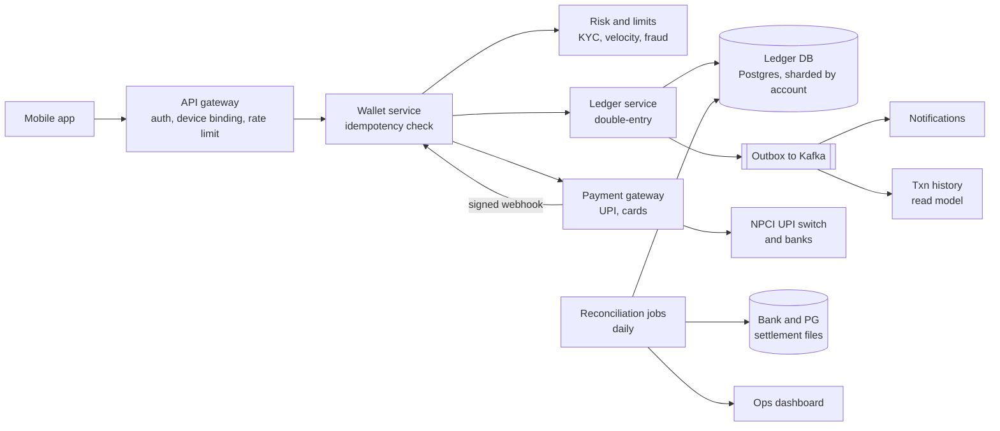

# 28 · Digital Wallet / UPI

> **Level:** Hard · **Time box:** 45 min · **Asked at:** PhonePe, Paytm, Razorpay, Juspay, Cred, Google Pay India, Amazon Pay, MobiKwik
> **Concepts used:** [35 payments domain: ledger, reconciliation](../../concepts/35-payments-domain.md) · [19 idempotency](../../concepts/19-idempotency-delivery-semantics.md) · [20 distributed transactions: saga, outbox](../../concepts/20-distributed-transactions.md) · [10 SQL transactions and isolation](../../concepts/10-sql-deep-dive.md) · [24 timeouts and retries](../../concepts/24-resilience-patterns.md) · [32 security](../../concepts/32-security-auth.md) · [36 multi-region and DR](../../concepts/36-deployment-multi-region.md)
> **Visuals:** [delivery semantics and idempotency](../../../visuals/v11-delivery-semantics.html) · [saga and outbox](../../../visuals/v12-saga-outbox.html) · [isolation levels](../../../visuals/v20-isolation-levels.html)
> **Code it:** LLD: [payment wallet (ledger + idempotency)](../../../lld/problems/19-payment-wallet/README.md)
> **Related problem:** [08 payment system](../08-payment-system/README.md) (merchant side; do it first)

## How to practise this

1. Set a 45-minute timer. Open [`my-design.md`](./my-design.md) and fill it in **without** looking below.
2. Then open each hint one at a time and compare. Write down what you missed in the Review section.
3. Do it again from memory on the repeat day in the plan. The second attempt is where it sticks.

## The prompt

"Design a digital wallet like PhonePe or Paytm Wallet. Users add money from their bank (via UPI or card), send money to other users, and pay merchants. Balances must always be correct."

> **Clarify first:** a **wallet** (a prepaid instrument, PPI) holds money on *our* books. **UPI** moves money between *bank accounts*; the app is only a front end and NPCI's switch talks to the banks. Interviewers often mix the two. This design is the wallet, with UPI as one way to top up and a follow-up on the UPI flow itself.

## Step 1: questions to ask

- Users and transactions per day? Peak (festival sales, salary day)?
- Which flows: top-up, P2P transfer, merchant payment, withdraw to bank, refunds?
- KYC levels and balance limits?
- Consistency: can a user ever see a wrong balance, even for a moment?
- What happens when the bank or NPCI times out?
- Regulatory constraints: where may data live? Audit needs?

<details><summary>Assumed answers</summary>

- 100M users, 50M transactions/day, peak 10× average (festival sale at midnight)
- All of: top-up (UPI/card via a payment gateway), P2P, merchant pay, withdraw to bank, refunds
- KYC levels with limits (RBI's PPI rules set them; e.g. a full-KYC wallet can hold up to ₹2 lakh). Limits are config, not code
- **Strong consistency for balances.** No negative balance, no double spend, no lost money. Ever
- External calls can time out with an **unknown** result; we must handle that
- Payment data stays in India (RBI directive, deep dive 5). Every money movement is auditable for years
</details>

## Step 2: estimates

<details><summary>Show the numbers</summary>

| | Calculation | Result |
|---|---|---|
| Avg TPS | 50M / 86,400 | **~600 TPS** |
| Peak TPS | ×10 | **~6k TPS** |
| Ledger rows | each transfer = 2 entries (debit + credit) | 100M entries/day |
| Entry size | ids, account, amount, direction, txn id, ts ≈ 200 B | 100M × 200 B ≈ **20 GB/day**, ~7 TB/year |
| Retention | keep for years for audit and tax | ~**35–70 TB** over 5–10 years (move old partitions to cheaper storage) |
| Balance reads | app opens + checks ≈ 10× writes | ~6k/s avg, ~60k/s peak |
| Hot account | a big merchant receives 1k payments/s | one row updated 1k times/s: needs special handling |

Takeaway to say out loud: "6k TPS is modest for a sharded SQL database. The hard part is **correctness**: a double-entry ledger, idempotency on every call, safe handling of unknown results from banks, and daily **reconciliation**."
</details>

## Step 3: API

<details><summary>Show the API</summary>

```http
POST /v1/wallet/topups
Idempotency-Key: <uuid>
{ "amount": 50000, "currency": "INR", "method": "UPI", "vpa": "user@okbank" }   # amounts in paise, integers
→ 202 { "topupId": "t_1", "status": "PENDING" }     # becomes SUCCESS when the gateway confirms

POST /v1/transfers
Idempotency-Key: <uuid>
{ "toUserId": "u_2", "amount": 20000, "note": "dinner" }
→ 200 { "transferId": "tr_1", "status": "SUCCESS", "balance": 30000 }

POST /v1/payments          { "merchantId", "orderId", "amount" }        # Idempotency-Key too
POST /v1/withdrawals       { "amount", "bankAccountId" }                  # Idempotency-Key too
GET  /v1/wallet/balance
GET  /v1/wallet/transactions?cursor=…

# From the payment gateway (signed webhook)
POST /internal/webhooks/pg   { "topupId", "pgRef", "status": "SUCCESS", "amount" }
```
Money is always an **integer in paise**, never a float. Every write has an idempotency key.
</details>

## Step 4: data model

<details><summary>Show the data model</summary>

```sql
accounts (
  account_id PK, owner_id, type,            -- USER_WALLET | MERCHANT | ESCROW_BANK | FEES | SUSPENSE
  balance BIGINT,                           -- cached; must equal the sum of entries
  status, kyc_level, version,
  CHECK (type <> 'USER_WALLET' OR balance >= 0)
)

transactions (
  txn_id PK, idempotency_key UNIQUE, type,  -- TOPUP | P2P | MERCHANT_PAY | WITHDRAW | REFUND
  status,                                   -- PENDING | SUCCESS | FAILED | REVERSED
  external_ref, created_at
)

ledger_entries (                            -- append-only, never UPDATE or DELETE
  entry_id PK, txn_id, account_id,
  direction,                                -- DEBIT | CREDIT
  amount BIGINT, created_at
)
-- For every txn_id: sum(DEBIT) = sum(CREDIT)
```

**DB choice:** Postgres or MySQL (or a distributed SQL DB such as CockroachDB/TiDB/Spanner-style when one shard isn't enough). We need ACID transactions across a few rows, unique constraints and serialisable-enough isolation. Shard by `account_id`. NoSQL would make every transfer a hand-written distributed transaction.
</details>

## Step 5: high-level design

<details><summary>Show the diagram</summary>


**Write (P2P transfer, both wallets on one shard):** check the idempotency key → risk and limit checks → one DB transaction: lock the two account rows in id order, check the sender's balance, insert the transaction row and two ledger entries (debit sender, credit receiver), update both cached balances, write an outbox event → commit → return the new balance. Notifications go out from the outbox.
**Write (top-up):** create the transaction as `PENDING` → call the payment gateway → the user approves in their UPI app → the gateway sends a webhook → verify the signature and amount → one DB transaction: debit `ESCROW_BANK` (the wallet issuer's pooled bank account), credit the user wallet, mark `SUCCESS`.
**Read:** balance comes from the account row (on the primary, or a replica with read-your-writes for the user). History comes from the read model built from the outbox.
</details>

## Step 6: deep dives (the part that gets scored)

<details><summary>Deep dive 1: the double-entry ledger</summary>

| Approach | How | Problem |
|---|---|---|
| `UPDATE balance = balance − x` only | One column per user | No history; a bug silently loses money; can't audit |
| **Double-entry ledger (recommended)** | Every txn = ≥ 2 entries; debits = credits; entries are append-only | More rows; but every rupee is traceable |
| Event sourcing only (balance = replay) | Sum all entries on each read | Slow reads; fix with a cached balance updated in the same transaction |

- Money never appears or disappears: it moves between accounts. Top-up = escrow → user. Merchant pay = user → merchant. Fee = merchant → fees account.
- Corrections are **new reversing entries**, never edits.
- Invariant check (runs continuously): for each account, cached balance = sum of credits − sum of debits. For all accounts together, the total is zero.

Say: "A double-entry, append-only ledger. The cached balance is updated in the same transaction as the entries, and a job checks that they always match."
</details>

<details><summary>Deep dive 2: idempotency and unknown results</summary>

- Client → us: `Idempotency-Key` with a unique index. A retry returns the stored result, not a second transfer. Store the key and the response together, in the same transaction as the ledger write.
- Us → payment gateway / bank: always send **our** transaction id as the reference, so the partner can dedupe too.
- **Timeouts are not failures.** If the bank call times out, the money may or may not have moved. Mark the transaction `PENDING`, then:
  1. Poll the partner's status API with our reference (with backoff).
  2. Wait for the webhook.
  3. If still unknown, the daily reconciliation decides.
- Never auto-retry a debit with a **new** reference. That is how users get charged twice.

| Outcome from the bank | Our action |
|---|---|
| Success | Credit the wallet (idempotent on our txn id) |
| Failure | Mark FAILED; nothing to reverse |
| Timeout / unknown | PENDING; status check, then reconciliation; show "processing" to the user |

Say: "Every call carries our idempotency key. A timeout is 'unknown', not 'failed'. We resolve unknowns with status checks and reconciliation, never with a blind retry."
</details>

<details><summary>Deep dive 3: concurrency, double spend and hot accounts</summary>

- Double spend: the user sends ₹500 twice at the same time with ₹600 balance. Fix: in the transaction, `SELECT … FOR UPDATE` on the sender's row (or `UPDATE … SET balance = balance − 500 WHERE balance >= 500` and check rows affected). The second one fails cleanly.
- Deadlocks: two users send to each other at once. Always lock accounts in `account_id` order.
- Cross-shard transfer (sender and receiver on different shards): no single transaction. Use a **saga**: debit the sender into a `TRANSIT` account on shard A, then credit the receiver from `TRANSIT` on shard B, driven by the outbox; compensate (refund the sender) if step 2 can't complete. Or use a distributed SQL DB that does this for you.
- Hot merchant account (1k credits/s): split it into N sub-accounts (`merchant#0..15`), credit a random one, sum them for the balance. Or credit in micro-batches every second. Credits to a merchant don't need a balance check, so batching is safe.

Say: "Row lock or a conditional update on the sender, locks taken in a fixed order, a saga through a transit account across shards, and sub-accounts for hot merchants."
</details>

<details><summary>Deep dive 4: reconciliation</summary>

Our ledger, the payment gateway, NPCI and the bank each keep their own records. They will disagree sometimes (timeouts, late webhooks, bank reversals).

- Daily (and intraday for big flows), load the partner's settlement file and match it to our transactions by reference and amount.
- Categories: **matched**; **in partner, not in ours** (missed webhook: credit the user); **in ours, not in partner** (we credited but money never came: reverse or investigate); **amount mismatch**.
- Also check: the sum of all user wallet balances = the balance in the escrow bank account. This is what the auditors and the regulator care about.
- Breaks go to a `SUSPENSE` account and an ops queue, with an SLA to resolve them.

Say: "The ledger is our truth, but money is only safe after reconciliation with the bank and gateway files. Wallet balances must add up to the escrow account."
</details>

<details><summary>Deep dive 5: security, compliance and RBI data localisation</summary>

- **Device binding** (SIM + device id), a PIN for every debit, and step-up checks for new devices. UPI itself binds the app to the phone number registered with the bank.
- Fraud checks in the write path: velocity limits, new-payee limits, risk scores. Keep this fast (< 50 ms) or move it async with a hold.
- Encrypt PII and bank details; tokenise cards (no raw card numbers stored, as per card-network and RBI tokenisation rules).
- **RBI data localisation:** RBI's April 2018 directive on *Storage of Payment System Data* requires payment system operators to store the **entire** data relating to payment systems (end-to-end transaction details, customer and payment credentials) **only in India**. RBI's later FAQs allow processing abroad, but the data must then be deleted from foreign systems and brought back to India within a short window (one business day or 24 hours, whichever is earlier). For a cross-border transaction, a copy of the foreign leg may also be stored abroad.
- Design impact: primary and DR regions both in India (e.g. Mumbai + Hyderabad on AWS), no payment data in foreign SaaS logs, analytics or support tools without checking where they store data, and audit trails that prove it.

Say: "Both regions are in India because of RBI's data-localisation directive. Even our logs and third-party tools must keep payment data inside the country."
</details>

## Follow-ups interviewers ask

1. Walk me through a UPI payment. (User's app (a third-party app like PhonePe, via its PSP bank) → NPCI's UPI switch → the payer's bank debits after the UPI PIN check → NPCI → payee's bank credits → status back to both apps. The app never holds the money; it holds state and must handle `PENDING` and deemed-success/reversal cases.)
2. How do you show the balance quickly after a transfer? (Return it in the transfer response; read from the primary or with read-your-writes for that user.)
3. Refunds? (A new transaction with reversing entries, linked to the original; never edit the old one.)
4. Multi-region active-active for the ledger? (Hard. Usually one writing region per account (home region) with sync replication to a nearby DR region in India; failover is a planned operation.)
5. A user reports "money debited from bank but not in wallet". (Find the PENDING top-up; status check with the gateway; if the bank says success, credit idempotently; if failed, the bank auto-reverses within the network's TAT. Reconciliation catches whatever is left.)

## Common mistakes

- Floats for money.
- A balance column with no ledger, or a ledger that allows UPDATE and DELETE.
- Treating a timeout as failure and retrying with a new reference.
- No reconciliation step.
- Ignoring hot merchant accounts and cross-shard transfers.
- Putting a DR region outside India.
