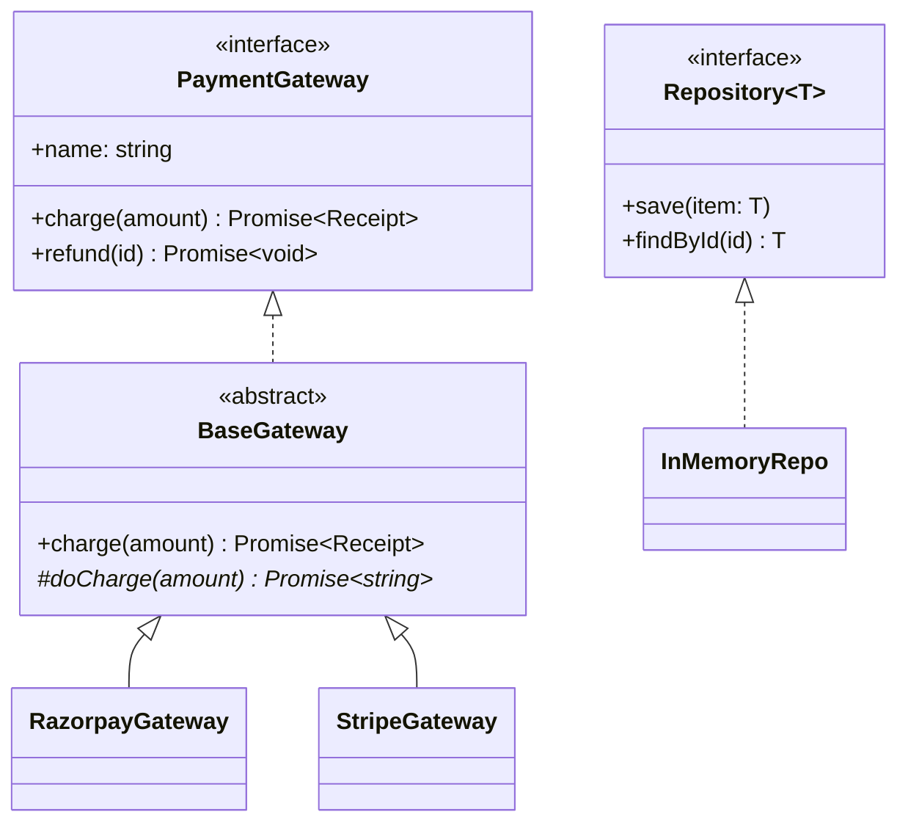

# L01 · Classes, interfaces and types in TypeScript

> **Time:** ~40 min · **Visual:** [visual.html](visual.html) · **Code:** [demo.ts](demo.ts) (`npx tsx lld/1-foundations/L01-classes-and-interfaces/demo.ts`)
> **Builds on:** nothing, start here · **Used in:** every LLD problem. First see [01 Parking Lot](../../problems/01-parking-lot/README.md), [06 Vending Machine](../../problems/06-vending-machine/README.md), [19 Payment Wallet](../../problems/19-payment-wallet/README.md)

## The idea in one line

An `interface` is a contract with no runtime code, a `class` is a blueprint that makes real objects, and `type` unions describe data and states, so the compiler can reject wrong code before it runs.

## Why it matters (the problem it solves)

This is a common first draft in a machine-coding round:

```ts
// Before: stringly-typed, public fields, optional everything
class Payment {
  status: string = 'created'; // 'captured'? 'CAPTURED'? 'capturd'?
  txnId?: string;             // only set when captured... maybe
  balance = 0;                // anyone can set payment.balance = -500
}

function charge(gateway: any, amount: number) {
  return gateway.pay(amount); // typo? wrong method? we find out in production
}
```

Three problems:

1. The compiler cannot catch a typo in `status`.
2. Nothing stops a "captured" payment with no `txnId`.
3. `any` turns off every check, so a gateway without `pay()` fails at runtime.

The interviewer reads your types before your logic. Clean types tell them you can model a domain.

## How it works

### 1. Interface: a contract, erased at runtime

```ts
interface PaymentGateway {
  readonly name: string;
  charge(amount: number): Promise<Receipt>;
  refund(paymentId: string): Promise<void>;
}
```

- It only describes a shape. `tsc` removes it completely. There is no `PaymentGateway` object in the JS output.
- Use it for boundaries that may change: gateways, repositories, notifiers, the clock.

### 2. Class: a blueprint that makes objects

```ts
class RazorpayGateway implements PaymentGateway {
  readonly name = 'razorpay';
  constructor(private readonly apiKey: string) {} // parameter property
  async charge(amount: number): Promise<Receipt> { /* call API */ return { id: 'rzp_1', amount }; }
  async refund(paymentId: string): Promise<void> { /* call API */ }
}

const live = new RazorpayGateway('live_key');
const test = new RazorpayGateway('test_key');
```

What happens at runtime:

```
  RazorpayGateway.prototype   { charge(), refund() }    <- methods: ONE copy, shared
          ^                ^
          | [[Prototype]]  |
   live { apiKey: 'live' }   test { apiKey: 'test' }    <- fields: one copy per object
```

- Fields live on each object. Methods live once on the prototype.
- `implements` is a compile-time check only. It makes `tsc` check the class at its definition, so a missing method is an error right there, not at some far-away call site.

### 3. Access modifiers

| Keyword | Who can read it | Checked when |
|---|---|---|
| `public` (default) | anyone | compile time |
| `protected` | the class and subclasses | compile time |
| `private` | only this class | compile time only: `(obj as any).pin` still works |
| `#field` | only this class | **runtime** (real JS private field) |
| `readonly` | anyone can read, nobody can reassign after the constructor | compile time; shallow |

```ts
class Wallet {
  readonly id: string;
  #balance = 0;                         // truly private
  constructor(id: string) { this.id = id; }
  get balance() { return this.#balance; }
  debit(amount: number) {
    if (amount > this.#balance) throw new Error('Insufficient funds');
    this.#balance -= amount;
  }
}
```

`readonly items: Item[]` still allows `items.push()`. Use `readonly Item[]` (or `ReadonlyArray<Item>`) to block mutation of the contents.

### 4. Structural typing: shape matters, not the name

TypeScript checks shapes. Any value with a matching `charge()` and `refund()` is a `PaymentGateway`, even without `implements`:

```ts
const fake: PaymentGateway = {
  name: 'fake',
  charge: async (amount) => ({ id: 'f_1', amount }),
  refund: async () => {},
};
```

This is why tests can pass a plain object as a fake. Java and C# check names (nominal typing). TS checks structure.

### 5. `type` vs `interface`

| | `interface` | `type` |
|---|---|---|
| Object shapes | yes | yes |
| Unions, tuples, mapped types | no | yes |
| `extends` / declaration merging | yes | no merging (use `&`) |
| Classes `implements` it | yes | yes (if it is an object type) |
| Rule of thumb | contracts that classes implement | data, unions and states |

### 6. Discriminated unions for states

```ts
type Payment =
  | { status: 'CREATED'; id: string; amount: number }
  | { status: 'CAPTURED'; id: string; amount: number; txnId: string }
  | { status: 'FAILED'; id: string; amount: number; reason: string };

function describe(p: Payment): string {
  switch (p.status) {
    case 'CREATED':  return `pending ${p.amount}`;
    case 'CAPTURED': return `paid, txn ${p.txnId}`;  // txnId is known to exist here
    case 'FAILED':   return `failed: ${p.reason}`;
    default: { const missed: never = p; return missed; } // compile error if a state is missed
  }
}
```

A captured payment without `txnId` cannot be written. If someone adds `'REFUNDED'`, the `never` line fails to compile until it is handled. For states with a lot of behaviour, use the State pattern ([L22](../../4-behavioral/L22-state/README.md)).

### 7. Interface vs abstract class

| | `interface` | `abstract class` |
|---|---|---|
| Runtime code | none (erased) | a real class with a prototype |
| Shared implementation | no | yes (concrete methods, constructor) |
| How many | a class can implement many | a class extends one |
| `instanceof` | not possible | possible |
| `new` it | no | no (abstract) |
| Use for | boundaries: `PaymentGateway`, `Repository<T>` | a base with shared steps (Template Method, [L26](../../4-behavioral/L26-template-method/README.md)) |

Default to interfaces. Use an abstract class only when you really share code.

### 8. Enums vs union literals

```ts
enum VehicleType { BIKE = 'BIKE', CAR = 'CAR' }  // a runtime object AND a type
type SpotSize = 'SMALL' | 'MEDIUM' | 'LARGE';    // type only, zero runtime code
const CHANNELS = ['EMAIL', 'SMS', 'PUSH'] as const;
type Channel = (typeof CHANNELS)[number];       // a union, plus an array to loop over
```

Both are fine. Avoid numeric enums: any number is accepted and the reverse mapping (`VehicleType[0]`) surprises people.

### 9. Generics: one container, many types

```ts
interface Repository<T extends { id: string }> {
  save(item: T): void;
  findById(id: string): T | undefined;
}
class InMemoryRepo<T extends { id: string }> implements Repository<T> {
  private items = new Map<string, T>();
  save(item: T) { this.items.set(item.id, item); }
  findById(id: string) { return this.items.get(id); }
}
```

One class serves users, orders and seats. Also useful: `Record<VehicleType, number>` for rate tables (the compiler checks every key), `Readonly<T>`, `Partial<T>`, `Pick<T, K>`.

### Class diagram



## In TypeScript

```ts
class CheckoutService {
  constructor(
    private readonly gateway: PaymentGateway,          // depend on the contract
    private readonly payments: Repository<Payment>,    // generic storage
  ) {}

  async pay(id: string, amount: number): Promise<Payment> {
    const receipt = await this.gateway.charge(amount);
    const p: Payment = { status: 'CAPTURED', id, amount, txnId: receipt.id };
    this.payments.save(p);
    return p;
  }
}
```

The full runnable version, with a gateway hierarchy, a wallet with `#balance` and an exhaustive `switch`, is in [demo.ts](demo.ts).

## Trade-offs / when NOT to use it

- **Do not add an interface for every class.** Add one at a boundary (gateway, repo, clock) or when a test needs a fake. `ParkingFloorInterface` with one implementation is noise.
- **Do not write clever types in a 90-minute round.** Conditional and deep mapped types slow the reader. `Repository<T>` yes, `Service<TReq, TRes, TCtx>` no.
- **Do not wrap plain data in classes.** A `Receipt` can be a `readonly` type. Use a class when there are rules to protect (balance, seat status, stock).
- **`private` is not security.** It is erased. Use `#field` when real runtime privacy matters, for example in a library.

## Common mistakes

- Using `any` "just for now". It switches off checks for everything it touches. Use `unknown` and narrow it.
- `status: string` instead of a union of literals. Typos compile.
- Optional fields (`txnId?`) instead of a discriminated union. Invalid combinations compile.
- Thinking `implements` exists at runtime. It does not. You cannot `instanceof` an interface. Use a type guard (`isCard(x): x is Card`).
- Thinking `readonly` freezes an array or object. It is shallow, and it is compile time only.
- Public fields with setters for everything. Expose behaviour (`debit()`), not raw state.
- Numeric enums, then sending `3` over JSON and nobody knows what it means.

## Say this in the interview

> "I model statuses as union literals and the entity itself as a discriminated union, so a captured payment always has a transaction id, and a `never` check in the switch forces me to handle new states."

> "Boundaries like the payment gateway and the repository are interfaces. Classes implement them and get injected through the constructor. TypeScript is structural, so in tests I can pass a plain object as a fake."

> "Fields that hold rules, like a wallet balance, are private and changed only through methods that check the rule. I use `#field` if I need real runtime privacy; `private` is a compile-time check."

## Your experience hook

- Payment orchestration across 3 providers: one `PaymentGateway` interface, one class per provider. The core code never imports a provider SDK.
- NestJS: providers are classes, injected by constructor. That is the same idea as `constructor(private readonly gateway: PaymentGateway)`, with a container doing the wiring.
- Payment status `created → pending → success/failed`: a union type (or discriminated union) stops a typo like `'sucess'` from ever reaching the database.

## Self-test

<details><summary>1. What is left of an interface after <code>tsc</code> compiles the file?</summary>Nothing. Interfaces and type aliases are erased. Only classes, functions and values (and enums) produce JavaScript.</details>

<details><summary>2. <code>readonly seats: Seat[]</code>. Can a caller add a seat?</summary>Yes, with <code>seats.push()</code>. <code>readonly</code> only stops reassigning the property. Use the type <code>readonly Seat[]</code> to block mutation methods.</details>

<details><summary>3. <code>private pin</code> vs <code>#pin</code>: what is the difference?</summary><code>private</code> is checked only by the compiler; <code>(obj as any).pin</code> still reads it at runtime. <code>#pin</code> is a real JS private field; outside code cannot read it at all.</details>

<details><summary>4. A plain object with <code>charge()</code> and <code>refund()</code> is passed where <code>PaymentGateway</code> is expected, without <code>implements</code>. Does it compile?</summary>Yes. TypeScript uses structural typing: the shape matches, so it is assignable. <code>implements</code> only adds an early check on the class.</details>

<details><summary>5. Model a ride: REQUESTED, ACCEPTED (has driverId), ONGOING (driverId, startedAt), COMPLETED (adds fare).</summary>A discriminated union on <code>status</code> where each variant has only its own fields, plus a <code>switch</code> with a <code>never</code> default so a new state is a compile error until handled.</details>

<details><summary>6. When do you pick an abstract class over an interface?</summary>When subclasses share real code (validation, logging, a fixed sequence of steps). If you only need a contract, use an interface: it is lighter and a class can implement many.</details>

<details><summary>7. Methods: one copy per object or one per class?</summary>One per class, on the prototype. Fields are per object. Arrow-function class fields (<code>handle = () =&gt; {}</code>) break this: each object gets its own copy.</details>

## Go deeper

- Next: [L02 · The four OOP pillars](../L02-oop-pillars/README.md)
- Storage and wiring: [L31 · Repository and DI](../../5-machine-coding/L31-repository-and-di/README.md)
- States with behaviour: [L22 · State](../../4-behavioral/L22-state/README.md)
- OOP examples in TS (classes, inheritance, interfaces): [low-level-design-ts/oop](../../../../low-level-design-ts/oop)
- Long notes: [archive/notes/LLD-guide.md](../../../archive/notes/LLD-guide.md) (part on TypeScript best practices)
- Books: TypeScript Handbook pages "Classes", "Narrowing", "Generics"; Effective TypeScript, the chapter on type design
