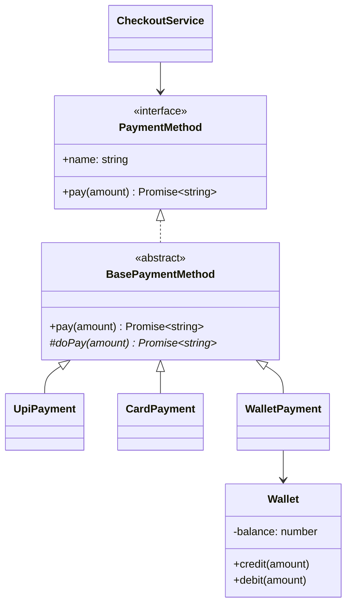

# L02 · The four OOP pillars

> **Time:** ~35 min · **Visual:** [visual.html](visual.html) · **Code:** [demo.ts](demo.ts) (`npx tsx lld/1-foundations/L02-oop-pillars/demo.ts`)
> **Builds on:** [L01 Classes, interfaces and types](../L01-classes-and-interfaces/README.md) · **Used in:** every LLD problem; clearest in [01 Parking Lot](../../problems/01-parking-lot/README.md), [11 ATM](../../problems/11-atm/README.md), [13 BookMyShow](../../problems/13-bookmyshow/README.md), [19 Payment Wallet](../../problems/19-payment-wallet/README.md)

## The idea in one line

Encapsulation protects state and its rules, abstraction hides how things work behind a small contract, inheritance shares a contract (and sometimes code), and polymorphism lets one call site work with many types without `if (type === ...)`.

## Why it matters (the problem it solves)

A typical first draft in a machine-coding round:

```ts
// Before: public state, a type switch, no contract
class Wallet {
  balance = 0; // anyone can write wallet.balance = -500
}

function pay(method: string, amount: number, wallet: Wallet) {
  if (method === 'WALLET') {
    wallet.balance -= amount;              // no insufficient-funds check
  } else if (method === 'UPI') {
    console.log('call UPI API', amount);   // HTTP details leak into checkout
  } else if (method === 'CARD') {
    console.log('call card network', amount);
  }                                        // a new method = edit this function again
}
```

What goes wrong:

- **No encapsulation.** Any file can set a negative balance. The rule "balance never goes below 0" lives nowhere.
- **No abstraction.** Checkout knows about UPI APIs and card networks.
- **No polymorphism.** Each new payment method edits a function that already works. The same `if` chain usually appears in 3 places (pay, refund, fees).

Interviewers spot this in the first 10 minutes. The four pillars are the vocabulary to fix it.

## How it works

### 1. Encapsulation: the object guards its own rules

The object owns its state. Outside code changes it only through methods that keep the rules (invariants) true.

```ts
class Wallet {
  #balance = 0;                                   // nobody outside can touch it
  get balance(): number { return this.#balance; } // read-only view

  credit(amount: number): void {
    if (amount <= 0) throw new Error('Amount must be positive');
    this.#balance += amount;
  }
  debit(amount: number): void {
    if (amount > this.#balance) throw new Error('Insufficient funds');
    this.#balance -= amount;
  }
}
```

```
   outside code ──x──> #balance          (blocked)
   outside code ────> debit(200) ──> checks rule ──> #balance -= 200
```

Rule of thumb: **expose behaviour, not setters**. `seat.hold(userId)` instead of `seat.status = 'HELD'`.

### 2. Abstraction: show what, hide how

Callers depend on a small contract. They do not see HTTP calls, retries, SDK objects or error codes.

```ts
interface PaymentMethod {
  readonly name: string;
  pay(amount: number): Promise<string>; // returns a transaction id
}
```

Checkout code talks only to `PaymentMethod`. If UPI moves from one provider SDK to another, checkout does not change.

**Encapsulation vs abstraction** (a classic follow-up):

| | Encapsulation | Abstraction |
|---|---|---|
| Question it answers | Who may change this data? | What does the caller need to know? |
| Lives in | One class (private fields + guarded methods) | The boundary between modules (an interface) |
| Failure looks like | Public fields, setters for everything | Leaky types: returning the raw SDK response |
| Example | `Wallet.#balance` + `debit()` | `PaymentMethod.pay()` hides the UPI API |

### 3. Inheritance: an IS-A relation that shares a contract

```ts
abstract class BasePaymentMethod implements PaymentMethod {
  abstract readonly name: string;
  protected abstract doPay(amount: number): Promise<string>; // each child fills this

  async pay(amount: number): Promise<string> {               // shared rule, written once
    if (!Number.isInteger(amount) || amount <= 0) throw new Error('Invalid amount');
    return this.doPay(amount);
  }
}

class UpiPayment extends BasePaymentMethod {
  readonly name = 'UPI';
  protected async doPay(amount: number) { return `upi_${amount}`; }
}
```

Use `extends` only when all three hold:

1. The child really **is a** parent (and can be used anywhere the parent is: Liskov, see [L05](../L05-solid-lsp-isp-dip/README.md)).
2. The tree is **shallow**: one level, two at most.
3. The parent is **stable**. A change in the parent hits every child.

Otherwise use composition ([L03](../L03-composition-over-inheritance/README.md)).

### 4. Polymorphism: one call, many behaviours

```ts
async function checkout(method: PaymentMethod, amount: number) {
  return method.pay(amount); // no if/else on type
}
await checkout(new UpiPayment(), 499);
await checkout(new WalletPayment(wallet), 200);
```

How JavaScript decides which `doPay` runs (dynamic dispatch through the prototype chain):

```
 walletPay.pay(200)
   walletPay (own fields: wallet)            pay? no
     └─> WalletPayment.prototype             pay? no   doPay? YES (used later)
           └─> BasePaymentMethod.prototype   pay? YES -> runs, calls this.doPay(200)
                                                         -> back down to WalletPayment.doPay
```

Kinds of polymorphism you can name:

| Kind | In TypeScript | Example |
|---|---|---|
| Subtype (runtime) | interface / `extends` + method override | `method.pay()` |
| Parametric | generics | `Repository<T>` |
| Ad hoc (overloading) | overload signatures, one body | `format(x: Date): string; format(x: number): string` |

In LLD rounds, "polymorphism" almost always means subtype polymorphism.

### Class diagram



### How to spot each pillar in a problem statement

| You read | Pillar to reach for |
|---|---|
| "balance must never go negative", "a seat can't be booked twice", "stock can't go below 0" | Encapsulation: private state + guarded methods |
| "support Razorpay and Stripe", "email, SMS and push", "store in memory for now" | Abstraction: an interface at the boundary |
| "car, bike and truck all park, but are charged differently" | Polymorphism (often via Strategy, [L20](../../4-behavioral/L20-strategy/README.md)) |
| "all accounts share the same audit and validation steps" | Inheritance with an abstract base (Template Method, [L26](../../4-behavioral/L26-template-method/README.md)) |

## In TypeScript

```ts
class WalletPayment extends BasePaymentMethod {
  readonly name = 'WALLET';
  constructor(private readonly wallet: Wallet) { super(); } // HAS-A wallet: composition
  protected async doPay(amount: number) {
    this.wallet.debit(amount);                              // the wallet guards its own rule
    return `wal_${amount}`;
  }
}

class CheckoutService {
  async pay(method: PaymentMethod, amount: number) {
    const txnId = await method.pay(amount);                 // polymorphic call
    return { method: method.name, amount, txnId };
  }
}
```

All four pillars in 15 lines: the wallet is encapsulated, checkout sees only the abstraction, the base class shares validation through inheritance, and `method.pay()` is polymorphic. Full version: [demo.ts](demo.ts).

## Trade-offs / when NOT to use it

- **Deep inheritance trees.** `Vehicle → MotorVehicle → Car → ElectricCar → TeslaModel3`: each level adds coupling, and a change at the top ripples to every leaf. Prefer HAS-A (`Car` has an `Engine`).
- **Interfaces with one implementation that is not a boundary.** `TicketIdGenerator` is fine (you fake it in tests). `ParkingFloorInterface` usually is not.
- **Hiding plain data.** A `Receipt` can be a `readonly` type. Getters on every field add noise without protecting any rule.
- **Inheritance just to reuse a helper.** If the child is not a real subtype, move the helper into a class you compose, or a plain function.

## Common mistakes

- Making fields private and then adding a public setter for each one. That is encapsulation in name only.
- Saying "abstraction and encapsulation are the same thing". They are not; see the table above.
- Using inheritance for code reuse when the child cannot keep the parent's promises (a `GiftCard` that throws on `refund()`).
- Writing `if (method instanceof UpiPayment)` in the caller. That is the type switch again, just hidden.
- Calling an overridable method from a base constructor. The child's fields are not set yet when it runs.
- Forgetting `super()` (or calling `this` before it) in a child constructor.

## Say this in the interview

> "Each entity owns its state and exposes behaviour, not setters. `Wallet.debit()` checks the balance, so the rule lives in one place and no caller can break it."

> "Things that vary, like payment methods, sit behind an interface. Checkout calls `method.pay()` and has no type switch, so a new method is a new class and checkout does not change."

> "I use inheritance only for a shallow abstract base that shares validation. For everything else, I compose: the wallet payment has a wallet, it is not a wallet."

## Your experience hook

- Payment orchestration across 3 providers: one internal `PaymentProvider` interface (abstraction), one adapter class per provider (polymorphism). Adding a provider did not touch the core flow.
- Payment status changes only through methods like `markSucceeded(eventId)` that check the current state. That is encapsulation, and it is what made out-of-order webhooks safe.
- NestJS exception filters and guards: you implement an interface (`CanActivate`), and the framework calls it polymorphically.

## Self-test

<details><summary>1. A <code>Seat</code> class has a public <code>status</code> field. Why is that a problem in BookMyShow?</summary>Any code can set <code>status = 'BOOKED'</code> without the hold, lock and payment checks. Make it private and expose <code>hold()</code>, <code>book()</code>, <code>release()</code>, each checking the current status first.</details>

<details><summary>2. Which pillar removes <code>if (vehicle.type === 'CAR')</code> chains?</summary>Polymorphism. Each type carries its own behaviour behind a shared interface (or a strategy object), so the caller makes one call.</details>

<details><summary>3. Encapsulation vs abstraction in one sentence each?</summary>Encapsulation protects an object's data and rules from outside code. Abstraction gives callers a small contract so they can ignore how the work is done.</details>

<details><summary>4. <code>class Square extends Rectangle</code>, and <code>setWidth</code> also changes height. What breaks?</summary>Liskov substitution. Code written for <code>Rectangle</code> expects width and height to be independent, so a <code>Square</code> cannot safely stand in for it. Inheritance was the wrong tool.</details>

<details><summary>5. When is inheritance the right choice?</summary>When the child is truly a subtype (it keeps every promise of the parent), the tree is shallow, and the parent is stable. Example: an abstract base with shared validation, or <code>class InsufficientFundsError extends Error</code>.</details>

<details><summary>6. How does JS find which <code>doPay</code> to run?</summary>It looks up the property on the object, then walks the prototype chain (<code>WalletPayment.prototype</code>, then <code>BasePaymentMethod.prototype</code>). The first match wins. That runtime lookup is dynamic dispatch.</details>

<details><summary>7. Is TypeScript "really" OOP if it has no runtime method overloading?</summary>Yes for LLD purposes. It has classes, interfaces, abstract classes, access modifiers and real dynamic dispatch. Overloading exists as multiple signatures with one implementation body.</details>

## Go deeper

- Next: [L03 · Composition over inheritance](../L03-composition-over-inheritance/README.md)
- Liskov and friends: [L05 · SOLID part 2](../L05-solid-lsp-isp-dip/README.md)
- Polymorphism as a pattern: [L20 · Strategy](../../4-behavioral/L20-strategy/README.md); shared steps: [L26 · Template Method](../../4-behavioral/L26-template-method/README.md)
- OOP examples in TS (prototype chain, overriding, init order, mixins): [low-level-design-ts/oop](../../../../low-level-design-ts/oop)
- Long notes: [archive/notes/LLD-guide.md](../../../archive/notes/LLD-guide.md), the part on the four pillars
