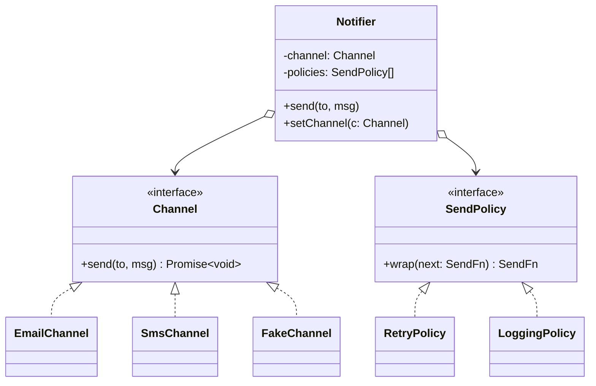

# L03 · Composition over inheritance

> **Time:** ~35 min · **Visual:** [visual.html](visual.html) · **Code:** [demo.ts](demo.ts) (`npx tsx lld/1-foundations/L03-composition-over-inheritance/demo.ts`)
> **Builds on:** [L01 Classes, interfaces and types](../L01-classes-and-interfaces/README.md) · [L02 The four OOP pillars](../L02-oop-pillars/README.md) · **Used in:** [05 Notification Service](../../problems/05-notification-service/README.md), [01 Parking Lot](../../problems/01-parking-lot/README.md) (fee rules), [17 Ride Sharing](../../problems/17-ride-sharing/README.md) (pricing, matching), [20 E-commerce Cart](../../problems/20-ecommerce-cart-coupons/README.md) (discounts)

## The idea in one line

Build behaviour by giving an object parts it **has** (a channel, a pricing rule, a retry policy) instead of making it **be** a subclass, so features combine freely and can change at runtime.

## Why it matters (the problem it solves)

You design a notifier. It sends by email or SMS. Then product asks for retries. Then logging. With inheritance, every combination becomes a class:

```ts
// Before: one subclass per combination
class Notifier { send(to: string, msg: string) { /* ... */ } }
class EmailNotifier extends Notifier { /* SMTP */ }
class SmsNotifier extends Notifier { /* SMS API */ }
class EmailWithRetry extends EmailNotifier { /* retry loop */ }
class SmsWithRetry extends SmsNotifier { /* the SAME retry loop, copied */ }
class EmailWithRetryAndLogging extends EmailWithRetry { /* ... */ }
class SmsWithRetryAndLogging extends SmsWithRetry { /* the SAME logging, copied */ }
// add Push and Rate-limit: 3 channels x 2^3 feature combos = 24 classes
```

Four problems:

1. **Class explosion.** `channels × 2^features` classes. 3 channels and 3 optional features = 24.
2. **Duplicated code.** Retry logic is copied into `EmailWithRetry` and `SmsWithRetry`, because a class can extend only one parent.
3. **Frozen at creation.** A user switches from email to SMS. An object cannot change its class, so you rebuild it.
4. **Fragile base class.** Children depend on how the parent works inside, not just on its contract. A harmless change in the parent breaks children.

## How it works

### The switch: IS-A becomes HAS-A

```
 Inheritance (IS-A)                         Composition (HAS-A)

        Notifier                             Notifier
       /        \                            ├── channel:  Channel        <- Email | Sms | Push | Fake
 EmailNotifier  SmsNotifier                  └── policies: SendPolicy[]   <- Logging, Retry(3), RateLimit
     |              |
 EmailWithRetry  SmsWithRetry                 3 channels + 3 policies + 1 Notifier = 7 classes
     |              |                         any combination, chosen at runtime
 EmailWith...    SmsWith...    (24 classes)
```

Each varying thing (the **axis of change**) becomes its own small interface. The main object holds one of each and delegates to them.

### Step by step

1. **Find the axes of change.** Here: *how* to send (channel) and *what extra* to do around sending (retry, logging, rate limit).
2. **Make each axis an interface.** `Channel`, `SendPolicy`.
3. **Hold them as fields**, passed in through the constructor (this is also Dependency Inversion, [L05](../L05-solid-lsp-isp-dip/README.md)).
4. **Delegate**: `Notifier.send()` calls `this.channel.send()`, wrapped by the policies.
5. **Allow a swap** if the business needs it: `setChannel(c)`.

### The fragile base class problem (a real JS example)

```ts
class CountingMap<K, V> extends Map<K, V> {
  writes = 0;
  override set(k: K, v: V) { this.writes++; return super.set(k, v); }
}
const m = new CountingMap([['a', 1], ['b', 2]]);
m.size;   // 2
m.writes; // 0  <- wrong!
```

The `Map` constructor calls `this.set()` for the initial entries, before the child's field `writes = 0` is initialised. So the count is reset after the two writes. The child depended on a detail of the parent it could not see. A composed version (`class CountingMap { private map = new Map(); set() {...} }`) has no such trap, because it only uses the public contract of `Map`.

### Class diagram



### Inheritance vs composition

| | Inheritance (`extends`) | Composition (has-a field) |
|---|---|---|
| Relation | IS-A, fixed at compile time | HAS-A, chosen at runtime |
| Combining features | one class per combination | plug in any mix |
| Reuse across unrelated classes | no (single parent) | yes (any class can hold a `RetryPolicy`) |
| Coupling | child sees parent internals (`protected`) | only the part's public interface |
| Swap behaviour at runtime | no | yes (`setChannel`) |
| Testing | need the whole parent | pass a fake part |
| Boilerplate | low | a bit more (delegating methods) |

### How to spot it in a problem statement

- "Support X, Y and Z, **and** optionally A, B" → two axes; inheritance would multiply them.
- "The user can **switch** ... at any time" (payment method, pricing mode, notification channel) → runtime swap needs composition.
- "Pricing differs by vehicle type **and** by time of day" → two independent rules, two fields.
- You are about to write a class name with "And" or "With" in it: `EmailWithRetryAndLogging`.

### The patterns that are just composition

| Pattern | Composition used for |
|---|---|
| Strategy ([L20](../../4-behavioral/L20-strategy/README.md)) | one swappable algorithm in a field |
| Decorator ([L14](../../3-structural/L14-decorator/README.md)) | wrap an object to add a feature, same interface |
| Bridge ([L18](../../3-structural/L18-bridge/README.md)) | two hierarchies joined by a field instead of multiplied |
| State ([L22](../../4-behavioral/L22-state/README.md)) | the current state object in a field, replaced on transitions |

## In TypeScript

```ts
type SendFn = (to: string, msg: string) => Promise<void>;
interface Channel { readonly name: string; send: SendFn; }
interface SendPolicy { wrap(next: SendFn): SendFn; }

class RetryPolicy implements SendPolicy {
  constructor(private readonly attempts: number) {}
  wrap(next: SendFn): SendFn {
    return async (to, msg) => {
      for (let i = 1; ; i++) {
        try { return await next(to, msg); }
        catch (e) { if (i >= this.attempts) throw e; }
      }
    };
  }
}

class Notifier {
  constructor(private channel: Channel, private readonly policies: SendPolicy[] = []) {}
  setChannel(c: Channel) { this.channel = c; } // runtime swap
  send(to: string, msg: string) {
    const base: SendFn = (t, m) => this.channel.send(t, m);
    const fn = this.policies.reduceRight((next, p) => p.wrap(next), base);
    return fn(to, msg);
  }
}

const n = new Notifier(new EmailChannel(), [new LoggingPolicy(), new RetryPolicy(3)]);
```

Retry is written once and works for every channel. The runnable version (with a flaky channel and a runtime swap) is in [demo.ts](demo.ts).

## Trade-offs / when NOT to use it

Inheritance is still right when:

- The child is a **true subtype** and keeps every promise of the parent (Liskov holds).
- The tree is **shallow** and the parent is **stable**: `class InsufficientFundsError extends Error`, `class Car extends Vehicle` in a parking lot where only the size differs.
- A framework asks for it: `extends Readable`, NestJS `extends PassportStrategy(...)`, React class components in old code.
- You share a fixed sequence of steps: Template Method ([L26](../../4-behavioral/L26-template-method/README.md)) with an abstract base.

Composition costs a little: more small objects, delegating methods, and wiring code. Don't split a class into parts that never vary.

## Common mistakes

- Treating the slogan as "never use `extends`". It says **prefer**, not never.
- Composing but still checking types: `if (this.channel instanceof EmailChannel)`. Then the field gives you nothing.
- Creating the parts inside the constructor (`this.channel = new EmailChannel()`). That is composition without the flexibility. Inject them.
- Mixins to get "multiple inheritance". They bring back the coupling and the name clashes. Use fields.
- Exposing the parts (`notifier.channel.send(...)` from outside). Callers should talk to the `Notifier` only (Law of Demeter, [L07](../L07-design-principles/README.md)).

## Say this in the interview

> "Notifications vary on two axes: the channel and the extra behaviour around sending, like retry and logging. With inheritance that is channels times feature combinations, so I make each axis an interface and the `Notifier` holds one channel and a list of policies. Retry is written once and works for every channel, and I can switch a user from email to SMS at runtime."

> "I still use inheritance for real IS-A relations with a shallow, stable parent, like custom error classes or an abstract base that fixes the order of steps. For anything that varies independently, I compose."

## Your experience hook

- Notification service on RabbitMQ: channels (email, SMS, push) are separate adapters, and retry/backoff is a policy around the consumer, not baked into each channel class.
- Payment orchestration: the orchestrator **has a** provider adapter (Razorpay, Stripe, ...) chosen per request, not `RazorpayOrchestrator extends Orchestrator`. Routing a payment to a different provider at runtime is just a different field value.
- Socket.io with the Redis adapter: the server **has an** adapter you plug in (`io.adapter(createAdapter(pub, sub))`). Broadcasting across nodes did not need a subclass of the server.

## Self-test

<details><summary>1. 4 channels and 3 optional features. How many classes with inheritance? With composition?</summary>Inheritance: 4 × 2^3 = 32 combination classes. Composition: 4 channels + 3 policies + 1 notifier = 8 classes.</details>

<details><summary>2. What is the fragile base class problem?</summary>A child depends on how the parent works inside (which methods call which), not only on its contract. When the parent changes its internals, the child breaks without being edited. Example: <code>Map</code>'s constructor calling <code>set()</code> before the child's fields exist.</details>

<details><summary>3. A user wants to change their notification channel. Why is inheritance a problem here?</summary>An object's class is fixed when it is created. With composition, the channel is a field, so <code>setChannel(new SmsChannel())</code> changes behaviour on the same object.</details>

<details><summary>4. Name three patterns that are built on composition.</summary>Strategy (swappable algorithm in a field), Decorator (wrapper with the same interface), State (current state object in a field). Bridge and Composite too.</details>

<details><summary>5. When is inheritance still the better choice?</summary>A true subtype, a shallow tree and a stable parent: custom errors, an abstract base with a fixed order of steps (Template Method), or when a framework requires <code>extends</code>.</details>

<details><summary>6. You composed, but the code says <code>if (this.pricing instanceof SurgePricing)</code>. What went wrong?</summary>The caller still knows concrete types, so adding a pricing rule means editing it. Put the behaviour behind the interface method and call it without checking the type.</details>

## Go deeper

- Next: [L04 · SOLID part 1: SRP and OCP](../L04-solid-srp-ocp/README.md)
- The patterns built on this: [L20 Strategy](../../4-behavioral/L20-strategy/README.md), [L14 Decorator](../../3-structural/L14-decorator/README.md), [L18 Bridge](../../3-structural/L18-bridge/README.md)
- OOP examples in TS (composition vs inheritance, mixins): [low-level-design-ts/oop/2.inheritance](../../../../low-level-design-ts/oop/2.inheritance)
- Long notes: [archive/notes/LLD-guide.md](../../../archive/notes/LLD-guide.md)
- Book: Head First Design Patterns, chapter 1 (the duck simulator: "favour composition over inheritance")
