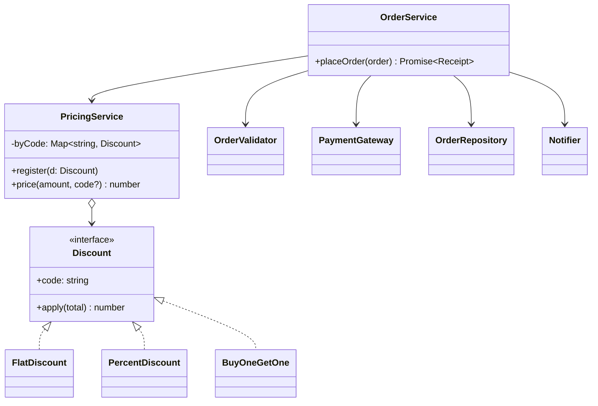

# L04 · SOLID part 1: SRP and OCP

> **Time:** ~40 min · **Visual:** [visual.html](visual.html) · **Code:** [demo.ts](demo.ts) (`npx tsx lld/1-foundations/L04-solid-srp-ocp/demo.ts`)
> **Builds on:** [L02 The four OOP pillars](../L02-oop-pillars/README.md) · [L03 Composition over inheritance](../L03-composition-over-inheritance/README.md) · **Used in:** [01 Parking Lot](../../problems/01-parking-lot/README.md) (fee rules), [05 Notification Service](../../problems/05-notification-service/README.md) (channels), [20 E-commerce Cart](../../problems/20-ecommerce-cart-coupons/README.md) (coupons), [09 Splitwise](../../problems/09-splitwise/README.md) (split types)

## The idea in one line

**SRP:** a class should have one reason to change (one actor who asks for changes). **OCP:** add new behaviour by adding code (a new class), not by editing code that already works.

## Why it matters (the problem it solves)

```ts
// Before: a god class
class OrderService {
  async placeOrder(o: { id: string; amount: number; email: string; coupon?: string }) {
    if (o.amount <= 0) throw new Error('bad amount');                  // validation
    let total = o.amount;
    if (o.coupon === 'FLAT100') total -= 100;                           // pricing rules
    else if (o.coupon === 'TENPCT') total *= 0.9;
    const res = await fetch(process.env.PAY_URL!, { method: 'POST' });  // payment details
    await db.query('INSERT INTO orders ...');                            // persistence
    await sendgrid.send(o.email, `Paid ${total}`);                       // notification
  }
}
```

- **Five reasons to change** in one file: marketing (coupons), finance (payment), DBA (schema), CRM (email copy), product (validation). Five teams edit one file and step on each other.
- **The coupon switch grows forever.** Every new coupon type edits a class that already works and forces a re-test of every other coupon.
- **Untestable.** One unit test needs the payment API, a database and SendGrid.

This is the exact first draft interviewers hope to see you refactor.

## How it works

### S: Single Responsibility Principle

> "A module should be responsible to one, and only one, actor." (Robert C. Martin)

"One reason to change" means **one actor** (person, team, stakeholder) whose requests change the class. It does **not** mean "one method".

**How to find the responsibilities: ask "who would ask me to change this line?"**

| Line in `placeOrder` | Who asks for changes | New home |
|---|---|---|
| `if (amount <= 0)` | Product | `OrderValidator` |
| coupon `if/else` | Marketing | `PricingService` + `Discount` classes |
| `fetch(PAY_URL)` | Payments / finance | `PaymentGateway` |
| `INSERT INTO orders` | DBA / platform | `OrderRepository` |
| `sendgrid.send` | CRM | `Notifier` |

After the split, `OrderService` only **coordinates** the steps. Its one reason to change is "the order flow itself changes".

```
                         OrderService.placeOrder()   (the flow only)
            ┌───────────────┬──────────┼─────────────┬──────────────┐
     OrderValidator   PricingService  PaymentGateway  OrderRepository  Notifier
       (product)        (marketing)     (finance)        (DBA)          (CRM)
```

**Smells that SRP is broken**

- The class name has "And", "Manager", "Helper" or "Util".
- A unit test needs more than one or two fakes.
- Git log: the file changes in many PRs for unrelated reasons; merge conflicts are common.
- Methods use disjoint sets of fields (low cohesion, see [L07](../L07-design-principles/README.md)).

### O: Open/Closed Principle

> "Software entities should be open for extension, but closed for modification." (Bertrand Meyer)

**Open for extension:** you can add new behaviour. **Closed for modification:** you do it without editing tested code.

The tool is polymorphism: put the varying rule behind an interface, one class per variant.

```ts
// After: the varying rule behind an interface
interface Discount { readonly code: string; apply(total: number): number; }

class FlatDiscount implements Discount {
  constructor(readonly code: string, private readonly off: number) {}
  apply(total: number) { return Math.max(0, total - this.off); }
}
class PercentDiscount implements Discount {
  constructor(readonly code: string, private readonly pct: number) {}
  apply(total: number) { return Math.round(total * (1 - this.pct / 100)); }
}

class PricingService {
  private readonly byCode = new Map<string, Discount>();
  register(d: Discount) { this.byCode.set(d.code, d); }       // extension point
  price(amount: number, code?: string) {
    const d = code ? this.byCode.get(code) : undefined;
    return d ? d.apply(amount) : amount;                        // no switch
  }
}
```

A new coupon "buy one get one" is a **new class** plus **one `register()` line** in the composition root. `PricingService` and the other discounts are not opened.

**Ways to get OCP in TypeScript**

| Technique | Example |
|---|---|
| Interface + one class per variant (Strategy) | `Discount`, `FeeRule`, `SplitStrategy` |
| Registry / map of handlers | `Map<string, Discount>`, `Record<Channel, Sender>` |
| Decorator / middleware | Express `app.use(fn)`, NestJS interceptors |
| Events (Observer) | emit `order.placed`; new listeners need no edit to the emitter |
| Configuration | rates in a config table, not in code |

### Class diagram (after)



### How to spot it in a problem statement

| You read | Apply |
|---|---|
| "types of coupons / vehicles / splits / notifications", "more may be added later" | OCP: interface + class per type |
| "fee depends on vehicle type **and** duration" | OCP on each axis; SRP: pricing separate from parking |
| "send a receipt", "save the order", "log for audit" next to business rules | SRP: move I/O out of the domain class |
| `switch (type)` appears in two or more methods | OCP: polymorphism |

## In TypeScript

```ts
class OrderService {
  constructor(
    private readonly validator: OrderValidator,
    private readonly pricing: PricingService,
    private readonly gateway: PaymentGateway,
    private readonly repo: OrderRepository,
    private readonly notifier: Notifier,
  ) {}

  async placeOrder(o: OrderInput): Promise<Receipt> {
    this.validator.validate(o);
    const total = this.pricing.price(o.amount, o.coupon);
    const txnId = await this.gateway.charge(total);
    await this.repo.save({ id: o.id, total, txnId });
    await this.notifier.notify(o.email, `Paid ${total}`);
    return { orderId: o.id, total, txnId };
  }
}
```

The interfaces passed into the constructor are Dependency Inversion, covered in [L05](../L05-solid-lsp-isp-dip/README.md). Full runnable version with a "before" and "after" and a new coupon added without edits: [demo.ts](demo.ts).

## Trade-offs / when NOT to use it

- **SOLID is a set of heuristics, not laws.** In a 90-minute round, abstract where the problem says "types of" or "may change", and around I/O. Keep the rest concrete.
- **Do not split a 30-line class into five files.** If all lines change for the same actor, it is one responsibility.
- **OCP for a rule that never changes is waste.** "An order has an id" needs no interface. Guessing future variation wrong costs more than editing later ([YAGNI, L07](../L07-design-principles/README.md)).
- **No class is closed to every change.** You choose which changes to protect against. Pick the ones the interviewer is likely to ask about ("now add a new coupon").
- **More classes = more navigation.** A reader must jump between files. Good names and a clear composition root pay for that.

## Common mistakes

- "SRP means one method per class." No: one actor, one reason to change.
- Splitting by technical layer only (controller/service/repo) while the service still mixes pricing, payment and notification.
- Replacing a `switch` with a `Map` that still lives inside the class and must be edited for each new type. Move registration to the composition root.
- Calling it OCP but adding `instanceof` checks somewhere else.
- Creating `IOrderService` with one implementation "for OCP". OCP is about the **varying** part, not every class.
- Forgetting to say *which* change you are protecting against. Say it out loud: "new coupon types".

## Say this in the interview

> "Right now `OrderService` changes for five different teams: marketing for coupons, finance for payment, the DBA for storage, CRM for emails, product for validation. I'll split it by reason to change. `OrderService` stays as the coordinator, and each concern gets its own class behind an interface."

> "Coupons are the part you'll extend, so pricing depends on a `Discount` interface with one class per coupon type, registered in the composition root. A new coupon is a new class and one registration line. `PricingService` itself does not change. That's open/closed."

> "I'm not going to add interfaces for stable things like the `Order` entity. I put seams where change is likely."

## Your experience hook

- Payment orchestration: adding a third provider was a new adapter class plus one line in the provider registry. The orchestrator was closed for modification.
- NestJS modules: controller (HTTP), service (rules), repository (DB) is SRP by layer. Inside the service, webhook handling and payment initiation were kept as separate providers because different events change them.
- API gateway: auth, rate limit and caching are separate middlewares added with `app.use()`. New cross-cutting behaviour did not touch the router. That is OCP through middleware.

## Self-test

<details><summary>1. Does SRP mean "a class does one thing"?</summary>Not exactly. It means one reason to change: one actor. A <code>PayrollReport</code> that finance and HR both change for different reasons breaks SRP even though it "makes one report".</details>

<details><summary>2. A <code>NotificationService</code> has <code>sendEmail</code>, <code>sendSms</code>, <code>sendPush</code> and a switch on channel. Which principles break? Fix?</summary>OCP (a new channel edits the switch) and SRP (it knows every provider). Fix: a <code>Channel</code> interface, one class per channel, and a registry injected into the service.</details>

<details><summary>3. You replaced the coupon switch with <code>new Map([['FLAT100', new Flat(100)], ...])</code> inside <code>PricingService</code>. Is it OCP now?</summary>Partly. The logic is polymorphic, but adding a coupon still edits <code>PricingService</code>. Move registration out (constructor parameter or <code>register()</code> called from the composition root).</details>

<details><summary>4. Name three ways to get OCP in Node/TS.</summary>Interface + class per variant (Strategy), a registry of handlers, middleware/decorators (<code>app.use</code>), events (new listeners), config tables.</details>

<details><summary>5. Name two smells that a class breaks SRP.</summary>Its tests need many fakes; its name has "And"/"Manager"; many unrelated PRs touch it; groups of methods use different fields.</details>

<details><summary>6. When is applying OCP a mistake?</summary>When the rule will not vary. Abstractions cost reading time. Add the seam when the problem says "types of" or "may change", or when the second variant appears.</details>

<details><summary>7. After the split, what is <code>OrderService</code>'s single responsibility?</summary>The order flow: the sequence validate, price, charge, save, notify. It changes only when that flow changes.</details>

## Go deeper

- Next: [L05 · SOLID part 2: LSP, ISP and DIP](../L05-solid-lsp-isp-dip/README.md)
- OCP in pattern form: [L20 Strategy](../../4-behavioral/L20-strategy/README.md), [L21 Observer](../../4-behavioral/L21-observer/README.md), [L25 Chain of Responsibility](../../4-behavioral/L25-chain-of-responsibility/README.md)
- Practice: [20 E-commerce Cart with coupons](../../problems/20-ecommerce-cart-coupons/README.md), [09 Splitwise](../../problems/09-splitwise/README.md)
- Long notes: [archive/notes/LLD-guide.md](../../../archive/notes/LLD-guide.md), the SOLID part
- Book: Clean Architecture (Robert C. Martin), chapters 7 and 8
