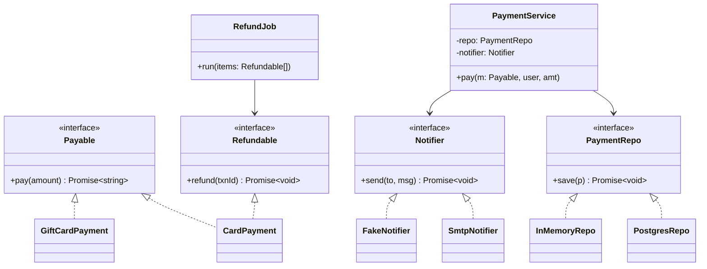

# L05 · SOLID part 2: LSP, ISP and DIP

> **Time:** ~45 min · **Visual:** [visual.html](visual.html) · **Code:** [demo.ts](demo.ts) (`npx tsx lld/1-foundations/L05-solid-lsp-isp-dip/demo.ts`)
> **Builds on:** [L02 The four OOP pillars](../L02-oop-pillars/README.md) · [L03 Composition over inheritance](../L03-composition-over-inheritance/README.md) · [L04 SRP and OCP](../L04-solid-srp-ocp/README.md) · **Used in:** [19 Payment Wallet](../../problems/19-payment-wallet/README.md), [05 Notification Service](../../problems/05-notification-service/README.md), [11 ATM](../../problems/11-atm/README.md), [13 BookMyShow](../../problems/13-bookmyshow/README.md) (DIP for repos and payment)

## The idea in one line

**LSP:** a subtype must keep every promise of its parent type. **ISP:** give each client a small interface with only what it uses. **DIP:** business logic depends on interfaces it owns, and the concrete details (DB, SDKs, email) are plugged in from outside.

## Why it matters (the problem it solves)

```ts
// Before: one fat interface, a subtype that lies, and a service that builds its own tools
interface PaymentMethod {
  pay(amount: number): Promise<string>;
  refund(txnId: string): Promise<void>;
}

class GiftCardPayment implements PaymentMethod {
  async pay(amount: number) { return `gc_${amount}`; }
  async refund(): Promise<void> { throw new Error('Gift cards cannot be refunded'); } // surprise
}

class PaymentService {
  private repo = new PostgresRepo();   // hard-wired DB
  private mailer = new SmtpMailer();   // hard-wired SMTP
  async refundAll(methods: PaymentMethod[], ids: string[]) {
    for (let i = 0; i < ids.length; i++) await methods[i].refund(ids[i]); // crashes on gift cards
  }
}
```

- The nightly refund job trusts the interface and crashes at 3 a.m. on a gift card. (LSP broken)
- `GiftCardPayment` was forced to "implement" a method it cannot honour. (ISP broken)
- `PaymentService` cannot be unit tested without a real Postgres and a real SMTP server, and moving to SES means editing payment code. (DIP broken)

## How it works

### L: Liskov Substitution Principle

> If `S` is a subtype of `T`, code written for `T` must keep working when given an `S`. (Barbara Liskov, 1987)

It is about **behaviour**, not just matching method names. The compiler checks names and types. You must check the promises.

**The four rules a subtype must follow**

| Rule | Means | Broken by |
|---|---|---|
| Preconditions: no stronger | accept at least what the parent accepts | `pay()` that rejects amounts over 10,000 when the parent did not |
| Postconditions: no weaker | deliver at least what the parent promises | `save()` that sometimes silently skips the write |
| No new exceptions | don't throw where the parent never does | `refund() { throw new Error('not supported') }` |
| Invariants: keep them | what is always true for the parent stays true | `Square.setWidth` also changing height |

**The classic: `Square extends Rectangle`**

```ts
class Rectangle {
  constructor(protected w: number, protected h: number) {}
  setWidth(w: number) { this.w = w; }
  setHeight(h: number) { this.h = h; }
  area() { return this.w * this.h; }
}
class Square extends Rectangle {
  setWidth(w: number) { this.w = w; this.h = w; }  // keeps it square...
  setHeight(h: number) { this.w = h; this.h = h; } // ...but breaks Rectangle's promise
}

function resize(r: Rectangle) { r.setWidth(5); r.setHeight(4); return r.area(); }
resize(new Rectangle(1, 1)); // 20
resize(new Square(1, 1));    // 16  <- caller's expectation broken
```

A square **is a** rectangle in maths, but not in code where width and height can change independently. IS-A in the real world is not enough; the **behaviour** must be substitutable.

**How to spot an LSP break in code review**

- A subclass method throws `NotImplemented` / `not supported`, or is an empty no-op on purpose.
- Callers check `instanceof` or a `type` field before calling a method.
- A subclass needs stricter input checks than the parent.
- Overriding a method changes another property's value as a side effect.

### I: Interface Segregation Principle

> Clients should not be forced to depend on methods they do not use.

Split a fat interface into small **role interfaces**, named after what a client needs.

```ts
interface Payable    { pay(amount: number): Promise<string>; }
interface Refundable { refund(txnId: string): Promise<void>; }

class CardPayment     implements Payable, Refundable { /* both */ }
class UpiPayment      implements Payable, Refundable { /* both */ }
class GiftCardPayment implements Payable             { /* pay only: honest */ }

async function refundAll(items: { method: Refundable; txnId: string }[]) { /* ... */ }
refundAll([{ method: giftCard, txnId: 'x' }]); // compile error, not a 3 a.m. runtime error
```

```
  CheckoutService ──> «Payable»      <── Card, Upi, GiftCard
  RefundJob       ──> «Refundable»   <── Card, Upi
```

Splitting the fat interface **also fixed the LSP problem**: gift cards no longer promise something they cannot do. ISP is often the cure for LSP.

Node example you already use: streams are split into `Readable`, `Writable`, `Duplex` and `Transform`. You implement only what you need.

### D: Dependency Inversion Principle

> High-level modules should not depend on low-level modules. Both should depend on abstractions. Abstractions should not depend on details. (Robert C. Martin)

```
 Before (dependencies point DOWN to details)      After (details point UP to abstractions)

   PaymentService                                   ┌─────── domain ─────────────────────┐
     │ new         │ new                            │ PaymentService ──> «PaymentRepo»    │
     v             v                                │                ──> «Notifier»       │
   PostgresRepo  SmtpMailer                         └───────────────────────^──────^──────┘
                                                                    implements│      │implements
                                                          ┌─────── infra ──────┴──────┴─────┐
                                                          │ PostgresRepo        SmtpNotifier │
                                                          └──────────────────────────────────┘
```

Two key ideas:

1. **The high-level module owns the interface.** `PaymentRepo` is defined next to `PaymentService`, in the shape the service needs (`save(payment)`), not in the shape Postgres offers (`query(sql)`).
2. **Wire it in one place.** A **composition root** (`main.ts`, or a NestJS module) is the only code that writes `new PostgresRepo()`. Everything else receives interfaces through the constructor.

```ts
// domain/payment-service.ts
export interface PaymentRepo { save(p: Payment): Promise<void>; }
export interface Notifier    { send(to: string, msg: string): Promise<void>; }

export class PaymentService {
  constructor(private readonly repo: PaymentRepo, private readonly notifier: Notifier) {}
  async pay(method: Payable, user: User, amount: number) {
    const txnId = await method.pay(amount);
    await this.repo.save({ userId: user.id, amount, txnId });
    await this.notifier.send(user.email, `Paid ${amount}`);
    return txnId;
  }
}

// main.ts: production wiring
const service = new PaymentService(new PostgresRepo(pool), new SmtpNotifier(cfg));
// payment-service.test.ts: test wiring, no network
const service = new PaymentService(new InMemoryRepo(), new FakeNotifier());
```

**DIP vs DI vs IoC** (a common follow-up)

| Term | What it is | Example |
|---|---|---|
| DIP | the **principle**: depend on abstractions you own | `PaymentService` knows only `PaymentRepo` |
| DI | a **technique**: pass dependencies in instead of `new`-ing them | constructor parameters |
| IoC container | a **tool** that builds the object graph for you | NestJS `@Injectable()` + module providers |

You can follow DIP with plain constructor injection and no container. That is enough for a machine-coding round.

### Class diagram (after)



### How to spot each in a problem statement

| You read / see | Principle |
|---|---|
| "some payment methods cannot be refunded", "some vehicles cannot fly", "read-only accounts" | ISP (+ LSP): split the capability into its own interface |
| You are about to write `extends` | LSP: can the child keep every promise of the parent? |
| "store in memory for now, DB later", "support SMS and email", "use the current time" | DIP: interface for the repo, channel, clock |
| "write unit tests" / "make it testable" | DIP: constructor injection + fakes |

## In TypeScript

```ts
interface Clock { now(): number; }               // even time is a dependency
interface IdGen { next(): string; }

class BookingService {
  constructor(
    private readonly repo: BookingRepo,
    private readonly clock: Clock,
    private readonly ids: IdGen,
  ) {}
  hold(seat: string) {
    const b = { id: this.ids.next(), seat, heldUntil: this.clock.now() + 5 * 60_000 };
    this.repo.save(b);
    return b;
  }
}
// test: fixed clock + counter ids = deterministic results
new BookingService(new InMemoryBookingRepo(), { now: () => 0 }, { next: () => 'B1' });
```

The runnable version (gift card LSP crash, the ISP fix, and the same service wired for prod and for tests) is in [demo.ts](demo.ts).

## Trade-offs / when NOT to use it

- **Not every class needs an interface.** Add one at I/O boundaries (DB, HTTP, queue, email, clock, random) and where a second implementation exists. An `IOrderValidator` with one implementation is noise.
- **Too many tiny interfaces** (one method each, everywhere) makes code hard to navigate. Group by client role, not by method.
- **LSP checks cost thought, not code.** If a subtype cannot keep a promise, don't force it: split the interface or use composition.
- **A DI container is optional.** For 10 classes, manual wiring in `main.ts` is clearer than decorators and `reflect-metadata`.

## Common mistakes

- Thinking LSP is satisfied because the code compiles. TypeScript checks shapes, not promises.
- "Fixing" LSP with `if (method instanceof GiftCardPayment) skip`. That spreads the type check to every caller.
- Defining the interface in the infrastructure module (`PostgresRepo` exports `IPostgresRepo`). The domain should own it, in the domain's words.
- Calling `new` for dependencies inside a service "just this once". Now the test needs the real thing.
- Mixing up DIP and DI. DIP is the rule; DI is one way to follow it.
- Injecting a service locator / the whole container. Dependencies become hidden again.

## Say this in the interview

> "Gift cards can't be refunded, so I won't put `refund()` on the base payment interface. I split it into `Payable` and `Refundable`. The refund job takes `Refundable[]`, so passing a gift card is a compile error, not a runtime crash. That keeps every subtype honest: Liskov substitution through interface segregation."

> "The service depends on `PaymentRepo` and `Notifier` interfaces that live next to it. The concrete Postgres and SMTP classes are created only in `main.ts` and injected through the constructor. In tests I pass an in-memory repo and a fake notifier, so the tests run in milliseconds with no network."

## Your experience hook

- NestJS: every service gets its repositories and clients through the constructor, and modules bind tokens to classes. That is DI with an IoC container. In tests, `Test.createTestingModule(...).overrideProvider(...)` swaps in fakes: DIP paying off.
- Payment orchestration across 3 providers: not every provider supported partial refunds. The capability was a separate interface the orchestrator checked at the type level, instead of an adapter throwing "not supported" (an ISP fix for an LSP risk).
- gRPC between signaling and media services: the signaling service depends on a `MediaClient` interface, so it can be tested with a fake that never opens a socket.

## Self-test

<details><summary>1. <code>Bird</code> has <code>fly()</code>. <code>Penguin extends Bird</code>. What breaks and how do you fix it?</summary>LSP: <code>Penguin.fly()</code> would throw or do nothing, surprising any caller that trusts <code>Bird</code>. Fix with ISP: a <code>Bird</code> base without <code>fly</code>, plus a <code>Flyer</code> interface only for birds that fly.</details>

<details><summary>2. Name the four ways a subtype can break LSP.</summary>Stronger preconditions (accepts less), weaker postconditions (promises less), new exceptions, broken invariants.</details>

<details><summary>3. Why does <code>Square extends Rectangle</code> break LSP even though a square is a rectangle?</summary>Code written for <code>Rectangle</code> assumes width and height change independently. <code>Square</code> changes both, so <code>setWidth(5); setHeight(4)</code> gives area 16, not 20. Behaviour, not maths, decides substitutability.</details>

<details><summary>4. Who should own the <code>PaymentRepo</code> interface: the domain or the Postgres module?</summary>The domain (the high-level module). It is written in the shape the service needs. Postgres implements it. That is the "inversion".</details>

<details><summary>5. DIP vs DI vs IoC container?</summary>DIP is the principle (depend on abstractions). DI is the technique (pass dependencies in). An IoC container (NestJS) is a tool that builds and injects the object graph for you.</details>

<details><summary>6. Why does DIP make unit tests fast?</summary>You inject in-memory fakes for the DB, gateway, notifier and clock. No network, no real time, deterministic results in milliseconds.</details>

<details><summary>7. Should every class get an interface?</summary>No. Put interfaces at I/O boundaries and where there is (or the problem says there will be) a second implementation. Otherwise it is extra reading for no gain.</details>

<details><summary>8. What is a composition root?</summary>The one place (usually <code>main.ts</code> or a DI module) where concrete classes are created and wired together. Everywhere else only sees interfaces.</details>

## Go deeper

- Next: [L06 · UML class diagrams and relationships](../L06-uml-relationships/README.md)
- DIP in practice: [L31 · Repository and DI](../../5-machine-coding/L31-repository-and-di/README.md)
- Testing with fakes: [L34 · Testing designs](../../5-machine-coding/L34-testing-designs/README.md)
- Long notes: [archive/notes/LLD-guide.md](../../../archive/notes/LLD-guide.md), the SOLID part
- Book: Clean Architecture (Robert C. Martin), chapters 9 to 11
